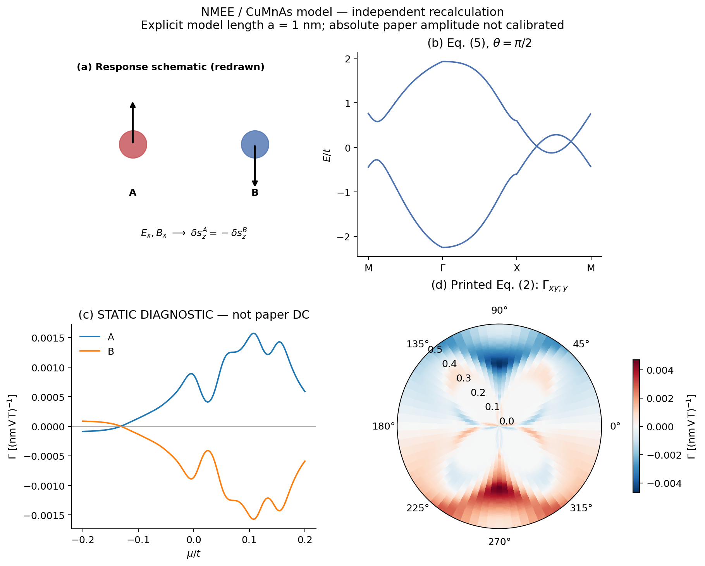
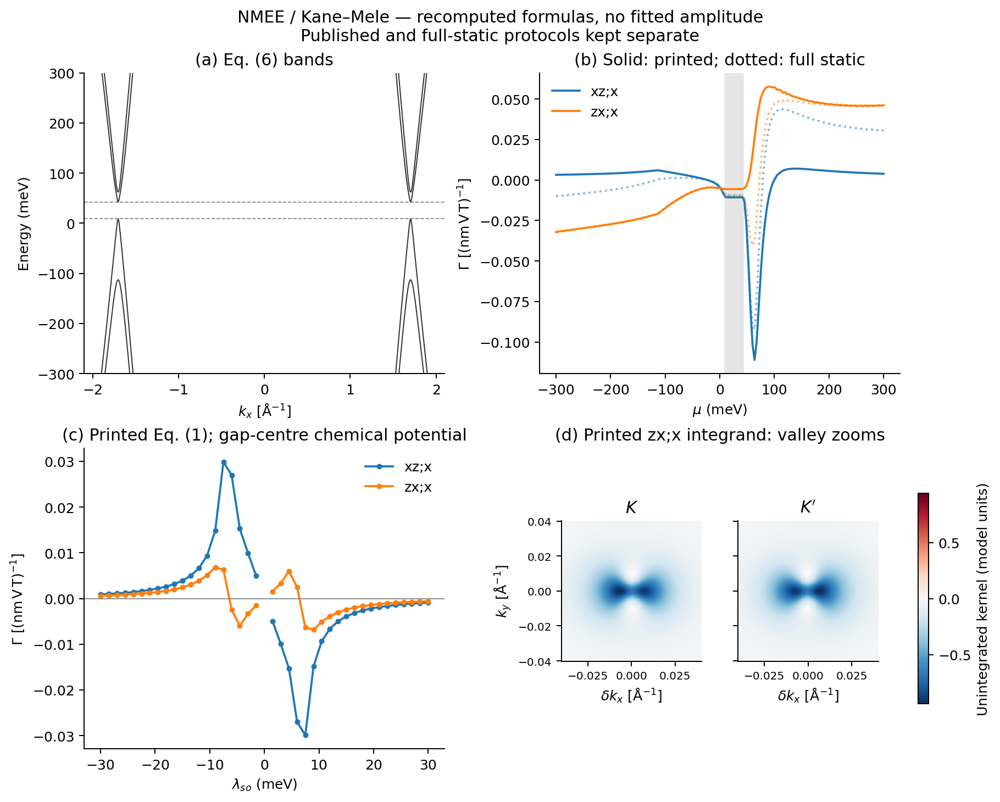
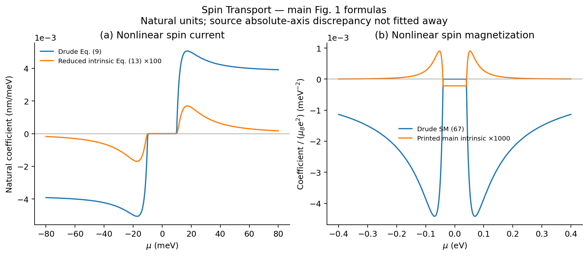
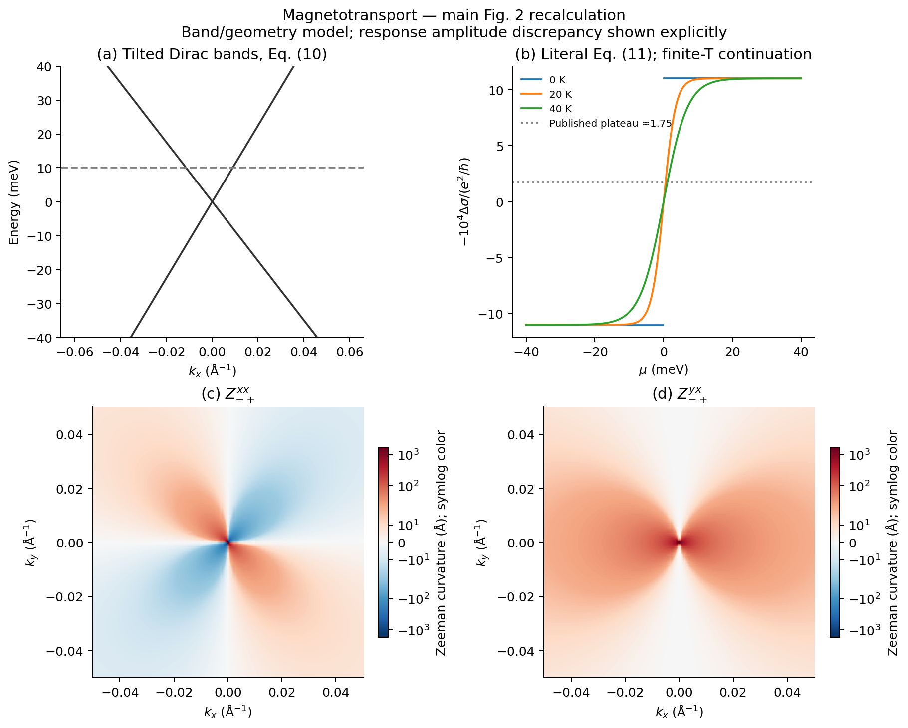
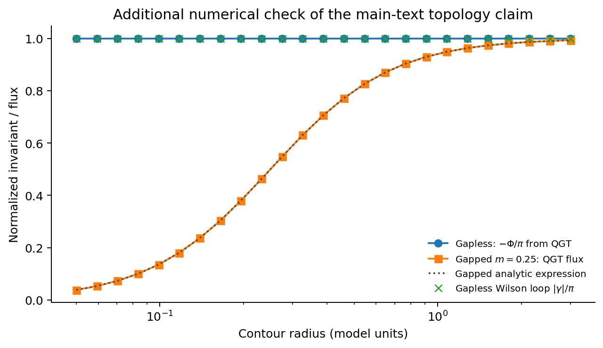
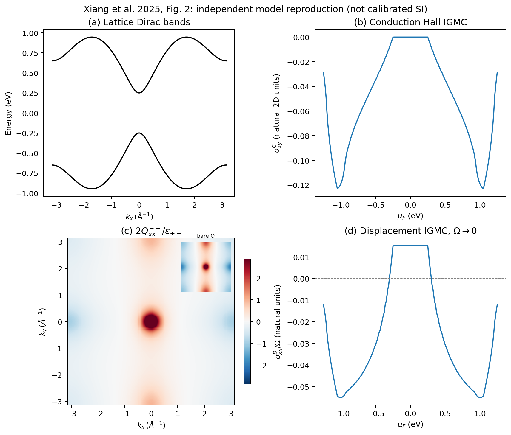

# 正文主图与物理能力

**用图检查机制是否可以计算和复用；不以逐点吻合原图作为接入标准。**
五篇现有模块的主要数值图已生成；Curvature–Flux 的正文是概念图，另附独立数值检验。
以下是模型复算，不是作者数据。静态对照、印刷公式和新增检验分别标明。

| 工作 | 正文覆盖与入口 | 这些图检验什么 | 保留的边界 |
|---|---|---|---|
| NMEE | [Fig. 1、2](../papers/jia-2026-nonlin-magnetoelectric-edelstein/figures/README.md) | CuMnAs 能带、局域交错自旋响应、Néel 角依赖；Kane–Mele 化学势/SOC 扫描与谷附近几何 | Fig. 1(c) 是静态对照；Fig. 2 是当前印刷公式分支，不代表补齐遗漏项后的 DC 结果 |
| Spin | [Fig. 1(a,b)](../papers/xiang-2025-spin-quantum-geometry/figures/README.md) | 二阶自旋流与自旋磁化的 Drude/本征贡献 | 使用自然单位；归一化和正文/SM 分支差异保留 |
| Magnetotransport | [Fig. 2(a–d)](../papers/xiang-2026-quantum-geometric-map/figures/README.md) | 倾斜 Dirac 能带、线性磁电导、Zeeman 曲率分布 | 印刷 Eq. (11) 与原图约差 2π；有限温曲线为明确标注的延拓 |
| Curvature–Flux | [Fig. 1、2 + 通量检验](../papers/cui-2026-curvature-flux-zeeman-qgt/figures/README.md) | 四类几何、绕数场/通量场、局域 Dirac 拓扑 | 正文图是示意；响应通道表不等于已模拟宏观电流 |
| IGMC | [Fig. 1、2](../papers/xiang-2025-intrinsic-gyrotropic-magnetic-current/results/figures/README.md) | Rashba/Dirac 能带、传导与位移响应、几何分布 | 原 Fig. 2(d) 绝对幅度仍未闭合；自然单位曲线可用 |

## NMEE：从输入到响应

Fig. 1(c) 展示 **A/B 局域响应相反、总响应抵消**。它不是原文简并体系本征 DC 系数的替代品。
SM 对角通道的遗漏/约定问题单独保留，不继续为匹配该面板扩展任务。
已有完整有限频混合 E/B 接口与绝缘静态接口见[模块首页](../papers/jia-2026-nonlin-magnetoelectric-edelstein/README.md)。

Fig. 2 保留印刷公式和 full-static 分支的区别。d 面板是原文的 **zx;x** 分量，放大 K/K′ 两谷以看清热点；
c 面板每个 SOC 参数取对应能隙中心，λso=0 的严格简并点不套用非简并公式。
曲线不是原图数字化验收结果；看到形状/符号差异不等于整个 NMEE 能力不可用。

## 其余工作

## 重算与核验

每篇入口提供命令、面板说明和限制。同名 **PNG / SVG / NPZ** 分别用于浏览、编辑、读取画图数组；
`validation.json` 保存参数及数值检查。只需根目录的 `requirements-core.txt`。
缺失值只用于明确注明的简并点或显示遮罩；不靠经验倍率匹配原图。
Spin 的 ×100/×1000 是论文原有且写在图例中的显示倍率，原始数组未乘倍率。

本次检查包括实际执行全部绘图脚本、逐图视觉检查，以及已有五模块回归。
回归规模为 1779 项，IGMC 在干净环境中跳过 1 项可选外部群论工具检查；其余通过，根入口另有 4 项通过。
单点网格检查不冒充整张参数扫描的逐点收敛保证；各篇说明中给出具体检查范围。
出版社正文/SM、私人通信和用户组会截图均不随图册公开。

导出检查：10 组 PNG/SVG/NPZ 均已检查，SVG 保留文字，NPZ 可无 pickle 读取、无无穷值，新增文档相对链接有效。
字体/导出设置集中在 `scripts/figure_support.py`，逐文件静态样式检查器无法识别这一导入；已直接检查成品。
这是 GitHub 阅览图册，采用 180 dpi PNG 和 SVG，不按投稿 PDF、固定栏宽验收。
