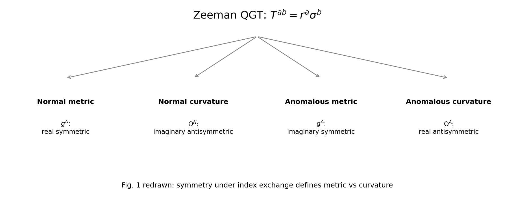
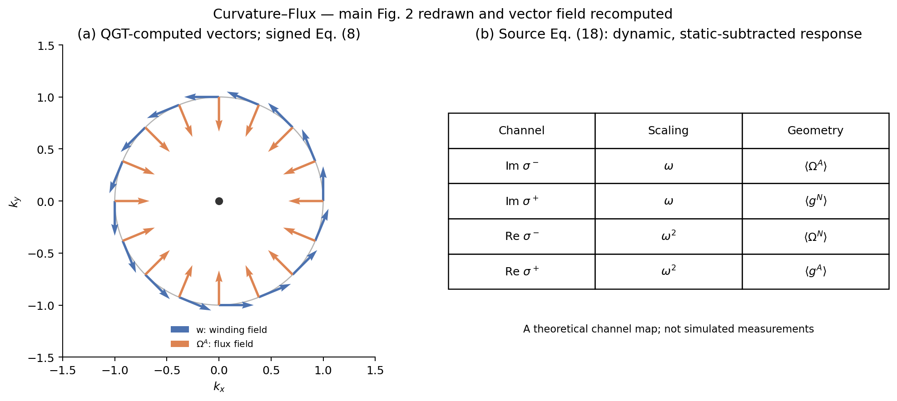
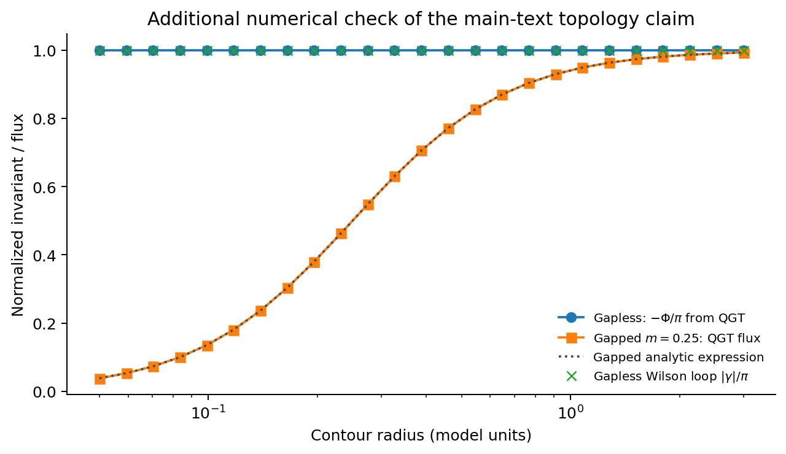

# Curvature–Flux 正文图与数值检验

[论文与能力](../README.md) · [五篇图册](../../../docs/MAIN_TEXT_FIGURES.md)

正文 Fig. 1、2 是概念示意，不能按输运曲线来验收。本目录重绘概念关系，并计算其局域模型内容。





- Fig. 1：按指标交换对称性及实/虚部分解 Zeeman QGT。
- Fig. 2(a)：直接从特征矢计算绕数场和 ΩA。对 d=(kx,ky,0)，有符号 Eq. (8) 给出**向内** ΩA、通量 −π；向外的是 −2ΩA。这里遵循公式，未照搬原示意图箭头。
- Fig. 2(b)：重排原 Eq. (18) 的动态、减去静态项后的响应通道表；不是模拟实验信号。



额外图用 QGT 环路积分和独立 Wilson 环路检验无质量 Dirac 拓扑，同时展示加质量后的通量变化。
512→1024 点的无质量通量最大变化约 3.0×10⁻⁵；1024 点与 −π 的误差约 9.9×10⁻⁶。
特征矢与投影算符 QGT 的检查误差约 3.4×10⁻¹⁶。这里验证局域拓扑，不宣称完整金属耗散/宏观电流已由这些图验收。

从仓库根目录运行：

```bash
python3 papers/cui-2026-curvature-flux-zeeman-qgt/scripts/plot_main_figures.py
```

[validation.json](validation.json) · 同名 SVG/NPZ 保存可编辑图及数组。
