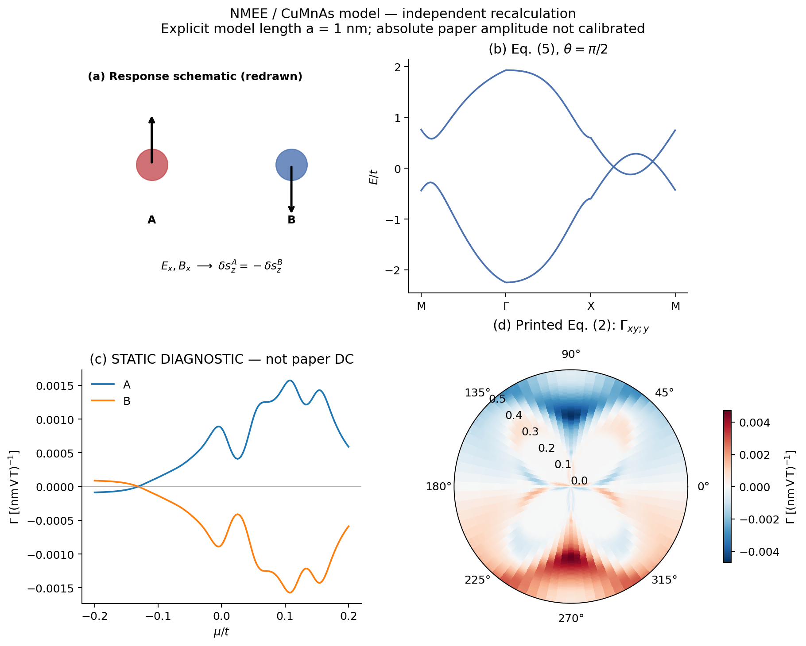
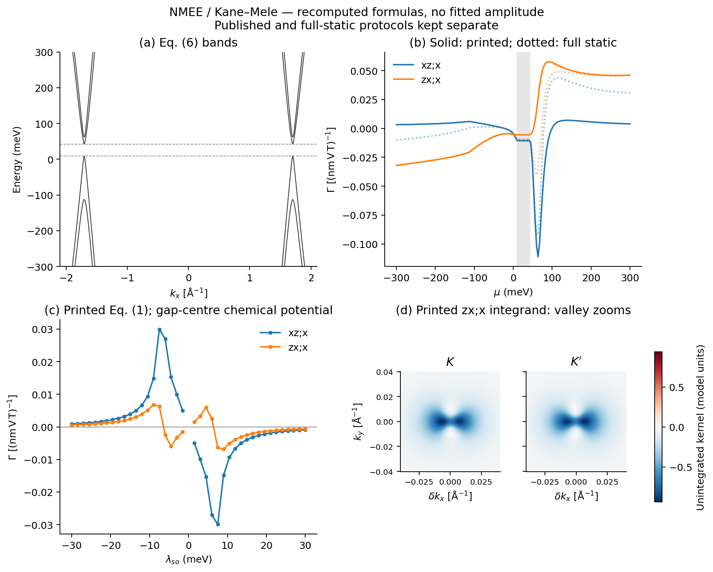

# NMEE 正文主图

[论文与可调用接口](../README.md) · [五篇图册](../../../docs/MAIN_TEXT_FIGURES.md)

重点是模型机制可调用。**Fig. 1(c) 不作为精准复现的验收门槛，也不冒充已完成的本征 DC 系数。**

| 面板 | 本仓库计算 | 解释与边界 |
|---|---|---|
| 1(a) | A/B 交错响应示意 | 自行重绘，不是数值结果 |
| 1(b) | CuMnAs Eq. (5) 能带，θ=π/2 | 采用负 kx 边的 M–Γ–X–M 路径，与代码 SOC 符号一致，显示两处 Dirac 交叉 |
| 1(c) | 冻结占据的静态有限 B 导数 | 验证 A+B 抵消；曲线不是原文 driven-DC Eq. (1) 的修订结果 |
| 1(d) | Eq. (2) 的 Γxy;y，μ/θ 扫描 | PT 双重态投影算符计算；模型长度显式取 a=1 nm，绝对幅度未按实验晶格校准 |
| 2(a) | Kane–Mele Eq. (6) 能带 | K/K′ 路径，标出采样所得能隙边缘 |
| 2(b) | Γxz;x、Γzx;x 随 μ 变化 | 实线是当前印刷 Eq. (1)，点线是 full-static，对应不同公式/协议 |
| 2(c) | 同两分量随 λso 变化 | μ 跟随对应能隙中心，不是原文表述的固定 μ；严格 λso=0 留空，不由非简并核推断零值 |
| 2(d) | Γzx;x 的 k 分辨响应核 | K/K′ 各 ±0.04 Å⁻¹ 放大，线性色标，无分位裁剪；不是全 BZ 积分 |

SM (37) 对角通道的遗漏问题与当前印刷分支分开记录；本图册未实现或宣称完成修订后的本征 DC 公式。
已验证的[完整有限频混合响应接口](../README.md#core-access-2026-11-01)仍可调用，不需先追平 Fig. 1(c)。
静态对照也不能单独证明某个 DC 原图错误。





从仓库根目录运行：

```bash
OPENBLAS_NUM_THREADS=1 OMP_NUM_THREADS=1 python3 papers/jia-2026-nonlin-magnetoelectric-edelstein/scripts/plot_main_figures.py
```

输出 PNG、可编辑文字 SVG、原始数组 NPZ 和 [validation.json](validation.json)。
CuMnAs 网格 201²，T=100 K，τ=50 fs；Kane–Mele 网格 451²，T=10 K，键长 0.142 nm，g=10。
Fig. 2(b) 在 μ=25 meV 的 451²→601² 检查：两分量相对变化约 0.0017% 和 0.0047%；
该检查不代表全部 SOC 扫描已逐点收敛。Fig. 1(c) A+B 的最大残差约 3.6×10⁻¹⁵，
Fig. 1(d) θ→θ+π 反号的最大残差约 1.7×10⁻¹⁶。
