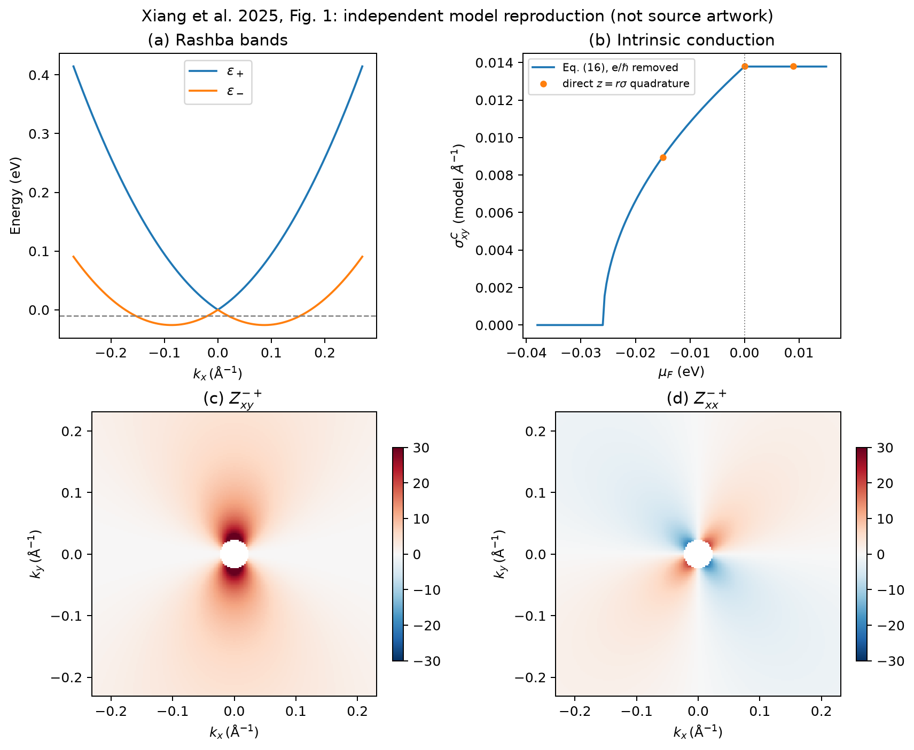
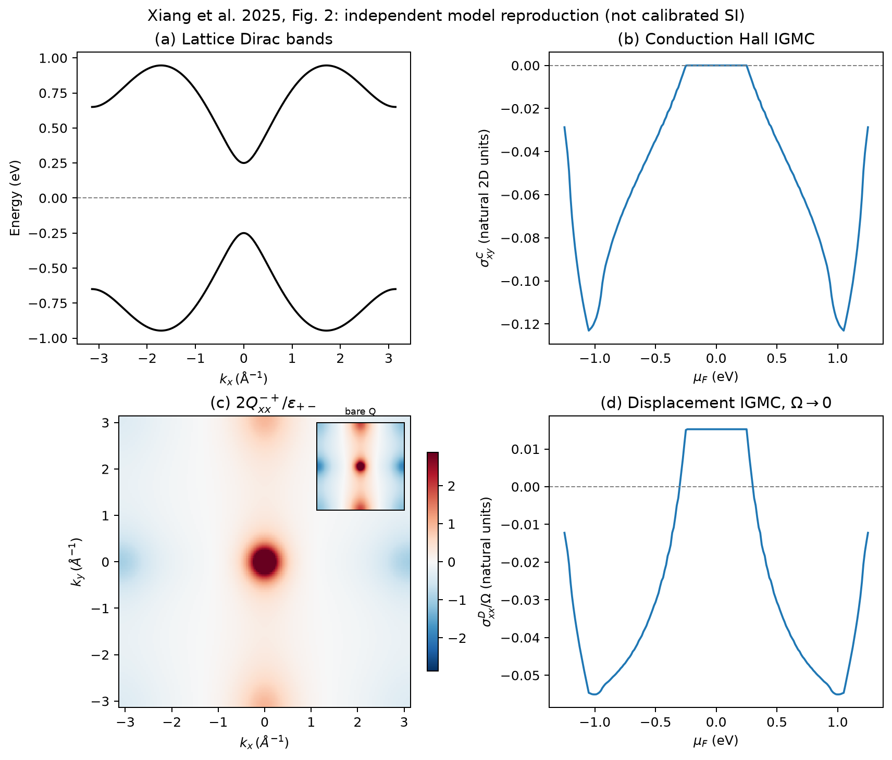

# IGMC 正文 Fig. 1、2

[物理能力](../CORE_ACCESS.md) · [五篇图册](../../../docs/MAIN_TEXT_FIGURES.md)

这两张模型图此前已在仓库；本次重新执行，并补充 SVG、NPZ、参数与显示约定。



Fig. 1：Rashba 能带、传导 IGMC 随化学势的变化，以及 Zeeman 曲率分布。
解析 Eq. (16) 与独立动量积分以曲线/散点对照。曲率图遮去半径小于 0.023 Å⁻¹ 的节点区域，
颜色固定为 ±30；NPZ 同时保存原始核、遮罩和显示数组。



Fig. 2：晶格 Dirac 能带、传导响应、裸度量及能量加权度量、位移响应。
几何色标限于绝对值 99.5% 分位，NPZ 不裁剪数值。d 面板为每单位光子能量 ℏω 的位移响应，
不是每 Hz 的系数。当前自然单位没有乘物理电流的全部 SI 前因子，原文 Fig. 2(d) 绝对幅度争议仍保留。

从仓库根目录运行：

```bash
OPENBLAS_NUM_THREADS=1 OMP_NUM_THREADS=1 python3 papers/xiang-2025-intrinsic-gyrotropic-magnetic-current/scripts/plot_main_figures.py
```

Dirac 图使用 181² 网格；已有 [51²→301² 检查](../results/raw/dirac_convergence.csv) 同时覆盖金属和绝缘点，
金属均匀网格结果不能当作全 μ 区间的精确收敛。Rashba 使用解析式并在三个 μ 点独立积分对照。
见 [validation.json](validation.json) 与 [parameters.json](../parameters.json)。新图单独存放于 `figures/`；原 `results/raw` 与 `results/figures` 的冻结基准不变。
