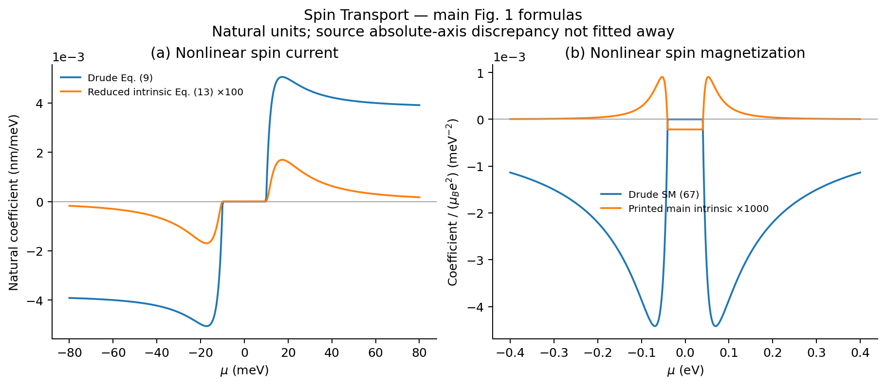
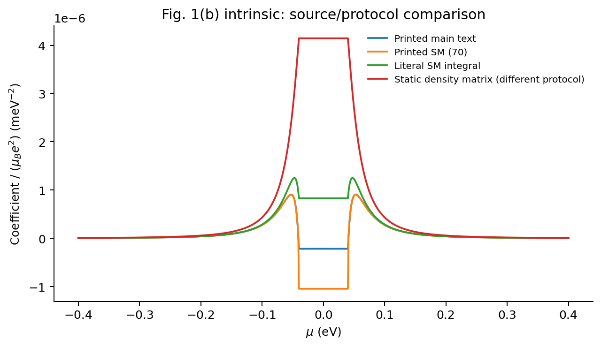

# Spin 正文 Fig. 1

[论文与能力](../README.md) · [五篇图册](../../../docs/MAIN_TEXT_FIGURES.md)

- **a：二阶自旋流。** 计算 Drude Eq. (9) 和约化本征 Eq. (13)，扫描化学势。
- **b：二阶自旋磁化。** 计算 SM (67) Drude 和正文印刷本征表达式。
- 附图将正文、SM (70)、字面 SM 积分和静态密度矩阵分支分别画出；静态分支不自动代表受驱 DC。





图使用自然单位。×100/×1000 是原文用于可视化的倍率，图例明确标注，NPZ 保留未放大的数组。
已有 Fig. 1(a) 约 2 倍归一化问题、Fig. 1(b) 正文/SM 的符号与形式差异继续保留；不通过乘系数消除。
因此图支持模型机制与参数依赖的复用，不宣称已校准原文全部 SI 纵轴。

从仓库根目录运行：

```bash
OPENBLAS_NUM_THREADS=1 OMP_NUM_THREADS=1 python3 papers/xiang-2025-spin-quantum-geometry/scripts/plot_main_figures.py
```

参数：τ=0.5 ps，vx=vy=10⁵ m/s，倾斜速度 0.1vx，β=10 meV；b 面板 Δ=40 meV。
a 面板角度/径向积分从 192/72 加密到 384/120，Drude 与本征的最大数组变化分别约
2.9×10⁻¹⁷、9.1×10⁻¹⁹；b 面板使用现有解析表达式。
详见 [validation.json](validation.json)，同名 SVG/NPZ 可编辑或读取数据。
