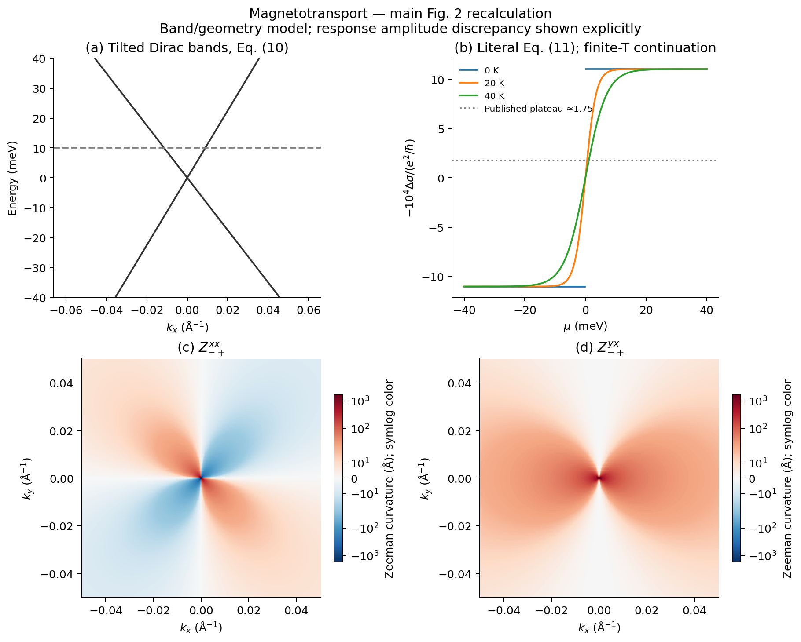

# Magnetotransport 正文 Fig. 2

[论文与能力](../README.md) · [五篇图册](../../../docs/MAIN_TEXT_FIGURES.md)

正文 Fig. 1 是分类图：普通/Zeeman 几何连接轨道/自旋耦合与磁输运；没有需要重算的数值曲线。
这里复算主要数值 Fig. 2：

| 面板 | 计算与含义 |
|---|---|
| a | Eq. (10) 倾斜 Dirac 能带 |
| b | Eq. (11) 磁电导随 μ 变化；20/40 K 为 Fermi 占据 tanh 延拓，印刷 Eq. (11) 本身是 T=0 |
| c,d | Zeeman 曲率 Zxx、Zyx 的动量分布；特征矢计算与解析式独立核对 |



**原文/公式的幅度问题保留在图上：** 按印刷式恢复 SI 得到的平台约 11.02，原图约 1.75，比例约 2π。
灰虚线只标原图参考值，不是拟合结果。局域几何色标采用 symlog，无有限点裁剪；T=0、μ=0 点留空。

从仓库根目录运行：

```bash
python3 papers/xiang-2026-quantum-geometric-map/scripts/plot_main_figures.py
```

β=1/8，τ=0.5 ps，g=10，Bx=1 T。能带图显式取 ℏvF=1 eV Å，这不是对原图未报告速度的反演。
局域几何的三个非奇异点解析式/特征矢误差最大约 1.4×10⁻¹⁴；绝对幅度核查复用已有独立 SI 审计。
[validation.json](validation.json) 记录具体结果，NPZ 保留未经色标变换的数组。
