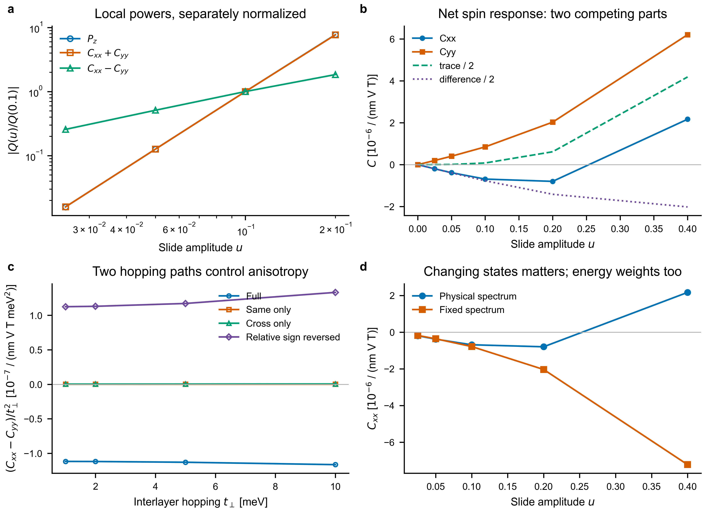

# BSF × NMEE: bilayer model and reusable response checks

## Current entry point: bilayer KM physics audit (2026-11-03)

Start with the [concise Chinese findings](docs/BILAYER_KM_FINDINGS_ZH.md), then
the [definitions, evidence and reproduction commands](docs/STAGE8_PHYSICS.md).
The current result is a gapped static EB spin coefficient: cubic electronic
layer dipole and trace, linear directional difference near a C3/mirror reference.
Breaking C3 restores a linear scalar response. Hopping-path and fixed-spectrum
controls separate what is established from what still needs explanation.

Sources: `bsf_nmee/bilayer_audit.py`, `bsf_nmee/static_observables.py`.
Data: `results/bilayer_stage8_audit.json`, `results/bilayer_stage8_controls.json`.
No material ferroelectricity, full driven-DC equivalence, or PRL novelty claim.
The linked earlier stages are retained as a chronological, frozen research record;
their earlier “next steps” describe their status at the time, not the current task list.

Earlier stages are preserved in [the historical README](README.md).
