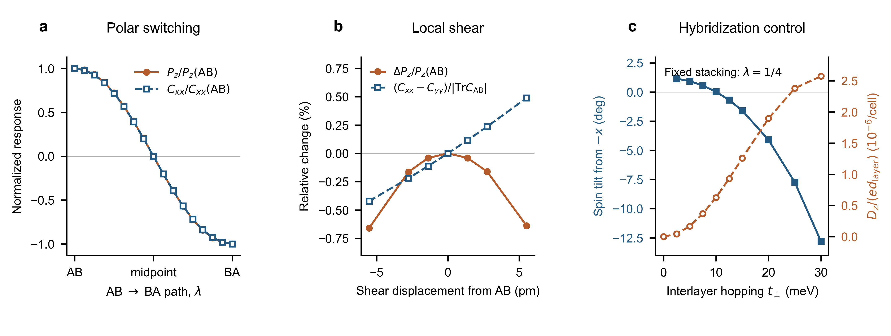

# Bilayer KM：从模型到完整滑移路径

本阶段是当前入口；Stage 1–8 保留为历史记录。研究对象是 A/B 子晶格不等价、两层 Rashba 符号相反的蜂窝双层，不是直接堆叠的理想石墨烯，也不是已验证的具体铁电材料。

## 五个物理结论

1. **净自旋来自两层不完全抵消。** AA 时两层 EB 自旋响应等大反向；滑移和层间杂化改变它们，产生小的净响应。AB 的净 Cxx 约为单层分辨响应的 0.26%，当前结果不是巨大增强。
2. **AB→BA 能翻转响应，但尚不特殊。** 在测试的 5、20 meV 耦合下，电子面外偶极与净自旋响应一起反号；不能据此声称独立控制自旋。
3. **小滑移有意义，但必须说清参考构型。** AA 附近：偶极、响应迹三次起步，方向差一次起步。极性 AB 附近：偶极及响应迹的“变化”二次起步，方向差一次起步。后者针对极性构型附近的轻微剪切，不能替代整段铁电翻转。
4. **层间混合确实有超出极化符号的信息。** 固定在 AB→BA 的 1/4 位置，耦合从 5 增至 20 meV 时，Cyx 从负变正，而电子偶极同号、能隙不闭合。反转的是横向分量，不是整个自旋。耦合扫描尚未对应压力或层间距的真实标定。
5. **必要条件已明确。** 关闭 Rashba 后面内 EB 自旋响应消失；令子晶格等价后恢复反演，净响应消失。两条不同的轨道跳跃通道可相互干涉，不能简单相加成总响应。

图 a：完整 AB→BA 路径，偶极和响应一起翻转。图 b：AB 附近，方向差线性变化而偶极变化为二次。图 c：同一堆叠下，层间耦合使横向响应反号，偶极保持同号。所有曲线来自模型计算，连线只引导视线。

## 怎样驱动滑移

模型输入的是已经给定的滑移，不包含离子力或势垒。实验设想应区分：用垂直栅场或机械剪切改变构型，再以面内 E、垂直 B 测 EB 自旋响应。不能说固定的测量场已经驱动了滑移；能否保持构型、需要多大驱动力，要由结构能量和畴壁动力学判断。

## 对 PRL 故事的判断

“铁电翻转带来自旋反号”本身偏常规。更值得检验的是：自旋响应能否提供极化测量没有的结构/杂化信息，以及这种差异能否在稳定材料中达到可测大小。目前具备可复用模型证据，但尚未建立 PRL 级新颖性或实际器件可行性。

详见 [Hamiltonian、机制、响应协议和误差](docs/STAGE9_MODEL_PHYSICS.md)、[英文正文候选段落](docs/STAGE9_SECTION.md) 和 [图注与证据记录](docs/STAGE9_FIGURE_QA.md)。全部原始结果在 `results/bilayer_stage9_*.json`；历史主文复现内核未改。
