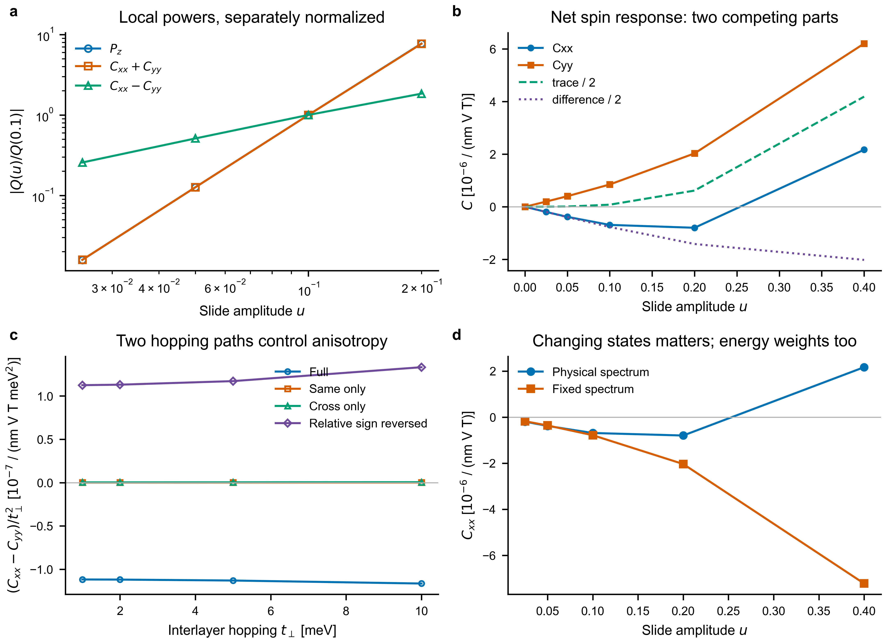

# Bilayer KM：这次真正弄清楚了什么

2026-11-03。前三步已完成：定义与对称性、电极化与阶数、层间耦合对照。
计算对象是绝缘体的静态 EB 自旋响应；尚未证明它与原 PRL 的驱动直流公式完全等价。

## 先明确测量

固定垂直磁场 Bz，分别施加面内 Ex、Ey，读取整个双层的净自旋磁化。
这里 Cxx 表示 δsx=Cxx Ex Bz，Cyy 表示 δsy=Cyy Ey Bz。
两者的和是方向平均响应的两倍，差是 x、y 方向响应的差。
这不是两种磁畴的和、差，也不是自旋流。

模型虽是蜂窝晶格，但含不同的 A/B 子晶格势与 Rashba 耦合，不能称为完整 LG80 石墨烯。
两层 Rashba 符号相反，是镜像配对的电子模型；不能仅凭 AA 原子投影称为完整 Hamiltonian 的直接堆叠。

## 三条物理结果

1. 小滑移首先改变“方向差”，电极化变化较慢。
   在同一条滑移路径上，位移翻倍时，Cxx−Cyy 约变为 2 倍；
   电极化 Pz 和 Cxx+Cyy 约变为 8 倍。改变六组模型参数及滑移方向后，这一小位移规律仍成立。
   但这只是阶数差异，不能据此说磁信号在实验中一定更容易测到；模型电极化本身很小。

2. 这条规律有明确条件，不是所有双层都成立。
   三重旋转使三个方向对净电荷转移的一阶作用相抵消，而方向差可以留下。
   水平镜像又要求这些量随正、负滑移反号，排除了偶数阶。
   故 Pz 与响应和最早允许三阶，方向差允许一阶。
   主动破坏三重旋转后，Pz 和响应和也出现一阶：对照支持这一解释。
   “对称性允许”不保证系数非零，特殊方向仍可能抵消。

3. 层间耦合改变电子态的组合方式，能量权重也重要。
   断开两层后，净响应消失。在弱耦合区，方向差约随层间跳跃强度的平方增长；
   同子晶格、异子晶格两类跳跃同时存在时作用明显，改变它们的相对符号可反转方向差。
   人工把各滑移结构的能谱变得完全相同，响应依然随滑移改变，说明不能只用能隙解释。
   但原模型 Cxx 的反号在这个对照中消失，说明实际反号涉及电子态与能量权重的共同作用。

图 a 比较各自归一化后的增长阶数，不比较不同物理量的绝对大小。
图 b 是净自旋响应；图 c 比较改变跳跃路径后的不同模型；图 d 是人工固定能谱的对照。

## 离 PRL 还差什么

值得保留的候选问题是：在什么结构条件下，磁电响应能读出电极化一阶看不到的滑移变化？
这次证明了一个模型中确实存在这种阶数差异，也找到了失效条件。
但选择定则本身不等于新的微观机制，“滑移调响应”“层间相干重要”也已有前人工作。
还需要推广条件、实际材料中的可测大小，以及与原文驱动响应的严格对应，才能判断是否足以形成 PRL 故事。

## 可信范围和复用入口

- 补齐的是刚性、点轨道模型的面外电子电偶极；未包含离子弛豫、真实轨道内部偶极或铁电势垒。
- 默认路径始终有约 29 meV 的采样带隙；没有把能隙闭合误当作阶数变化。
- 加密积分网格后，默认电极化变化小于 0.062%，响应和、差变化小于 0.00024%；磁场步长检查也通过。
- 可复用代码、数据、定义和文献边界见 [详细记录](STAGE8_PHYSICS.md)。
- 原有五篇论文复现与 Stage 1–7 冻结数据均未改写。
