# worklog｜Layer NMEE

> 本项目唯一的当前工作记录。正文、模型定义和全部讨论图见 [双层绝缘体中层分辨自旋响应的界面调控](双层绝缘体中层分辨自旋响应的界面调控.md)。这里集中记录已经做过什么、哪些结论仍成立、哪些说法已更正，以及数据在哪里。历史记录的“下一步”只表示当时计划，不是当前待办。

## 新窗口接手入口

1. 先读本节及“当前物理状态”，再读最新两至三条 dated 记录。历史条目的“下一步”不是当前执行授权。
2. 仓库：`/Users/jiaqi/Desktop/worksofJiaqi/quantum-geometry-reproductions`，研究分支 `research/bilayer-km-static-polarization`。先检查工作区与分支，再沿最新条目的归档路径读取README、原始结果、预测文件和限制；不要只凭聊天摘要延续结论。
3. 本文件是统一worklog；Obsidian版与仓库 `studies/bsf-nmee-connection/docs/manuscript/worklog.md` 为同步镜像。正文仍是同目录的连续文稿，探索结果不自动升级为正文结论。
4. 必须区分：内部层势差与外部屏蔽栅场；整片抵消与同层翻向；有符号斜率与响应幅度；固定势Hamiltonian干预与独立自洽DFT；已知数据回查与事前盲预测。未收敛分解不作为机制证据。
5. 最新授权：补齐全方向内核并验证7269，通过后执行有界7268小批次；KM及已有DFT分析同步推进，验证后估算各体系及全部候选纯计算时长。其余候选未获整批提交授权；以最新条目为准，不自动执行历史计划。日本计算和数值后处理只能经计算节点调度；GitHub不启用Actions邮件，研究归档用[skip ci]且不称远端检查通过。

聊天本身不保证自动继承。新窗口拿到本文件和仓库路径后可恢复可核查状态；外部计算缓存、软件与计算资源还须按记录重新确认，不能仅因文件存在就假定可重跑。

## 当前物理状态

- 最新阶段：复核项目、Zotero 与同行文献。MoSSe 的 S/Se 界面使两层局部自旋响应幅度增大，整片因相互抵消而减弱。一阶电流自旋与绝缘磁电自旋能否在空间上分开仍待检验。WS₂ 初筛下 +x、上 −x，整片方向未分辨；同协议 MoS₂ 因受力超过约定值结束，未获得响应。首批 16 个双层启动 4/16（25%）、数据收齐 1/16（6.25%）、绝对幅值达标 0/16（0%）。

- 观察量是绝缘、固定离子条件下的静态 $E_xB_z$ 诱导层自旋；垂直控制电场或层势差与两个探测场分开定义。
- KM 与 MoSSe 均有两类现象：界面能够使指定层相对同朝向孤立层反向；总响应也能在两层自身不反向时过零。两者不能仅凭总信号的符号区分。
- 当前 KM 主例是 AB–BA 路径的 $\lambda=1/4$，邻近位置与小幅参数变化保留两类过程。KM AB/BA 作为高对称对照，不称它们已经重现同一门控补偿路径。
- MoSSe S/S 堆垛 A/B 由水平 $m_{001}$ 联系。它交换上下层并反转面内自旋；所以两个堆垛都可呈下负上正，而优势层相反。
- 最新材料检验：十二态KM仍是有效的存在性例子，但直接投影MoSSe到十二态不保留反向，二十态结果也依赖投影窗口。所选跨带通道放回完整材料可驱动反向；完整空间检验表明，删掉已选态与其余态之间的电场跃迁连接会稳健地破坏反向。该模型问题暂缓；不能直接将toy的选择性或阈值规则当成MoSSe判据。普通3R-MoS₂固定堆垛对照进一步支持：平滑静电势能激活正响应，所选跨层混合则使下层反向；跨占据—空态通道与MoSSe存在机制联系。现有KM尚未重现同一种通道选择性，绝对幅值及普适机制仍待验证。材料最小模型、跨晶格规律和PRL新颖性尚未完成。
- 前轮门控—层距验证：原层距至增加0.30 Å的已算点中，−0.50 V/nm未使MoS₂下层翻向；门控可改变总响应符号，两层自身方向保持。层距主要改变相反层响应的强度。全部点保持绝缘，尚未找到近原层距同层翻向的实际条件。
- 最新压缩检验：MoS₂原3R堆垛缩短0.10/0.20 Å，补偿偏场依次向负方向移动；所有已算完整材料点仍下负上正、保持绝缘。但屏蔽静电参照也重现同一宏观趋势，层方向却相反，因此不能以补偿点移动独立鉴别杂化机制。
- 最新MoSSe应变检验：同一S/S堆垛的−2%、0、+2%弛豫点都保持下负上正与绝缘；压缩使下层负值约减半，仍未翻向。匹配孤立层和静电参照都为正，跨层价带—空态混合仍能驱动反向。该结果强化界面方向改写的稳健性，尚未建立应变开关；仅缩放杂化的先验模型不足以预测实际应变。
- 最新 MoSSe 栅场自洽验证：固定 S/S 结构、±0.10 V/nm，完整双层净响应敏感度比两个实际几何匹配孤立层之和高约 48%–49%；上层主导、下层变化很小。屏蔽使绝对电控幅度下降约一个数量级，相对增强仍保留。全程绝缘、两层自身不翻向；这是固定离子和现有探测响应定义下的独立材料证据，尚非完整 PRL 新颖性或实验读出验证。

- 最新共同通道检验：保持已有自洽屏蔽势，去掉所选跨层价带—空态混合后，下层恢复正响应，上层电控主导及净增益明显减弱；“下层价态—上层空态”方向尤其重要。强选层电控可在同层尚未翻向时出现。该结论是明确材料模型中的因果干预证据，不是普适阈值；应开始以新材料检验机制而非无限完善单一算例。

- 最新InSe拓展：初始自洽栅场计算支持约1.4–1.6倍净电控增益，但两层均明显变化并部分抵消，和MoSSe上层主导不同。多类跨层混合共同参与，不能直接迁移MoSSe的单一VC翻向叙述。独立加密核查中两层C变化不足1%，抵消后小净值变化约35%；电控增益尚非网格收敛定量结果。

- 最新InSe镜像伙伴核查全部完成：同一正栅场在A削弱两层、在B增强两层；两层方向保持，两者净变化同向。调控方向稳健，净幅度尚未收敛，不能将初步增益作定量结论。

- 最新KM回查：零偏置能级、层权重及完整矩阵元可预报小偏置调控方向；代表态的强选层电控来自每层内部不同程度的抵消。该机制尚未在三个材料中用同一定义逐一核验，不能称为普适判据。

- 最新材料同定义核查：MoSSe下层与InSe下层的相对栅控变化相近，突出差别是MoSSe上层更易电控。能量/矩阵元分项不具备已验证的零磁场极限，不能宣称已证实材料层内抵消；完整层响应与原自洽结果一致。KM与材料的统一微观因果链仍待建立。

- 最新固定通道对照：MoSSe删除下层价态—上层空态混合后，下层恢复正响应，上层相对与绝对电控均显著下降，优势转到下层；InSe同类删除不改变层方向，却增强两层电控并反转调控趋势。支持共同通道影响局部响应与选层电控，但没有普适“杂化放大”或“翻向导致增益”规律。

- 最新原八态KM反馈：同一方向跨层通道已出现电控增强/抑制两种作用；弱耦合路径交叉项可预报新的相对通道符号下的电控方向，两层C可保持方向。无需先加态；但材料是否由同一交叉项主导、以及可实现的控制方式仍未证实。

- 本轮KM＋三材料判据检验已完成并停在讨论：简洁通道展开在MoSSe/MoS₂局部有效，但在InSe错误预报部分方向及增强/抑制，尚无普适材料判据。更强混合只是事后适用性线索；真实栅场也不能普遍等同于刚性层势差。完整失败结果已归档，不自动追加计算。

## 2026-11-11｜项目复核、同行工作与下一步物理问题

**目前最强的材料事实。** 对同一朝向、同一内部原子位置的两片 Janus MoSSe，先单独计算，再看它们构成 S/Se 界面后的响应。这里 +x 沿 a₁，+z 从下层指向上层，施加 +Eₓ 和 +B_z，下表为零额外垂直栅场时的面内 Pauli 自旋响应。S/Se 双层属 C₃ᵥ，BSF 构造上层的操作为 {E | τₐ + dẑ}，τₐ = (a₁ + 2a₂)/3，d 是两层参考平面的间距。

| S/Se 实际结构，12×12 | 下层 | 上层 | 整片或两片之和 |
| --- | ---: | ---: | ---: |
| 两片孤立层 | +14.0 | +14.1 | +28.2 |
| 形成界面后 | −57.3 | +66.8 | +9.5 |

单位为 10⁻⁹ (nm V T)⁻¹。正、负分别指 +x、−x。形成界面后，下层翻向，两层各自的幅度都增大，整片却只剩分开时的约三分之一。三组网格都保留这个判断。以 1 V/μm 的面内电场和 1 T 的磁场为例，线性缩放给上层约 6.7×10³ cm⁻² 的 Pauli 自旋面密度，整片约 9.5×10² cm⁻²。这个换算给出实验需要面对的绝对量级，尚无已标定的层分辨测量。依据为 screening/review7268-20261111/field_responses.csv、screening/progress-20261111/closed7268/acceptance.json 和筛选内核中的面积与电子 g 因子约定。

**哪些对照改变了理解。**

1. 同属 C₃ᵥ 的 S/S 界面用 {m₀₀₁ | τₐ + dẑ} 从下层构造上层。S/S 和 S/Se 均为下层 −x、上层 +x。整片方向相反来自两层抵消程度改变。它们各自内部都没有交换上下层的对称操作。把一个完整堆叠水平镜映成另一个堆叠时才需同时交换层标签。固定离子、分别自洽的 ±0.10 V/nm 结果也纠正了一次预测。同条件粗网格上，S/S 的上层承担两层绝对栅控变化之和的约 96%，S/Se 约 67%。加密后 S/Se 约 61%，下层参与明显增多，上层仍更敏感。把优势层预测为下层失败。各层零栅场方向和栅控排序稳定，S/Se 栅控变化的绝对幅值仍略超原定网格误差限。见 screening/review7268-20261111/matched_kernel_interfaces.json；旧的 25 态汇总保留为当时快照，27 态终态以 screening/progress-20261111/closed7268/ 为准。
2. S/S 的材料模型中，独立互换弱混合与完整界面的能谱和电子态。保留完整界面电子态、换回弱混合能谱，下层仍反向；只换成完整界面的能谱，下层仍沿原方向。这个结果在对照中比单看带隙或某个轨道权重更能说明形成界面改变了参与带间响应的电子态。用该对照解释 S/S，S/Se 的表格本身只给界面总效应。历史 3R 型 MoS₂ 也提供独立线索：孤立单层 D₃ₕ 禁止当前分量，仅保留邻层产生的沿厚度变化、面内平均电势时，下层沿 +x；完整双层下层却沿 −x。另一方面，压缩后整片抵消点的移动也可由上述电势重现。它不能独立鉴别杂化。
3. 在各栅场点保留已经算出的屏蔽势，恢复选定的“下层价态—上层空态”耦合，使 MoSSe S/S 的上层更容易受栅场调控，在 InSe 中却削弱上层电控。这里改变的是模型矩阵元。InSe 的 C₃ᵥ 双层无内部换层操作；加密后上下层各自变化不足 1%，很小的净残差变化约 35%。两层的强相消值得保留，整片残差的精确大小仍待确定。低阶展开在 InSe 错误预测了部分调控方向，刚性层势差与外部屏蔽栅场亦可给出不同趋势。逐项证据见 materials/layer-channel-sensitivity-20261110、materials/material-criterion-20261110 和 materials/material-gate-split-20261110。
4. 早期滑移模型给出了对称堆叠附近张量各分量对位移的不同首项。某些模型参数下 K/K′ 附近能解释大部分响应，不能据此指定实际 MoSSe 的主导谷。八态双层 Kane–Mele 模型进一步分清同层反向、两层补偿，以及不同跃迁路径相互加强或抵消。独立低频计算验证了先加自旋 Zeeman 磁场、再加弱电场的绝缘态响应；默认参数下并非总出现同层反向。十二态投影和窗口依赖的高能分解未能给出材料通则。模型层势差也不能代替外场和屏蔽。详见 docs/STAGE6_PHYSICS.md、docs/STAGE7_PHYSICS.md、docs/STAGE9_MODEL_PHYSICS.md、mechanism/km-channel-control-20261110，以及连续正文的能谱与电子态交叉对照。

**同行已经回答到了哪里。** 核读本地 Zotero 的 NMEE、LEE（含补充材料）、layer-tensor、Törmä 的 Essay、一阶 Rashba–Edelstein 高通量与 HgI₂ 滑移自旋研究。另检索 APS、arXiv 与期刊原文，交叉查找绝缘磁电效应、逐层自旋、电流诱导自旋、非局域自旋、滑移光磁化和磁场中的 Rashba 响应。以下按论文回答的问题区分，截至 2026-11-11。

| 关系 | 同行结果及对本文的影响 |
| --- | --- |
| 理论前序 | Hou 与 Bloembergen 已测得电场改变磁化率及逆效应。磁化可含电场与磁场的乘积已有经典先例。王健组 Xiang 等把 Zeeman 量子几何与自旋响应联系起来，Jia 等给出 NMEE 的量子几何理论、绝缘 KM 例子及 CuMnAs 的亚晶格自旋力矩。仅凭绝缘体存在 NMEE 或内部局域响应可以相消，均不能建立本文的新意。[经典顺磁磁电实验](https://doi.org/10.1103/PhysRev.138.A1218) · [自旋量子几何](https://doi.org/10.1103/14mp-263q) · [NMEE](https://doi.org/10.1103/r3x2-kb93) |
| 材料与输运前序 | Gong 等说明 TMD 双层载流子的自旋、谷和层可耦合。Dyrdał 等在磁化的 Rashba 二维电子气中研究纵向电流诱导自旋，Leiva-Montecinos 等说明层间耦合可增强、削弱或反转 Edelstein 响应。Milivojević 等在电极选择接触的 WSe₂ 插层双层石墨烯中已预测一层的电流可在另一层诱发自旋。单凭“电流和自旋可以不在同一层”也不足够。[TMD 双层](https://doi.org/10.1038/ncomms3053) · [磁化二维电子气](https://arxiv.org/abs/1702.08162) · [双层 Rashba](https://doi.org/10.1103/PhysRevResearch.5.043294) · [非局域电流诱导自旋，预印本](https://arxiv.org/abs/2608.15622) |
| 与拟写主张有实质重叠 | Zhou 等已在非磁双层中由电流产生逐层自旋，并用堆叠对称性、栅场和 MoSSe 材料解释。补充材料第 VII 节还研究了 S/S 终端，Γ 附近朝向层外的 S p_z、Mo d_z² 轨道明显成键，K 附近面内 Mo d 轨道更保留单层特征。须核对具体构型才可逐点对比。Li 等的层张量理论已覆盖有相应换层对称时的选层和外场关系，包含有限层间混合。Jian Zhou 早在 2022 年已给出滑移铁电双层的光致逐层非线性磁化、补偿与换畴响应。光学驱动涉及 E(ω)E(−ω)，与这里的静态 EₓB_z 不同。这三篇直接限制“换层、外场激活、滑移翻转”作宽泛标题的空间。[一阶层 Edelstein](https://doi.org/10.1103/qhvs-pfkq) · [有限杂化的层张量](https://doi.org/10.1103/2zmv-g9md) · [滑移双层光磁化](https://doi.org/10.1038/s41699-022-00297-6) |
| 相邻方向 | 垂直电场与面内电场共同产生的电流自旋、磁性交错界面的电磁响应，以及层赝自旋的量子几何，分别涉及不同外场、磁性或观测量。筛选一阶效应和滑移调 Rashba 纹理也已有材料文献。[双电场 Edelstein，预印本](https://arxiv.org/abs/2610.17535) · [交错磁界面](https://doi.org/10.1103/sxyb-5rcy) · [层赝自旋，预印本](https://arxiv.org/abs/2610.26982) · [一阶效应高通量](https://doi.org/10.1103/xly2-mhk9) · [HgI₂](https://doi.org/10.1021/acs.nanolett.3c04869) |

在核查到的工作中，尚未发现同一非磁双层中同时把零磁场的载流子 Edelstein 自旋与绝缘带隙内 EₓB_z 诱导的**真实自旋**逐层比较，并用界面变化给出材料预测的直接竞争论文。此为有范围的检索判断，不单凭题目或无检索结果主张首创。

**建议讨论的中心问题。** 电流流过双层时，带边附近可运动的电子决定传统 Edelstein 自旋积累；同一个样品在化学势回到带隙后，面内电场与垂直磁场仍能经占据态到空态的虚跃迁诱导自旋。界面能否分别调节这两组电子态，以致一种自旋随带边载流子转到另一层，另一种仍主要留在原层？若成立，层分布能区分两种自旋产生机制，并给出一个可以利用的控制自由度。若两者始终随同一组层极化带边态一起移动，材料将支持更简单的解释。当前仅有第二种响应的层数据。

Törmä 的 Essay 用平带说明，压低能带色散的作用后，波函数仍可决定可观测响应。对本项目最有启发的是设计能让两种解释给出不同结果的对照。S/S 的能谱—电子态交叉结果已朝这个方向走了一步。进一步可以从 LEE 原文的 Γ/K 区别出发，核对实际堆叠，检验轻掺杂时一阶自旋是否随费米面跨入不同的谷而换层，同时积分整个布里渊区的绝缘磁电响应是否保持；哪一谷主导后者未知。应按简并带组求和并恢复全区结果。能带的层权重或普通量子度规的大小不能给出有符号的层自旋。[Törmä 的 Essay](https://doi.org/10.1103/PhysRevLett.131.240001) · [王健组自旋量子几何](https://doi.org/10.1103/14mp-263q) · [MoSSe 一阶 LEE](https://doi.org/10.1103/qhvs-pfkq)

**怎样判定这条线值不值得写成 Letter。**

1. 八态 KM 用同一哈密顿量和同一物理层自旋算符。在零磁场、相同弛豫近似和受控的电子或空穴面密度下算电流诱导自旋；用同一结构在带隙内算自旋 Zeeman 磁电响应。另立一阶输运计算，当前绝缘核在化学势离开带隙时终止。比较两层的方向和各自占比，保留绝对量，不直接比较量纲不同的系数。材料对应的 C₃ᵥ 允许前者沿 ±y、后者沿 ±x。两者正交已由对称性给定，值得验证的是两层分布是否独立。无额外垂直栅场的 D₃d 对照强制二者各自层间反平行。若优势层差别仅在几乎消失的响应、一个微调参数或个别简并本征态中出现，放弃“可独立调层”的主张。
2. 第一轮材料选择重在判断两种机制能否区分。先用 MoSSe 连接既有两类文献，再在另一个非镜像等价的材料或界面上事先写下预测并检验。MoS₂/WS₂ 区分单层禁戒后界面激活和化学替换；实际对照需先讨论 MoS₂ 的几何受力。InSe/GaSe 则专门检验强混合的反例。是否继续滑移，由稳定极性伙伴和可判别后果决定。结构固定的栅控、自洽屏蔽、离子位移、畴切换分别定义。资料库中标记为滑移稳定也不等于动力学稳定已验证。
3. 若要说同一样品在弱 B_z 下出现两层不同的自旋转角，必须在**同一载流子密度**获得两项响应，并检查磁场引起的自旋进动、轨道偏转和散射机制。不能把两个化学势的结果组成一个自旋矢量。垂直磁场还耦合轨道，目前材料值只含自旋 Zeeman 项。若保持绝缘态作为主线，可先以另一种办法校验整片量：在绝热平衡、相同固定离子自旋 Zeeman 模型下，将 Pauli 自旋换算为共轭磁矩后，EₓB_z 产生的 Mₓ 与 BₓB_z 产生的面内极化 Pₓ 对应同一个自由能混合导数。可用独立极化计算检验极限与符号。均匀磁场的这个对照只读到整片，实验还需考虑轨道及离子贡献。两条路线目前都没有材料级读出验证。[早期正、逆效应实验](https://doi.org/10.1103/PhysRev.138.A1218)
4. Introduction 可从“同一界面中的带边输运，能否代表绝缘体的局域磁响应？”起笔。用一阶层 Edelstein 和绝缘 NMEE 分别说明两类已知事实，再给 MoSSe “两层变强、整片变弱”的事实作切入。模型、材料的独立预测和可辨认的后果成立后，才把两类自旋的空间分离写作发现。若假设失败，保留界面如何重组绝缘自旋、哪个材料削弱电控这条有独立证据的材料物理结论。

**计算与档案核查。** 日本 IMR 的 MoS₂ 3R 型 {E | τₐ + dẑ} 同条件作业 566940 已于北京时间 16:43 结束。最大残余力约 0.16 eV/Å，超过该作业约定的 0.10 eV/Å，因此未进入层自旋计算。调度正常结束、材料未通过结构检查。相同构造的 WS₂ 仅 6×6 初筛支持下 +x、上 −x，整片方向随带窗变化；历史 MoS₂ 下 −x、上 +x 不足以建立 Mo/W 替换使层自旋对调。8 种母体的 16 个双层中，按统一筛选启动 4/16（25%），三场双层及两片参照收齐 1/16（6.25%），所有定量标准满足 0/16（0%）。含不统一协议的零场历史已有 7/16（43.75%）。7269 通过全方向内核验证，和材料完成网格收敛属于两项检查。本轮提交 0 个作业。终态见 screening/mos2-1930-20261111/result.json 和 screening/progress-20261111/jobs.json。

以研究分支 405429b 为复核基线，逐项读取专题目录全部 1,303 个 Git 对象，核对 475 个 JSON、69 个 CSV 和 254 个 Python 文件的可解析性。物理复核重点为连续正文、历轮 Worklog、模型各阶段报告、材料原始汇总、事前预测、失败记录和最新调度回执。文件可读和数值收敛分别核查，本轮未重跑 DFT。隔夜构型 POSCAR.A、POSCAR.lower 和 POSCAR.upper 在本地工作树呈删除状态，基线提交仍保有三者；保留现有工作树状态。没有改动定稿周报。

## 2026-11-11｜第九周周报定稿的两组比较

周报下周计划更新为以下两个材料问题。

1. **双层的磁电自旋响应，在多大程度上能由组成它的两片单层来理解？** 从 MoSSe 中已观察到的下层自旋反向出发，进一步考察 BiDB 中的 MoS₂、WS₂、InSe 等代表体系。比较形成界面前后各层自旋响应的变化，分析层间杂化如何改变两层对整片响应的贡献，并考察垂直栅场或铁电滑移能否调节这种层分布。
2. **电流诱导的自旋与电、磁场共同诱导的自旋，会以相同的方式响应界面变化吗？** 一阶层 Edelstein 效应来自参与导电的载流子，NMEE 在绝缘态也可由带间虚跃迁产生。结合双层 Kane–Mele 模型和 BiDB 中的代表材料，比较这两种响应在上下层的分布及其随堆叠的变化。

周报已采用作者提供的 VESTA 侧视图与层响应数据合图，列为图 3。图注注明场方向、原子颜色和 Net 两柱的含义。本周在 MoSSe 例子后补充 MoSSe、MoS₂、InSe 与八态 KM 的分析，并说明 BiDB 首批代表构型的选择。下周计划分两点，先比较孤立单层与双层，区分固定堆叠的电场调控与滑移铁电态的结构切换；再用同一 KM 模型比较一阶载流子响应与带间 NMEE 的层分布。两种响应是否可能分别集中于不同层留待计算。先核对 MoS₂／WS₂，讨论后决定 InSe／GaSe。本次为周报编辑。

## 2026-11-11｜第九周周报精简稿与可拼接的单幅数据图

本周结果。两片各自产生 +x 自旋的 Janus MoSSe 单层形成 S/Se 界面后，下层自旋转向 −x，上层仍沿 +x。两层各自的磁电自旋响应都增强，整片响应却因相互抵消降至两片孤立单层之和的约三分之一。这是同一界面、固定探测场方向和无额外垂直电场的结果。独立单层保留双层中各自的原子坐标与朝向。

下周目标。同一个双层里，由电流产生的自旋与由电场、磁场共同产生的自旋，会集中在不同层吗？八态 Bilayer Kane–Mele 将比较带边载流子的占据变化和占据态与空态之间的虚跃迁怎样受层间杂化影响。先核对 MoS₂／WS₂ 同条件结果，讨论材料与模型后决定 InSe／GaSe 的计算。两种效应的层分布差异仍是研究假设。

周报图用单根纵轴给出有符号的层响应。固定 E 沿 +x、B 沿 +z，+z 由下层指向上层。12×12 网格中，孤立下层、孤立上层及其和分别为 +14.03、+14.15、+28.18；完整 S/Se 双层分别为 −57.26、+66.78、+9.51，单位 10⁻⁹ (nm V T)⁻¹。零额外垂直电场的 6×6、9×9、12×12 都支持相同定性判断。图中的变化包括界面形成带来的全部电子效应，不将差额唯一归于层间杂化。Times New Roman 数据图、矢量 PDF/SVG 与脚本见 screening/week9-20261111/MoSSe-layer-response.*、layer_response.py。VESTA 使用 screening/overnight7268-20261110/compute_inputs/ 中的 POSCAR.lower、POSCAR.upper、POSCAR.A，三者文件哈希均与相应计算记录一致。

## 2026-11-11｜第九周周报 NMEE 部分与下一轮讨论顺序

截至 11 月 11 日的周报草稿。已对照 11 月 8 日第八周周报、连续正文、应变结果、两种 MoSSe 界面的同条件响应及 InSe 通道对照。第八周已报告 KM 的两种反转、MoSSe 同层相对孤立层翻向、MoS₂ 界面激活。本周的新问题是固定界面上两层各自怎样随垂直电场变化，以及两层变化如何合成整片响应。

本周工作（周报可用文字）

1. 检验了上周提出的应变调控设想。在 MoSSe 的 S/S 界面，2% 双轴压缩使下层沿 −x 的自旋响应约减半；压缩、无应变和拉伸三个计算点上，下层始终沿 −x，同朝向的孤立层始终沿 +x。
2. 比较了同一 Janus MoSSe 单层形成的 S/S 与 S/Se 两种界面。固定面内电场沿 +x、磁场沿 +z，两个双层均为下层沿 −x、上层沿 +x。增大沿 +z 的垂直电场，两层的自旋幅度都减小。S/S 界面几乎只有上层变化，S/Se 界面的下层也明显参与。由于起初占优势的层不同，整片响应幅度在 S/S 增大、在 S/Se 减小。
3. 比较 MoSSe 与 InSe 的跨层电子态混合。在保持各场点电子屏蔽势的模型对照中，恢复下层价态与上层空态之间的混合，使 MoSSe 上层更容易受垂直电场调控，却使 InSe 上层更难调控。八态 KM 中不同跃迁过程可以彼此加强或抵消，但将简化模型用于 InSe 时未能正确预测这一趋势。
4. 完成 3R 型 WS₂ 的初步计算。在相同探测场方向下，下层自旋沿 +x、上层沿 −x，两层几乎相消，整片方向仍未分辨。历史 MoS₂ 数据给出相反的层方向，需用同条件结果核对。

下周目标：检验同一个双层中，电流诱导自旋最强的层，是否也是面内电场与垂直磁场共同诱导自旋最强的层。先检查 MoS₂ 与 WS₂ 的同条件结果，再用八态 Bilayer Kane–Mele 对照一阶 Edelstein 和 NMEE，逐层比较大小及其对层间杂化的依赖。干净绝缘态的一阶直流载流子贡献为零，直接比较两种响应的层排序需在同一轻掺杂条件下另算，并保留带隙内的内禀 NMEE 作为参考。先讨论材料与模型结果，再决定 InSe／GaSe 的计算。

周报图使用固定离子、独立自洽的 −0.10、0、+0.10 V/nm 态，统一取 6×6 网格与 112 带。左图为零垂直电场时的有符号方向，右图为两端场点响应绝对值之差。S/S、S/Se 的整片幅度变化分别为 +0.27 和 −0.65，单位 10⁻⁹ (nm V T)⁻¹。S/Se 加密网格保留层排序，斜率绝对幅值未通过原定门槛。图及脚本归档于 screening/week9-20261111/，输入为 review7268-20261111/matched_kernel_interfaces.json。在讨论周报之前没有启动新作业或提前执行下周模型比较。

## 2026-11-11｜把单层到双层的变化与一阶 Edelstein、NMEE 的区别放在同一个材料问题中

**选题判断。** 单个堆叠的一层是否翻向，属于材料结果。平滑静电模型是用来排除一种解释的对照，放在机制分析或补充材料中。两者目前都不足以独立支持 PRL。已知的三件事需要明确：电流可以诱导两层方向相反的局部自旋，双层 Rashba 耦合可以改变 Edelstein 响应的强弱和符号，联合电磁场的内禀 NMEE 在绝缘体内可以存在。层张量的对称性选择定则还给出了电场和换层操作之间的一般关系。[层 Edelstein 原文](https://doi.org/10.1103/qhvs-pfkq) · [双层 Rashba 研究](https://arxiv.org/abs/2307.02872) · [NMEE 原文](https://doi.org/10.1103/r3x2-kb93) · [层张量](https://doi.org/10.1103/2zmv-g9md)

**两种响应可能给出不同的空间分布。** 在非磁、直流条件下，传统一阶电流诱导自旋取决于费米面附近哪些载流态被重新占据；化学势在干净带隙中，这一贡献消失。本项目计算的静态自旋塞曼 NMEE 则可来自已占据态与空态的虚跃迁，无须直流导电。界面可以主要改变带边态在哪一层，也可以改变参与虚跃迁的态分布在哪一层。这两件事之间没有一般的等价关系。物理假设是同一个界面可能使载流子诱导的自旋与绝缘态磁电自旋具有不同的上下层分布。实际材料是否明显偏离同一层分布，尚无一阶逐层数据可判。近平衡的另一种理解是，带隙内的双线性系数描述面内电场如何改变一层自旋对垂直塞曼磁场的响应；原则上还应与传统二次磁电效应区分研究对象，不能把所有静态 E×B 磁化称为全新效应。[早期二次磁电实验](https://doi.org/10.1103/PhysRev.138.A1218)

**用实际结构作空间对称性检验。** a₁ 沿 +x，+z 从下层指向上层，取面内电场沿 +x。仅讨论面内诱导自旋。D₃ₕ 的孤立 MoS₂、WS₂ 层具有水平镜面，当前一阶和 EₓB_z 两个面内响应均为零。C₃ᵥ 的 Janus 单层均允许。对 C₃ᵥ 的 3R 类双层，一阶电流诱导自旋只允许沿 ±y，垂直磁场参与的 NMEE 只允许沿 ±x，两层系数可独立。零栅场 D₃d 反演双层两种响应都逐层等大反向，整片相消。已对 10 个实际结构用完整点群矩阵重算上述张量形式，代码与结果见 screening/lee-nmee-symmetry-20261111。空间对称性允许的项可能数值为零。

若在**同一轻掺杂态**两种响应均有限，且它们在上下层的相对比例不同，加弱垂直磁场时，上下层的面内自旋可以形成既非平行也非反平行的夹角。这为两种响应的区别给出一个可否证后果。比例相同，则只能共同转动，独立调层的主张应放弃。D₃d 反演双层保持上下层反平行，是严格的零垂直栅场对照。带隙内只有一个面内方向，不能把绝缘态 NMEE 和另一个掺杂浓度的一阶结果相加来宣称有夹角。带载流子时，还要分离磁场引起的自旋进动、轨道偏转及散射贡献；反转磁场本身只分出磁场奇项，不能唯一鉴别内禀 NMEE。该角度是候选问题的检验方式，并未给出材料角度预测值。

**电子调控和结构切换。** 外加垂直电场的第一组计算固定离子并独立自洽，回答电子如何响应。滑移铁电需要同一种材料的两个稳定极性堆叠、相反的自发极化和可切换性。双层 3R-MoS₂ 是已有实验对照，但不能据此确认所有 BiDB 堆叠都可切换。若一对畴由水平镜面对映，该镜面同时交换上下层并反转两个面内自旋分量；单看换畴时自旋翻号不能区分一阶响应和 NMEE。只有在确定使用切换作为证据时，才考虑相应结构的路径和能垒。[3R-MoS₂ 双层滑移实验](https://doi.org/10.1126/science.ado1744)

**计算顺序。** 八态 KM 先使用满足相应点群的构型，给同一个 Hamiltonian、同一个物理层自旋算符计算两种响应。先把化学势放在带隙内，再在相同的小电子或空穴掺杂下对比。改变层间耦合时，检验层比例的差异能否保留在一段参数和化学势范围内。若只在极微小分母或某个散射时间下看似巨大，力度不足。材料先复核 MoS₂ 与 WS₂，再以 InSe 与 GaSe 检验“带边态移到哪一层，整个电磁响应也随之移到哪一层”这一简单解释是否成立。InSe 中先前出现过指定跨层混合抑制电控且低阶展开失效，继续作为模型的限制。该检验次序是研究方向，GaSe、掺杂 DFT 和滑移路径本轮均未提交。

**计算状态（北京时间）。** 作业 566902 于 15:20 左右完成。WS₂ 同向错位双层，C₃ᵥ，构造算符 {E｜(a₁+2a₂)/3+dẑ}；零额外垂直电场下，两种带窗和两个磁步长均给出下层 +x、上层 −x，受力在约定范围内且保持绝缘。两个层信号量级各约 47，整片为 −0.04 或 +0.09（单位 10⁻⁹ (nm V T)⁻¹），整片方向未分辨，网格也尚未加密。历史同种堆叠的 MoS₂ 给出下层 −x、上层 +x。两次协议及几何来源有区别，先不归因于元素替换。已提交且确认在计算节点运行一个 MoS₂（1930）对照，作业 566940，4 核，约 16:29 启动；采用与 WS₂ 同样的网格、场、层定义及数值流程，各材料使用对应的原子势。预计 16:45–17:05 判断零场结果，运行上限约 17:59。首批 16 构型中 7/16（43.75%）已有旧或新零场响应；统一筛选启动 4/16（25%），双层和匹配孤立层数据收齐 1/16（6.25%），绝对幅值达约定精度 0/16（0%）。归档位置 screening/ws2-2654-20261111 与 screening/mos2-1930-20261111。

## 2026-11-11｜重新讨论材料主线，开始 WS₂ 与 MoS₂ 的比较

先讨论两个问题：同一种单层接触不同界面，能否让同一层的诱导自旋反向？如果能，能否在算下一种材料前指出哪种堆叠有希望，给出物理理由？垂直电场是第二个独立问题，它可以改变已有自旋的大小。一次构型间整片翻向、或一次栅场下两层抵消程度的变化，都不能证明同一层翻向。

**已有材料。** 固定面内探测电场沿 +x、磁场沿 +z，+z 由下层指向上层。Janus MoSSe 的 S/S 界面（7269）中，同朝向孤立下层沿 +x，形成双层后下层沿 −x，这是界面使一层方向改变的证据。S/S 与 S/Se（7268）两种双层均下 −x、上 +x，均以上层对垂直电场更敏感。先前关于换终端会使下层变得最敏感的预测未获支持。这两例还没有展示在两个稳定堆叠之间令同一层翻向。两例整片方向相反，可以由上下层抵消后的差额解释。

**以前表格的含义。** 栅场指另外施加在样品上下方向的电场。这里的“零场”专指未施加这个额外电场，报告的是面内电场与垂直磁场联合诱导的自旋。上层占比是上层变化量的大小除以上下两层变化量大小之和。斜率是固定这两个探测场时，每增加单位垂直电场，带方向的诱导自旋响应系数改变多少；原先沿 −x 的自旋向零靠近也有正斜率。等权就是直接把两层沿同一轴的自旋相加，得到整片自旋。1/4 是人为假定一次测量仅记录四分之一的上层贡献，用来演示抵消，没有已知器件或材料常数赋予这个数特殊意义，从手稿主线撤下。符号 M 指这种假想测量的读数，C下、C上是两层各自每单位面内探测电场和垂直磁场乘积所诱导的自旋，w下、w上是对各层假想的测量灵敏度，r 是上层与下层灵敏度之比，G下、G上是各层 C 随额外垂直电场的斜率，r* 是两层变化恰好相消时的比值。

**Essay 与王健组的联系。** Törmä 所举的平带超流给出了一个清楚的物理极限。能带变平会压低由群速度产生的贡献；若仍有超流刚度，就必须追问成对电子如何运动，波函数的轨道组成随动量的变化在特定条件下给出了答案。后来对最小量子度量的修订还表明，只有把自洽响应也处理好，几何量和物性才真正对应。[Essay](https://doi.org/10.1103/PhysRevLett.131.240001) · [平带理论](https://doi.org/10.1038/ncomms9944) · [最小量子度量](https://doi.org/10.1103/PhysRevB.106.014518)

向龙俊、王健等从自旋在磁场下怎样改变电子态出发，建立塞曼量子几何与振荡磁场诱导电流的关系；随后区分测自旋流与测自旋磁化所需的几何对象。他们的 NMEE 工作已在 Kane–Mele 绝缘体中展示联合电磁场的内禀响应，还讨论了反铁磁体中不同作用。自旋量子几何的相关工作也已区分交流、直流和散射贡献。我们应明确研究带隙内、固定离子、静态自旋塞曼响应。相邻的 LEE 论文直接算了 MoSSe，并已讨论电场激活逐层自旋；layer-tensor 工作给出了内部换层操作下正负电场之间的关系。材料问题还留有空间：在相同点群允许相同响应方向、又没有内部换层操作的双层中，实际成键能否使某一层选取相反的方向，能否预测哪些界面会这样？[塞曼量子几何](https://doi.org/10.1103/PhysRevLett.134.116301) · [自旋输运](https://doi.org/10.1103/14mp-263q) · [NMEE](https://doi.org/10.1103/r3x2-kb93) · [王健组中文综述](https://doi.org/10.7498/aps.75.20260518) · [LEE](https://doi.org/10.1103/qhvs-pfkq) · [layer-tensor](https://doi.org/10.1103/2zmv-g9md)

可以把 Törmä 的思路用于本项目的一个简单理论对照。考虑两片电子完全不互相跃迁的绝缘层。若只把一整层的所有能级一起升高一个常数，同时保持带隙和占据，该层的波函数和内部跃迁能量均不变，层自旋响应也不变。真实垂直电场可以同时改变每层内部的电势，并改变不同层电子态间的混合，因此单靠两层能级相对移动还不能解释电控。具体可从完整双层取出一层，保留其原子坐标与朝向，单独计算；再把另一层产生的电势在面内取平均，加回这份单层计算。这一步保留界面电势在垂直方向的变化，同时去掉电子跨层跃迁。MoS₂ 中这一电势能解释响应出现，却给出沿 +x 的下层自旋，完整双层给出 −x。InSe 中指定跨层混合还可削弱电控。这些是对材料规律必须同时解释的约束。仅凭平滑电势模型与完整双层的差别，不能把全部差别唯一归给某一对轨道。

**计算次序。** 前期时间主要花在 7269 的全方向方法验证、7268 局部弛豫、孤立层与三个垂直场重算，以及加密网格。之后优先选第三个 MoSSe 堆叠，是延后其他材料的一个可调整的选择。现在新提交 1 个日本 PBS 作业 566902，4 核、最长 90 分钟，WS₂（2654）先做固定结构、零额外垂直电场的双层计算和层自旋响应；超过既有受力限值即停止。作业北京时间约 15:03 开始，预计 15:25–15:45 可判断此次零栅场结果，16:33 是运行上限。所有计算与后处理均在计算节点。WS₂ 与 MoS₂ 的这一对双层均由 D₃ₕ 单层构成 C₃ᵥ 双层，构造算符为 {E｜(a₁+2a₂)/3+dẑ}，d 表示层中心间距；内部无换层操作。单层水平镜面禁止当前 x 向响应；形成双层后允许出现。这里比较用 W 替换 Mo 后两层方向是否保留，不假定重元素给出更大自旋。下一步再以 GaSe 与 InSe 的对照检验另一材料族，两者目前没有新提交。MoSSe 一个局部通道的精细分解可留到看到跨材料差异后再做。

首批 16 个双层中，有过零垂直场响应记录的共 6/16（37.5%，含不同协议）。同一轮统一筛选启动 3/16（18.75%），所需数据收齐 1/16（6.25%），绝对响应达到约定精度 0/16（0%）。7269 的方向、方法验证及 ± 场数据可用。该验证重用了波函数，没有把三个场的匹配孤立层和全部网格作为一次新材料筛选重做，绝对幅值亦未全部收敛。以上百分比回答不同的问题。

## 2026-11-11｜首批完成率、S/Se 的 τ_B 结构终态与层选择读出

**首批进度按 8 种母体的 16 个双层计。** 统一筛选已启动 2/16（12.50%），所需双层与匹配孤立层数据收齐 1/16（6.25%），全部定量门槛通过 0/16（0%）。S/S 是历史方法锚点，在同内核比较中使用，单列于统一筛选进度之外。S/Se τ_A（7268）27/27 个场点与网格参考态已齐，9→12 网格层斜率幅值变化 10.24%，门槛为 10%，上层敏感的排序已分辨。每次检查或推进须同时报分子、固定分母与百分比。

本轮新提交 0 个作业。日本 PBS 作业 566628 于北京时间 12:26:47 结束，用时 14 分 40 秒。Janus MoSSe S/Se 的 τ_B=(2a₁+a₂)/3，构造算符 {E｜τ_B+dẑ}，母层和双层均为 C₃ᵥ，内部无换层操作。该配准的数据库固定结构零栅场 SCF 用时 873 秒、34 次电子迭代，最大力 0.152052 eV/Å 超过 0.100 门槛，按协议终止（退出码 1）。零栅场响应及正负栅场均未计算，关于配准能否改变敏感层的先验预测仍待检验。此前预计的 13:30 三场验收已取消，当前项目无在途作业，下一次材料验收时间待定。终态见 screening/progress-20261111/registry7266/k6_A0/result.json 与同目录上级 jobs.json。

**Essay 带来的新检验。** Törmä 的图 1、式 (1) 和实验讨论引出一个材料问题：两个具有相同允许张量的界面，能否用一个独立可调的读出区分栅场在两层间的分配？a₁ 沿 +x，a₂ 夹角 120°，+z 从下层指向上层；取 E∥+x、B∥+z。两个 τ_A=(a₁+2a₂)/3 界面的构造算符分别为 {m₀₀₁｜τ_A+dẑ}（S/S）与 {E｜τ_A+dẑ}（S/Se）；两者母层和双层均为 C₃ᵥ，完整双层内部均无换层操作。两者在三个场点均下层 −x、上层 +x。正栅场均削弱两层自旋幅度，相同 6×6、112 带下，上层在绝对栅控变化中的占比分别为 96.2% 和 66.7%。两者净斜率均为负，S/S 的零场净自旋沿 −x，故净幅度随正栅场增大；S/Se 的零场净自旋沿 +x，净幅度减小。

定义 G 为独立自洽的 ±0.10 V/nm 态所得中心斜率；归一化读出 M=C下+r C上，r=w上/w下。探针对两层的权重同号、已标定、在测量区间可视为常数。r=1 时 G 分别为 −1.370、−3.249；r=0.25 时分别为 −0.300、+1.618，单位 10⁻⁹ (V² T)⁻¹。取保守开区间 0.06<r<0.49，已有网格和带窗均给出 S/S 负、S/Se 正。S/S 目前只有 6×6 的同协议对照。零斜率条件 r*=−G下/G上 给出了量纲清楚、可否证的界面间差异。这里的读出是对已有层数据的条件性推论；具体光学或其他探针需要分别标定两个界面的权重、检查背景和绝对灵敏度。若权重随场漂移，实际斜率还含两层 C 乘以各自权重导数之和。数据与复算入口见 screening/readout-weights-20261111/。

**下一轮材料检验。** 对 S/Se τ_A 先检验平滑屏蔽静电参照能否重现下层 G 的符号与大小，再在固定屏蔽势下测试 S/S 已指定的价态—空态带组。用带窗、磁步长与近简并带组换基检查归因，并在未用于选择通道的界面预先登记预期方向。MoS₂ 压缩的净补偿点可由静电重现；InSe 的同类混合可抑制电控，低阶展开曾预报错方向。这两个现成反例应与 MoSSe 并列。KM 的任务是给出多条带间跃迁对层斜率相加与抵消的可检验条件。

**Introduction 草稿。** The interband matrix elements of Bloch states govern how an insulator responds to an electric field. In a bilayer subject to a perpendicular magnetic field, an in-plane electric field can induce opposing spin polarizations on neighboring layers. How does an interface distribute the change in these polarizations under a gate voltage? We compare two Janus MoSSe interfaces with the same point group and in-plane registry. A positive gate weakens both layer responses in each structure, yet increases the magnitude of the net response at the S/S interface and decreases it at the S/Se interface.

手稿可按“同一母体、同点群的两个实际界面 → 各层方向与匹配孤立层 → 屏蔽静电与跨层混合的不同预报 → 带权探针的符号判别”组织。前两步有材料数据，第三步在 S/Se 仍要验证，第四步尚待具体探针标定。以下是原刊逐页核对与原始研究对照。

Törmä Essay 精读、文献与反例

> 原文为 Päivi Törmä 的邀稿 Essay，2023 年 12 月 11 日出版。
> 来源为 Zotero 条目 TF6PRBDH，PDF 附件 GAPEPQ9V。
> 阅读范围为正式刊本全部 7 页，采用 page-grounded 定位。
> 主体按观点文章阅读，实验和理论结果分别回查原始研究。
> 图 1 已核对原刊图注，Figure 1 位于第 2 页，编号公式 Equation 1 位于第 1 页，无独立结果表。
> 文献关系采用 targeted external check，优先核对影响我们论证的原始工作。
> 以下材料预测与拟议读出来自本项目分析，论文作者没有研究 Layer NMEE。

#### 01 文献与定位

Päivi Törmä，Aalto University，*Phys. Rev. Lett.* **131**, 240001 (2023)。引用位置宜在 Introduction 从能带到波函数的转折处。电子自旋的具体响应定义另引 NMEE 原文。[正式刊本](https://doi.org/10.1103/PhysRevLett.131.240001)

#### 02 一句话概括

作者用多轨道能带、平带超流和几何测量说明，波函数随参数怎样改变可以决定响应，并把计算哪些几何量、怎样在实验中区分其贡献列为开放问题。[Paper: PDF pp. 1–3, Eq. 1, Fig. 1]

#### 03 研究问题

当能谱与对称性给出的信息仍不足时，能否从波函数的变化得到一种可预测、可检验的响应？作者关注从几何表征走向物理控制。我们的版本把控制变量定为界面配准与实际垂直栅场，把输出定为同一实际空间层上的有符号自旋。[Paper: PDF pp. 3–5]

#### 04 理论脉络

平带提供了一个特殊对照，群速度被压低，带间矩阵元仍可保留。Peotta 与 Törmä 给出孤立平带中超流权重与量子度量的联系，Huhtinen 等随后阐明最小量子度量和自洽配对响应的适用条件。这一修订提示我们先定义操作和观测量，再评价几何指标。[原始平带研究](https://doi.org/10.1038/ncomms9944)；[理论修订](https://doi.org/10.1103/PhysRevB.106.014518)

#### 05 作者指出的困难

测量一种态的量子几何、辨认某个物性中几何的贡献、在数值近似下稳定提取该贡献，是三个不同的问题。常规贡献与几何贡献共存时，作者建议寻找它们对可控参数的不同依赖。[Paper: PDF p. 3, Experiments, Updating computational methods]

#### 06 核心图像

图 1 的双轨道例子中，态的轨道组成随动量改变，邻近态才获得有限量子距离。对我们的启示是检查随动量与场变化的波函数。单个 k 点上的层权重或某轨道占比很大，本身不能给出占据—空态跃迁的相对相位。[Paper: PDF p. 2, Fig. 1]

#### 07 论证方法

这是一篇叙事性观点文章。作者选取理论与实验实例，继而讨论计算、基底依赖、带接触和应用前景。没有系统抽样、统一统计或新增材料筛选，不能从实例推导某类材料出现某种响应的概率。[Paper: PDF pp. 2–6]

#### 08 三个论证环节

图 1 说明几何的微观来源。多带电流矩阵元把它联到物性。嵌入位置的反例又检验这种联系能推广多远。第三步尤其值得带入 Layer NMEE：同一物理层算符在简并子空间换基时应给出同一结果，而实际改变堆垛、探针深度或层分界则属于不同操作。[Paper: PDF pp. 2–4, Fig. 1]

#### 09 公式怎样接到项目

式 (1) 的量子几何张量为 $Q_{ij}=\langle\partial_i u|(1-|u\rangle\langle u|)|\partial_j u\rangle$。实部是量子度量，虚部与 Berry 曲率相联。[Paper: PDF p. 1, Eq. 1]

项目正文已有更对口的对象。设 $W^\ell_{vc}=\langle v|\Sigma_x^\ell|c\rangle\langle c|\partial_{k_x}H|v\rangle$，$\Delta_{cv}=\epsilon_c-\epsilon_v$。固定自洽栅场态后，静态 $C_{xx}^\ell$ 涉及 $\partial_{B_z}\operatorname{Im}\sum_{vc}W^\ell_{vc}/\Delta_{cv}^2$ 的布里渊区积分，整体因子与符号沿用正文。由此看清三个对象：几何距离、带层自旋顶角的有符号响应、这一响应随外栅场的斜率 $G_\ell$。从一般量子度量的大小不能直接推出后两者的符号。近简并带按完整带组处理，磁场差分保留整个核。

#### 10 实验怎样建立因果区分

Essay 引用的 Gao 等异质结构实验有两项具体检验：反转反铁磁序时非线性霍尔信号翻向，以及与散射时间不同的标度关系。两项一起约束解释。本项目对应的候选检验，是在标定层权重后预报读出的栅控方向，并用第二种权重预测另一次可观测变化。两种实验涉及不同物理量。[Paper: PDF p. 3, Experiments] [Gao 等原始实验](https://doi.org/10.1126/science.adf1506)

#### 11 结论边界

作者展示了非平庸波函数结构可以改变多类物性，并建议将相关量引入第一性原理计算。平带超流的几何关系有明确前提。本项目是有隙、固定离子的静态自旋 Zeeman 响应，从一般论述过渡到材料结论需要层分辨算符与机制对照。[Paper: PDF pp. 2–4]

#### 12 作者明确讨论的限制

作者强调多轨道模型中规范不变与轨道嵌入依赖可以同时成立，低能投影可能丢掉重要贡献，带接触处逐带度量可能发散。作者还把区分竞争机制的实验列为尚待推进的工作。[Paper: PDF pp. 3–5]

#### 13 项目中的反例

[Analysis] MoS₂ 的压缩补偿趋势也能由平滑静电参照重现，尽管该参照给出的下层方向与完整双层相反。InSe 删除所选跨层混合后电控可以增强，已有简洁展开还会预报错方向。这两例要求任何候选规律同时预测层方向和层斜率，并在未用于选通道的构型上验证。它们也给“杂化越强、响应越强”划定了边界。

#### 14 值得带入计算的做法

保持实际空间层分界与物理自旋读出固定，对相同自洽栅场比较完整、平滑静电以及预先指定带组混合的模型。先在两个探测磁步长、两个带窗上重建完整有符号响应与层和，再比较干预后 $C_\ell,G_\ell$ 的差异。若干预改变了零场方向却反复预报错栅控方向，应把两个机制主张分别裁定。原有逐项能量/矩阵元分解的弱磁场极限失败须保留。

#### 15 最近邻工作及手稿位置

原 NMEE 已建立联合电磁场诱导自旋及绝缘体内禀响应。LEE 已建立电流诱导的层选择性。Li 等给出内部层交换操作约束的电可逆张量，项目此前引用的预印本已正式发表于 *Phys. Rev. B* **114**, 295402 (2026)。对本项目两种无内部换层操作的 $C_{3v}$ MoSSe 界面，允许张量相同，材料问题落在各层有符号系数和栅控分配。推荐叙事顺序为已知几何响应、已知层选择、同点群界面的材料判别、可区分的后果。[NMEE](https://doi.org/10.1103/r3x2-kb93)；[LEE](https://doi.org/10.1103/qhvs-pfkq)；[layer-tensor](https://doi.org/10.1103/2zmv-g9md)

#### 16 候选验证与失效条件

[Hypothesis] 对同配准的 S/S 和 S/Se，先冻结 S/S 已辨认的价态—空态通道及空间投影定义。在 S/Se 上检验完整波函数给出的下层 +x 栅控增量能否由静电参照重现，以及移除这一带组耦合后是否显著改变完整层斜率。如何验证：报告网格与窗口下的绝对差、符号和层和闭合，用未参与选通道的配准检验预测。可能失败：静电已给出同样增量，或通道作用随窗口改变符号，此时共同通道的材料归因仍待定。

[Analysis] 对同配准两界面另取线性、正权重、近似不随栅场变化的假想读出。设归一化读数 $M=C_l+r C_u$，其中 $r=w_u/w_l$。按已归档斜率，取 $r=0.25$ 后在同一 6×6、112 带条件下分别预报 S/S 的 $G_M=-0.300$ 和 S/Se 的 $G_M=+1.618$。已有各带窗与网格的符号交叉权重分别约为 0.040–0.054 与 0.499–0.627。如何验证：先独立计算或标定两层探针权重、正负号、绝对信号和随场漂移，再预测信号符号。可能失败：权重随场变化产生额外 $C_\ell\,\partial_F w_\ell$ 项，或轨道背景、信噪比掩盖电子自旋项。创新状态：已做最近邻核查，权重读出思路此前已有，本轮新增两实际界面的数值符号判别，尚无器件验证。

## 2026-11-11｜S/Se 的 τ_A 三网格参照收齐，开始 τ_B 配准检验

补算 566504 于北京时间 10:27 正常结束，调度耗时 37 分 58 秒。12×12 匹配孤立上层在 −0.10、0、+0.10 V/nm 的 Cxx 依次为 +14.18215、+14.14545、+14.10762。两端带隙均为 1.462 eV。与原 25 个参考态合并后，6×6、9×9、12×12 的完整双层和两份匹配孤立层在三个场点均已算齐。对全部 27 态重放受力、绝缘性、PAW/MMN、禁戒项、面内各向同性、磁探测步长及带窗检验，27/27 通过单态检查。9→12 的完整参照比较与计算节点记录一致，两个孤立层 G 分别变化 5.09%、5.12%，双层 G 变化 10.24%，超过预定 10%。敏感层排名通过原有差值检验，整体绝对幅度精度仍待改善。

共同坐标为 a₁ 沿 +x、a₂ 与之夹 120°、+z 从下层指向上层。固定 E∥+x、B∥+z。在 Janus MoSSe S/Se、C₃ᵥ 的 {E｜τ_A+dẑ} 界面，τ_A=(a₁+2a₂)/3，双层内部无交换上下层操作。12×12 下，正栅场使下层原有 −x 幅度减弱（G下=+5.395），上层原有 +x 幅度也减弱（G上=−8.612）。两份孤立层均沿 +x，G下孤=−0.361、G上孤=−0.373。完整双层 G净=−3.217，相对孤立层和 −0.733 多出 −2.484，单位均为 10⁻⁹ (V²·T)⁻¹。6、9、12 三网格的差分别为 −2.309、−2.384、−2.484。三个网格都支持界面提高净电控幅度。相应比值从 3.46 到 4.09 再到 4.39，定量倍数需保留网格限定。相同 6×6 协议的 S/S {m₀₀₁｜τ_A+dẑ} 上层占 96.2%，S/Se τ_A 占 66.7%，敏感层都在上层。S/Se τ_A 在 12×12 的上层占比为 61.5%。

按本轮“做计算推进”，本次在首批清单中选同一 S/Se 终端、同一取向陪集的 τ_B=(2a₁+a₂)/3 配准（7266）。BSF 母体构造为 {E｜τ_B+dẑ}，C₃ᵥ→C₃ᵥ，R_B⁻ 为空，数据库固定结构层中心间距 d=6.30300 Å。这个对照保持终端与取向，比较两个实际配准及其各自层距的综合影响。历史有限磁探测下的零场层方向已有记录，本轮独立检验真实自洽栅场在 τ_B 是否仍以上层为主、正栅场是否仍同时削弱两层。这两项作为低置信度迁移假设归档。历史零场计算使用不同磁探测，未当作新协议双层结果。

τ_B 的两个孤立层经按元素映射、平移和晶格取模后，最大残差 7.3×10⁻⁹ Å。已核对可复用的孤立层零场参考，其几何、POTCAR、电子数、k 网格、零静磁场与偶极原点匹配，回读来源结果和独立规范审计。三个单层场点用同一个刚性平移后的几何。以下按 6×6、固定离子、完整 PAW 自旋张量执行。先验收双层零场及复用的匹配零场参照，再串行执行双层与孤立参照各自 ±0.10 V/nm，共最多五个新 SCF。若零场最大受力超过原初筛门槛 0.10 eV/Å，停止该结构的栅场扩展。额外 z 弛豫不在该作业内。相同点群只约束张量形式，配准对两个层斜率的分配需要计算。

作业 566628 已于北京时间 12:12:04 在日本 PBS 计算节点 csuper001 启动，4 核、24 GiB、上限 4 小时。已复核历史孤立参照，现运行 τ_B 双层零场自洽。按先前 6×6 冷启动双层约 19 分钟、栅场双层约 11 分钟及栅场孤立层约 6 分钟估算，预计 12:40 可核验零场，若通过预计 13:30 可验收本轮全部场点；调度硬上限 16:12。首批 16 个候选中，统一筛选已启动 2/16（τ_A、τ_B），三网格数据收齐 1/16，全部定量门槛通过 0/16。S/S 方法锚点及历史零场结果单列。

本轮归档 results/screening/progress-20261111/，包含两个回传态、27 态复核、配准与参照复用依据、已提交输入和作业回执。

## 2026-11-11｜同配准 MoSSe 两界面的敏感层均在上层，下层参与程度与整片栅控趋势不同

昨夜 565092 于北京 06:11 结束，墙钟 8 h 04 min 17 s，退出 1。逐份回收并重新验收了 25/27 个参考态。双层 6×6、9×9、12×12 各三个自洽场点全部通过单态验收。12×12 上层孤立参照的两个有限场点未启动。已有数据占 28.226 GiB，统一给每个新态预留 8 GiB 会超过 35 GiB 预算。根据同尺寸孤立层实测最大用量 1.305 GiB，今日改为每态预留 2.207 GiB，仍计入两个作业合计 35 GiB 限额，另留文件系统余量。566504 于 09:49 在计算节点 csuper001 开始串行补算这两态，4 核、24 GiB、3 h。相邻同尺寸两态各约 21 min，预计 10:30–10:40 返回，10:45 验收，硬时限 12:49。另一份 566509 用 1 核重新处理 S/S 旧自洽波函数，1 min 11 s 完成，退出 0，两个场点的全张量验收均通过。两份均经 PBS 计算节点执行。首批新界面已启动 1/16，完整精度协议通过 0/16，S/S 方法对照单列。

**坐标与结构。** 母层 Janus MoSSe 点群为 C₃ᵥ。两种 C₃ᵥ 双层的面内配准均为 τ_A=(a₁+2a₂)/3，其中 a₁ 沿 +x、a₂ 与 a₁ 夹 120°，+z 从下层指向上层。下层→上层的 BSF 构造标签为 S/Se 的 {E｜τ_A+dẑ} 与 S/S 的 {m₀₀₁｜τ_A+dẑ}。d 表示各自结构的两层原子平均高度差，S/Se 本轮为 6.34794 Å。Enhanced BSF 的两个取向陪集不同，双层内部均无层交换操作。各层在 E∥+x、B∥+z 时读 ±x，E∥+y 时读 ±y。两种结构及本次 S/S 正负场均直接核过全方向分量。

**S/Se 的固定离子场响应。** 下表为 12×12，双层 112 带、孤立层 64 带。数值为有符号 Pauli 自旋响应 Cxx，单位 10⁻⁹ (nm·V·T)⁻¹，正值对应 +x。正外栅场沿 +z。三个几何各自独立自洽并保持固定。

| Fz (V/nm) | 双层下层 | 双层上层 | 整片 | 匹配孤立下层 | 匹配孤立上层 |
|---:|---:|---:|---:|---:|---:|
| −0.10 | −57.800 | +67.630 | +9.831 | +14.070 | 补算中 |
| 0 | −57.264 | +66.777 | +9.513 | +14.034 | +14.145 |
| +0.10 | −56.721 | +65.908 | +9.187 | +13.998 | 补算中 |

在 9×9 已得到完整孤立对照。从负场经零场到正场，孤立下层依次 +13.768、+13.732、+13.692，孤立上层依次 +13.898、+13.859、+13.820。12×12 的孤立下层仅施加界面前后，其匹配几何相同，零场响应由 +x 转为双层下层的 −x。相应栅控增量也改变方向，孤立下层 G=−0.361，完整双层下层 G=+5.395。该对照包含界面静电及电子混合，二者的份额仍待分辨。

**同一数值协议的两界面对照。** G=[C(+0.10)−C(−0.10)]/0.20，单位 10⁻⁹ (V²·T)⁻¹。以下 S/S 与 S/Se 在相同 6×6 网格均使用同一六邻点 PAW 全张量内核，112 带，S/S 两端均由本轮 566509 重算响应。零场为已通过的同内核基准。

| 界面 / 网格 | G下 | G上 | G整片 | 上层占两层绝对斜率和 | 零场整片方向 |
|---|---:|---:|---:|---:|---|
| S/S，6×6 | +0.057 | −1.427 | −1.370 | 96.2% | −x |
| S/Se，6×6 | +3.240 | −6.490 | −3.249 | 66.7% | +x |
| S/Se，9×9 | +4.575 | −7.730 | −3.155 | 62.8% | +x |
| S/Se，12×12 | +5.395 | −8.612 | −3.217 | 61.5% | +x |

**收敛与预测裁定。** 所有双层态均绝缘，最小探测能隙 0.6488 eV，最大受力 0.01059 eV/Å。对全部 9 个双层参考态及两个带窗，禁戒分量/允许分量尺度最大 7.7×10⁻⁶，面内各向同性偏差/尺度最大 4.9×10⁻⁶，磁探测步长减半偏差/尺度最大 1.6×10⁻⁶。12×12 的 96 与 112 带给出上层绝对栅控占比 61.47% 与 61.48%。9→12 双层零场 C 的网格差为 2.58%，满足 5% 门槛。G 的最大差为 0.882，即相对最大层斜率 10.24%，超过事前 10% 门槛（6→9 为 17.26%）。排名差 |G上|−|G下|=3.217，大于观察到的网格、带窗、半探测步长变化最大值的两倍 1.764。静态上层优势同样通过排名检验。两层斜率的绝对量级须保留精度限定。

事前方向预测得到支持，三网格、两带窗、三个采样场点始终下 −x / 上 +x，零场静态绝对值都以上层较大。事前主预测“静态上层最大而下层更易栅控”不获支持，敏感层是上层。正场增强还是削弱原先未预测。实际两个界面上，正场使下层 −x 和上层 +x 的幅度都减小。

**手稿与计算方向。** 两界面在相同配准标签和相同点群下，均保留上层主导，却给出显著不同的下层栅控贡献。优势静态层可以与敏感层重合，S/Se 是此前基于 S/S 等数据提出两种排名常相反的直接反例。适合做成并列面板的后果是，同样从负栅场加到正栅场，S/S 整片由 −0.132 到 −0.406，沿 −x 的幅度变大。S/Se 在相同网格由 +7.170 到 +6.520，沿 +x 的幅度变小。两者有符号净增量同沿 −x，差别来自相反层自旋的补偿。S/Se 从 6 到 12 网格，整片 G 仅从 −3.249 变到 −3.217，而两层斜率的变化明显更大。补齐孤立层参照后，优先对 S/Se 下层做与 S/S 同定义的平滑静电及跨层价态–空态混合对照，检验哪些成分产生下层 +x 栅控增量。机制归因、独立构型预测及实验绝对读出仍待完成。KM 保留八态模型给出的通道竞争及 direct 反例，InSe 保留低阶展开失败。

本轮原始结果、全张量表、对比和计算记录见 results/screening/review7268-20261111/。昨晚失败终态及事前预测均按原件保留。

## 2026-11-10｜S/Se τ_A界面结构验收通过；单份夜间串行零场—栅场复核

**用户授权与实际提交。** 用户明确要求验收弛豫后继续新零场/匹配孤立层、逐步放行正负栅场，谨慎安排到明日下午的串行工作。本轮限定一个材料界面，工作作业565092.cmspbs1已于上海22:07:13开始在csuper004运行，来源与结构门均通过，当前k6_A0双层零场SCF，运行2分46秒时已观察到第6次电子迭代；计算节点生成的三个POSCAR与本机预备结构的原子坐标/晶格逐项完全一致（文件格式哈希另存）；CP_001、1节点4CPU/24GiB/16h，上限64分配CPU·h、worker15.5h，不追加其他材料。此前首次提交565090在来源哈希门直接退出，未创建campaign、未启动DFT或数值后处理；这是本轮第二份调度提交、唯一有科学工作计划的活动作业，不能漏报首份拦截。原因已逐文件核清：远端final_anchor_acceptance.json386字节、本地归档387字节，仅末尾换行不同；JSON所有内容及证据哈希完全一致，其余10个输入文件SHA一致。保留原contract、退出日志和远端原始JSON，只修正预期来源哈希后作一次人工核验的行政替代；不放宽科学门、不重试失败SCF。

**结构验收与BSF描述。** 弛豫564629已F，调度32分38秒，VASP约1950秒、4离子步全部电子收敛，最大力0.005635 eV/Å<0.03。旧wrapper退出2源于OUTCAR坐标打印精度，把固定xy误读为4.89×10⁻⁶ Å漂移。已核对原始高精度CONTCAR及其哈希，实际最大xy漂移1.14×10⁻¹⁴ Å、晶格变化0、去共同平移后的最大z位移0.00630254 Å，满足原门槛，没有重弛豫或放宽容差。原passed=false记录保留，新裁定另存structural_acceptance.json。

按toolkit v0.18/既定Enhanced BSF，Janus MoSSe母层C3v；S/Se界面的母体构造/配准标签为g={E|τ_A+d ẑ}，τ_A=(a₁+2a₂)/3、a₁∥+x、a₂与a₁夹120°、+z下→上。弛豫后双层仍C3v，R_B⁻为空，d（层原子平均高度差）=6.34793961 Å。上下层内部z形变相差最多0.00219376 Å，因此此g标识构造与配准，不再声称它精确映射两个已发生不同形变的层；两个匹配孤立层分别建模与计算。保持全部内部结构，只作整体z平移使双层物理分界在分数z=0.5，孤立层分别居中，防止微小刚性位移改变FFT层切分。新结构的响应方向尚待复核，不能直接把原始几何下层−x/上层+x登记成新结果。

**冻结执行顺序和停止规则。** 每个6×6、9×9网格先运行双层、匹配下层、匹配上层三个零栅场；三者SCF、力、绝缘性、全方向张量、PAW/MMN规范及探测半步长均通过后，再依次−0.10、+0.10 V/nm自洽栅场（双层→下层孤立→上层孤立），全程固定新结构。两网格共18个参考态；仅当能带窗口诊断充分而网格变化/敏感层排名仍未定时，才在时间/空间许可下串行12×12（最多27态）。所有96/112双层带窗及48/56/64单层带窗都保存C和G=[C(+0.10)−C(−0.10)]/0.20；G符号或层排名不稳健时不宣布敏感层，9网格后停审，不靠更密网格掩盖带窗问题。任何硬性科学/程序失败立即停止，无自动续交、无自动重试、无自动能带扩展。

新态至少预留125分钟、8GiB增长空间（当前数据+预留≤35GiB，文件系统空闲≥16GiB）、单文件6GiB限制；提前完成即退出，不为运行到下午填充任务。POTCAR全文仅去首尾空白的SHA事前固定、每态另记原始SHA；重启WAVECAR/CHGCAR只是初猜，其实际复制后SHA在计算节点记录，不称事前冻结。全部计算、哈希与数值后处理在PBS计算节点；前端仅短时调度/小文件传输。组/项目配额和余额仍未知，df不是个人额度。独立提交审查通过，本地8项针对门槛测试、Python编译及PBS语法检查通过；这些不代替材料验收。

**进度与时间。** 新构型启动1/16、统一三栅场流程验收0/16，7269全方向方法锚点验收单列完成。低置信度纯计算规划：6+9网格约5–10h；如需12网格则累计约10–16h或受预算提前停止，含双层及两份独立孤立层，不含排队。按已开始时间，6+9规划完成窗口为11日03:07–08:07，条件12扩展约08:07–14:07，调度硬上限14:07:13。目标2026-11-11 15:00（上海）人工验收；科学失败会使任务提前停止。16构型此前名义39.1累计作业小时（宽范围17.9–84.2h）只对应初筛低网格预算，不能拿本轮6/9/12加密时长混作全批已经排程的完工时间。

**本轮物理贡献与PRL判别。** 本轮新增的是结构合格的对照基准，尚无新增门控材料结论。在相同C3v允许张量下，对E∥+x、B∥+z分别验收下层/上层的±x响应及+z栅场增量；E∥+y的±y分量同步数值检查，sz应为禁戒。接下来检验S/Se {E|τ_A+d ẑ}与S/S {m₀₀₁|τ_A+d ẑ}是否具有不同栅控敏感层，独立于哪层零场绝对响应更大。若下层主导猜测不获支持，保留为反例；同点群本身不能决定c_l、c_u或其栅场导数。即使获得敏感层变化，也还需静电/跨层混合对照及绝对信号收敛，才能形成可预测机制；局部z弛豫通过不证明完整声子稳定、滑移路径或实验可读出。KM direct八态无同层翻向、InSe低阶判据失败继续保留。

归档：results/screening/overnight7268-20261110/，含冻结contract、替代前contract、原始失败/修正裁定、结构输入、逐源校验和独立审查。统一Worklog同步，研究归档[skip ci]；跳过CI不称检查通过。

## 2026-11-10｜按BSF／Enhanced BSF统一结构、坐标与响应方向汇报

用户要求以材料物理语言交流，参考GitHub group-theory-operations-toolkit，明确点群、stacking operator的Seitz记号及笛卡尔响应方向。数据库编号只作索引；预测用“得到支持／不支持／尚无法判断”，不再使用“命中”。本轮未提交新作业；MoSSe S/Se、τ_A配准的有界垂直弛豫564629仍在计算节点运行，最新调度运行28分44秒，尚无结构验收结果。全批新构型启动1/16，统一三栅场全流程验收0/16；结构验收目标22:30（上海，依赖收敛），硬时限22:45:53。

**依据与本轮核验。** 使用项目固定toolkit v0.18.0、提交551a0daf8d4ba5a5f24b2811694bfe438616de48；已读取GitHub对应stacking.py与本地Seitz/层响应实现。调用左陪集及等价界面接口，并用轴自旋←极E×轴B的等变映射重新核对八个BiDB结构。普通LEE的轴自旋←极电流二维张量不能直接代替本项目EB张量。原子映射、点群、层保持/交换操作与张量基归档results/screening/bsf-reporting-20261110/；仅本地小型结构/群论核验，无新DFT或材料响应积分。

**统一坐标与Seitz定义。** 对本表六角材料取a₁=a(1,0,0)，a₂=a(−1/2,√3/2,0)，+z由下层指向上层，+y使坐标右手。τ_A=(a₁+2a₂)/3，τ_B=(2a₁+a₂)/3≡−τ_A modΛ。取下层原子平均高度为z=0，保留输入面内原点；构造算符g={O|τ+d ẑ}满足L_u=gL_l，d为两层原子平均高度之差，不是界面最近原子间距。E为恒等，m₀₀₁=diag(1,1,−1)，反演记作bar1=−I。这样m或反演操作的平移不会误用数据库原点下约24 Å的仿射z平移。下表为母体构造/参考配准；弛豫后的层内形变另记，不能强行宣称任意弛豫结构仍由同一g精确逐原子映射。

| 材料与界面 | 单层→双层零场点群 | 下层→上层stacking operator | 数据索引 |
|---|---|---|---|
| Janus MoSSe，S/Se，τ_A配准 | C3v→C3v | {E｜τ_A+d ẑ} | 7268；本轮 |
| Janus MoSSe，S/Se，τ_B配准 | C3v→C3v | {E｜τ_B+d ẑ} | 7266；历史 |
| Janus MoSSe，S/S，m₀₀₁取向类 | C3v→C3v | {m₀₀₁｜τ_A+d ẑ} | 7269 |
| Janus MoSSe，S/S，反演取向类 | C3v→D3d | {bar1｜τ_B+d ẑ} | 7270 |
| MoS₂，3R型τ_A配准 | D3h→C3v | {E｜τ_A+d ẑ} | 1930 |
| InSe，τ_A配准A | D3h→C3v | {E｜τ_A+d ẑ} | 864 |
| InSe，τ_B配准B，A的m₀₀₁伙伴 | D3h→C3v | {E｜τ_B+d ẑ} | 镜像伙伴，非新增母体 |

Enhanced BSF以左陪集O G_S区分取向代表，τ与实际G_B另行确定；代表元不是唯一的堆垛名称。MoSSe单层G_S=C3v，m₀₀₁不在G_S，故E与m₀₀₁是不同取向类；MoS₂/InSe单层G_S=D3h，m₀₀₁属于G_S，故它与E属于同一取向类。实际原子嵌入核对hP母晶格中MoSSe有4个取向左陪集，MoS₂/InSe各2个；不据此推断有同样数量的稳定界面。

表中所有C3v双层R_B^−均为空，R_B^+有6个点操作。尤其MoSSe S/S的构造算符含m₀₀₁，不意味着m₀₀₁交换层后保持整个双层不变；该g平方含面内平移2τ_A，非晶格平移。D3d反演双层则有6个层交换操作，包含真正的内部反演{bar1|τ_B+d ẑ}。InSe A/B之间的水平镜像属于不同堆垛的关系，不能当成A内部的对称。

**方向统一到具体场。** 下表s指EB诱导Pauli自旋密度，固定E=+E x̂、B=+B ẑ，在F_z=0读方向；“加正栅场”指独立自洽的+z控制电场。C3v每层允许C_l=diag(c_l,c_l,0)的3×2截取，即s_l=c_l B_z(E_x x̂+E_y ŷ)，s_lz=0；符号由材料决定。改用E=+E ŷ时，将表内±x替换为±y；历史材料的这一y方向关系是对称性推论，不能冒充全部已有全方向数值复核。D3d零栅场另有c_u=−c_l、净响应严格为0，而对F_z的一阶导数满足G_u=G_l；净栅控允许，但大小/方向仍须计算。

| 材料/构型 | 下层EB自旋方向 | 上层EB自旋方向 | +z小栅场对各层幅度的作用及证据状态 |
|---|---|---|---|
| MoSSe，S/Se，{E｜τ_A+d ẑ} | −x | +x | 尚未计算；原始几何受力门槛失败，弛豫中 |
| MoSSe，S/Se，{E｜τ_B+d ẑ} | −x | +x | 历史零场直接有限场结果；未完成统一小栅场对照 |
| MoSSe，S/S，{m₀₀₁｜τ_A+d ẑ} | −x | +x | 下层−x幅度略减小，上层+x幅度明显减小；上层约占95–96%的绝对层斜率和 |
| MoSSe，S/S，{bar1｜τ_B+d ẑ} | −x | +x，且与下层等大 | 历史零场；净0由反演保证，实际小栅场尚待算 |
| MoS₂，3R型{E｜τ_A+d ẑ} | −x | +x | 已有有限场/压缩补偿研究；不把内部U斜率当作统一±0.10真实栅场结果 |
| InSe，A：{E｜τ_A+d ẑ} | −x | +x | 两层幅度均减小，均明显参与；上层约占61–62% |
| InSe，B：{E｜τ_B+d ẑ} | −x | +x | 两层幅度均增大，均明显参与；下层约占61–62% |

各比例为已有探索网格的绝对斜率分配，非统计精度或最终收敛值。正栅场下，MoSSe S/S与InSe A的下层增量Δs_l沿+x（原−x响应减弱）、上层增量Δs_u沿−x（原+x响应减弱）；InSe B恰相反。不能把增量方向当成响应本身翻向。InSe A/B满足c_l^B(F)=−c_u^A(−F)、G_l^B(0)=G_u^A(0)，另一层同理；这是堆垛间变换律，不要求同一个A的两层等大。

**孤立层与界面机制回顾。** MoSSe的C3v孤立层允许此响应；Se–Mo–S由−z至+z排列的匹配层沿+x，S/Se τ_A双层中的下层却沿−x，这是当前原始固定几何的界面方向改写候选。S/S主例中匹配孤立下层+x→接触下层−x已有多项对照支持。MoS₂、InSe的D3h孤立层在F_z=0的当前EB通道被水平镜面禁止；进入C3v双层后才允许。MoS₂平滑界面静电参照下层沿+x，完整界面下层沿−x，因此单靠对称性允许不能解释方向。MoSSe S/Se τ_A与S/S m₀₀₁取向类的整片分别沿+x与−x，而各层始终下−x/上+x，这一界面间净翻向来自补偿改变，不是同层方向随界面翻向。

**KM单独标轴。** m=45 meV、有Rashba项的单层为C3v。λ=1/4伙伴路径构型保留一个竖直镜面，双层为Cs(m)，R_B^−为空。本轮BSF配准条件计数得到2个层保持、0个层交换操作，三个一般k点的镜面Hamiltonian残差6.8×10⁻¹⁶ eV。采用x′=(1/2)x+(√3/2)y作为探测方向，y′=ẑ×x′；在E∥+x′、B∥+z时只能读±x′。代码原生a₁/a₂夹角60°且记录下层相对上层位移，转成“下层→上层”Seitz算符必须取负位移：λ=1/4时τ_KM=(1/6)a₁−(7/12)a₂，direct为{E|τ_KM+d ẑ}，mirror为{m₀₀₁|τ_KM+d ẑ}。它们不能套用材料τ_A/τ_B的编号。历史mirror模型展示沿±x′的同层翻向；本轮direct参数组两层均+x′，未复现材料下−x/上+x，但静态贡献与内部U灵敏度可由不同层主导。内部U不等于实际F_z，模型没有堆垛稳定性能量。

**对主线的实际意义。** 同为C3v的材料界面具有相同允许张量形式，却可能具有不同c_l、c_u及G_l、G_u。BSF/Enhanced BSF负责构造、等价性和严格约束，材料物理要解释并预测这些有符号系数及其真实栅场导数。优先对照MoSSe {E|τ_A+d ẑ}与{m₀₀₁|τ_A+d ẑ}，可固定配准标签、比较取向/终端变化；实际平衡层距和层内几何仍不同，不能称只改一个微观参数。InSe A/B的增强/削弱交换由已知变换律联系，不能独立承担PRL新颖性。新增物理必须落实到具体界面静电与跨层混合如何共同决定方向和层选择性，并在未用于解释的构型上接受检验。

GitHub依据：[固定版本stacking.py](https://github.com/Xin-Jiaqi/group-theory-operations-toolkit/blob/551a0daf8d4ba5a5f24b2811694bfe438616de48/src/group_theory_operations/stacking.py)。连续正文暂未重写，历史失败和旧协议结果均保留。

## 2026-11-10｜汇报口径与本轮对PRL主线的贡献

用户要求后续每轮先简洁列提交作业、整体筛选进度和几点验收，再讨论材料物理、idea与手稿增量。最新短时查询564629仍R，调度已运行11分30秒，结构结果complete=false；初始passed=false只是未完成标志，不是新的弛豫失败。已完成7268双层/孤立层零场两个SCF，另有一个经批准的垂直弛豫在运行；7269方法验收另列。16构型中本轮新构型启动1/16，统一0/±0.10三场全流程验收0/16；历史5构型零场结果不计为本轮全流程完成。结构验收目标暂定上海22:30，依赖弛豫收敛；22:45:53为作业硬上限。该时间不代表7268有限栅场或全部16构型验收时间，尚无全批排程。

**材料物理增量。** 7268原始结构的两个匹配孤立层完全同朝向、平移等价且响应均为正，完整双层却下负上正，为“界面建立之后出现层响应不等价”提供了比初始不同单层更清楚的对照；但当前受力未过，静电与混合贡献未分离，不能升格为稳健材料机制。7268/7269整片异号、各层同号，把总补偿改变与局部翻向明确拆开。新的direct八态反例进一步拆开两个命题：没有层翻向也能出现静态优势层与电控敏感层不同，不能把翻向当作选层电控的必要条件。

**手稿主线的收紧。** 候选故事是“不等价界面如何分别改变层响应方向与真实栅场灵敏度，以及何时二者由共同跨层通道影响”。它必须落到结构稳健的同母体对照、可预测条件和层分辨可测后果；‘选层’本身与有限杂化不是足够增量。当前可以新增探索级7268孤立→双层的有符号对照，以及KM中方向改写/灵敏度分配非必然绑定的反例图；不能写已发现普适材料判据、真实栅场敏感层交换或实验开关。最关键下一材料判别是7268实际屏蔽栅场是否将7269上层主导改为下层主导；命中仍需静电参照/混合对照作机制检验，未命中则如实否定原启发式猜测。InSe保持反例边界，后续GaSe用于检验可迁移性。绝对信号收敛与独立层权重读出仍是PRL证据缺口。全方向离散错误的修正是方法可靠性贡献，应归入方法/补充材料，不能当作新材料效应。

## 2026-11-10｜7268零场返回：层内方向改写初现，受力门槛阻止栅场；已批准有界垂直弛豫

**执行状态。** 日本PBS 564589（双层A0）与564590（匹配孤立层）均正常结束，退出0；分别耗18分50秒与10分11秒调度墙钟。程序成功不等于科学验收通过：A0最大力0.14124 eV/Å超过事前0.10门槛，孤立层0.085241通过。zero7268_acceptance.json总体false，未提交±0.10栅场，也没有放宽门槛。当前原始结构结果归档full-tensor-pilot-20261110/pilot7268/，原始JSON和失败记录保留。

**已算与未算严格分开。** 6×6探索网格、112带下，零场Cxx（单位10⁻⁹(nm·V·T)⁻¹，Pauli自旋密度）下层−61.65996，上层+69.77604，整片+8.11609；96带分别−62.91118、+71.01333、+8.10216。匹配孤立层总Cxx在48/56/64带为+12.52763/+12.61342/+12.61417，两个原始孤立层同朝向且平移等价。因而当前固定原始几何确有“正孤立层→负双层下层”的符号对照；它支持事前猜测的静态符号部分，但结构门槛未过、网格未收敛，不能计为完整预测命中或稳定材料结论。双层最小探测能隙0.6914 eV；禁戒张量、面内各向同性、探测半步长及带窗符号检查通过。尚无7268栅场数据，敏感层、正栅场增强/削弱、±0.10是否翻向均未判。 与同定义7269零场整片−0.27114相比，7268整片+8.11609虽然翻号，但二者均下负上正，故这一界面对照目前只显示抵消比例改变，不能宣称已实现同一层随界面改变翻向。7268相对自身匹配孤立层的下层反向是另一个命题。

**结构问题定位与用户决策。** 输出精度内所有面内力为零；下层/上层合力分别+0.000174/−0.000174 eV/Å，最大力来自下层S的垂直力−0.14124。主要是层内垂直内力，不是已识别的整体滑移驱动力；这不证明声子或滑移稳定。原协议规定失败不自动弛豫，已将具体方案交用户，用户明确答复“执行这次有界局部弛豫”：仅7268零场双层，固定晶格及所有面内坐标，只调整z；4CPU/24GiB/110min，最多12离子步，目标最大力<0.03 eV/Å，去整体平移后最大z位移>0.15 Å即拒绝，失败不重试。结构通过后需重建匹配孤立层并重新检查其等价性，不沿用原孤立层数值；之后所有栅场仍在同一个固定结构上算，电子电控与结构变化分开。

**时间预算更新。** 两个零场SCF实测18.13/9.76min，总流程18.79/10.14min；双层/孤立层相对旧冷启动预测为1.016/0.915，尚无理由用一例重定所有化学体系预算。16构型全部重算144个参考态的旧名义39.1累计作业小时、宽情景17.9–84.2h继续作为规划范围，非已排程完工时间；理想双并发下限约19.6h，均不含排队、弛豫和收敛。若原几何可放行，余下4个栅场参考态名义约40min累计作业时长、理想双并发约20min；该分支因受力未放行。此次额外结构诊断上限7.33分配CPU·h；新结构重验/新增孤立层及栅场ETA在结构结果后更新，不预先承诺今晚全部结束。

**结构作业已提交。** 用户批准后，独立审查与本地ASE约束往返检查确认六个原子全部F/F/T、元素顺序不变；17项内核测试仍通过。作业564629已在日本csuper004运行，上海20:55:53开始，4CPU/24GiB/110min；调度时限约22:45:53，属于强制上限而非保证完成时间，当前没有窄区间收敛ETA。只提交此一项结构作业，无自动重试/后继栅场；来源与参数哈希在relax_submission.json。 后续约5分08秒检查时首个离子步完成（11次电子迭代）；暂按总30–90min安排，即上海21:25–22:25的低置信度规划窗口。这个范围只据首步和未知后续步数作预算，不能保证收敛；22:45调度硬上限不变。

**PRL工作假设和反例。** 重点检验“同一母体的界面是否分别决定层自旋响应方向与栅场敏感层”，而不是把静态响应最大的层等同于最易电控的层。7268原始同朝向正孤立参照有利于排除初始单层方向差异，但仍不能仅凭成界面后反向区分静电与跨层混合。7268/7269对照同时改变终端、朝向或配准因素，不能称纯配准因果实验。八态KM现有主要层分辨结果用mirror块；代码已有direct同朝向块，可做最小、不调参的检验，不恢复十二态。InSe仍保留为低阶判据失败和多通道共同电控边界；巨大百分比或删除通道不独立构成新物理。physics/hypothesis_queue.json固化可否定假设、最小测试和停止规则。实验须区分层和/层差：现有InSe镜像伙伴净栅控斜率近同，而层差斜率反向，单一整片信号不足以识别局部调控方向。

**同朝向八态KM最小检验已返回，主假设失败。** 按封存参数仅做direct块、m=45 meV、t=0/10 meV及两个伙伴配准（中心坐标δ=±1/4，对应现有接口λ=1/4、3/4）；本机单线程BLAS，45,513积分点，总8.37秒，无调参扩展。解耦层均为正且相等；t=10后两个配准的上下层仍均为正，未重现7268原始几何相对孤立层的单层反向，记录failed_as_observed，不把次要观察冒充主测试通过。能隙、层求和及伙伴关系检查通过。次要观察是：一个配准上层静态响应较大、下层对内部U较敏感，伙伴配准交换这两项分配；因此“静态大小与电控敏感性可分离”并不要求先发生层自旋反向。该测试仅一个积分网格，内部U不是自洽外栅，不能当成材料规律或外场斜率。结果/失败/预注册来源位于physics/direct-km-7268-20261110/；InSe既有失败仍保留。

## 2026-11-10｜已获执行授权：全方向内核与7269验收进行中，7268条件放行

用户明确批准：补齐全方向内核并验证7269，通过后提交7268小批次；KM和已有DFT分析同步推进，汇总结果和反例，并在7269验证后估算各体系/全部体系的纯计算时长。此授权覆盖必要方法修正与有界验证，不是16构型同时提交。AGENTS与接手入口已更新。

**方法实现。** 新归档results/screening/full-tensor-pilot-20261110/实现独立PAW上/下层sx/sy/sz顶角、Ex/Ey导数、Bz冻结势混合响应，显式网格尺寸与层求和；保留旧四邻点实现以作回归。15项本地测试通过，含非零旧Cxx回归、矩形移位网格、含占据简并的规范变换、笛卡尔旋转、上下层积分、六方向差分矩、失效输入拒绝。通过本地测试不等于材料验收通过。

**实际7269反例阻止了过早放行。** 日本CP_001作业564535在csuper004完成，38秒墙钟，退出码2（科学验收失败，不是成功作业）。使用已有e000/A波函数，无新DFT。独立顶角层求和误差1.0e-15，旧下层sx顶角误差0；旧Cxx最大差2.64e-9（响应表单位）。但是四邻点导数给出被C3v禁止的整片Czx≈30.8、Czy≈−17.8，远超2%门槛；Cxx/Cyy、探测步长检查不能消除它。原始失败已保存validation7269_four_link.json，不能将该sz称作材料新物理。

修正检验针对几何离散：旧四邻点在六角网格上不是C3闭合集合，改用原始MMN完整面内邻点壳层，通过Σ w b bᵀ=I确定导数权重，不对输出张量平均或手动置零。同步补查两条倒格矢方向内部与倒格矢边界的PAW波函数连接。原2%禁戒/5%面内各向同性/1%探测步长门槛不放宽；旧四邻点模式仍须精确回归，完整邻点模式Cxx相对旧结果另限5%离散变化。补充验证仅4CPU/8GiB/5min，7268每态拟限1h50min，使合计申请上限仍低于26 CPU·h。当前等待补充结果，7268未提交。

**并行物理分析。** physics/analyze.py汇总既有资料：探索级完整界面设置中，外部屏蔽栅场8/8、内部势差6/6出现“零场绝对层响应更大的一层，不是绝对电控斜率更大的一层”。这些是同材料不同设置，不是14种独立材料，强抵消时静态大小差的精度必须单独核对。MoSSe7269的零场净保留比例约2.24%，电控净保留比例约92.31%；InSe A分别约0.065%和22.96%。两种抵消不能混用。四个强耦合KM对照全部大小排名相同，材料干预中6/14也相同，因此不能升格为普适反相关定律。

在尚无7268响应时封存低可信度、可被否定的猜测：7268零场下负上正，上层静态绝对值较大、下层绝对栅控斜率较大，±0.10区间两层不翻向；不预言正栅场增强还是削弱。它以7266同终端历史响应及7269敏感层对照为启发，不是已建立机制判据，且7266直接有限场与本批冻结势定义不等同。数值误差内排名不定只判inconclusive，不判命中或反例。封存文件physics/prediction_freeze.json，SHA256 11bd0485e98e5dbff33453e3964b2499b0c71e223add1fc5efbc3296bc651bcf。InSe低阶判据失败继续保留。

**资源与时长。** 本轮日本短时预检确认旧缓存/波函数存在，账号DP_002两运行名额被其他项目占用，未修改其作业；本项目校准使用CP_001共享4CPU申请。/work UID用量约6.617e9KiB，UID上限字段0，组/项目配额与余额仍未知，不解释为无限；当前只新增小缓存，未迁入大数据。科学导出/运算均在PBS节点。首次7269全方向导出21.8秒，导出加两带窗及半步长响应总34.1秒；这是已有波函数后处理耗时，不是DFT时长。旧4CPU记录MoSSe单场双层SCF约10–14min、孤立层约4–10min；InSe双层约26–42min、孤立层约19–26min。估算会分离SCF/后处理、墙钟/CPU·h及复用/全重算，不把排队计入纯计算。

**7269验收完成。** 修正验证作业564587在csuper004耗21秒，退出0；六连接边界规范审计564588耗4秒，退出0。最终规范审计覆盖3对方向各内部/边界共6例，包括斜向边界；PAW波函数与MMN最大相对差0.00924，小于原0.08门槛，缓存与原始MMN差0。96/112带完整壳层禁戒最大值分别5.96e-6/0.01669，Cxx最大离散变化1.62e-6/0.000425；原下层约−6.193、上层约+5.922的方向和幅值保留。17项本地测试通过。一个严格C3的合成模型亦显示四邻点伪面外响应0.577、六邻点约4e-11，支持离散几何定位。失败保留；验收是方法首批门槛，不是全带窗/网格收敛。

**7268最小零场批次放行。** 原始结构经共同z平移对齐层间中面，不改层内几何；双层及两个孤立层均核对为C3v。两个实际孤立层经纯面内平移逐原子映射误差2.714e-9 Å，因此可按同一正Fz复用同一孤立层响应，不重复计算，证据isolated_reference_equivalence7268.json；该复用不适用于双层上下层本身。初始只提交A0（564589）和lower0（564590）两个独立SCF，已确认在csuper004运行；upper0为严格几何等价参照。每项4CPU/24GiB/1h50min，最多两项在队；有限栅场在零场科学验收后再放行。

**纯计算时长估算（条件性，非所有材料实测）。** runtime_estimates.csv逐一列出16构型；runtime_summary.json说明模型。按每个双层及两个匹配孤立层、各0/±0.10三场共9态，不计任何复用，16构型共144态；按7269实际全方向后处理和既有MoSSe/InSe SCF计时，其他体系按倒空间点数、体积和电子数代理做粗外推。冷启动迭代数、正式PAW/带数和低对称结构未冻结，故给0.5–2倍情景范围，Ge/Sn另计是否含半芯态，不称统计置信区间。

| 母体 | 构型数 | 每构型全流程名义累计墙钟h（4CPU） | 粗规划范围h |
|---|---:|---:|---:|
| MoSSe | 4 | 1.6 | 0.8–3.1 |
| MoS₂ | 2 | 2.0 | 1.0–4.0 |
| WS₂ | 2 | 2.0 | 1.0–4.1 |
| InSe | 2 | 3.3 | 1.7–6.6 |
| GaSe | 2 | 4.1 | 2.0–8.2 |
| GeS | 1 | 1.0 | 0.5–8.0 |
| SnS | 1 | 4.4 | 0.5–8.7 |
| SnS₂ | 2 | 2.3 | 1.2–4.6 |

核算已将单层后处理按其自身电子数估计，修正了初版用双层成本估算所有单层的重复高估。全重算名义合计39.1作业小时（约156分配CPU·h），宽情景合计17.9–84.2小时；理想两个4CPU作业并发约19.6小时只是无排队、无负载不均的下限式估计，不是完成承诺。表中是SCF加导出/响应，不包括离子弛豫、机制对照、密网格收敛或排队/传输；参考去重及复用可降低新增量，但不能先扣除全部旧结果。GeS/SnS宽范围反映正式赝势及对称性方案未定。估算用统一倒空间步长，产生MoSSe6×6、MoS₂/WS₂7×7、InSe5×5、GaSe/SnS₂6×6、GeS/SnS4×5的规划网格；这些网格尚未逐材料验收。历史InSe计时混合冷/热启动，冷启动1.5倍因子只是预算假设。7268初始两个零场SCF将提供实测校正。

截至本轮最后检查，7268作业564589/564590均在计算节点自洽阶段，尚无新材料响应可报告。没有提交有限栅场、其他候选或结构弛豫。下一检查点为两个零场作业终态、力/能隙/禁戒分量/带窗符号，再按已授权方案放行栅场；zero_acceptance_contract.json已事前记录，任何失败均保留，不自动放宽门槛。源代码、预测和失败结果在新材料响应产生前已通过d44a2d1推送。源代码/预测/失败结果先行GitHub归档[skip ci]，不宣称CI通过。没有新增碎片化用户文档。

## 2026-11-10｜快速Idea迭代的并行组织：已建候选清单与统一旧数据表，尚未启动计算

用户希望快速迭代、验证Idea，提出结合Bilayer KM、已有DFT和16个BiDB候选并行观察；日本、WSL及邹老师组资源可用但须谨慎。本轮将该方向具体化为有门槛和预算的小批次组织，未把泛称多资源可用视为各站点均已通过本项目验收。未启动任何科学作业；没有新物理结果，也尚未建成自动提交/全张量生产流水线。

**四条互相反馈的工作线。** 八态KM根据材料差异检验有符号路径竞争；已有DFT负责校准及检验机制解释的边界；新材料每批只解决一个界面/化学对照；本地统一收集全部成功、失败与未定记录。模型不等材料全部算完，材料也不等普适公式。每轮以“原假设—判别观察—误差/反例—下一次冻结预测”收束，不只累计材料数量。

优先假设H1：同一MoSSe母体的终端/配准改变上、下层真实栅控分配；H2：零场层响应最大的层未必是电控最敏感的层；H3：InSe与MoSSe同类混合对电控作用不同，是否可由实际栅场改变的态与响应矩阵元解释，而非仅看能级差/混合模。H1/H2先以直接材料输出筛选，H3只对突出对照深入，不自动恢复低阶普适拟合。GeS/SnS自旋倾转另列条件性方向，待对称和全方向方法门槛通过。

**已建立可审核的数据入口。** results/screening/parallel-idea-loop-20261110/内含candidate_queue.csv（16构型/8母体，按物理问题、复用状态和优先级组织）、campaign.json（四线分工、科学门槛、预算和停止条件）、existing_screened_gate_observations.csv（MoSSe7269与InSe864共9条历史设置，保留全部带窗/参照组合及源文件行号与SHA256）、verification.json、manifest.json。只汇总既有小CSV，未重新计算材料响应；重复带窗/参照设置不是独立材料或统计样本。层斜率求和一致仅为表格完整性检查，不取代独立层算符验证。

这张共同表保留了有用对照：MoSSe7269上层占两层绝对栅控变化约95–96%，InSe864约61–62%；InSe层斜率绝对量更大，但同时抵消更强。不能因此从“选层更强”直接推导“净信号更大”或“更易实验测量”。数据仍标记为探索、未网格收敛，不作精确材料排序。

**首个最小批次建议。** 先审查/校准7269已有缓存，再以新配准7268为第一个新构型；7266为同母体历史对照，InSe864为共同电控反例。先7268零场双层与两个匹配孤立层，共最多3个SCF参考态；核对结构、能隙、响应定义和数值质量后才考虑6个±0.10参考态。第一阶段拟含1个4CPU/0.5h缓存检验及最多3个4CPU/24GiB/2h SCF，申请上限26 CPU·h；门控扩展最多再48 CPU·h。这是拟定硬上限，不是耗时估计或已批准/已申请的机时，不含后续网格收敛和其他候选。

并发与在队作业均最多2个，自动重试0次；须先核对同账号其他项目用量、站点队列限制与可用容量。缓存回归及矩形网格/全方向修改尚未实施，通过前不能把campaign当提交器。不能将3/6个参考态误写为对应全部16个构型的预算。数据、检查点按构型/场/协议分开，SCF未收敛、闭隙、规范/对称/单位失败即停后继，不自动加场或加内存。

**资源核对及分工。** 已读集中资源政策与能力清单。2026-11-10 19:38（上海）短时只读检查：WSL SSH超时一次，无重试、当前容量未知；星逸sinfo成功，UID用量4.961T，UID上限字段为0，组配额/余额未核实，绝不解释为无限空间。日本/牛顿/天津本轮未连接，历史记录不是本轮实测。私有原始证据保存在keys-japan/keeper/2026-11-10-layer-nmee-parallel-preflight.json，资源清单已更新，不向GitHub上传资源账号细节。

本机/可达后的WSL用于小KM与汇总；日本可作为已有缓存和本项目验证环境的候选，所有科学计算与后处理必须PBS。邹组先比较星逸CPU适配，但历史整节点独占和空间问题须解决；牛顿仅GPU且需既有协调，SOC项目验收未完成；天津授权VASP环境仍待核实。不得把AutoWann非SOC接口验收直接当NMEE项目验收，也不为站点迁移强制引入Wannier拟合：本项目需要完整KS链接和物理自旋顶角。新站点需先复现同一锚点，不能直接拼接其输出。

后续推进顺序仍是MoSSe界面对照→MoS₂/WS₂与InSe/GaSe可迁移性→SnS₂激活及通过方法门槛的GeS/SnS方向电控；每轮结论汇回本worklog，仅突出候选做机制与结构反馈。实际读出须尽早区分净自旋和层可分辨自旋；PRL目标要求可检验的新关系，不承诺某个筛选批次必然足够发表。本轮未新查文献或宣称新颖性完成。

本轮两处worklog同步并GitHub归档，[skip ci]，不改Actions设置，不称远端检查通过。当前交付是可审查的并行方法和数据入口；端到端执行器、全方向验收、站点科学回归尚未完成，全部候选dispatch状态保持not_submitted。

## 2026-11-10｜接手核对：历史数据复用边界与分阶段顺序，等待讨论

本轮按AGENTS、接手入口、当前物理状态、最新三条记录、首批归档、材料判据成功/失败归档及连续正文定义接手。未运行科学计算、DFT、批量后处理或远端调度；未访问日本计算资源。以下是讨论方案，不是提交授权。正文及原始结果不变。

**核对结果。** 初始工作区干净，分支为research/bilayer-km-static-polarization；本地HEAD与实时查询的远端均为dfbf1d897dbe3a5dddaa35554db75f43b3ad27a5。两处worklog逐字一致。首批manifest的29个文件、材料判据manifest的19个文件均通过本地SHA256核对；24个结构包含在首批清单中。当前BiDB SHA256为afe1fe7711189be5b0e189b0c101d6488a7578f4f9ba4e1bb0164534f4255984，与归档一致；toolkit HEAD为551a0daf8d4ba5a5f24b2811694bfe438616de48，与归档一致。这些是来源完整性检查，不是物理收敛或远端CI通过。

**科学主线理解。** 要寻找的是稳定、不等价界面怎样改写指定层的自旋方向并分配真实栅场的电控敏感性，以及能否从这种材料对照形成下一材料可检验的预测。固定正Ex、正Bz下C的符号决定sx方向；G的符号决定C如何随正Fz改变，增强/削弱须结合C自身符号。整片过零不等于同层翻向。镜像联系不同堆垛，不自动构成单个双层内部交换层的对称性。八态KM保留为路径竞争解释；InSe失败及实际栅场不等同刚性层势差的证据继续保留，不恢复十二态拟合。

**五个旧构型的初步复用判定（仅文件层面，远端波函数/缓存未重新核验）。**

| 构型 | 已定位证据与可复用内容 | 不能直接视作已完成的部分 |
|---|---|---|
| MoSSe 7269 | mosse-gate-scf-20261109含固定弛豫几何、±0.10 V/nm自洽双层和两个实际几何匹配孤立层，适合作协议锚点 | 原始BiDB导出不等于弛豫几何；绝对量尚非最终网格收敛；该轮斜率不需要上层孤立参照零场，故须核查三场参照是否齐全 |
| MoSSe 7266 | project-x/outputs/MoSSe-NMEE/7266-blind/WORKLOG.md保留封存预测与独立有限场DFT验证，层方向可作历史对照 | 直接有限场自洽探测与近期冻结势响应不能默认同定义；没有据此确认±0.10 V/nm栅控或统一全方向数据 |
| MoSSe 7270 | 连续正文及project-x/outputs/MoSSe-NMEE/finite_field/results中的零栅场历史记录，可作反演层补偿对照 | 历史网格、探测协议和缓存需逐项核对；零场净值受禁不代表栅控无价值，不据此跳过有限栅场 |
| MoS₂ 1930 | mos2-3r-20261107、后续界面/判据归档保留零场、静电和混合证据 | 早期±0.25场与内部势差不能替代统一±0.10自洽栅场；有限探测步长、网格和禁戒分量存在历史精度问题 |
| InSe 864 | inse-nmee-20261109有0、±0.10自洽栅场及匹配孤立层、零场8×8核查 | 6×6到8×8层值变化不足1%，净残差变化约35%；有限场8×8尚未算，净电控增益不能作收敛材料常数 |

首批inventory.py中的existing-zero-gate标记来自预置ID集合，不是自动完成的缓存兼容性审计。不能以该布尔字段保证可直接重用波函数或免除协议核对。

**方法门槛的具体发现。** material-criterion-20261110/response_core.py以sqrt(nk)推断网格，使用cell[a//2,0]构造x向导数，只读当前spin/spin_total顶角；上层由total−lower得到。因此该内核不能直接认定支持矩形各向异性网格、Ex/Ey及sx/sy/sz全方向输出，也不能把代数层求和当作独立验证。后续需先审查导出层与求导层，再用禁戒分量、对称映射、独立层算符及已知Cxx校准；本轮没有改代码或运行新响应。

**建议执行顺序，全部新计算等待讨论后授权。**

1. 先完成结构和定义审计：按uid、几何/朝向、层界、二维单位、磁耦合、真空场正号、PBE/SOC/vdW、网格及带窗建立复用对应；BSF配合完整原子映射去重。GeS/SnS先判断坐标误差还是实际畸变，不自动对称化。核对全方向内核，明确每个旧结果属于直接有限场还是冻结势定义。
2. 方法校准后优先MoSSe四界面：7269为已知锚点，7266/7268回答同一母体的终端/配准能否改变敏感层，7270为反演对照。每个构型先零场及匹配孤立层，再各自自洽的±0.10；统一精度后才横向比较。不得预报一定交换敏感层。
3. 接着MoS₂/WS₂与InSe/GaSe成对推进，利用1930/864旧结果，检验方向与层分配能否迁移；将待验证的关系先记录，再核验下一材料。化学替换不是纯SOC或纯轨道实验。
4. SnS₂两界面检验中心对称母体的界面激活；GeS/SnS通过结构和张量门槛后检验栅场激活面内净自旋与允许sz的组合。此方向调控仍是条件性预测；报告完整自旋矢量，不能只凭一个分量变号。
5. 按绝对层/净响应、绝对栅控变化及层分配选出2–3个突出候选，要求关键差异超过数值敏感性。随后做静电/混合机制对照，从材料提炼条件，由八态KM解释并冻结下一次预测。无规律时不自动扩库。
6. 对最终候选核对同一堆垛内离子弛豫，并把实验读出放到机制筛选同时考虑：分别说明测到的是净自旋还是能区分上下层，不能用净信号反推同层翻向。结合收敛绝对量评估可测后果；只有主张滑移开关才追加路径/势垒/畴问题。

优先PRL判断是“同一母体不同不等价稳定界面，是否稳健地改变哪一层更易电控，并能给出下一界面的事前预测”，不是16个材料数值排名。LEE/layer-tensor已有外场激活、选层及有限杂化背景；本轮未做新的文献检索或宣称新颖性闭环。

本轮仅同步本统一worklog两份镜像并归档GitHub，提交使用[skip ci]；不更改Actions邮件或工作流，不将跳过检查称为通过。停在讨论，不生成提交脚本，不启动任何作业。

## 2026-11-10｜转向BiDB代表性筛选：16个双层的讨论方案，尚未授权批量计算

用户认可方向调整：不再要求KM的一个短展开统一MoSSe、MoS₂、InSe，先通过“同一种单层—不同稳定界面—统一栅场条件”的材料对照发现规律。本轮仅核对本地BiDB和BSF/Enhanced BSF、导出结构并制定方案；没有新增DFT、结构弛豫、远端任务或提交脚本。**清单待讨论，不是执行授权。** 正文暂不改写。

### 先保存这轮讨论的物理澄清

- MoS₂的“方向相反”指固定正Ex、正Bz时：完整双层下层诱导自旋沿−x，而相同结构/朝向的孤立层在提取的平滑界面静电势中沿+x；不是电极化或两个堆垛方向相反。静电参照非唯一、也不是实际新材料。
- 当前InSe864由同向单层通过{E|(1/3,2/3,d)}构造，单层862为D3h，双层C3v；同一双层内没有交换上下层的对称操作。其层C近抵消不是对称性严格要求；863才是反演对称对照。构造单层→另一层的connection operator不自动是整个双层的对称操作。
- m001联系两个不同InSe堆垛A/B，关系为C下^B(F)=−C上^A(−F)，并交换上下层。小正栅场在A削弱两层幅度，在B增强；同一A的负小栅场则增强，不能外推至任意大场。逐层幅度变化不等于整片净幅度变化。
- MoSSe“上层更敏感”主要是7269 S/S A及既有小偏场协议的结论；镜像伙伴会交换优势层。7266已有强层响应证据，尚无同等完整的小偏场机制比较；不能泛化为所有MoSSe构型的性质。
- “M派/InSe派”不是已建立的材料分类。KM可以同时出现增强和抑制；低阶展开失败本身不是新物理。普适材料判据仍未获得。

### 第一批候选：先建立对照，不按最大响应猜材料

本地快照`project-x/tmp/bidb.db`共11184行；ID只对该快照定位，归档同时保存完整uid及数据库SHA256。下列16个双层全部标为slide_stability=Stable、非磁、PBE有隙。Stable是数据库滑移稳定标签，不等于已核查每个构型的声子、可合成性或实际开关路径。8种单层母体；5个双层已有历史零场结果，可复用，但门控条件/精度未必可直接混用。

| 材料组 | 单层ID；拟议双层ID | BSF构型及用途 | 要回答的问题；值得深入的结果 |
|---|---|---|---|
| Janus MoSSe | 7265；7266、7268、7269、7270 | 7266/7268为同向S/Se界面的两种配准；7269为m001取向的S/S；7270为反演对照 | 同一化学组成、同为C3v时，选层电控是否随界面终端/配准改变？优先关注敏感层交换、实际栅控变化明显增加或同层方向差异，而非重复已有零场增强。 |
| 普通TMD MoS₂/WS₂ | 1929→1930、1931；2652→2654、2653 | 各取同向错位C3v及反演D3d各一；1930复用 | 相同结构类型下换Mo→W，能否迁移响应方向和选层规律？W较大SOC只是选择理由，不预言更大NMEE；化学替换同时改变能级/矩阵元，不能叫纯SOC实验。 |
| III–VI InSe/GaSe | 862→864、863；739→741、740 | 同向错位C3v及反演D3d配对；864复用 | InSe的两层共同参与电控、强抵消是否在同族材料复现？若GaSe变成强选层，说明不能用s/p轨道标签直接分类；若共同出现可进一步找可迁移条件。 |
| 各向异性 GeS/SnS | 783→785；1082→1084 | 矩形晶格同向平移：GeS为(0,1/2)，SnS为(1/2,0)；名义C2v | 增加面内各向异性是否让栅场调节自旋方向而非只有大小？不是只把Cxx数值算大；见下方条件性张量预测。两种配准不同，不能当作纯Ge→Sn替换控制。 |
| 中心对称单层 SnS₂ | 2404；2405、2406 | 单层D3d；2405同向零配准D3d，2406可选m001取向、(2/3,1/3)的C3v代表 | 由本身无静态净NMEE的中心对称单层出发，界面能否产生有用的层响应和电控？关注界面激活的绝对信号，不能相对零单层报“无限增强”。 |

16个候选的数据库PBE隙0.660–1.530 eV，只作预筛，不是新SOC计算结果。已算零场ID为7266/7269/7270/1930/864；其余11个不宣称已有NMEE。数据库母体导出文件不是已经完成的匹配孤立层计算。

暂不加入WSe₂、WSSe、ZrI₂：前两者先作为同族扩展备选；低对称ZrI₂ 2829/2830等PBE隙仅约0.3 eV，门控绝缘范围与精度风险更高，先保留而不使第一批失焦。这是本轮范围选择，不是否定材料价值。

### BSF/Enhanced BSF具体负责什么

已用实际坐标匹配下层→上层操作，全部候选匹配误差小于2×10⁻⁸ Å；记录代表元、平移、完整uid和原始结构。代表元允许乘单层对称操作而改变，不把数据库uid中某个矩阵字符串直接当作唯一BSF名称。取向、配准与实际完整双层对称性分别记录。

调用固定toolkit提交551a0daf8d4ba5a5f24b2811694bfe438616de48，以“轴矢量自旋←极矢量E×轴矢量B”计算空间允许分量，显式计入交换层；电控导数再计入Fz变号。它给的是空间对称性必要约束，不保证非零幅度，也没有强加E与B的交换对称。

- 取向陪集及双层畴的陪集不能混为一谈。对称等价伙伴先由张量关系生成，不作为独立发现重复计数；候选随后用完整原子映射（包括平移/层交换）核对。非对称基底可能破坏等价性。
- 不仅看双层点群，还记录其操作是否交换层。D3d双层允许局部反向响应但零场净响应受禁；C3v不强制两层等大；“零净响应”不是剔除理由。
- GeS785、SnS1084的数据库层群分别为pm2_1b、pm2a，原始坐标在严格容差下显示较低对称，在10⁻³ Å恢复C2v且有交换层操作。**尚未修改或自动对称化原结构。** 进入响应计算前须确认是坐标数值偏差还是物理畸变；保留原始坐标及修正量，不能简单放宽容差后把被禁的小响应当新效应。
- 在名义C2v结构及当前x/y晶轴中，Bz与Ex可以允许净sz，零栅场净sx则受禁；垂直栅场的一阶变化允许净sx，而净sz的一阶变化受禁。若两个允许系数都非零，正负小栅场可使总诱导自旋从近z方向向相反x方向偏转。这是**条件性先验预测**，不是已算出的NMEE或已有新颖性结论。对应的零场sz分量单层也可能允许，不能称必然由界面创造。

### 统一计算方案（拟议，待讨论后执行）

**物理定义。** 首批限非磁、绝缘、固定离子的静态自旋Zeeman NMEE。探测场为面内Ex/Ey和Bz，读出每层sx/sy/sz及净值，记s_i^l=C_ij^l(Fz) E_j Bz。Fz是独立垂直控制场，绝不与Bz或探测E混称；它的正号按真空静电场方向校准。所有材料报告相同二维面积归一化、同一自旋算符和磁耦合约定；KM的模型g不能直接与材料绝对量比较。首批不声称包含轨道磁响应、金属输运、完整离子磁电或真实开关。

**结构与参考。** 原数据库结构用于定位与预筛，正式参考采用一致的PBE+SOC及既有vdW设置。先确认参考对称性和无明显异常力；若需轻微弛豫，限制在同一堆垛局部势阱并记录，之后三种Fz固定同一几何。每个双层比较上下层对应的孤立层，保持各自层内结构、朝向、面内晶格和外场定义；只有通过完整对称映射才复用另一层。不能用一个任意单层计算代替所有堆垛的结构匹配参照。沿物理层间中面分层，孤立层以整层为对象，不能把单层内部两个半空间称为上下材料层。

**场协议。** 拟用Fz=0、±0.10 V/nm，各场独立自洽屏蔽；磁探测响应沿用既有冻结自洽势定义。若端点闭隙或变得不可靠，统一缩到±0.05 V/nm并标记，仍不可靠则暂存为超出本批绝缘范围，禁止继续加大场追符号。内部刚性层势差可用于后续机制控制，不能代替这三种真实外场参考态。保持固定整数占据，不把门控掺杂混入此次电位移场比较。

**共同输出。** 每层与净C(0)，实际小栅场变化ΔC，绝对电控斜率G，以及相同场协议的匹配孤立层对照；对于方向调控报告真实自旋矢量而非只报一个投影翻号。记录绝缘状态、层求和和对称关系。按绝对信号/变化和层分配筛选，近零分母不报巨大相对增益。材料替换/堆垛差异和同一结构的场调控分开归因。

**分阶段投入。** 先完成对称性/参考结构与零场，保留“净值为零但门控允许”的对照，再加小偏场；高价值候选才做静电嵌入和删混合，不给16个候选一开始都做轨道归因、NEB或应变扫描。若16个双层都推进三场，自洽双层参考态上限为48个；匹配孤立层至多32个几何、三场96个参考态，可按严格结构/对称关系去重、复用。此为工作量结构估计，不是任务数、耗时或已批准机时。

**方法门槛。** 三个旧材料先校准相同定义，按倒空间间距配置各向异性积分网格，不能所有材料都盲用6×6。已有材料内核重点是sx/Ex；GeS/SnS的sx/sy/sz和Ex/Ey需先扩展算符/方向并核验，不声称全张量自动流程已完备。检查禁戒净分量、独立层求和、场步长与候选网格敏感性；若差异小于数值不确定性，标为未定而非正负发现。金属性、未收敛和小净残差均保留，不挑好看的窗口。

**结构反馈。** 筛选报告严格称固定结构电子电控。对最终2–3个突出候选，再比较同一堆垛内离子弛豫是否保持趋势；只有主张滑移开关时才需研究势垒/畴壁。不能把固定结构结果直接叫器件总响应或安全读出场。所有日本计算与科学后处理必须经计算节点提交；本轮没有访问或占用计算资源。

### 怎样的结果值得深入，怎样的结果应收束

优先深入：①同一化学组成的两个稳定、不等价界面出现不同敏感层，且实际栅场引起的变化明显大于数值误差；②同一层相对匹配孤立层有稳健方向改写，并有可实现的控制后果；③低对称材料出现有可读出幅度的自旋方向电控；④不同化学体系重复某个条件关系，可用简洁模型提出下一次预测。对称性允许本身、轻微幅值变化、近抵消导致的巨大百分数、人工通道开关，都不能单独承担PRL新颖性。

若筛选得到的只是杂乱的幅值变化，不自动扩大数据库；若主要由已知对称性决定，定位为系统验证而非新机制；若出现突出材料但无普适规律，可以围绕明确机制与实际预测写材料物理故事。KM的职责是解释从材料中提炼的问题，不要求拟合16个材料或让所有材料遵循同一二次式。

### 归档、文献与handoff

原始结构、metadata、候选CSV、toolkit结果及可重跑的本地只读清点脚本：`studies/bsf-nmee-connection/results/screening/bidb-pilot-plan-20261110/`。这份统一worklog包含完整用户可读方案，不另建碎片化正文。没有生成作业提交文件；正文/历史结果未改动。

依据：[BiDB与稳定性字段](https://2dhub.org/bidb/bidb.html)，[Pakdel等数据库论文](https://pmc.ncbi.nlm.nih.gov/articles/PMC10831070/)，[BSF](https://doi.org/10.1103/PhysRevLett.130.146801)，[Enhanced BSF](https://doi.org/10.1103/PhysRevB.111.224102)，[高通量REE先例](https://doi.org/10.1103/xly2-mhk9)。这些支持工作组织和对称性方法，不是所列候选已有NMEE的证据。

当前是适合handoff的自然检查点，但没有必要中断本轮已完成的整理。若换窗口，首先读本条、“当前物理状态”和候选归档，再与用户讨论首批范围及方案；**当前授权仅为整理讨论方案与上传，未授权提交首批计算。** 不自动扩材料、不恢复十二态拟合、不将已有失败判据改写成普适规律。是否换窗口由用户决定，本轮没有创建或转移聊天。

## 2026-11-10｜KM与三种材料判据检验完成：保留机制，明确InSe边界，转入讨论

本轮目标是检验能否从KM的路径竞争解释走向可预测的材料条件。只使用现有MoSSe S/S、3R-MoS₂、InSe缓存；没有新增DFT、材料、应变或模型态。全部科学计算经日本PBS计算节点完成。现按用户要求停止扩算，下一步是讨论物理主线、文章和核心科学问题。

### 本轮最重要的物理结果

**跨层混合能改写层响应，也能增强或削弱该层的电控；但目前没有一个已验证、适用于三种材料的简洁增强/抑制判据。** 原八态KM中竞争路径的交叉作用仍成立。将其简洁描述用于材料时，MoSSe、MoS₂局部有效，InSe构成明确反例，不能用重新拟合消除这一边界。

固定原先的“下层价态—上层空态”子空间，以α调节该Hermitian混合块。先用α=−1/4、0、+1/4确定二次表达式，再冻结预测并独立计算α=±1/2；α=1的原物理界面已有部分先验结果，只算回查外推，不能称盲预测。其余态、通道和响应算符保留，修改后的Hamiltonian未重新自洽屏蔽。材料展开是删指定通道背景附近的局部近似，不能直接将奇次项称为KM弱总耦合下的纯二阶干涉项。

| 材料与控制 | 新的半幅通道检验 | 恢复完整通道对上层电控幅度的实际作用 |
|---|---|---|
| MoSSe，内部层势差 | 层斜率符号正确，最大相对误差约5.9% | 增强，低阶预测方向正确 |
| MoSSe，自洽外部栅场 | 层斜率符号正确，最大相对误差约2.3% | 增强，低阶预测方向正确 |
| MoS₂，内部层势差 | 层斜率符号正确，最大相对误差约6.6% | 增强，低阶预测方向正确 |
| InSe，内部层势差 | 正半幅处上下层斜率方向均预测错误 | 实际抑制，低阶式却预测增强 |
| InSe，自洽外部栅场 | 局部方向正确，但幅度不可靠 | 实际抑制，低阶式却预测增强 |

“电控幅度”指响应对控制量的斜率绝对值，不是自旋响应本身的方向。MoSSe完整界面的小下层残差也不能被该近似定量准确描述。内部层势差是零栅场材料上的刚性能级台阶；外部栅场使用已有±0.10 V/nm独立自洽态。两者不能混用单位或视为同一实验控制，MoS₂本轮没有对应的对称小偏场自洽验证。

### InSe教给我们的适用边界

四组保留态/投影设置都出现上述失败；减半探测步长后，层斜率最大变化仅约0.0114%，符号全部保持。因而不能将失败简单归咎于差分步长。

事后检查发现，能量加权跨带混合指标在InSe约0.305，MoSSe/MoS₂约0.154/0.143；InSe删通道背景的最小直接能隙也较小。这提示更强电子态重组可能限制短展开，但**尚未建立普适阈值或证明它就是失败的唯一原因**；该指标是一组代表设置下的事后诊断，不是事前筛选条件。

另一个有用边界：InSe正半幅人工通道控制中，增加内部层势差与增加外部屏蔽栅场使上层斜率方向相反，而投影平均层能级差都向同一方向移动。因此，至少这一对照不能用“外场乘一个正屏蔽系数＝刚性层势差”解释，实际门控引起的电子态和矩阵元变化必须保留。这不是说原物理界面也出现相反斜率，更不能唯一归因于某一种屏蔽项。

### 对PRL主线与接手的意义

仍值得保留的主线是“界面重组层内有符号自旋响应，并重新分配电控敏感性”；KM解释路径之间为何可相互增强或抵消，材料展示这种竞争的不同实现。尚缺：能事先判定实际材料增强或抑制的条件，以及与此条件对应的现实控制预测。本轮不再增加模型复杂度来挽救一个失败的普适公式，也不把三种材料的同类通道自动写成同一微观机制。

已补上本worklog的“新窗口接手入口”和仓库AGENTS入口。新窗口可据此恢复已验证状态和待讨论问题，但聊天上下文、外部缓存及资源可用性不会自动继承。正文暂不改写，以免将探索结果提前升级为成熟结论。

归档：`studies/bsf-nmee-connection/results/materials/material-criterion-20261110/`，含原始结果、事前预测、全部失败点、核查与说明。三阶段共405个场态记录，全部有效且保持绝缘；前两阶段最小能隙约0.795 eV。日本作业563995/564011/564028均在csuper010完成、退出码0，用时2分22秒/2分17秒/50秒。研究归档使用[skip ci]，不声称远端CI通过；不启用Actions邮件。

## 2026-11-10｜材料反馈原八态KM：混合路径的交叉作用可决定电控增强、抑制与方向

本轮从MoSSe/InSe相反的通道干预趋势回查原八态KM，没有增加轨道、DFT或材料拟合。固定既有1/4堆垛、45 meV亚晶格势、60°同向自旋/电场探测，磁场沿z；U为内部上层减下层在位能差，不直接等于实验外加栅场。只在Mac计算。

首先确认：在同一U=−4 meV、同一堆垛下，指定“下层价态—上层空态”通道对上层电控的作用可随总体层间耦合改变。

| 整体层间耦合 | 删通道时上层G | 完整界面上层G | 完整/删通道的绝对斜率比 |
|---|---:|---:|---:|
| 10 meV | +13.354 | −28.159 | 2.109，增强 |
| 20 meV | +60.172 | −39.119 | 0.650，抑制 |

G=∂C/∂U，表内单位10⁻³ (nm V T eV)⁻¹。两种趋势经更密积分及更小探测步长确认，说明解释“混合可增强也可抑制电控”不必先把模型扩大到十二态。这组强耦合对照中删通道也可能改变上层C方向，不能单靠这张表声称自旋方向全程不变。

### 更凝练的物理：不同混合路径之间存在有符号的交叉作用

将层间混合分为保留的其余通道和指定通道，后者相对强度记为α，整体强度为t。对有隙的弱耦合模型：

$$G_\ell(t,\alpha)=t^2\left(A_\ell+B_\ell\alpha+D_\ell\alpha^2\right)+O(t^4).$$

A是其余路径的最低阶作用，D是指定路径的二次项，B是二者的交叉项。孤立层在刚性层势差下G=0；同时反转全部层间跳跃只是层基底变换，完整响应不变，因而展开从t²开始。这不同于只反转一组通道的相对符号。

本轮上层的交叉项为正、指定路径二次项为负，能够相互竞争。**因此能级更接近、混合幅度更大，并不足以决定电控增强还是抑制；相关矩阵元的相对符号也不可缺。** 展开系数目前通过可控模型计算提取，不是已得到一个只看几个能级就能使用的材料判据，也不是强耦合材料的可加贡献比例。

在t=2 meV、U=0的三个α=−1/0/+1点确定系数后，先写下七个未计算的弱耦合组合的预测，再独立验证；所有层与净斜率方向正确，上层幅度误差不超过7.3%。t=4 meV的小下层残差误差可达28.1%，不宣称整个弱展开都定量准确。随后单独预报并验证α=−1/2，与已留出的+1/2对照：

| 相同选定通道幅度、不同相对符号 | 下层C | 上层C | 下层G | 上层G | 正向增加U |
|---|---:|---:|---:|---:|---|
| α=+1/2 | −0.06891 | +0.06968 | −0.94716 | +0.13224 | 增强两层幅度 |
| α=−1/2 | −0.09466 | +0.08488 | +0.74336 | −0.65792 | 削弱两层幅度 |

C列单位10⁻³ (nm V T)⁻¹，G列单位10⁻³ (nm V T eV)⁻¹。两层自身方向在这些小U区间保持；裸层能级与指定混合的幅度相同，但完整杂化能谱允许改变。因此这是“相对矩阵元信息会改变电控方向”的检验，不是“完整能谱完全相同仍不同”的检验。改变某一通道相对符号是诊断控制，尚未对应可实现的栅场、应变或堆垛操作。

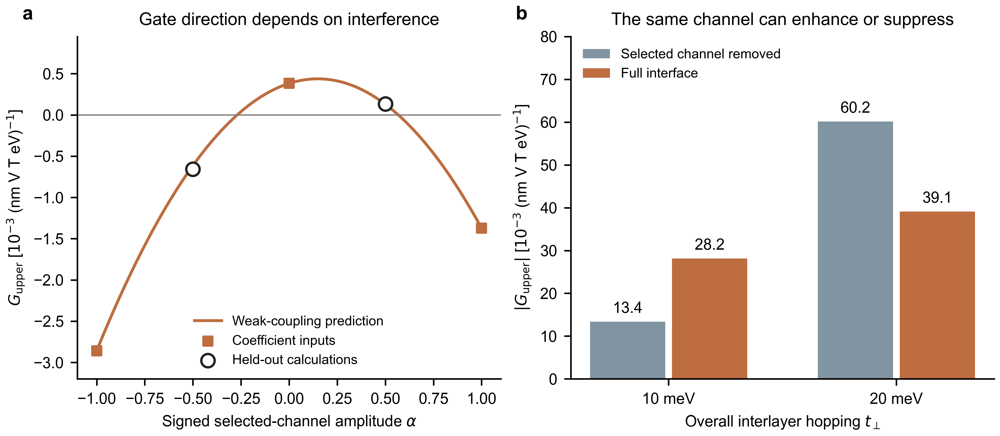

图：左为上层G随指定通道相对强度的变化，曲线来自事前写下的弱耦合展开，实心方点用于确定系数，空心圆是独立的±1/2验证；这些弱耦合测试点的上层C保持正。右为同一U下更强耦合的完整/删通道绝对电控对照，显示增强和抑制两类结果；右图没有使用左侧弱展开外推。

对材料与PRL主线：现在原八态模型提供了更简洁的组织思路——不同跨层响应路径可相互加强或抵消，并改变电场主要调控哪一层、增强还是削弱。MoSSe与InSe的对照可放入这一框架，但不能说已证明两种材料由本轮同一个交叉项支配。KM也未复现材料全部通道的局部C翻向规则。下一实质缺口是：材料中固定态组的相对矩阵元与路径交叉作用，是否能解释并预判增强/抑制；同时需把诊断控制联系到实际调控。普适能级判据、材料盲预测、实验读出和PRL新颖性仍未完成。

核查：全部71组参数/控制/精度记录保留、均有共同能隙，最小4.07 meV；旧完整模型C差异小于10⁻¹⁵，有限U斜率与旧解析导数相差小于1.7×10⁻⁷。投影通道的完整k导数、厄米性、全层间符号变换、层求和均核查。中间恢复路径可非单调，端点同号不代表全程无过零。归档results/mechanism/km-channel-control-20261110，包含事前计划、预测文件与来源哈希、所有数据、图和复算脚本。没有修改模型核心或启动日本任务；统一worklog与GitHub归档同步，提交用[skip ci]。

## 2026-11-10｜固定通道干预：MoSSe选层电控与层方向改写有共同来源，InSe给出反向对照

本轮复用已完成的MoSSe S/S A、InSe A在零场和±0.10 V/nm下的通道干预结果，没有新DFT、远端作业、材料或扩大模型。新增工作是统一比较绝对栅控斜率与各层自身的相对敏感性，并检查所有投影窗口，而不是只重述原有绝对信号。

主要干预：去掉“下层价态—上层空态”混合及其厄米共轭，保留原有各栅场自洽屏蔽势及其他块。占据/空态指零栅场下分开的层投影块，不是整片双层某一条瞬时能带。改动后没有重新自洽屏蔽，因此是条件性的材料Hamiltonian机制对照，不是已经可以在实验中单独关闭的一条通道。

| 体系与控制 | 零栅场下层C | 下层响应幅度变化 | 上层响应幅度变化 |
|---|---:|---:|---:|
| MoSSe，完整界面 | −6.193 | −0.184% | −4.811% |
| MoSSe，去掉上述通道 | +4.961 | −5.341% | −0.485% |
| InSe，完整界面 | −1053.124 | −0.135% | −0.215% |
| InSe，去掉上述通道 | −581.862 | +1.339% | +1.267% |

C单位10⁻⁹ (nm V T)⁻¹。百分数比较控制场从−0.10增至+0.10 V/nm时的幅度变化，除以该层两个端点的平均幅度；负号为削弱、正号为增强，不是相对零场或单层的增强。代表行为最大带窗口、frozen-8设置；不是材料精确预测。完整界面均下负上正；删通道后MoSSe变成下正上负、InSe仍下负上正。上述每一个控制内，栅场变化均未使层本身翻向。

物理判断：

- **MoSSe支持同一通道同时影响两件事：下层的响应方向，以及上层突出的电控敏感性。** 删除后下层恢复正响应，电控优势转到下层。六种投影设置中，上层相对敏感性减少89–95%，绝对斜率幅度也减少86–94%；因此不是仅仅改变归一化分母造成的假增强。上/下层相对敏感性比从19–26降至0.030–0.091。
- **InSe说明同类通道不是普适的电控放大器。** 删除后两层自身方向保持，但同一正向栅场由削弱两层变为增强两层；上层相对敏感性提高4.6–6.0倍、绝对斜率提高2.8–3.2倍。九种投影设置都支持这一方向，两个层变得同样容易调控。
- MoSSe同时删去两个方向的价态—空态混合，强上层选择性也消失；只删价态—价态及空态—空态混合则仍保留上层优势。恢复75%的VC混合时，下层尚未翻向，上层已承担84–95%的两层绝对电控变化，说明“翻向”不是选层电控的原因或必经阈值。
- InSe同时删两个方向后的相对敏感性趋势依赖投影窗口，不能拿其中一个代表值声称“所有VC混合都增强电控”。其方向通道对照更稳健。部分中间控制的C接近零，百分比会被放大，不能据此宣称实际高效率；所有原始控制及端点变号标志均已保留。

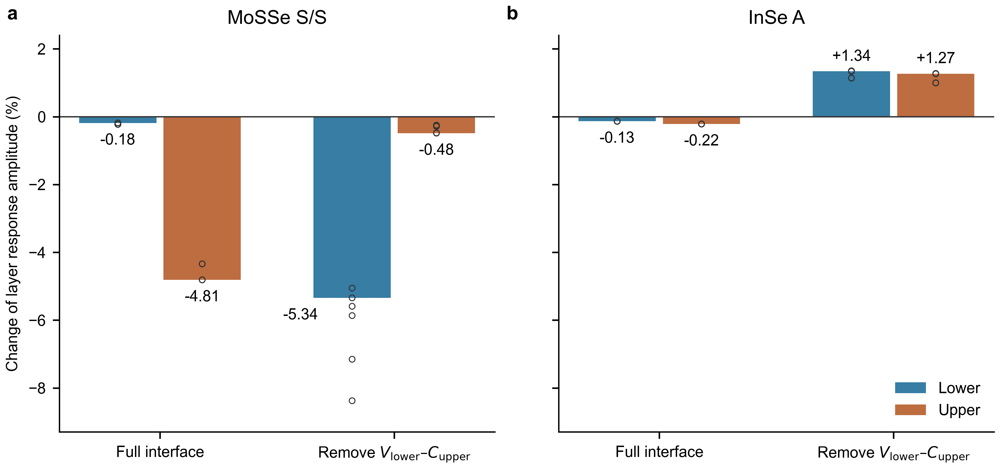

图：相同栅场区间下，两层响应幅度的有符号相对变化；正为增强、负为削弱。柱为代表窗口，空心点为全部六/九种投影设置，非统计独立样本。MoSSe删通道使上层电控优势转到下层；InSe则使两层从被削弱转为被增强。因删通道造成的基准C方向变化另列在表中，不能与栅场翻向混淆。

对PRL主线：可以保留更具体的候选认识——界面混合不仅改写每层承载的自旋响应，还改变电场主要调控哪一层、朝增强还是削弱的方向调控。MoSSe提供方向改写和选层电控的共同通道证据，InSe表明基准响应方向与电控方向不是同一件事。**这还不是从能级排列和矩阵元出发的普适预判条件。** KM应解释C与其栅控导数为何可独立改变；不能强迫它复现某个材料的通道规则。本轮也没有证明上轮不稳定的“能量项—矩阵元项相消”归因。

可靠性与边界：完整响应与上一轮独立内核核查相差小于1.3×10⁻⁹；层求和残差小于1.8×10⁻¹²。全部315个原场点、105组控制/窗口均保留，最小能隙MoSSe约0.795 eV、InSe约0.725 eV。沿用已有6×6网格和有限态空间；先前磁偶残差、InSe小净值的网格敏感性仍存在，不升级为定量收敛或实验验证。该结果是已有数据的回顾性机制检验，不是新盲预测。

归档：results/materials/layer-channel-sensitivity-20261110；含两个原档案的SHA256、全量表、对照图、可复算本地分析及检查。本轮只在Mac处理已有小型结果文件，没有新日本任务；模型核心、GitHub工作流及通知设置不变，归档提交用[skip ci]。

## 2026-11-10｜MoSSe / InSe同定义核查：层选择性保留，内部抵消归因尚未成立

本轮复用MoSSe S/S A和InSe A在−0.10、+0.10 V/nm下的独立自洽结果，固定结构与探测方向，没有新增DFT、材料、应变或模型。统一为与八态KM相同的平方能量分母响应核，纳入自洽屏蔽后的自旋与电场矩阵元变化。

先给可保留的物理：两种材料始终下负上正，正向增加栅场都削弱两层幅度。MoSSe上层承担约96%的两层绝对变化之和；InSe两层均参与变化。**比较各层自身的相对变化后，MoSSe下层并不比InSe下层特别迟钝；显著差别是MoSSe上层更容易被电场调节。**

| 从−0.10到+0.10 V/nm | 下层G | 上层G | 整片G | 下层幅度减少 | 上层幅度减少 |
|---|---:|---:|---:|---:|---:|
| MoSSe S/S A | +0.0570 | −1.4265 | −1.3695 | 约0.18% | 约4.8% |
| InSe A | +7.0862 | −11.3104 | −4.2242 | 约0.13% | 约0.22% |

G是上述两个自洽端点之间的C变化除以0.20 V/nm，单位10⁻⁹ (V² T)⁻¹；百分数以该层两个端点C的平均绝对值归一化，不是相对零场或孤立单层的增强。代表值采用现有最大带窗口及最小磁探测步长。原有带窗口对照中MoSSe分别约0.18–0.23%、4.3–4.8%，不把表中小数当成材料精确预测。本轮仍是已有6×6状态，InSe小净值的动量网格敏感性没有被消除。

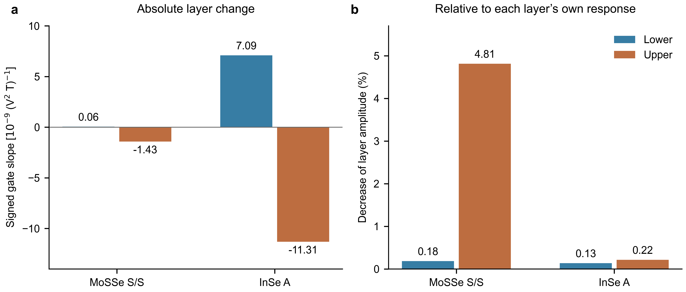

图：左侧为同一定义下的有符号栅控斜率，右侧为同一场区间中各层自身响应幅度的减少百分比。InSe绝对信号更大，不等于其相对电控更强；MoSSe的突出特征是上下层电控敏感度高度不对称。两种材料均没有在此区间发生同层翻向。

### 关键限制：不能把分项的大数相消直接当成物理机制

在每个磁探测场下，将自洽端点之间N/Δ²的变化按精确乘积恒等式拆为能量分母变化和矩阵元分子变化，再取B奇部分。完整响应与旧数据相差不足3.1×10⁻¹⁰，层求和与分项求和均满足数值一致性；但是两项自身不稳定。

具体而言，锚定零场能带对应方式下，缩小磁探测能量步长从0.002至0.0000625 eV，MoSSe下层“能量项”由+489.64变成−657.53，而完整G始终约+0.05701；InSe该项由−29.13变成−3565.90，完整G约+7.086。矩阵元项相应补偿。不同能带对应方式进一步改变分配。因此本轮没有建立分项的零磁场极限；这种相消不能作为巨大隐藏物理贡献的证据。

近简并能带、跨场对应及有限带空间都要求谨慎处理；本轮记录了这些诊断，但没有证明唯一根因。即使改成同一响应的单分母写法，分项也会重新分配。尤其材料电场顶角由Δr重建，其变化不等于纯粹的电子态混合。**结论是“本轮不能区分本来弱敏感与能量—矩阵元抵消”，而不是“已经证明不抵消”，也不是任何分解在原理上都不可能。**

### 对KM与PRL主线的意义

KM提供了“层内抵消能造成选层电控”的可控例子，尚不能宣布材料实现相同机制。继续保留候选链条：界面重塑层相关电子态→改变各层对栅场的敏感度分配→产生层选择性净自旋调控。已有固定分层子空间的通道干预支持界面作用；这一轮使需要解释的材料特征更明确：为什么MoSSe上层特别易于电控，而InSe两层较接近？不能只用两种材料绝对信号大小来回答。

下一项有判别力的验证（尚未自动追加）应使用现有固定层/轨道子空间及完整响应，检查同一个跨层通道干预能否同时消除方向改写和上层的相对电控增强，保留近简并态组而非强行追踪单条带。它比继续调整分项直到出现理想抵消更直接地检验因果链。普适判据、实验读出与PRL新颖性仍未完成。

数据：results/materials/material-gate-split-20261110，含事前计划、两轮全部54组诊断、原始输入校验值、162行层/净分解表、原结果对照、图和脚本。日本PBS作业563905、563910均在csuper004计算节点完成，退出码0，用时2分08秒和1分31秒；没有登录节点数值计算或新增VASP任务。模型核心和CI设置未改动；归档提交使用[skip ci]，不把跳过CI写成通过CI。

## 2026-11-10｜回到八态KM：层选择性来自每层内部不同程度的抵消

本轮按三个材料已有证据回查原八态KM，没有新增材料、DFT、应变或十二态拟合。目标是从零偏置能级、层归属和自旋/电场矩阵元预报初始栅控方向。保持既有1/4堆垛、45 meV亚晶格势、60°同向自旋/电场探测；U是上层减下层在位能差，不是以V/nm计的未屏蔽外场。

核心结果：能级移动会使两层都明显响应，但电子态混合导致的矩阵元变化在下层几乎将它抵消，上层只部分抵消。因此出现上层主导的电控。这个“每层内部的抵消”与“上下层之间抵消、形成小净值”是两个不同层次。

代表t=10 meV的细化结果，G=∂C/∂U，单位10⁻³ (nm V T eV)⁻¹：

| 初始电控的诊断项 | 下层 | 上层 |
|---|---:|---:|
| 跃迁能量变化 | +82.848 | −85.085 |
| 自旋/电场矩阵元变化 | −82.594 | +63.344 |
| 完整变化 | +0.254 | −21.741 |

下层原为负、上层为正，所以正U削弱两层幅度，上层占初始绝对变化之和约99%。这一分解是当前响应核的导数诊断，不是两个独立实验机制或静电/杂化贡献百分比；精确简并时不能随意按单条带分项。

预先保存零偏置预测后，独立计算t=10/15/20 meV、U=±0.25/±0.50 meV。所有层及净变化方向均预测正确，对称差分的斜率与解析预报相差不超过0.28%，共同能隙大于9.93 meV。小的下层斜率具有明显曲率，有限偏置单边线性外推相对误差最高148%，不宣称有限区间幅度准确。粗网格仅能量项的净符号不稳定，撤回“其稳健预测错误净方向”的初步推断；稳健结论是能量项单独不能解释层选择性。

增强耦合从10到20 meV使同一下层C由负转正，但G下始终为正；同层翻向不是选层电控的必要门槛。1/4构型的m001伙伴3/4独立验证还给出：同一正U由削弱两层变为增强两层，层自身方向保持。该现象与InSe定性一致；镜像关系属于已知张量对称性，不单独声称新颖性。

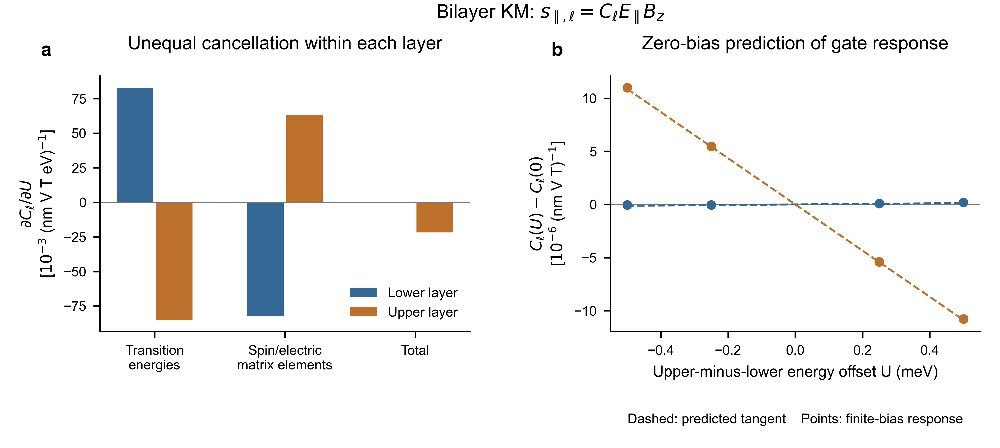

图：左为初始电控斜率的两部分及其总和，显示下层近抵消和上层未完全抵消；右为零偏置预报的切线与独立有限偏置响应变化。颜色表示上下层，扣除各自零场值不表示自旋过零。完整数据、非线性误差及原始控制均保留。

与材料的连接及边界：MoS₂的已有谱交换对照支持局部符号依赖电子态；MoSSe已有屏蔽通道干预使方向改写与强选层电控关联，而且选层先于翻向；InSe删去指定下层价态—上层空态混合可在C方向不变时翻转G方向。但三者尚未做本轮同一定义的能量/矩阵元栅控分解，不能把KM的近抵消机制直接宣布为材料的共同定律。瞬时本征态中的VV/CC/VC旋转也不等同于材料固定分层子空间的通道删除。

本轮得到的是从完整零偏置电子结构做局部预报的办法，还不是几个标量构成的普适判据。对PRL的更具体候选问题是：界面是否通过改变每层内部的带间抵消，选择电场主要调控哪一层？下一项最有判别力的材料验证应比较MoSSe弱变化的下层与InSe明显变化的两层，检验差别是否来自这种内部抵消；须包含既有自洽屏蔽态的场依赖矩阵元。本轮尚未执行此材料分解，不增加新材料掩盖缺口。

归档：results/mechanism/km-gate-predictor-20261110；本地project-x/outputs/km-gate-predictor-20261110。全部本轮运算在Mac，未提交日本作业。原八态模型和响应定义未改动。

## 2026-11-10｜InSe镜像伙伴：独立验证完成，栅控方向由堆垛选择

此前先验预测通过：保持同一正 ExBz 探测条件，+0.10 V/nm垂直控制场在堆垛A削弱两层相反的自旋响应，在水平m001伙伴B增强两层。两个堆垛始终下负上正，没有同层翻向；两者整片系数的变化却同为负。因而仅看整片栅场变化，不能判断局部自旋是在增强还是削弱。零场整片符号仍可不同，不能说所有净信号都无法区分堆垛。

下表为较密核查设置、同一正栅场相对各自零场的变化；单位10⁻⁹ (nm V T)⁻¹。

| 堆垛 | 下层响应绝对值变化 | 上层响应绝对值变化 | 整片系数变化 |
|---|---:|---:|---:|
| A | −0.631 | −0.843 | −0.211 |
| 水平镜像伙伴B | +1.078 | +0.873 | −0.205 |

五个新增独立自洽点全部完成；两种网格、三种保留态数、两种磁探测步长均保持该方向关系。所有检查点的探测能隙大于0.896 eV。层幅度变化约千分之一，不能叫巨大局部增强。抵消后净变化在加密核查中约减半；初始1.4–1.6倍净电控增益仍不是收敛结论，且没有同网格匹配单层，不推算新倍数。

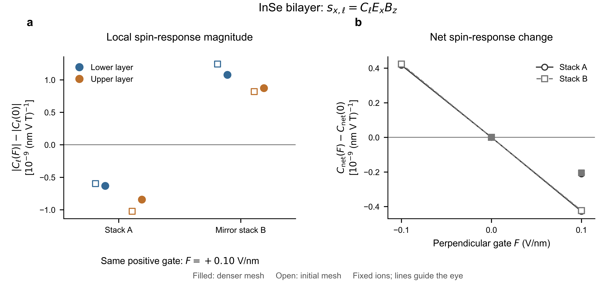

图：左为相同正栅场引起的各层幅度变化，正值增强、负值削弱。右为各自零场基线扣除后的整片变化，过原点不代表真实自旋翻向。实心/空心表示较密/初始核查；连线仅引导视线。图显示最高保留态数，全部其他核查在源数据中。这里是固定离子的自洽栅场准备态，随后采用既有冻结电势、自旋Zeeman探测定义；不是总轨道磁响应或结构切换模拟。

对PRL主线：InSe提供“局部自旋方向保持，电控增强/削弱方式随堆垛改变”的独立材料例子。与MoSSe/MoS₂共同支持界面改写层响应及其电控敏感性，但不支持所有材料共享单一VC通道或阈值。m001变换是既有张量对称性，不能单独承担新颖性。还需能解释并预判调控方向的微观条件及可信读出，不能仅靠增加材料数量或宣称净增益。

计算记录：560298、560314、560693均正常完成。560299在完整保存B08后主动终止，未完成Bp8保留并排除；560693由已完成B08重新独立算同一个Bp8，正常结束。未增加科学状态，未改动其他共享账号作业。所有日本端科学运算在PBS计算节点，无本任务剩余作业。小数据核查与绘图在Mac完成。

文献边界已明确：Ke等[PRL135,046201](https://doi.org/10.1103/jhlq-2dd7)的BN畴壁工作指出，理想C3畴内垂直场不给整层净横向力，局部破C3的畴壁可被驱动；Wang等[PRL137,126801](https://doi.org/10.1103/jq6y-y9ft)通过单轴应变破C3，使单畴也获得定向横向力，并同时改变势垒。后者的单轴应变不能与我们此前保C3的双轴应变等同。两篇正文及关键整页已核查，Directional的SM方法/应变控制部分可读，但后续访问受限；Domain-wall的SM本轮未取得，不用未读表格宣称InSe切换场。

物理上需分开：固定结构的电子电控、偏场导致的离子弛豫、堆垛畴比例改变。若整片系数为 $C_{\mathrm{eff}}=fC_A+(1-f)C_B$，电场调控还包含 $(C_A-C_B)df/dF$，并非都是局部电子响应改变。理想镜像伙伴零场有 $G_A=G_B$，因此固定畴比例的电子线性斜率相同；畴壁移动仍可产生额外净变化。实验应同步确认A/B畴是否改变，再分离小信号读出与写入脉冲；仅有滞回不能唯一证明滑移。

零横向力也不等于绝对不会切换：C3保证高对称点的一阶横向力为零，但不保证力常数始终为正，也不能排除热涨落、边界、缺陷或畴壁。现有±0.10 V/nm固定离子计算不能给出安全读出场或矫顽场。后续最小力学核查可先看小滑移处的回复力是否随读出偏场软化，再决定是否需要畴壁计算。本轮不自动扩展。

你的FQFE稿件在本机阅读，不将全文、图或具体数值另行上传。需区分层内子晶格重排与两片完整单层的相对滑移。分数极化按模极化量子理解，并不解除普通响应张量的点群限制：孤立D3h InSe在零栅场仍禁止当前的 $E_xB_z\to s_x$，但允许部分面内磁场的NMEE分量。实际坐标下允许的 $\Gamma_{ijk}$ 为xxy、xyx、yxx、yyy（i为自旋、j为E、k为B）；这与BPVE的空间对称变换有联系，因为两个轴矢量的det因子抵消，不意味着微观机制相同。FQFE可作为后续接口，本轮不另起算例。

路径：results/materials/inse-mirror-gate-20261109；本地project-x/outputs/inse-mirror-gate-20261109。含先验、五点独立结果、核查数据、图及文献边界。

## 2026-11-09｜InSe 同质双层：净电控增强不等于单层主导

本轮完成预定7个独立自洽点：匹配孤立层的零场和±0.10 V/nm，BiDB864双层A的零场和±0.10 V/nm，以及A的水平m001滑移伙伴B零场。单层parent862；A/B是相同朝向单层的平行错位堆垛，平移分别为(1/3,2/3)/(2/3,1/3)。仍固定数据库离子坐标，不做应变、弛豫或更大材料扫描。单层D3h、双层C3v；BiDB滑移稳定不等于独一基态、声子稳定或已证实有限铁电极化。

最值得保留的物理：界面不仅使原本禁止的层响应出现，也改变电场增强或削弱哪一层。InSe和MoSSe可以有接近的净电控增益，内部的层分配却完全不同。InSe为In s,p与Se p体系，为此前Mo d–硫族p体系提供了有用的轨道对照。

- 孤立层零栅场的Cxx数值为零，±栅场产生相反响应；A/B的层响应交换并反号，整片反号，符合事先给出的对称性预测。
- InSe正栅场使负的下层响应变得较不负，使正的上层响应变得较不正：两层幅值都减弱，上层减弱更多，整片因此更负。已算场强内两层自身及整片均未翻号。
- 计入自洽屏蔽后，净栅场敏感度为匹配孤立层之和的约1.4–1.6倍。上层只占两层绝对变化之和的61–62%，MoSSe则为95–96%。这里是两个相反的层变化部分抵消，不是两层变化同向叠加；后者是事前保留的一条条件性预测，本轮没有出现。

下表为初始6×6探索的代表结果；C单位10⁻⁹ (nm V T)⁻¹。C是ExBz诱导自旋的系数，F为独立的垂直控制场。数值较大的层响应强烈抵消，不能将其称为巨大净信号。

| 结构 | F（V/nm） | 下层C | 上层C | 整片C |
|---|---:|---:|---:|---:|
| InSe A | −0.10 | −1053.944 | +1052.993 | −0.951 |
| InSe A | 0 | −1053.124 | +1051.755 | −1.369 |
| InSe A | +0.10 | −1052.527 | +1050.731 | −1.796 |
| 镜像伙伴B | 0 | −1051.752 | +1053.130 | +1.379 |

定义G为两端栅场的C差除以0.20 V/nm。代表设置下，实际双层(G下,G上,G净)=(+7.09,−11.31,−4.22)，匹配孤立层对为(−1.31,−1.31,−2.63)，平滑静电参照约为(−1.19,−1.19,−2.38)。静电参照的两层C方向也与实际双层相反，因此所选静电参照不能解释实际层方向及电控分配。该参照不是唯一的静电/杂化可加分解。

机制检验修正了从MoSSe迁移的预想：去掉所选跨层价带—空态混合后，下层仍负；价—价、空—空混合对电控也重要，不能说同一条VC机制已经普适。更稳健的观察是，只去掉“下层价态—上层空态”方向的混合，9组表示选择中两层的G都反向，而两层C的方向保持。也就是某层自旋一直朝同一方向，电场却能由削弱它变为增强它。此为冻结原屏蔽势的材料模型干预，不能直接当作实验开关。删除全部VC后的下层G符号有窗口依赖，不能挑选其中一个表示宣称稳健翻向。

独立8×8零栅场自洽核查已完成：下层C=−1061.649，上层C=+1060.758，相对6×6各变化不足1%，方向保持；但小净值由−1.369变为−0.891，约变化35%。能隙仍约0.900 eV。因此层局部响应的方向和量级在本次核查中稳定，净信号更敏感；1.4–1.6倍只是6×6不同态数下的初步门控估计，不能当作网格收敛区间。没有追加8×8有限栅场计算。

Γ附近的重要性也保留：半径0.4ΓK内占8×8层C绝对被积权重约92%。Γ处价带顶75/76带的Se pz投影约74–77%，最低空态77/78带约53% In s、45% Se pz；低约0.63–0.69 eV的69/70及73/74带主要为Se px/py。这支持选择s,p体系作对照，但轨道投影不是NMEE因果分解，不能称一对带边已解释全部响应。全部预定自洽点及独立核查都保持绝缘；全空间响应保留全部占据态。

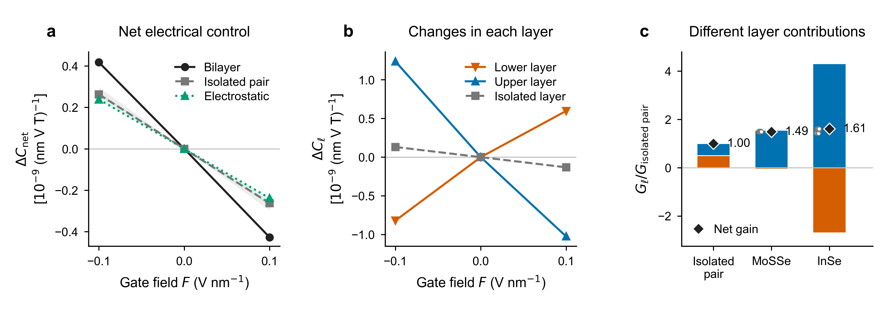

图：左，栅场引起的整片响应变化，相比匹配孤立层对及静电参照；中，两层各自的变化；右，各层G除以各材料匹配孤立层对的G，黑菱形为净增益。曲线画C(F)−C(0)，穿过原点不表示真实自旋翻向。右图基准G为负，正柱表示加强该方向的净变化，负柱表示抵消。阴影/空心点是不同截断设置，不是统计误差。图中增益仍是初步门控结果，未包含网格误差。完整图注和可编辑原图见仓库。

对PRL主线的意义：保留“界面同时改写层响应与层电控”，但不能把净增强、强选层或某一类混合的重要性互相等同。仍缺能预判实际材料层调控方向的条件，以及可实现的结构操作；不靠恢复十二态拟合来替代这个物理问题。

下一项可检验预测（尚未追加DFT）：自由双层的m001关系给出G下(B)=G上(A)、G上(B)=G下(A)，整片G相同。因此小正栅场应在A削弱两层相反的局部响应，在滑移伙伴B增强它们，而两个堆垛的整片栅场变化方向仍相同。它把局部调控与滑移联系起来；对称关系本身已有layer-tensor理论基础，不单独作新颖性声明。基底或不对称双栅可能破坏严格关系。

归档：仓库 studies/bsf-nmee-connection/results/materials/inse-nmee-20261109，含先验预测、7点原始记录、静电及通道对照、图与源数据；本地project-x/outputs/inse-nmee-20261109，远端/work/sunq/xjq/inse-nmee-20261109。所有VASP及远端数值处理在日本PBS计算节点，未在登录节点执行。560010/560116/560139/560207正常完成；560011完成A/B后主动终止刚启动的Am以避免时限，中断数据保留且未使用，Am已由560139独立完成。560208加密自洽核查及560244轨道诊断均正常完成，本轮无剩余运行作业；完整状态见jobs.json。

## 2026-11-09｜屏蔽条件下的共同通道检验，以及向新材料拓展

用户同意检验“跨层价带—空态混合是否同时改写层响应与增强层选择性电控”，并提醒不要把探索限制在 MoSSe/MoS₂。本轮复用已有零场与 ±0.10 V/nm 自洽数据，没有新增 DFT 或材料。在每个场强保留其原有屏蔽电势，连续削弱同一组跨层混合；这些人为对照不重新自洽屏蔽。

**结果支持共同电子来源，但不支持把同层翻向当成电控增强的必要门槛。** 去掉所选跨层价带—空态混合后，下层从负恢复为正，上层主导的栅场敏感性显著减弱。两件事是同一组混合参与产生的后果，不应写成“翻向引起电控增强”。

代表设置为112态、零场冻结8空态的d+p子空间。C单位为10⁻⁹ (nm V T)⁻¹；G为同一 ±0.10 V/nm 外场差分，单位10⁻⁹ (V² T)⁻¹。alpha是保留的所选杂化振幅比例，不是实验可独立调节的旋钮。

| 保留的跨层价带—空态混合 alpha | 零栅场下层 C | 下层 G | 上层 G | 整片 G |
|---|---:|---:|---:|---:|
| 0 | +12.383 | −0.410 | −0.399 | −0.809 |
| 0.50 | +6.110 | −0.202 | −0.785 | −0.987 |
| 0.75 | +0.702 | −0.082 | −1.078 | −1.160 |
| 1，实际双层 | −6.193 | +0.057 | −1.427 | −1.370 |

六组态数/投影选择下结论保持：去掉VC后下层C均为正（+9.08至+13.92），净敏感度绝对值降至0.734–0.834，低于匹配孤立层之和0.921；上层占两层绝对变化之和从95–96%降至43–64%。在alpha=0.75时，下层仍为正，上层却已占84–95%，说明无需追求同层翻向开关，也能有明显选层电控。

进一步区分两个方向后，“下层价态—上层空态”的混合值得重点保留：只去掉它，下层C在全部设置中恢复为正（+2.86至+5.00），栅场敏感性转为下层主导。只去掉价—价及空—空混合，下层仍负、上层仍主导。相反方向VC的同层符号依赖投影窗口，不作唯一符号定则；各通道不能加成响应贡献百分比。

物理含义：界面提供的跨层虚跃迁不仅改变“每层响应有多大、朝哪边”，也能改变“电场主要调节哪一层”。本轮将此前未屏蔽模型的线索推进到实际屏蔽参考上的共同通道证据。尚未由带组能级及有符号矩阵元独立预测另一材料的优势层，也未证明普适规律或实验读出；不能仅以本轮通道删除宣称PRL新颖性已完成。

方法与边界：在零栅场定义层/价态子空间，通过含PAW修正的同k波函数重叠映射至两个栅场的完整KS空间，保持同一物理通道，连同该通道的场依赖一致缩放；不只删除零场跃迁却放回其场依赖。最大子空间奇异值偏离1为1.50×10⁻⁴；全部126点保持绝缘，最小采样能隙约0.795 eV；原始双层结果逐值恢复，减半磁探测步长的C变化小于3.90×10⁻⁵。仍沿用6×6网格和有限KS态数。112态表示已有较大的B偶残差（内部chi归一化最大约0.073，96态小得多），原始参考中已存在；本轮采用对称B奇导数，不用chi(B)/B。两种态数下共同机制一致，不等于已经完成时间反演/空态精度的最终审计。无VC对照不等于孤立层或唯一静电参照，原屏蔽势冻结后也不代表一个新的自洽材料。

**后续探索不必等待MoSSe完全解释。** 允许由算例发现现象、再提炼机制，但接下来的材料应当能检验而不只是重复故事。建议小规模考虑：较强SOC的非Janus同质双层、改变两层能级匹配的异质双层，之后再考虑不同晶格/对称性。先看相同动量处的能级、轨道对称性和自旋矩阵元，再预报优势层；小能隙或type-II标签本身不保证强VC混合。成功、无增强、机制不同都保留，不按信号大小筛掉反例。

已有[MoSe₂/WS₂电场驱动type-I/type-II能带对齐转变实验](https://doi.org/10.1038/s41467-024-48321-1)支持这类能级调控可实现，可列入候选；其晶格失配/莫尔与应变近似需先评估，也可比较MoSe₂/WSe₂。该光学工作不是NMEE证据，本轮未启动这些新材料。具体候选需结合数据库结构和带组判断，不预先保证增强。

记录：日本PBS559934，csuper001，1分52秒，Exit_status=0；所有波函数处理与数值运算均在计算节点。未操作共享账号的其他作业。脚本、全部对照、先验计划与审计见[本轮归档](https://github.com/Xin-Jiaqi/quantum-geometry-reproductions/tree/research/bilayer-km-static-polarization/studies/bsf-nmee-connection/results/materials/mosse-screened-channels-20261109)。本地原始返回位于project-x/outputs/mosse-screened-channels-20261109，远端同名/work/sunq/xjq目录；大型波函数和许可证文件不入Git。

## 2026-11-09｜MoSSe S/S：计入栅场屏蔽后，约五成的相对电控增强与上层主导仍保留

固定同一零应变弛豫后的 S/S 双层，在物理外场 −0.10、+0.10 V/nm 下分别完成双层、匹配下层、匹配上层的独立自洽 DFT，共六个点。两个孤立层都使用双层的实际层内几何，上层不再由近似镜像代替。全部点保持绝缘，完整双层仍下负上正。没有弛豫离子、改变电子数或寻找同层翻向。

### 结果与物理图像

相同外场增量引起的净响应变化，完整双层比两个匹配孤立层之和大 48%–49%。同时，电控变化几乎集中于上层：上层的敏感度约为匹配孤立上层的三倍，下层变化很小且略微抵消上层变化。零场时两层响应接近抵消，并不意味着它们对栅场同样敏感。

下表给出对正负场的差分 $G=[C(+F)-C(-F)]/(2F)$，$F=0.10\,\mathrm{V/nm}$，单位 $10^{-9}(\mathrm{V^2\,T})^{-1}$。它衡量绝对响应变化，不以近零的净响应作分母。

| 自洽栅场对照 | 下层 G | 上层 G | 整片 G |
|---|---:|---:|---:|
| 完整双层，96 态 | +0.0785 | −1.4416 | −1.3631 |
| 完整双层，112 态 | +0.0570 | −1.4265 | −1.3695 |
| 两个匹配孤立层，各 64 态 | −0.4579 | −0.4628 | −0.9207 |

对正方向的物理栅场，上层的正响应明显减弱，下层的负响应基本保持、仅略微减弱，于是整片响应更快地向负方向移动。按两层变化的绝对值之和计，上层占约 95%–96%；不能把这个百分数误称为净有符号变化的占比。

必须分开“相对优势”和“绝对幅度”：计入屏蔽后，双层的电控敏感度从未屏蔽模型的约 15.7 降至 1.37，孤立层之和从约 11.9 降至 0.92。绝对电控幅度减小约一个数量级，但双层的相对优势保留。两层 Mo 附近平均静电势差对外场的变化约为裸线性电势的 15%，也支持明显屏蔽；该局部指标不是唯一的介电常数。

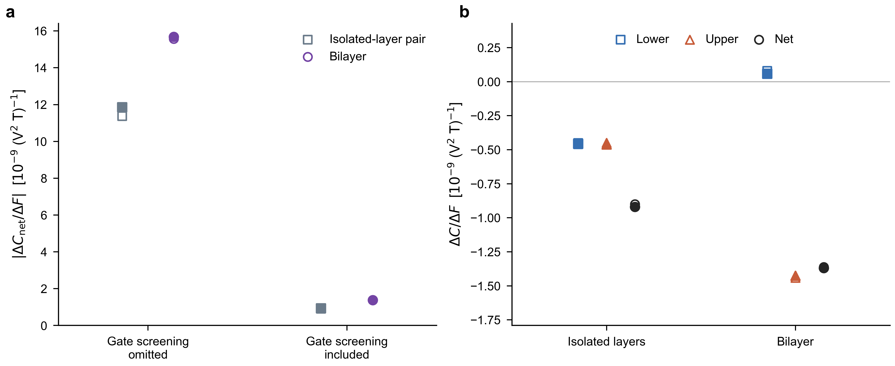

图｜(a) 栅场屏蔽前后，双层与孤立层之和的净响应敏感度。(b) 计入屏蔽后的有符号层响应敏感度：界面使上层对栅场更敏感，下层变化很小。两个面板均取 ±0.10 V/nm 的差分区间；模型横向对照用施加的单电子电势斜率，自洽 DFT 用实际外场。空心点与范围保留各态数设置，实心点对应最高态数，不是统计误差。原模型上层参照近似为下层镜像，本轮为实际上层；最高态数下，两种参照的斜率差仅占孤立层之和的约 0.53%，不足以解释增强。

### 对 PRL 主线的意义

本轮把“界面增强层选择性的电控响应”从未屏蔽模型推进到了独立自洽材料证据。值得保留的物理表述是：界面既改写每层的磁电响应，也使原本近似对称的层门控敏感度变得高度不对称，因此净响应更容易被电场调节。这比仅报告补偿过零更具体，也无需同层翻向开关才能成立。

约五成增益本身仍不足以宣称 PRL 新颖性已完成。本轮独立验证了现象，不能单凭双层／孤立层对照把自洽增益唯一归为杂化：各体系的屏蔽也不同。跨层价带—空态混合的机制证据来自上一轮控制，应与本轮的实际外场检验共同叙述。补偿点辨认堆垛畴的思路继续保留，但不能沿用未屏蔽模型的偏场标尺；本轮没有测到或外推确认新的补偿零点。

### 核查与归档

- 六个 SCF 均达到 EDIFF=1e-9；同一结构、原子位置和场正负号按实际提交输入核对。真空电势斜率独立验证了外场方向和幅度。VASP EFIELD 的符号与物理外场相反，取 `EFIELD=-F/10`。
- 最低探测带隙约 0.795 eV。双层 96/112 态、孤立层 48/56/64 态全部比较仍给出约 48%–52% 的增强；最高孤立层态数对应正文所述 48%–49%。磁探测步长减半造成的物理响应变化小于 2.02×10⁻⁵（C 的表中单位）。没有统计误差条或已完成最终网格收敛的声称。
- 这里是垂直栅场电子自洽；随后 $E_xB_z$ 的 NMEE 仍沿用既有固定势、纯自旋 Zeeman 的完整 KS 定义，不包含新的离子或磁探测场交换反馈。6×6 网格用于快速机制检验，不冒充最终器件精度。
- PBS 559806 在 csuper001 完成（32分39秒），559807 在 csuper003 完成（22分16秒），退出码均为 0。日本端输入准备、VASP、波函数导出与响应计算全部在计算节点，无本轮未完成任务。
- 完整数据、输入、代码、核查和可编辑图归档于仓库 `studies/bsf-nmee-connection/results/materials/mosse-gate-scf-20261109/`；本地原目录 `project-x/outputs/mosse-gate-scf-20261109`，远端 `/work/sunq/xjq/mosse-gate-scf-20261109`。正文此次未重写，没有新增材料、场强或应变任务。

## 2026-11-09｜MoSSe S/S：跨层混合使净 NMEE 的模型门控敏感度提高约三成

本轮只使用已有零应变、充分弛豫的 S/S 双层与匹配单层，完成材料模型检验，没有新增 DFT。这里“电控效率”指相同栅场变化引起的净响应绝对变化，即 $G=\partial C/\partial F$，不以接近抵消的零场净响应作分母。

### 结果与物理图像

界面不仅改变每层响应的方向，也改变哪一层对栅场更敏感。完整双层的净响应变化比独立层之和、平滑静电参照大约三成，其中上层承担约 78% 的门控变化。匹配独立层和静电参照则接近两层各占一半。所测范围内完整双层仍下负上正、保持绝缘，没有同层开关，也没有随栅场显著增强的尖锐共振。

下表是零场附近的导数，单位为 $10^{-9}(\mathrm{V^2\,T})^{-1}$。完整双层列出 96/112 态范围，独立层使用 64 态，静电参照列出 64 态的两种势截断，删除通道列出全部六种设置；这些范围表示设置敏感性，不是统计误差。响应仍定义为固定 $E_xB_z$ 下单位面积 Pauli 自旋的 $C_{xx}$。

| 对照 | 净响应对栅场的导数 | 下层 | 上层 |
|---|---:|---:|---:|
| 完整双层 | −15.56～−15.66 | −3.37～−3.36 | −12.19～−12.31 |
| 匹配孤立层之和 | −11.85 | −5.93 | −5.93 |
| 平滑静电参照之和 | −11.91～−11.98 | −5.95～−5.99 | −5.95～−5.99 |
| 移除所选跨层价带—空态混合 | −11.79～−12.78 | −5.73～−6.01 | −5.82～−7.05 |

为什么增强？栅场会改变两层的相对能级，进而改变跨层价带—空态的虚跃迁混合。将控制电势明确分成“刚性层间能级偏移”和剩余层内电势后，前者在完整材料中给出约 −5.22 的净响应导数；移除所选跨层价带—空态混合后，仅剩 −0.91～−1.33。剩余电势的响应仍约 −10～−12。因此，支持的图像是：界面混合增加了一条对层间能级对齐敏感的调控途径；不是全部门控都来自杂化，更不是必须增强裸层间跃迁才有效。这里分解的是外加电势的线性导数，不是声称微观机制具有唯一、可相加的百分比。

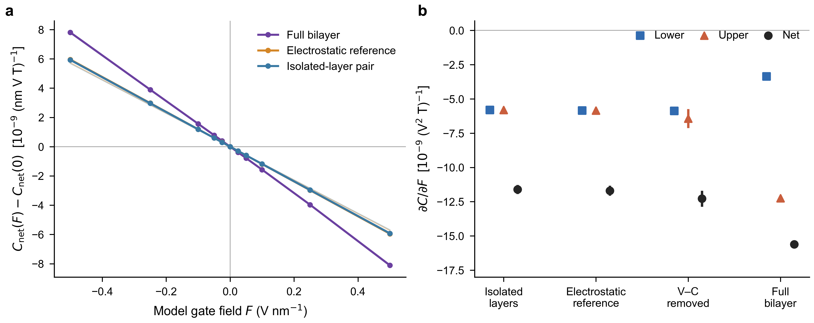

图｜(a) 净响应相对零控制场的变化；每个点来自计算，连线辅助阅读，细线表示其他已检验设置。(b) 下层、上层和整片的零场附近导数；标记和短线表示设置范围的中点与范围，不是统计误差。移除所选跨层价带—空态混合后，净响应增强与上层主导都减弱。横轴 F 是模型中的单电子电势斜率，并非已校准的实验栅压。

### 对 PRL 主线的意义与下一项判据

这把“界面改写每层响应”和“电场调节层间抵消”连接得更具体：界面重构还可增强对层间能级差的响应，从而提高净信号的门控敏感度。它比仅描述过零更有机制内容，但约三成的冻结势增益本身尚不足以确立 PRL 新颖性。

下一项值得讨论的独立验证是：在同一固定 S/S 结构下，选一对小幅正负偏场，连同匹配单层计入自洽屏蔽，判断相同实际外场下完整双层是否仍变化更大、且上层贡献主要变化。若屏蔽消除增益，就保留界面方向改写和层选择性的结论，不宣称提高了实验栅控效率。本轮没有自动提交该 DFT。

### 核查与可复用边界

- 所有参照都施加相同线性电势，保留单层内部的直接 Stark 作用。F_model 对应单电子势能 $+Fz$，未加入新栅场的自洽屏蔽；不能直接与旧 VASP EFIELD 正号或实验电压等同。
- 下层参照与双层层内结构完全一致；上层用下层的水平镜像，实际上下层层内坐标的最大镜像差为 0.000691 Å。没有冒充完成独立上层 DFT。静电参照分别提取上下层环境，属于明确但非唯一的平滑势近似。
- 407 个曲线点全部有效，最低带隙约 0.628 eV；响应对态数、所选态窗口、静电势截断和小场差分的变化不推翻上述趋势。核查不等于完成所有网格与器件收敛。固定零场的价带投影；H0 和栅场算符同时执行通道删除，避免栅场重新引入已删除通道。响应仍在完整 KS 空间计算。
- 两个日本 PBS 任务 559753 / 559757 均在 csuper001 计算节点完成、退出码 0，分别用时 3 分 19 秒 / 50 秒。没有在登陆节点做科学计算，没有新增 DFT。
- 数据、控制定义、原始 JSON/CSV、绘图源与可编辑图统一归档于仓库 `studies/bsf-nmee-connection/results/materials/mosse-gate-efficiency-20261109/`；本地原工作目录 `project-x/outputs/mosse-gate-efficiency-20261109`。正文此次不重写。

## 2026-11-08｜MoSSe S/S 双轴应变：压缩削弱负响应，小幅应变尚未使同一下层翻向

本轮只做同一个S/S堆垛的−2%、0、+2%三个独立零磁场DFT参考，固定受应变晶格、允许原子弛豫；各点都保留原C3v堆垛并保持正带隙。观察固定正 $E_xB_z$ 下的下层 $C_{xx}$，没有另加垂直控制场、扩材料或恢复十二态模型。

### 结果与物理图像

压缩2%使下层负响应约减半，拉伸2%没有使它更接近翻向；三个实际点都没有出现同层翻向。相同应变与层内坐标的孤立层、平滑静电参照却始终为正。因此，界面相对孤立层造成的方向改写在这三个条件下保留，但不能写成“已实现应变开关”。

下表单位为 $10^{-9}(\mathrm{nm\,V\,T})^{-1}$，对应单位面积Pauli自旋。完整双层列出96/112态范围，孤立层列出64态，静电参照列出全部已检验设置范围；范围是计算设置敏感性，不是统计误差。

| 双轴应变 | 双层下层 | 匹配孤立层 | 平滑静电参照 | 双层零磁场带隙（eV） |
|---|---:|---:|---:|---:|
| 压缩2% | −3.36 至 −2.91 | +19.68 | +20.11 至 +20.61 | 0.954 |
| 0 | −6.92 至 −6.19 | +11.43 | +11.90 至 +12.24 | 0.804 |
| 拉伸2% | −7.32 至 −6.37 | +5.31 | +5.99 至 +6.29 | 0.426 |

全过程上层保持正。96态的整片响应依次为−0.402、−0.275、−0.102：压缩虽削弱下层负响应，整片负值反而增大，因为上层正响应也变弱、两层抵消比例改变。这是层局部与整片信号必须分开的直接例子。三个离散点不能排除未采样位置的非单调变化，也不用于外推临界应变。

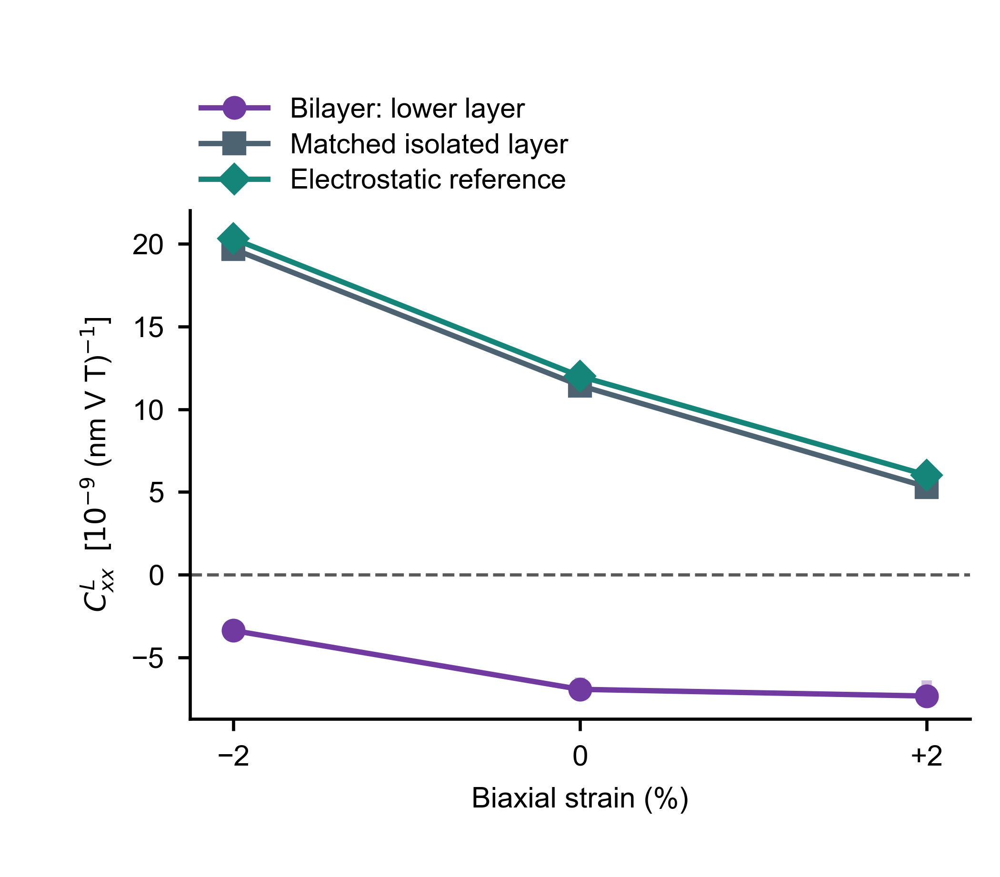

图｜同一层的应变响应取决于是否处于界面中。紫色为完整双层下层，灰色为从各弛豫双层取出、保留同一层内结构的孤立层，绿色为该结构的平滑屏蔽静电参照。点分别选96态双层、64态单层及64态/3.2 Å截断的静电参照；淡色竖线包括全部已检验设置，非统计误差。连线只引导视线。孤立单层始终取其整个单层的响应，不能把程序沿Mo平面生成的辅助分区误认成两个物理层。

### 为什么不能把应变理解成只改变杂化强弱

压缩后，匹配孤立层的正响应从+11.43增至+19.68；界面仍足以把它反向。与此同时，S/S间距从3.0003缩至2.9577 Å，所选跨层价带—空态混合块反而增强（96态/8空态窗口的范数1.368→1.454 eV）。所以“接触更紧、混合更强，就应有更大的负响应”不成立。相反方向的带间过程如何竞争，还取决于各层本身的电子态与跃迁能量。

可以把完整双层下层减去匹配孤立层，定义界面造成的总改变：零应变约−18.35，压缩后约−23.04。界面的总改变更负，但孤立层正响应的增加更大，最终完整下层反而向零靠近。这个差值包含全部界面效应，只是清楚定义的材料对照，不能被叫作唯一的“杂化贡献”，也不是把两种独立微观通道相加。

对三个应变点分别进行完整KS空间中的所选混合干预：只保留跨层价带—空态混合时下层都为负；去掉该块、保留价带—价带与空态—空态块时都为正。每点六种保留设置结论一致。例如96态/8空态窗口下，后两种控制在压缩、零应变、拉伸时分别为−3.56/−9.58/−14.59与+19.33/+12.13/+8.48。这里支持该跨带通道是稳定的充分反向途径；分区依赖所选子空间，不宣称已经找到了唯一、可加或普适必要的微观来源。

进一步的后验诊断仅用于零应变与压缩：保留未压缩电子态、换用压缩后的能谱，下层为+3.92；保留压缩电子态、换回原能谱，则为−14.24；真实两端为−6.92与−3.36。112态同样支持能谱变化与电子态重组相互抵消的解释。这不是简单的整体能隙缩放，也不能把两种虚拟控制相加。拉伸跨参考的能量序配对未通过简并兼容性检查，已拒绝用于归因，没有强行修配后宣布同一规律。各点下层占据电子数差小于0.0003，未见明显层间电荷转移。

### 对PRL主线、KM及下一步的含义

本轮支持的候选主线仍是：界面能够改写同一层的磁电响应方向，整片信号还受两层抵消控制。新证据是这种局域反向在三个独立弛豫的拉压条件下都存在，且单靠平滑静电环境不能重现其方向。本轮没有补上实际小幅应变驱动的同层开关，也没有给出可迁移的临界应变判据，不能据此宣布PRL新颖性已建立。

KM目前适合说明同层翻向与层间抵消是两件事，以及层间作用不能用孤立层相加代替；若用于预测真实应变，不能只改变 $t_\perp$ 而冻结层内电子结构。先不恢复十二态拟合、不扩应变范围。下一轮先讨论如何把已证实的界面方向改写与门控补偿凝练为主线，再决定是否值得验证联合调控；没有自动提交新的应变、偏场或材料任务。

### 预测、方法与执行审计

- 事先封存的几何模型只按键长缩放跨层跃迁，未标定层内变形势。它曾给出拉伸略微削弱负值的弱假说；在看到应变响应前，归一化审计已发现趋势主要来自平凡的晶格尺度因子，撤去了其可靠预测含义。实际DFT没有支持这一拉伸趋势。保留prior_prediction.json、prediction.json、prediction_metric_audit.json与原PLAN，不把后验压缩解释包装成预言命中。
- 实际采用PBE-D3零阻尼、SOC、450 eV、6×6网格、力标准0.01 eV/Å；应变相对原BiDB面内晶格常数3.250850 Å，不是重新求得的零应力晶格。三个零磁场KS参考独立自洽，NMEE沿用冻结势的静态自旋EB响应，尚非完整探测场自洽、精密网格或绝对幅值收敛的最终结果。96/112态均给出相同方向及压缩减弱趋势；相关响应分量的探测步长减半差异小于0.000056（表中单位）。
- 原计划z-only约束未被所用ASE导出器写入，三份实际弛豫POSCAR都是T T T，即所有离子坐标自由；记录已更正。实际最大面内漂移仅3.73×10⁻⁷ Å，三者均为C3v；各点最终最大力分量小于0.01 eV/Å。它们保留同一堆垛，不等于本轮已验证声子稳定性或应变实验可达性。
- 拉伸原作业558256在VASP弛豫成功后被过严的1e-8分数坐标程序检查中断。复用该收敛结构，改用1e-5 Å物理位移检查并独立核对对称性；没有放宽力标准或重算弛豫。接续558276、机制558277与完整能谱审计558278正常结束；0/压缩及对应对照也已完成。原失败、失效依赖、v1/v2程序与实际输入均保留。
- 日本侧DFT、导出和科学后处理全部在PBS计算节点；前端只用于传输、调度及已知文件的短读取。最终数据完整性、相同层内结构、对称性、正带隙、层加和与图像已核对。本地完成小文件汇总与绘图。

文献背景而非NMEE证据：[JACS 2020 Janus界面耦合实验](https://doi.org/10.1021/jacs.0c07051)支持界面力学耦合与电荷重排、层距、失配压缩相关；[JPCC 2020](https://doi.org/10.1021/acs.jpcc.0c01286)指出小幅应变能明显改变MoSSe能隙而固有势阶变化较小。二者均不是本轮自旋NMEE或翻向的实验验证。

数据、输入、完整机制控制、拒绝的能谱配对及图源统一存于仓库 results/materials/mosse-strain-20261108；本地对应 project-x/outputs/mosse-strain-20261108。未重写正文或周报，仍只维护正文与本worklog两个阅读入口。

## 2026-11-08｜周报、连续正文与两页组会汇报整理

本轮暂停科学探索，没有提交新计算或增加应变点。保留用户认可的KM叙述，在同一份正文中补齐真正零磁场的MoSSe机制控制、MoS₂界面静电/混合对照，以及压缩—补偿的最新结论。

- 正文图7a替换为96/112态零磁场材料参考，图8集中能谱—电子态与价带/空带混合控制；新增图9、10纳入既有MoS₂结果。原环境、读出和精度图顺延至11–13。
- 科学表述保留：同层自身反向与层间补偿不同；能隙变化不足以解释材料反向；跨占据—空态混合是稳健充分通道，不是唯一必要机制。静电参照与完整材料可有相似补偿趋势、相反层方向。
- 周报按插层/NMEE两部分组织，以无公式短文说明本周认识和下周候选。小幅双轴应变仍为待讨论假说，未当成计算结果。
- 本地组会文件第12页展示KM两种反转与响应定义，第13页展示MoSSe独立DFT及MoS₂材料模型。第11页仅纠正“引入耦合破缺对称性”的不准确归因；前10页插层内容保留。两页包含可编辑数据图及讲者备注。
- 新图源、逐点CSV和矢量图存于 docs/manuscript/sources-20261108；原始结果仍引用既有结果目录，不另建科学结果版本。正文与本worklog继续作为Obsidian两个阅读入口。

下一步先讨论能否把“可调控的层局部反向”凝练成主轴，再决定应变测试及实验后果；尚不宣称PRL新颖性、统一最小模型或可用实验读出已经完成。

## 2026-11-08｜MoS₂小幅压缩：补偿偏场向负方向移动，但该趋势不是杂化的独有指纹

本轮固定同一个平行3R MoS₂堆垛，只将原S/S间隔缩短0.10、0.20 Å，并比较垂直控制场0、−0.32、−0.50 V/nm。七个新零磁场自洽材料参考和一个静电对照作业全部完成，均在日本PBS计算节点运行；两个原层距端点复用前轮数据。没有扩材料或恢复十二态模型。

### 先说物理结论

计算前提出的定性预测得到支持：压缩使整片NMEE的补偿偏场向更负方向移动。这里“补偿偏场”专指上下层的 $C_{xx}$ 相加为零所需的垂直控制场，不是每层响应消失。

最直接的证据是固定 $F_z=-0.32\ \mathrm{V/nm}$：原层距的整片响应为正；缩短0.20 Å后为负。全过程已算点中，下层仍为负、上层仍为正，最小带隙约1.00 eV。因而这是压缩改变哪一层占优势，不是同一下层翻向，也不是金属化。0.10 Å压缩在该偏场已接近过零，小净值的符号随保留态数变化，不作确定正负的主张。

| 相对原结构压缩（Å） | 完整材料的补偿偏场估计（V/nm） | 平滑屏蔽静电参照（V/nm） |
|---:|---:|---:|
| 0 | −0.288 至 −0.262 | −0.211 至 −0.199 |
| 0.10 | −0.341 至 −0.305 | −0.276 至 −0.262 |
| 0.20 | −0.410 至 −0.370 | −0.357 至 −0.341 |

表中零点由实际异号偏场点之间插值得到，不是新增精算的临界点；范围展示不同材料截断/静电参照设置的敏感性，不是统计置信区间。三个偏场共同支持移动方向。此前从增加层距的数据外推的数值门槛并不精确，本轮验证的是方向及同一偏场下的净符号次序，不宣称已经建立无参数的准确临界条件。

### 为什么需要更负的电场

压缩后，两层相反的响应都变强；零偏场下，下层的负响应仍略占优势，而且这部分未被抵消的量增大。缩短0.20 Å时，零偏场净不平衡增加约45–57%，而从零场调到−0.50 V/nm所造成的净响应变化仅增加约3–11%。原来的偏场因此不够，需要更负偏场才能再次平衡两层。两层的方向和强度必须分开判断。

这可以用局部近似 $C_\Sigma(F_z,d)\simeq C_\Sigma(0,d)+\chi_g(d)F_z$ 理解，其零点约为 $F_c=-C_\Sigma(0,d)/\chi_g(d)$；这是对已有数据的简洁解释，不是新的普适微观公式。整个比较保持中性、绝缘及C3v几何对称性，不能解释为改变载流子数或新打破一个禁戒对称性。

### 静电对照给出的限制，比“预测命中”更重要

平滑屏蔽静电参照也重现了向负偏场移动，并同样在−0.32 V/nm下从原层距净正变成0.20 Å压缩后的净负。然而它的层局部方向与完整材料相反：所有已算静电参照均为下正、上负，完整材料则均为下负、上正。

| 在同一个−0.32 V/nm控制场比较 | 原层距净值 | 缩短0.20 Å后净值 | 下层／上层方向 |
|---|---|---|---|
| 完整材料模型 | 正 | 负 | 负／正 |
| 平滑屏蔽静电参照 | 正 | 负 | 正／负 |

因此，只测整片翻号或补偿偏场随压缩的移动，不足以辨认是否由显式跨层电子混合主导。这是完整材料与机制参照的比较，不能冒充已经发现两个真实材料状态具有相同的全部可观测量。此前“恢复所选层间混合能使同一层反向”的材料干预证据仍然保留；本轮说明的是，这一宏观调控趋势不是该机制的专属指纹。

静电参照的势来自每个实际结构和偏场的自洽离子+Hartree势，施加到孤立单层的完整KS参照中，不包含显式跨层电子态。它包含真实屏蔽，但原始势仍带有完整界面的电荷重排，不能称为彻底移除了所有杂化后果。它也未包含面内微观场、完整XC/非局域界面变化和额外的探测场自洽。因此不能把两种模型相减当作唯一的杂化贡献，更不能声称杂化在真实材料中不重要。

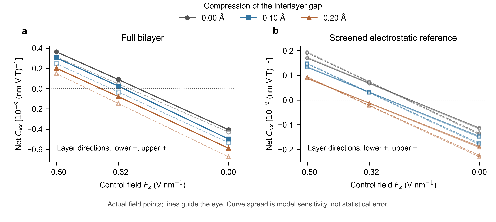

图｜相似的整片补偿趋势可以对应相反的层局部方向。(a) 完整MoS₂双层，实心实线与空心虚线分别保留96、112个KS态。(b) 平滑屏蔽静电参照，展示两种空间截断和四种态数设置的全部结果。横轴为垂直控制场，纵轴为整片 $C_{xx}$，单位 $10^{-9}(\mathrm{nm\,V\,T})^{-1}$，对应单位面积Pauli自旋；两面板纵轴范围不同。曲线只连接真实计算点，不代表已求得精确相边界。图中标出的层方向在所有采样点成立；线间差异是模型敏感性，不是统计误差。

### 对PRL候选主线的意义和边界

本轮增加了一条事先提出、随后得到支持的实际控制趋势：固定堆垛的微小面外压缩能调整磁电补偿偏场，在保持两层方向和绝缘态的同时改变净响应方向。但不能以“零点随压缩移动”作为杂化机制的新颖性证明。主线仍可围绕“界面改写每层响应，外场调节层间补偿”，其中微观归因应由层局部反向和此前的电子态/混合干预承担。若要建立实验辨认方案，必须有额外约束层局部响应或电子态混合的证据，并解决信号读出量级；本轮未建立可用的层分辨实验探针，也未证明已经达到PRL新颖性。

这不是已完成压力标定的预测。原S/S间隔为3.03829445 Å，两个压缩间隔为2.93829445、2.83829445 Å；固定层内结构和面内晶格，未求新的受压平衡结构、声子稳定性或GPa对应关系。当前6×6积分、96/112态响应仍非最终绝对幅值和零点收敛；门控势自洽，NMEE探测响应仍为冻结势的静态自旋材料模型，本轮没有新增独立自洽有限探测场核验。所有七个新点的磁场差分步长减半，分量变化不超过0.000033（图中单位）；输入哈希、刚性位移、控制场符号、层加和、正带隙及作业退出状态均已通过核查。

完整数据、实际零点括区、七组新输入、静电势参照及脚本在仓库 results/materials/mos2-compression-20261108；图源对应full_response.csv和electrostatic_response.csv。正文未重写，继续仅以正文和本worklog作为阅读入口。

## 2026-11-08｜MoS₂固定3R：门控改变优势层，尚未把同层翻向带到原层距附近

按本轮授权，固定原3R A堆垛、面内晶格和层内原子结构，仅改变层距与垂直控制场。没有扩材料、扫应变、做NEB或恢复十二态模型。先写下判别计划，再完成四个零磁场自洽参考及现有完整材料模型的NMEE响应；日本计算全部在PBS计算节点运行，四个作业均正常结束。本轮没有用层间跳跃缩放因子假装实际层距。

### 最重要的结果

在原层距以及增加0.15、0.30 Å的三个位置，−0.50 V/nm均未使下层翻向；下层保持负、上层保持正。原层距和增加0.30 Å处，电场都能使整片从负变正。这是上下层优势互换，不是同一下层方向改变。

观察量仍为 $\delta s_x^\ell=C_{xx}^\ell E_xB_z$，$F_z$是另加的垂直控制场。下表为同一96态材料响应计算，单位 $10^{-9}(\mathrm{nm\,V\,T})^{-1}$，对应单位面积Pauli自旋。它用于比较方向和趋势，不是已完成最终收敛的绝对系数。

| 层距增加 Δd（Å） | Fz（V/nm） | 下层 | 上层 | 整片 |
|---:|---:|---:|---:|---:|
| 0 | 0 | −5.091 | +4.685 | −0.406 |
| 0 | −0.50 | −4.998 | +5.362 | +0.364 |
| +0.15 | −0.50 | −3.435 | +3.835 | +0.401 |
| +0.30 | 0 | −2.526 | +2.310 | −0.216 |
| +0.30 | −0.50 | −2.382 | +2.820 | +0.438 |

1. 原层距下，负偏场只使下层绝对值减少约2%，主要增强上层。两种保留态数下，上层贡献了约88%的净响应变化。增加0.30 Å处，门控仍主要改变上层，对下层的改变约6%。
2. 固定−0.50 V/nm，把层距增加0.30 Å，下层负响应和上层正响应的绝对值都减弱约一半；它们的变化大部分互相抵消，整片改变远小于各层。这说明在本轮范围内，层距主要改变相反层响应的强度，门控主要改变哪一层占优势。不是宣称两个控制完全独立，或一个只影响静电、另一个只影响杂化。
3. 本轮没有找到可称为“近原层距同层翻向”的条件。不把未算的更强场外推成可行方案，也不声称已经排除所有现实控制。增加层距不等于施加正压力；尚未计算力—层距关系、结构松弛或畴壁运动。这里的原层距是BiDB参考结构，界面S/S间隔约3.038 Å，不是用本轮电子计算方法重新优化的平衡距离。

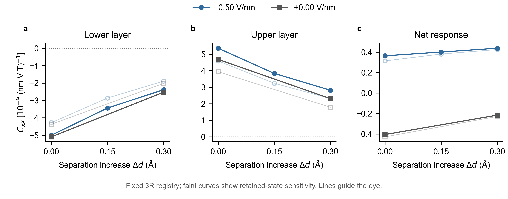

图｜固定3R-MoS₂中，门控改变净响应却没有造成下层翻向。(a–c) 下层、上层及整片的 $C_{xx}$ 随实际层距增量变化；灰色为零偏场，蓝色为−0.50 V/nm。实心点为96态计算，浅色空心点为112态核查，展示方法敏感性而非统计误差。连线只连接实际计算点，不是拟合或已确定的临界边界。原层距零场点复用前轮相同方法。该图的物理含义是：两层各自的响应和总响应必须分开判断。

### 本轮精度与可复用边界

所有五个参考点及所检验的微小Zeeman扰动均保持正带隙，当前网格最小约1.15 eV。96/112态均给出相同的层与净值符号；磁场差分步长减半，四个新点各分量变化不超过0.000027（上表单位）。幅值仍有明显保留态数敏感性，不能把小数位数当精度。本轮使用自洽垂直场的电子态，但探测电场/磁场响应仍为冻结势的完整KS材料模型，未新增独立自洽有限探测场验证；6×6积分也尚非最终收敛。没有定位精确的净响应零点或下层翻向临界层距。输入、结构、能隙、层加和、作业退出状态均已核查，四个计算的原始结果全部保留。

### 对五个物理问题的判断

- 十二态模型目前不必补。它尚未提供比完整材料结果更可靠、可迁移的翻向判据；继续压缩态数不应成为主问题。保留此前成功和失败的投影记录。
- 三种调控不能都归结为“调层间杂化”。垂直场首先改变屏蔽后的层内电势与层间能级差，也能改变电子混合；层距改变轨道重叠及界面电荷重排；堆垛改变跃迁路径，有时还改变对称性。它们也会通过结构松弛互相影响。最低阶场能含有 $-p_z(d,\tau)F_z$，所以垂直场可以改变层距方向和滑移方向的力。先固定结构厘清电子作用，再检查有价值的控制点能否保持该结构。
- KM可以精炼为两条概念洞见：同层反向与层间补偿不同；层间作用使响应不能由孤立层简单相加。材料中的具体通道归因由材料证据承担，不把KM与MoS₂/MoSSe尚不相同的主导通道写成已经统一的最小机制。重要反例保留在记录与后续SM。
- 不必为了材料名字新颖而扩材料。MoS₂/MoSSe已提供“单层禁戒/单层允许”的有意义对照。下一体系应当解决明确缺口，如更强信号、更低控制门槛或新的对称性约束。
- 对称性应当接入。已调用项目固定的group-theory-operations-toolkit v0.18.0，按“轴矢量自旋 ← 极矢量电场 × 轴矢量磁场”求约束，并计入层交换。D3h单层禁止当前通道；C3v的3R双层允许且每层满足 $C_{xx}=C_{yy}$、$C_{xy}=C_{yx}=0$，但不规定符号或上下层大小。反演/水平镜面若属于同一双层的层交换对称，可强制相反层响应抵消；若水平镜面联系的是不同堆垛A/B，则得到 $C_b^B(F_z)=-C_t^A(-F_z)$。后者不保证零点存在。均匀响应的分类宜先关注点操作是否交换层；许多层群共享同一宏观张量形式，不必先机械列满80层群。C2v允许x/y方向不同，可作为有具体物理问题时的后续推广。

### PRL候选主线与同行边界

现在可以保留“界面激活或改写每层的自旋磁电响应，外场再改变层间补偿”的候选主线。本轮支持后半部分，却没有实现最乐观的“垂直场把MoS₂同层翻向拉到原层距”预测；这个阴性结果应当保留。真正的主线增量仍应落在界面机制、可事先预测的控制条件和可信的实验读出，不靠更换材料名字或扩大模型维数补足。

实际门控可能改变堆垛：3R-MoS₂已有[电场推动畴壁和极化切换的实验](https://doi.org/10.1038/s41467-024-45709-x)；2H-MoS₂也有[电场调节轨道与振动层间耦合的实验](https://doi.org/10.1103/PhysRevMaterials.6.024002)。两者支持“控制手段会耦合”的判断，不是本轮NMEE或精确阈值的实验验证。

周攀等的[Electrically reversible layer-tensor responses in bilayers](https://doi.org/10.1103/2zmv-g9md)已于2026-11-05发表为PRB 114, 295402。本轮核对出版方摘要，确认其一般层张量门控框架；不能把“电场选择优势层”的一般对称性论证作为我们的独有新颖性。这不排除我们研究NMEE及其界面微观机制。当前3R A自身没有交换层的水平镜面，不能直接套用同一结构 $C(F_z)=-C(-F_z)$；正确关系联系A/B两个堆垛。这里没有声称本轮重读了该文全文/SM。

完整数据、30个图源值、群论约束、输入与四个作业终态在仓库 results/materials/mos2-gate-spacing-20261108，本地对应 project-x/outputs/mos2-gate-spacing-20261108。当前正文未重写，仍只维护正文与本worklog两个阅读入口。

## 2026-11-08｜固定3R-MoS₂：静电能激活响应，跨层混合改变其方向

本轮固定BiDB 1930的平行3R堆垛与1929单层参照；未改变层距/堆垛、未扩材料、未恢复十二态模型。完成零场自洽参考、完整材料响应、所选跨层混合干预、静电嵌入与已有单层外场的校准。所有日本DFT与科学后处理均在PBS计算节点；九个本轮作业全部正常结束。

### 本轮最重要的物理

界面静电势与跨层电子混合都能改变响应，但不能简单二选一。对当前MoS₂下层，平滑静电环境单独产生正响应，完整界面却给出负响应。固定其余界面作用、恢复所选Mo d/S p跨层混合，六种材料窗口均使同一下层从正变负。这里的“翻向”是固定几何的材料模型干预结果，尚不是本轮新实现的实验调控路径。

观察量仍为 $\delta s_x^\ell=C_{xx}^\ell E_xB_z$；下表单位 $10^{-9}(\mathrm{nm\,V\,T})^{-1}$，是单位面积Pauli自旋。范围表示不同窗口/嵌入方式的敏感性，不是统计误差。

| 控制对象 | 下层/整张孤立层的 $C_{xx}$ | 能说明什么 |
|---|---:|---|
| 孤立MoS₂单层 | 约0 | 水平镜面禁止这个整层分量 |
| 对孤立层施加独立提取的平滑界面静电势 | +0.356至+0.513 | 静电本身能激活，但方向与完整界面相反 |
| 保留界面其余作用，移除所选d+p跨层Hamiltonian块 | +0.794至+4.171 | 弱化该混合后下层方向改变；此项不等于“纯静电双层” |
| 恢复完整界面混合 | −5.091至−4.368 | 六种窗口均恢复负方向 |
| 此前独立自洽DFT，同6×6网格、较小探测场 | −5.212 | 材料模型保留DFT方向；不把两种计算的幅值混合拟合 |

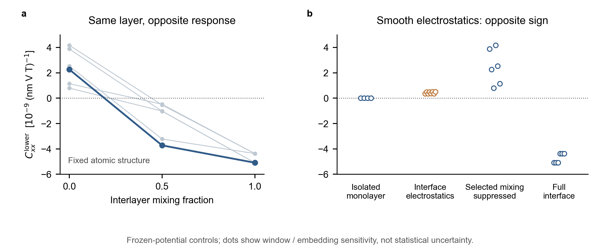

图｜固定3R-MoS₂的下层NMEE机制对照。(a) 将所选d+p跨层混合从0恢复至实际值，全部六种材料窗口均出现正到负的变化；深色为96态、冻结8条额外空带构造干预的代表，响应仍在完整96态空间计算。线只连接三个已算点。(b) 孤立层、平滑静电嵌入、抑制所选混合、完整界面的对照；展示所有相关窗口/空间截断值。前两列使用整张孤立层，后两列使用实际双层的下半空间。灰线/散点差异不是实验误差，第三列不是严格解耦极限。图用于机制与方向，绝对幅值尚未充分收敛。

### 与MoSSe共同的电子机制，以及仍不相同的部分

1. 只把弱混合状态的跃迁能量换成完整界面的谱，下层仍为正；保留完整界面电子态、换回弱混合的谱，下层仍为负。六种窗口的符号均跟随电子态。因而仅用能隙缩小不能解释本轮反向，关键是参与带间自旋响应的电子态被重新组织。
2. 只恢复跨层价带—导带（已占据态—空态）混合，六种窗口均给出负响应，范围−13.04至−11.76；只恢复价带—价带混合则都为正。这与此前MoSSe中识别的反向通道相呼应。这里是基态波函数中的虚混合，不是光吸收产生真实导带载流子。
3. 必须保留的反例：MoS₂的导带—导带及合并同类带控制在部分窗口也能反向；它们不如价带—导带通道稳定。因此后者是稳健的充分反向通道，不能称唯一或必需机制。各通道响应也不能简单相加。去混合后整片净值的符号依赖窗口，不能把稳健的下层结论扩大为整片结论。
4. 两种材料的起点不同：普通MoS₂单层这个分量为零，Janus MoSSe本来就非零；界面都可以重排带间自旋响应并改变层的方向。现有八态KM支持界面引起同层反向及层间补偿的概念图像，但此前通道核查已表明其VC通道不是相同的反向主因。本轮未重算KM，不以换符号约定消除这个差别，也不宣称三个体系已有同一最小微观模型。

### 静电对照有多可信

静电势从独立自洽计算的离子+Hartree势提取，并非由NMEE反推一个等效场。保留面内平均，隔离单层后施加；两个空间截断、40/48/56/64空态截断均保留其正方向。它未包含面内微观场、完整XC及非局域界面变化，不能据此给出“静电占百分之几”的结论。

为检查这套嵌入的物理量级，又独立计算了已有的单层+0.25 V/nm控制点的零磁场自洽势，没有新增偏场扫描。实际真空势斜率为+0.24996 V/nm，层内线性拟合仅+0.01189 V/nm，说明屏蔽很明显。把该自洽势施加回零场单层，整层响应为−0.113至−0.118，与此前自洽DFT的−0.140方向一致、量级接近；空间截断版本为−0.077至−0.093。未屏蔽均匀场模型约−1.1的结果不能直接和自洽DFT比较。此校准支持静电对照的定性解释，同时要求保留幅值限制。

真正零场材料参考中仍有数值B偶残差，112态与96态幅值也未完全相等。中心磁场导数步长0.001/0.002/0.008 eV保持完整界面下层符号与幅值近似不变；单层禁戒分量在40/48/56态截断下接近零，64态约−0.002。全部材料干预保持绝缘。上述证据用于判断方向和机制，不当作最终精确系数。

### 对PRL候选主线的意义

主张可以从“界面让两层不再完全抵消”推进为：“界面重新组织每一层产生自旋的带间过程；它能在普通单层禁戒的通道中激活响应，也能使原有层响应反向。”MoS₂和MoSSe现在有共同的材料机制证据；KM目前承担概念模型的角色。

这仍不是PRL新颖性已经成立。静电与混合的竞争不能只停在人为删除Hamiltonian块的测试上，下一轮讨论应聚焦：能否针对已有堆垛、偏场或层距提出一个事先可检验的方向预测，并说明实际读出。补偿点辨畴保留，但不以很小的净自旋信号冒充已可实施器件。尚不启动新的材料/模型扩张。

原始结果、全部反例、输入、图源与作业状态归档在仓库 `results/materials/mos2-interface-20261108`；本地对应 `project-x/outputs/mos2-interface-20261108`。图的42个源数据点在 `figure_source.csv`；完整通道在 `mechanism_followup.json`，静电校准在 `gate_embedding.json`。相关PRX的K点带偏移研究提供了区分静电势和不对称混合的背景，但不证明NMEE只由K点带边主导，见本轮归档的文献核查记录。

## 2026-11-07｜普通3R-MoS₂：界面激活单层禁戒分量，偏场改变层间抵消

本轮暂停十二态模型，按用户授权选择普通非Janus的3R-MoS₂。它与MoSSe共用Mo–S骨架，便于区分孤立层已有响应与界面新增响应。使用既有BiDB结构，未做NEB或新结构优化：单层1929；双层A为1930，平行堆垛 $O=E$、相对位移 $(1/3,2/3)$；B是A的水平 $m_{001}$ 镜像伙伴，移回共同下层原点后为 $(2/3,1/3)$。单层为D3h，A/B各自为C3v。1930标为滑移稳定、为数据库所采样MoS₂双层中结合最强者；与2H微小能量差不作为严格全局基态证明。B继承自由、上下对称环境中的镜像稳定性。

### 得到了什么物理对照

本轮始终测同一分量 $\delta s_x^\ell=C_{xx}^\ell E_xB_z$，上下层按空间中面划分，$s$为单位面积Pauli自旋。另加的垂直场 $F_z$ 是控制量，不是探测场。下表单位均为 $10^{-9}(\mathrm{nm\,V\,T})^{-1}$；数值来自同一初步计算精度，暂不当作最终幅值。

| 材料与控制 | 下层 | 上层 | 整片/整层 |
|---|---:|---:|---:|
| 孤立MoS₂，零偏场 | — | — | −0.000084，约为零 |
| 3R A，零偏场 | −4.561 | +4.018 | −0.543 |
| 镜像3R B，零偏场 | −4.037 | +4.580 | +0.542 |
| 3R A，−0.25 V/nm | −4.503 | +4.379 | −0.124 |
| 3R A，+0.25 V/nm | −4.630 | +3.668 | −0.963 |
| 孤立MoS₂，−0.25 V/nm | — | — | +0.1393 |
| 孤立MoS₂，+0.25 V/nm | — | — | −0.1396 |

1. 孤立单层的水平镜面对称性禁止这个整层分量；形成3R界面后，计算得到下负上正、未完全抵消的响应。它提供普通非Janus材料中“零→非零”的对照，与MoSSe“原有响应被界面改变甚至反向”互补。并非所有单层NMEE分量都为零。
2. A/B的净信号反号，但两者均下负上正：镜像交换上下层，同时反转面内自旋，改变了哪一层占优势。独立计算的净镜像残差约0.00051，层镜像残差约0.42%。不能将它描述为同一化学层自身已经翻向。
3. 在三个已算偏场点（−0.25、0、+0.25 V/nm），偏场主要改变上层的响应大小，上下层各自都没有翻向，净响应也未翻号。负偏场接近抵消不等于已经证明补偿点；不从三个点外推一个精确开关场。

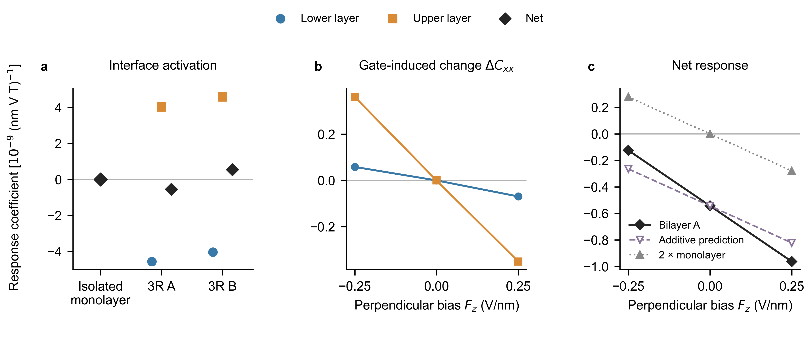

图｜普通3R-MoS₂的初步静态NMEE对照。(a) 零偏场孤立单层及镜像伙伴A/B的 $C_{xx}$；单层仅标整层值。(b) A中上下层相对零偏场的变化 $\Delta C_{xx}$，不是绝对响应。(c) A的净响应、预先封存的独立层增量预测，以及两张孤立单层响应之和。全部七个主比较点均展示；连线只连接离散点。较小探测场与更密网格的核查另列，不混入偏场曲线。正号表示正 $E_xB_z$ 下的 $+x$ Pauli自旋，不表示全部自旋矢量方向已测得。

### 一个预先预测，以及它为何没有完全成立

在双层偏场结果取得前，于19:50封存并推送预测（commit 94de333、gate_prediction.json）：若界面部分不随偏场改变，每层只增加孤立单层的响应增量，则A在+0.25、−0.25 V/nm的净值分别应为−0.822、−0.264。实际为−0.963、−0.124；两侧的净变化均约为该预测的1.50倍。这个双侧一致的偏离说明，简单独立层相加尚不能描述双层门控，界面的响应也随偏场改变。此比例仍需精度核查，不能直接称作唯一的层间杂化增强因子。

真实垂直电场不等于把每一整层的能级刚性平移：它在孤立MoS₂内部也打破水平镜面对称性并产生响应。反之，完全解耦、占据保持不变的绝缘层，只加一个单位矩阵势移，不改变内部能量差与本征态。因此后续KM—材料联系应明确区分层能级差、层内Stark变形与层间混合，不能把真实门控全部归于一个刚性层势差参数。

### 对PRL主线与下一步的意义

MoS₂给出更干净的界面激活参照，尚未给出同层反向的新材料实例。它支持保留“界面重新塑造每一层的磁电响应、外场再控制抵消”的候选叙述，但没有唯一识别杂化机制。LEE已经包含电流诱导层自旋及外场激活的情形；更一般的layer-tensor框架也已讨论层交换控制。我们目前的绝缘态 $EB$ 响应与之不同，更换响应类型本身不是PRL新颖性的充分依据。[LEE](https://arxiv.org/html/2607.17209v1)、[layer-tensor](https://arxiv.org/html/2610.34067v1)。

下一项物理判别宜固定MoS₂堆垛，区分界面静电造成的单层态改变与跨层电子混合：只有削弱层间混合、同时保留同一层内参照后仍可判断响应如何变化，才能把“界面激活”进一步缩小为可预测机制。不先扩材料、十二态或大范围偏场。A自身没有水平镜面对称性，只有 $C_B(F)=-C_A(-F)$；这不保证A的曲线关于零偏场反对称，也不保证实用场范围内一定有零点。

### 可信范围、资源与复用

- 两个探测场同时减半，A净值从−0.54299变为−0.54481，约0.34%；下层−5.212、上层+4.667，幅值有14%–16%变化。相同小探测场下，9×9独立计算给出下层−6.270、上层+5.686、净值−0.58446：符号全部保留，净值再改变7.28%，层幅值再改变20%–22%。可以保留定性线索，不能宣称幅值收敛；偏场点尚未在更密网格重算，1.50倍增量与补偿场均不是精确预测。本轮在这一步收束，不继续加精度扫描。
- 线性 $E_xB_z\to s_z$ 是三重旋转禁止的分量；小探测场下，提取残差从6×6的3.414降至9×9的0.100，减小约97%，但尚未归零。不把它当成新效应，不宣称完整张量已经验证。PEAD日志还包含Berry相位串分布警告，其对最终精度的影响尚未单独排除；当前数据用于定性筛查。
- 单层同一张薄层内部两个半空间约+222.10、−222.10，属于空间补偿，不是两张材料层。把两个孤立层的响应分布刚性移到双层位置，相同中面划分仅由尾部可得到约+2.04/−2.04，方向与实际A相反、净值仍近零。因此需公开空间划分；这个分布对照不是自洽解耦Hamiltonian，也不把每个半空间贡献当成独立可测机制。
- 净系数约 $5\times10^{-10}(\mathrm{nm\,V\,T})^{-1}$，绝不能仅凭图中符号清楚便声称实验信号强。此处是中性绝缘体、固定离子、spin-only Zeeman静态响应，未包含轨道磁场、载流子输运或探测器模型。
- 全部VASP与密度后处理均在日本PBS计算节点。单层548482、负偏场548487、单层偏场548488/548489正常退出；A/B初作业548484/548485在正B两个Ex点收敛后按计划停止，由548511/548515收集。正偏场548486超时、未完成密度排除；548534仅重做未完成点并正常退出，548537完成汇总。独立核查548536在csuper005正常退出，耗时1小时34分20秒；最终分析548538在csuper001正常退出，14秒。本轮所列计算均已结束，没有新增任务。原时限延长申请被调度器拒绝，没有绕过；失败与恢复记录均保留。
- 有限PEAD空带EIGENVAL的10000 eV是占位值，原记录已保留，正式记录仅报告普通对角化B参照的能隙。此修正不改变自旋密度。只有零偏场单层保留独立正负B核查，其余使用非磁时间反演关系；未测B偶残差记null。
- 物理门控方向采用VASP EFIELD=−Fz/10。旧MoSSe部分数据用原生力场方向，比较偏场正负前须统一。探测步长不是实验推荐场强。
- 结构、全部结果、原始与更正记录、封存预测、作图脚本及作业谱系统一归档于 `studies/bsf-nmee-connection/results/materials/mos2-3r-20261107`；原始大文件留在授权计算资源，不上传POTCAR或凭据。

## 2026-11-07｜材料检验收紧十二态解释：必须保留正确的电场跃迁连接

本轮没有把材料最小模型缺口全部补上。重要进展是查明：上一轮十二态KM例子证明了一种可能机制，但不能直接视为MoSSe的无拟合最小模型。真实材料中，按零场层间混合强弱挑出的十二个态不足以保留NMEE；电场连接这些态与其余态的方式，是一个更稳健的缺口。以下为现有零场数据上的诊断，不是新增DFT或真实实验操作。

### 没有根据响应符号挑选模型

每层保留顶部两条价带、最低两条导带，以及另外六条空态中与邻层顶部价带耦合的两个组合。第一种选择按耦合矩阵的奇异向量，精确保留该直接层间耦合；第二种预先规定的选择再考虑虚混合的能量分母。两者均不使用响应值。Hamiltonian、自旋读出、Zeeman矩阵和Bloch重叠中的电场连接均从同一材料参考投影，不拟合KM参数或MoSSe的符号。

所选高空态是Mo d–S/Se p混合态；主窗口中含较多Mo dxz/dyz成分。但其轨道成分是全BZ平均，不是NMEE贡献权重，不能据此宣称某一个原子轨道独占机制。

### 通道驱动反向，与十二态足以计算响应，是两件不同的事

主窗口96态参考，下层C单位10⁻⁹ (nm V T)⁻¹：

| 对照 | 关闭所选层间混合 | 原强度 |
|---|---:|---:|
| 完整材料空间 | +13.498 | −6.602 |
| 所选态的层间通道保留，其余材料电子态仍在 | +13.498 | −30.460 |
| 直接删减成十二态 | +23.368 | +28.394 |

第二行再去掉顶部价带—所选高空态的层间耦合，会恢复+2.532。因此，所选通道确实能驱动材料反向；第三行却说明，保留这些通道不等于保留了完整响应。两种选态方式和三种轨道窗口均得到这个区别。

把被删去部分只当一个不变背景也不成立：由弱端独立确定背景后，十二态模型对强端预测+18.524，仍与材料−6.602相反。不能用一个常数背景修补这个模型。

真实材料中，高空态到低空态/到顶部价带的耦合均方范数比约0.61–0.76，且高空态之间也有不可忽略的层间耦合。与之相比，原toy在ρ=0.1时，同类统一BZ范数比约0.017–0.019。两者结构不相同；这些范数不是响应贡献，也不等于toy的ρ，更不能单靠它们预测符号。因此，上轮“空态偏向价带”的假设尚未变成真实材料的判据。

### 不能用继续加带来掩盖问题

逐级补深价带没有得到稳定、单调的恢复。保留顶部价带、恢复全部d+p空态后，二十态版本在主窗口确实从+21.456变为−7.234；但另一个窗口的强端仍为+3.618或+5.303。三种十二态、三种十六态的预定高空态能量组选择也没有重现反向。不能挑主窗口的二十态结果，声称已经完成材料验证。

这里修正的是“哪些态可以删掉”的判断，不是否定此前完整材料的反向。前一轮关掉较深价带的层间混合，仍然保留了那些电子态及其外场响应；它并没有证明这些态可以从模型中直接删除。同样，直接层间耦合很弱的空态，也可能经其他态或外场矩阵元进入响应。

### 在完整材料中，电场连接给出了稳健的物理线索

这次保留全部96/112态，只固定零磁场的已选空间P与其余空间Q，分别关闭二者之间的Hamiltonian、Zeeman、自旋读出或电场连接。原模型、算符及零场投影的定义保持统一；没有把场依赖的子空间变化偷偷混入分组。

| 人为诊断：关闭P与Q之间的连接 | 主窗口下层C | 六种窗口/态数的符号情况 |
|---|---:|---|
| 什么也不关：完整参考 | −6.602 | 均为负 |
| 仅零磁场Hamiltonian连接 | −14.006 | 均为负 |
| 仅电场跃迁连接 | +94.224 | 均为正 |
| 仅Zeeman连接 | +23.829 | 随窗口变化，不能作统一判据 |
| 仅自旋读出连接 | −28.237 | 均为负 |

最稳健的结论是：保留主要层间混合，却丢失它与其余电子态之间的电场跃迁连接，会丢掉反向所需的物理。当前问题不只是空态能级放在哪，而是外场通过哪些态间连接产生自旋响应。

电场控制通过Bloch重叠连接的P↔Q部分实现，仍用同一协变差分求响应。这是改变电场顶点的人为诊断，不是规范变换，更不是已经找到一个实验旋钮可只关闭该连接。完整空间的Q还包含占据态和空态，不能把本表升级为某一个高空轨道或唯一三带路径的定量归因。保留二十态、只把其余高空态补回时也观察到相同方向的电场连接效应，但该缩减模型本身窗口稳定性不足，主结论以前述完整空间检验为准。

### 对简洁模型与PRL主线的意义

十二态KM模型目前的正确角色是存在性例子：它说明跨带混合可以改变同层响应。尚不能把它的ρ条件或平方根阈值规律直接应用到MoSSe，也不能声称已经完成跨材料普适规律。

下一步应优先推导被省略态在少态空间中产生的有效电场耦合，以及需要时的混合EB项和相应读出修正，再测试是否恢复材料反向。它们必须从真实Hamiltonian和物理算符导出，而不是为得到翻号添加拟合项。消去态通常不只是改动零场能量，也会改动外场如何作用；这给出了为何裸删带会失败的具体原因。

可继续发展的科学问题是：界面如何重排电场与磁场共同访问的虚跃迁路径，从而改写一层的磁电方向？不同对称性对这些轨道连接的允许/禁止，才是后续推广的入口。这个候选主线比“层间耦合越强越好”具体，但还缺无拟合的简化响应描述和可实现的材料调控预测。本轮没有证明PRL首创性，不开始应变或大规模材料筛选。既有门控补偿与镜像畴路线继续保留。

### 证据、资源与交接

- 两种无响应拟合的选态方式×三种轨道窗口；完整顶点控制另核查96/112两种空间。所有主要完整空间对照保持绝缘。
- 新增子空间选择与正交化的两个测试通过；幅值选择保留目标层间耦合的相对误差约4×10⁻¹⁶，主例通过KS提升后的Hamiltonian投影误差约6.4×10⁻⁶ eV。截断基的最小度量本征值约0.9957，显式正交化后计算。
- 完整顶点控制的自旋读出线性分解残差约10⁻¹⁰（表中单位），Zeeman有限差分线性残差低于1.6×10⁻⁴。没有把不同通道响应当成可随意相加的独立来源。
- 材料仍使用现有6×6真正零场参考。112态高空态精度和d+p投影范围问题未消失；本轮支持定性诊断，不是最终幅值、栅压或应变阈值。
- 日本PBS作业548243、548244、548247、548272、548273均在csuper001退出0，分别23、5、5、7、21秒；前端仅传输、提交和读取小结果。没有新DFT、登录节点科学计算、应变或新堆垛任务。
- 数据、实际脚本、所有未通过的缩减对照见[本轮材料检验归档](</Users/jiaqi/Desktop/worksofJiaqi/quantum-geometry-reproductions/studies/bsf-nmee-connection/results/mechanism/material-active-space-20261107>)。下一位agent应优先继承本节，不能只读取上一轮十二态成功例子便宣称材料已被解释。

## 2026-11-07｜12态KM衍生模型：选择性跨带混合可翻转同层响应

本轮完成用户授权的简洁模型尝试，全程在Mac本地计算；没有扫应变、增加材料或提交日本作业。结论是：12态有效模型已经可以重现MoSSe所提示的跨层价带—空态混合驱动同层反向，但成功依赖轨道耦合的选择性。这个选择性尚未从MoSSe无拟合地推出，因此不是材料最小模型已经完成，也不是“多加一条空带就会反向”。

### 模型保持了什么，只增加了什么

保留原KM每层的A/B轨道、自旋、SOC、位移相关层间跃迁及物理自旋算符；每层只增加一个含自旋的空轨道r。原四态KM每层有两条占据态、两条空态；加入r后每层六态，双层十二态，总占据数仍为四。单层块和双层结构为

$$
h^{(6)}_\ell=\begin{pmatrix}h^{\rm KM}_\ell&0\\0&\Delta I_2\end{pmatrix},\qquad
H_{12}=\begin{pmatrix}h^{(6)}_u&T_6\\T_6^\dagger&h^{(6)}_l\end{pmatrix}.
$$

原KM层间块保持10 meV。新增轨道先放在A位置，沿用原位移相关跃迁的空间形式；新增耦合只用强度g、空轨道能量Δ和一个选择性比率ρ描述：它与邻层价带的耦合权重为1，与邻层原空态的耦合权重为ρ。价带/空态由同一零磁场孤立层谱投影定义，磁场作用时不重新划分；动量导数包含这些投影的导数。主例Δ=120 meV、ρ=0.1，其余仍取原λ=1/4、m=45 meV、Rashba SOC=20 meV、intrinsic SOC=10 meV，探测方向保持60°。

必须明确：ρ=1才是没有通道选择的直接短程轨道扩展，它在本主例中没有反向；ρ<1使用投影后的带基有效耦合，一般比原短程跃迁更长程。ρ=0.1不是群论强制的数，也不是已从MoSSe得到的参数。两类空态表示不同轨道来源；新增轨道在谷区高于原低导带，并非全BZ始终按能量排在它上面。这些都是当前模型的物理假设，不能隐藏在“最小模型”标签下。

### 最主要结果：同一层可以被跨带混合改写方向

精细积分下，原子堆垛、原KM耦合、探测场方向均固定：

| 新增跨带耦合g / meV | 下层纵向C | 带隙 / meV |
|---|---:|---:|
| 0 | −3.146 | 13.256 |
| 40 | −12.454 | 15.213 |
| 80 | +0.996 | 17.623 |
| 120 | +21.466 | 20.340 |

C单位为10⁻⁵ (nm V T)⁻¹。这是同一层的变化，不是只看整片信号。反向时仍绝缘，带隙反而增加。弱耦合先增强原方向，继续增强才反向，不能概括成“杂化越强，C越正”的全程单调规律。g=0精确返回原八态KM的下层结果，新空轨道只是未参与响应的旁观态。

将十二态完整层间跃迁只保留VC通道，下层仍为+31.907，说明跨带混合本身足以实现反向。ρ增至0.25仍有+6.977；不是只有精确ρ=0才成立。ρ=1时则为−75.444，原方向被加强，说明“增加空态”本身不充分。ρ=0.25的上层仍为正（+1.351），说明也存在只让下层相对原状态翻向、上层方向保留的参数点；没有为了选这个结果重拟合任何MoSSe数值。

### 与材料机制是否一致：做同样的电子态/能量对照

取g=40与120 meV两端点，分别交换电子态与能量，并重新计算各对照Hamiltonian的电场耦合：

| 十二态对照 | 下层C |
|---|---:|
| 弱混合态、弱混合能量 | −12.535 |
| 弱混合态、强混合能量 | −12.359 |
| 强混合态、弱混合能量 | +48.835 |
| 强混合态、强混合能量 | +21.343 |

这里使用统一20301点积分，因而与上面76899点表有小幅数值差异。模式是−、−、+、+，与MoSSe的+、+、−、−在机制上对应：只换能量没有翻向，换电子态就有翻向。两模型不必拥有相同的绝对符号和量级；不能把这四个响应当成可相加的“能量贡献/几何贡献”。

另一个更强的人为控制把全部占据/空态各压成一条平能级，两端却均为正（约3782与3838，同上单位）。因此本轮没有证明一个完全不依赖能谱的符号定理；上述有限端点的谱交换支持电子态重组的重要性，不等于任何能量重排都保持符号。

### 得到什么可解释、可预测的条件

1. 要有适当的轨道选择：相同能量和强度下，把新轨道的空间耦合从A型换为B型，C为−41.804，不再反向。对称性允许响应，不决定其符号。把两种耦合都说成“层间杂化增强”会丢掉关键区别。
2. 空态不能过远，或耦合必须相应增强：固定g=120 meV，将Δ提高到500 meV，C恢复−14.141。虚混合的实际能量分母为Δ−εv(k)；消去空态得到的二阶自能含有−g² W W†/(Δ−εv)，提示g²/Δ是一个量级指引。它不是单纯的整体带隙，也不是足以单独决定符号的参数。
3. 原响应与新增通道必须竞争到足够强，且竞争通道不能压过目标通道。去掉Rashba后本方向自旋响应消失，不能将新空态视作与SOC无关的万能开关。

具体预测检验：在保留原KM层间块且ρ=0.1的同一模型家族，用Δ=120、250、500 meV的三个反转位置，确定一个参考标度g_c²/Δ≈0.05444 eV。三个点各自的比例约0.0511、0.0544、0.0673 eV，本身已有变化；因此采用平方根关系作量级预测，而不冒充严格定理。

| 未参与定标的Δ / meV | 事先预测g_c / meV | 随后计算g_c / meV | 偏差 |
|---|---:|---:|---:|
| 180 | 98.99 | 95.10 | +4.1% |
| 350 | 138.03 | 145.43 | −5.1% |

预测先写入独立JSON，再计算这两个能级。更细积分在预测值的0.9与1.1倍处也分别得到负、正响应。这是同一有效模型内未用于定标参数的插值检验，不是新材料的独立预测；没有用MoSSe数据拟合模型。

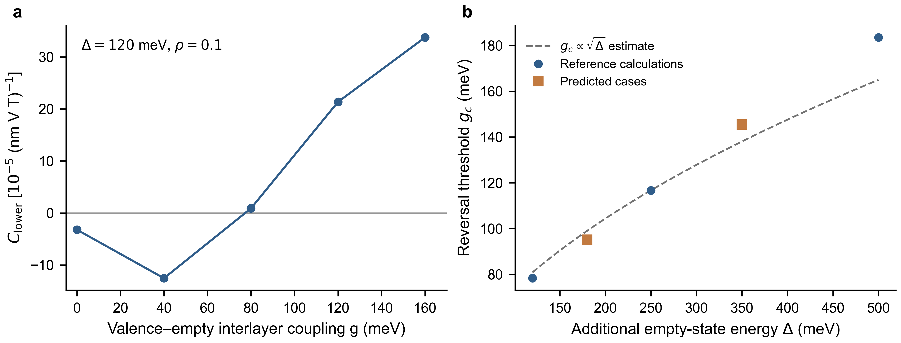

图｜选择性跨带混合驱动同层磁电反向。a，固定Δ=120 meV、ρ=0.1和原KM层间耦合，下层响应随新增耦合g变化；五个圆点均为实际计算，连线只引导视线。b，新增空态能级越远，翻向所需耦合越大。蓝点为三个参考计算，橙色方点为未参与定标的两个检查点；虚线为事先采用的平方根量级估计，并非普适相边界。图为讨论稿，数据源和可编辑矢量图随仓库归档。

### 是否只适用于MoSSe；对PRL主线意味着什么

这轮在没有拟合MoSSe的KM衍生Hamiltonian中得到同样的跨带因果对照和谱控制模式，因此机制不依赖MoSSe的具体化学公式。在λ=0.20、0.30以及m=46 meV时也保留反向，说明不是孤立的四分之一点。m=44 meV时下层原本已为正，增强耦合后仍为正，则没有“翻号”可言。应推广的是条件，而不是声称所有双层必然发生同一现象。

主线候选更具体了：具有轨道选择性的跨层占据—空态混合，可以改变一层自身的磁电方向；较高空态是可控制的物理通道，而非可随意忽略的附带能带。当前“对称性允许—微观耦合决定符号—模型内预测阈值”的证据链已较完整，但尚未证明PRL首创性、不同晶格普适性或可测器件。

最重要的下一步不是继续堆模型项，而是回到MoSSe，把顶部价带、低空态和较高空态的实际耦合及自旋/电场算符投影出来，判断所需的选择性是否自然出现、哪个真实结构操作能改变它。若对应不上，应承认该十二态模型只证明一种可能机制，不能将它硬套到材料。若对应上，再预测应变或另一稳定堆垛的符号并独立验证。门控层间补偿与镜像畴辨认路线继续保留。

### 核查、数据与交接

- 新模型保持时间反演、水平镜像伙伴关系及同时旋转堆垛的C3协变性；新增耦合的速度含谱投影导数。原KM极限、对称性、速度及平谱导数共5项相关测试通过。
- 主结果20301与76899点积分保留符号，有限磁差分步长0.002减至0.001 T，代表点C变化不超过4.9×10⁻¹³（原始单位）。谱控制的速度以两种步长独立检查，最大差约4.0×10⁻⁶ eV·nm。
- `controlled.json`中的`all_paths_CC`人为对照关闭了绝缘间隙，`insulating=false`。其中固定四条占据态算出的巨大数值无物理效力，不能引用成增强效应。它没有进入任何结论或图。
- 主结果：[本轮完整归档](</Users/jiaqi/Desktop/worksofJiaqi/quantum-geometry-reproductions/studies/bsf-nmee-connection/results/mechanism/minimal-km-20261107>)。`main-thresholds-predictions.json`是主模型事先预测，`heldout-fine.json`是细积分独立符号检验。`exploration`保留最初无原KM耦合的探索；不能将其阈值当成主模型阈值。
- MoSSe这轮没有新增计算，仍继承上一轮材料空态/积分精度边界。十二态模型的量级和g、Δ不能直接换成MoSSe的栅压、层距或应变。没有把选择性ρ解释为已经测得的材料参数。

## 2026-11-07｜跨层价带—导带混合驱动材料同层反向；KM尚需补足相应通道

本轮只做已授权的机制辨认：使用真正零磁场材料参考，分别打开/关闭价带—价带（VV）、导带—导带（CC）、价带—导带（VC）层间混合；未扫描应变、未扩堆垛、未提交新的自洽DFT。日本科学计算均在PBS计算节点完成。

### 得到的物理图像

MoSSe S/S中，跨层价带—导带混合足以让同一下层从正响应变为负响应。只保留同类带之间的混合则没有反向。这里的“价带—导带”指占据态与邻层空态在电子波函数中的混合，不是实际吸收光子把电子激发到导带。

| 保留的层间混合 | 下层 Cxx | 带隙 / eV |
|---|---:|---:|
| 关闭所选 d+p 层间块 | +13.498 | 1.398 |
| 仅价带—价带 | +14.305 | 0.842 |
| 仅导带—导带 | +10.863 | 1.398 |
| 价带—价带及导带—导带 | +12.941 | 0.841 |
| 仅价带—导带 | −9.093 | 1.399 |
| 完整层间混合 | −6.602 | 0.842 |

表用96态、冻结8空态轨道窗口，响应单位10⁻⁹ (nm V T)⁻¹。六组窗口/态数对照均保持表中符号。每行是重新计算的完整响应，不能相加。第一行不是独立自洽孤立单层。

最直接的判断是：价带—价带混合已经明显缩小能隙，却没有反向；价带—导带混合几乎不改变这个带隙，却能反向。因此“界面缩小能隙”不足以解释本材料；关键是界面改变了参与自旋响应的电子态。保持其他通道原值时，将VC强度从0、0.25、0.5、0.75增到1，下层C依次为+12.941、+10.355、+6.258、+0.592、−6.602。这个0.75–1的阈值是人为通道控制，不是实际应变、层距或栅压。

### 哪些态值得放进简洁模型

将每层价带限制为最顶部两条，保留它们与另一层空态的混合，仍得到稳健反向。仅保留更深价带参与的VC混合不能在不同窗口下给出同样稳健的结论。因此，本轮没有证据要求先给KM加一组深价带。

进一步把导带分为最低两条和其余较高六条：

| 只打开的跨层混合 | 下层 Cxx |
|---|---:|
| 顶部价带 → 最低导带，及其厄米共轭 | +2.538 |
| 顶部价带 → 较高导带，及其厄米共轭 | −9.010 |

这两行的符号也在六组表示中一致。它提醒我们：只画VBM/CBM两条带可能漏掉决定方向的虚跃迁通道。不过在完整材料背景中，去掉顶部价带—最低导带通道，C恢复为+13.005；去掉顶部价带—较高导带通道，则恢复为+13.428。两者共同参与完整材料的反向，不能称“唯一某条高能跃迁贡献了负响应”，更不能把非加性直接宣布为已经推导出的特定干涉机制。

带组定义是各层零场块的能量本征态：每层22个d+p自旋态中，价带13–14，最低导带15–16，较高导带17–22（均从1计数）。不是完整双层能带图的固定序号。顶部价带组与更深价带在采样点最小间隔约0.155 eV，两个导带组间约0.032 eV；一般k点不能将每组两态误称严格简并。该细分尚需更密零场k网格确认，不能据此宣布已经锁定唯一原子轨道最小基。

### 与现有KM的关系及最少应补的物理

对KM四分之一构型、m=45 meV、固定60°探测方向做相同通道控制。t=20 meV时，下层纵向响应（单位10⁻⁵）依次为：无层间混合−7.413，仅VV +35.522，仅CC +11.229，仅VC −47.878，完整+1.077。完整模型t=10→20 meV的−3.146→+1.077与已有精细结果一致。所有控制保持绝缘。

因此，KM已有“界面能改变同一层方向”的现象，却尚未重现MoSSe这次识别的微观主因：KM当前VC通道增强原来的负方向，反向依赖其与其他通道竞争。不能用符号约定变化消除这个机制差别，也不应为了叙事统一宣称已经一致。

下一版简洁模型的优先候选是：每层一组含自旋的价带、两类可区别的空态，并保留轨道选择性的跨层耦合。若每组先用两态表示，则是每层6态、双层12态的候选；这是本轮证据支持的建模方向，尚未证明12态足够或数学上最小。高能空态也可能被折入8态有效模型，但那时自旋与电场耦合算符也应随之修正，不能只删掉能带后继续用原算符。先验证该简化是否保留“只开关键VC也能反向”，再考虑增加其他轨道或应变自由度。

### 对PRL主线与下一步预测的意义

主线候选从“层间耦合留下净自旋”推进到“跨层占据—空态混合重写一层自身的磁电方向，而缩小能隙并非充分条件”。本轮给出了材料内的因果对照，但尚未建立一个事先选出材料/堆垛的通用判据，亦未证明与已有杂化调响应工作相比的首创性。

下一步最聚焦的验证是构建上述简化跨带模型，给出耦合与能级匹配如何改变方向的可检验条件，再选择一个真实结构操作实现它。双轴应变和另一种稳定堆垛都可以保留为实现方式；不能把“应变必然增强杂化”当作预测。已有栅场主要改变两层相消、镜像畴补偿偏场的路线继续保留，不因本轮机制分类而删除，也不将其说成同层电控翻转已经实现。

### 证据与交接

固定零场各层谱投影定义VV/CC/VC，之后对所有控制使用相同物理自旋、Zeeman和电场耦合；KM修改后的速度显式包含投影算符对动量的导数。轨道窗口4/8/12、态空间96/112全部核查，磁扰动步长0.002减至0.001 eV，最大响应变化小于1.02×10⁻⁴（表中单位）；材料所有控制带隙至少0.841 eV。KM采用20301与76899个积分点，所有通道符号一致，精细结果复现原始完整端点。子空间旋转协变性、Hamiltonian重构与速度导数测试均通过。

继承上一轮精度限制：材料使用现有6×6真正零场缓存；112态仍有B偶残差，96/112绝对幅值尚不一致。本轮支持机制与符号，不作为最终定量数据、实验阈值或新独立DFT预测。没有将响应按VV/VC线性分摊。

PBS作业548191、548192、548193均在csuper001正常结束，分别38、55、32秒；前端只作传输和调度。数据、实际计算脚本及检查见[仓库通道对照快照](</Users/jiaqi/Desktop/worksofJiaqi/quantum-geometry-reproductions/studies/bsf-nmee-connection/results/mechanism/mixing-channels-20261107>)。下一位agent首先读本节，再读原零场参考的精度边界；不从旧44态或有限场准备的缓存重新开始。

## 2026-11-07｜真正零场参考：界面改写层响应，门控调节层间补偿

本轮完成零磁场自洽基态，并在同一零场势上补充空态迭代。全部科学计算在日本 PBS 计算节点完成，没有扩材料、没有新增门控自洽 DFT。以下是固定离子、固定占据数、保持绝缘的材料模型对照；不是完全自洽的外加栅场预测。

### 本轮保留的物理

1. **同层翻向仍随电子态重组出现。** 保留弱杂化电子态，仅换成强杂化的能量，响应仍为正；保留弱杂化能量而换用强杂化电子态，响应已经为负。因此，在本材料的这些对照中，单靠跃迁能量变化解释不了反向，界面对电子态的混合是关键。
2. **固定原层距的门控仍主要调节谁占优势。** 在内部层势差 U=−0.60 至 +0.60 eV 的九个已算点，下层始终为负；整片响应则在 U=−0.15 与 0 之间过零，这附近上下层保持异号。未找到可靠的同层门控反向条件，因此不提交以该预言为前提的新 DFT。
3. **“先减弱、后增强”不作为新效应来讲。** 它只说明调两层能级差并不等于削弱全部层间杂化。当前可用的物理叙述是：界面可以重塑一层自身的磁电方向；静电调节可以进一步改变两层合成后的净方向。两种作用在本算例中分开验证，不宣称是所有双层的普适分工。

下表使用零场势精修后的96态对照，轨道构造冻结8条空态。数值单位为10⁻⁹ (nm V T)⁻¹，仍不是最终收敛幅值。

| 对照 | 下层 Cxx |
|---|---:|
| 弱杂化态、弱杂化能量 | +13.498 |
| 弱杂化态、强杂化能量 | +18.152 |
| 强杂化态、弱杂化能量 | −12.373 |
| 强杂化态、强杂化能量 | −6.602 |

相应112态结果为 +13.833、+18.499、−11.652、−5.844。两种态空间以及冻结4/8/12条空态的三种轨道窗口均保持相同符号顺序。弱端指关闭选定 d+p 层间块，不等同重新自洽的孤立单层。谱配对仍按前一节定义，不能把四项解释成可加的能量贡献和几何贡献。

96态的 U=−0.15、0、+0.15、+0.60 eV 四点，下层依次为−7.713、−6.602、−6.326、−9.962，整片依次为+1.115、−0.285、−1.746、−8.106。模型约定 H_U=U(1/2−P_bottom)，即U>0提高上层相对下层的电子能量。这个正号不能直接当成旧DFT中外加垂直场的正号，数值也不能直接换算成栅压。真实栅场还涉及屏蔽和层内势变化，本轮只隔离层势差作用。所有扫描点带隙为正，112态最小约0.458 eV。

### 必须继承的精度边界与更正

零场自洽基态已经建立：没有沿用有限磁场的密度或波函数。精修后占据能量的 k/−k 配对误差小于9×10⁻¹⁰ eV，基态总自旋分量约10⁻⁸量级。最高空态却较难收敛：全112态的配对误差从初轮约18 meV降至0.63 meV，仍留下不应存在的B偶电场—自旋残差。因此，不能把零场电场—自旋残差单独当成“基态有物理磁性”的证据；有限空态表示与精度也会产生它。这修正了上一轮对残差来源过强的解释。

精修112态下层χ(E→s,B=0)=−0.005923；投影到96态后为+4.50×10⁻⁶，后者仅为δb=0.002时目标奇响应的约0.034%。96态的全部谱对照也保留同样机制，B偶残差均在约10⁻⁶量级。不能据此宣布112态精度问题已消失：96/112态下层幅值仍相差约13%；64态截断明显不足。完整净值接近相消，不能用相对误差很大的零点邻域宣称精确电压预测。

±b差分提取的C在步长0.001/0.002 eV下稳定；初始与精修112态下层C只改变约1.7%，同层反向与门控净值过零的符号均保留。本轮以这些定性结论作为idea依据，停止继续堆叠精度计算。更密k网格、充分收敛的高能空态及自洽响应对幅值的影响，留到确有定量主张时处理。

### PRL主线与同行边界

本轮增强了“保持绝缘和占据数不变，界面仍能改写层自身的磁电方向”的机制证据。尚未得到一个能事先选择材料/界面的简洁翻向判据，也没有把同层反向连到已经可实现的外场开关。门控补偿与镜像畴读出继续保留，但此前约7 aT的理想漏磁估算、实际探针层权重和光学读出量级问题仍未解决；不能写成已经可测的器件。

补查了Leiva-Montecinos等 [Spin and orbital Edelstein effect in a bilayer system with Rashba interaction, PRResearch 5, 043294 (2023)](https://doi.org/10.1103/PhysRevResearch.5.043294)。发表版用Boltzmann输运讨论双Rashba层，明确把反号与层定位交换的联系用于轨道Edelstein响应，不能照搬旧预印本摘要，将其说成已经证明本项目的同层自旋反向。可借鉴其“界面参数—电子态—响应”的组织方式；它也提醒我们，泛称“杂化可调响应”不足以确立首创性。现有LEE/LTE和band-mixing工作仍按前述直接邻近工作/机制背景分别使用，不因已有相邻题材放弃本方向。

当前优先级：保留界面重构与门控补偿两条互补路线；下一轮围绕可实现的调控条件或可测后果讨论具体预测，不继续扩大偏置范围强求预设翻号。本轮没有证明一个普适纯几何判据，KM原主例仍需要电子态与能量共同变化，不能将材料对照结论直接升级为KM定理。

作业548088（零场SCF与对照，14分23秒）、548122（空态检查，11秒）、548129（固定零场势精修与对照，7分50秒）、548133（96态机制对照，17秒）均在csuper001退出0；前端仅用于传输、调度和读取小结果。模型对照本身为秒至几十秒，首次参考准备约二十余分钟。没有使用登录节点做科学计算。

数据与脚本：[仓库本轮快照](</Users/jiaqi/Desktop/worksofJiaqi/quantum-geometry-reproductions/studies/bsf-nmee-connection/results/mechanism/zero-field-20261107>)；大波函数、PAW数据与完整缓存留在远端原项目的zero-field-20261107和zero-field-refined-20261107目录。快照README记录依赖与适用范围，不把有许可限制的PAW文件或连接凭据上传GitHub。

## 2026-11-07｜112 态复核与固定结构层势差扫描

本轮仅推进 MoSSe S/S 堆垛 A，未扩材料。日本全部波函数处理和数值计算通过 PBS DP_002 计算节点进行。完成 6×6 与独立 9×9 的 112 态数据导出和模型对照；没有提交新的门控 DFT，因为尚未找到可靠的同层门控反向条件。

物理结果：在两个网格及冻结 4/8/12 空态所定义的三种 d+p 子空间中，四组谱对照都保持相同符号顺序：弱杂化态配弱/强能量均为正，强杂化态配弱/强能量均为负。弱端本轮取整个 d+p 层间块关闭，强端取原始耦合；它与上一轮44态的弱端 α=0.5 不同，不能比较为相同临界状态。结果支持电子态重组的作用，并未得到唯一轨道归因。

| 112态、冻结8空态的控制 | 6×6 下层 C | 9×9 下层 C |
|---|---:|---:|
| 弱态、弱能量 | +13.834 | +16.683 |
| 弱态、强能量 | +18.507 | +18.570 |
| 强态、弱能量 | −11.561 | −8.531 |
| 强态、强能量 | −5.749 | −3.662 |

单位为10⁻⁹ (nm V T)⁻¹。以上是下述冻结势诊断，尚不能作为已完成的严格零场材料验证。

固定原子结构和原始层间耦合，扫描内部层势差 U=−0.60、−0.45、−0.30、−0.15、0、+0.15、+0.30、+0.45、+0.60 eV，两网格下层始终为负且保持绝缘。6×6 的 U=0、+0.15、+0.60 三点分别 −5.749、−5.465、−9.051；9×9 分别 −3.662、−3.198、−6.032。负响应先减弱再增强，不能认为两层能级错位增大就必然恢复孤立层方向。U 是内部模型势差，不能直接等同外加栅压/栅场；这些点未包含门控自洽屏蔽。

关键限制与新发现：旧112态参考是 b=+0.016 eV 准备的自洽 KS 波函数。此次导出完整层自旋、空间层投影、总自旋 Zeeman 算符和邻点 Bloch 重叠，构造 H*=H_KS(b)−bΣz，再围绕 H* 用 ±δb 重算响应。减去外加 Zeeman 并没有恢复严格的非磁零场参考：χ(E→s)在δb=0仍非零。6/9网格的残留分别为−0.04652/−0.10914（与 C×b 同归一化），而δb=0.002时的奇响应仅约−0.01150/−0.00732，残留不可忽略。δb从0.001至0.016的导数稳定并不能消除这一问题。可能涉及磁场引起的自洽势变化、有限子空间和场算符实现；本轮未把这些原因进一步分开。

旧的χ(b)/b为−8.658/−10.482；新冻结势导数为−5.749/−3.662。两者定义不同，不把差值称作数值收敛误差，也不覆盖旧的独立自洽 DFT 结果。现有谱对照增加了支持证据，但不能升级成“零场机制已最终确认”。下一步应建立真正零场自洽的112态参考并一致重建算符与重叠，再比较谱控制；不能继续仅从有限场 Hamiltonian 减去外加项。

对PRL主线：界面改变同一层方向的候选机制继续保留；固定平衡结构的门控目前主要支持既有层间补偿功能，未支持同层开关。补偿点辨认堆垛畴不撤回，其实验量级和读出权重限制仍沿用前述记录。现在优先清理零场参考这一实质物理定义，再决定能否预报新的门控反向；不通过调参数追求预设符号，也不扩材料或进行对称性大全筛选。KM与MoSSe互相修正、机制稳定后再推广不同晶格/对称性的路线保留。

作业：547984导出6×6，547985分析因实数参考的复数缓冲类型失败（未产生结果），修复并通过本地实对角Hamiltonian回归检查后547986完成；547987导出9×9，547988分析完成。导出6×6用54秒，9×9分析22秒。科学处理位于csuper计算节点；前端仅传输、调度和读取小结果。本轮未独立复核共享存储配额或计费，沿用用户提供的日本免费资源说明。没有恢复其他项目作业。

原始结果与可回放脚本：[本轮材料对照目录](</Users/jiaqi/Desktop/worksofJiaqi/project-x/outputs/MoSSe-NMEE/7269-mechanism/full-controls-20261107>)，包括full6.json/full9.json、export_full.py、analyze_full.py及PBS模板。远端项目为/work/sunq/xjq/mosse-7269-mechanism-20261104，9×9在其model-grid9子目录；缓存full-controls-cache.npz保留完整112态矩阵。本轮脚本是冻结势诊断，不替代未来真正零场协议。

## 2026-11-06｜反转来自能量变化，还是电子态重组？

本轮按用户授权，在 Mac 本地对既有 KM 与 MoSSe 模型做机理计算，未新增材料或提交远端 DFT。保留两条候选叙事：界面改变同一层的响应方向；门控改变层间补偿并可能用于堆垛畴读出。已有 LEE/LTE 先例不是放弃后一条路线的理由，但需要明确本工作的增量。

### 物理结论

两种模型都允许界面把同一层的 NMEE 调过零，但这次对照没有支持“相同的一条纯电子态混合规则即可解释二者”。

- MoSSe：形成较强杂化态后，负响应在换回弱杂化能量谱时仍然存在。反之，保留弱杂化电子态而换成强杂化能量谱，仍为正。能量变化在这组对照中甚至增强正向倾向；负向改变主要随电子态的重组出现。
- KM：只换能量或只换电子态均未使下层由负转正；两者一起改变才反向。这是竞争贡献对能量权重和矩阵元的共同依赖，不能写成“能隙无关”或“杂化越强必然翻向”。
- 共同的可靠结论是：同一层的响应不是一个由单层朝向预先固定、只待另一层加权的量，界面可以重塑它本身。更具体的共同反转判据尚未找到；“两项竞争，谁大谁决定符号”本身也不构成预测规律。

### 对照定义与数据

所有计算固定堆垛、层标签、探测方向和绝缘占据。先对弱/强杂化的零场 Hamiltonian 分别对角化，再构造

$$
H_{p,q}(\mathbf k)=\sum_n\varepsilon_{n,q}(\mathbf k)
|u_{n,p}(\mathbf k)\rangle\langle u_{n,p}(\mathbf k)|.
$$

$p$ 指保留哪一端的电子态，$q$ 指采用哪一端的能量；逐波矢按能量序配对，简并子空间不允许被任意拆开。随后加入同一个物理 Zeeman 算符，重新求完整静态混合响应。KM 的电场矩阵元由新的 Hamiltonian 一致求导；MoSSe 保留原始 Bloch 重叠所定义的位置算符。没有只改响应式分母、却借用旧速度矩阵元。

这是人为 Hamiltonian 对照，不是两项可加的“能量贡献＋几何贡献”，也不是一项真实实验操作。结果依赖明确的谱配对协议；不用于宣称一种唯一广义 QGT 或唯一原子轨道来源。

| 从弱杂化基准出发 | KM 下层 $C_{xx}$ | MoSSe 下层 $C_{xx}$ |
|---|---:|---:|
| 原始弱杂化电子态与能量 | −3.1460 | +10.0003 |
| 保留电子态，只换强杂化能量 | −1.0892 | +13.5539 |
| 保留能量，只换强杂化电子态 | −13.4990 | −5.5429 |
| 原始强杂化电子态与能量 | +1.0766 | −0.8203 |

KM 单位为 $10^{-5}(\mathrm{nm\,V\,T})^{-1}$，MoSSe 单位为 $10^{-9}(\mathrm{nm\,V\,T})^{-1}$。两个模型不比较绝对正负号；比较的是各自弱杂化基准能否被反转。

KM：$\lambda=0.25$、$m=45$ meV、$U=0$、$t_\perp=10/20$ meV，探测方向沿保留竖直镜面的面内法线。表内使用既有精细积分设置 81/80/120、76899 个积分点和 0.03125 T 的 Zeeman 步长。

MoSSe：S/S 堆垛 A 原层距的 44 态 $d+p$ 模型，整体层间块乘 $\alpha=0.5/1$，28 条占据态、6×6 原始重叠网格，Zeeman 能量步长 0.001 eV。这里的弱杂化端不是重新自洽的自由单层。该模型在原杂化下为 −0.82，而独立 DFT 约为 −6.85；不能将表内幅值或临界参数当成定量材料预测。本轮尚未在 112 态嵌入空间或更密材料网格重复谱替换，现阶段属于材料模型的机制证据。

另做了所有占据态/空态分别展平为两个能级的对照。MoSSe 两端分别为 +55.94、−45.83，仍异号；KM 两端均为正，约为 +0.03808、+0.03874 $(\mathrm{nm\,V\,T})^{-1}$。展平强烈重排整个布里渊区的能量权重，数值不对应可实现的能带，不能据此预测增强倍数。简并展平能带的逐带贡献不唯一，结果文件仅保留完整求和。

### 核查与适用边界

1. KM 粗/细积分下四个非展平对照的符号均保持；下层值最大变化约 $7.12\times10^{-7}(\mathrm{nm\,V\,T})^{-1}$。层求和误差小于 $1.3\times10^{-15}$。KM 原始两端与此前精细计算一致。
2. MoSSe 将 Zeeman 步长从 0.002 减至 0.001 eV 后，六个对照最大相对变化约 $3.0\times10^{-5}$。改用 $\alpha=0.75$ 作为弱端，四个对照依次为 +4.9345、+7.3301、−3.4492、−0.8203，符号判断不变。所有对照保持带隙。
3. 初次 KM 运行在 Kramers 简并点主动停止，因为逐带求导不适用。现改为简并点对整个控制 Hamiltonian 求方向导数，并检查两种微小位移的一致性；最大差小于 $8.0\times10^{-10}$ eV·nm。未删除这些积分点，也未用任意简并本征态代替子空间导数。
4. 三项独立物理检查通过：控制速度与有限差分一致；简并空间内旋转不改变 Hamiltonian 且拒绝任意拆简并；响应与已有内核、整体基变换及统一能量缩放规律一致。新脚本不修改原响应核心。
5. 层分辨响应是给定空间/轨道分区的量，不等于某个原子的自旋整体翻转。有限场逐带诊断在简并块中不唯一；物理讨论只用完整响应和有定义的子空间和。

计算与数据位于仓库 [机制对照脚本](</Users/jiaqi/Desktop/worksofJiaqi/quantum-geometry-reproductions/studies/bsf-nmee-connection/scripts/compare_reversal_mechanism.py>)、[结果目录](</Users/jiaqi/Desktop/worksofJiaqi/quantum-geometry-reproductions/studies/bsf-nmee-connection/results/mechanism>)。材料输入沿用 [既有轨道模型](</Users/jiaqi/Desktop/worksofJiaqi/project-x/outputs/MoSSe-NMEE/7269-mechanism/orbital-model>) 的 dp/op/berry-7269.npz 和 model.py，结果文件记录 SHA256。回放方式：在仓库根目录调用上述脚本；KM 参数为 `km --grid 81 80 120 --endpoints 10 20 --step .03125 --output <结果文件>`，材料参数为 `mosse --data <既有轨道模型目录> --endpoints .5 1 --step .001 --output <结果文件>`。无需 VASP 或远端节点。

### 同行与可实现调控：本轮判断

- LEE（PRL 137, 076401；[正文](https://doi.org/10.1103/qhvs-pfkq)）和新增的 [Electrically Reversible Layer-Tensor Responses in Bilayers](https://arxiv.org/html/2610.34067v1) 是门控选层方向的直接邻近工作。后者明确允许有限层间杂化，不能用“他们忽略耦合，我们加入耦合”制造区别。其对称性关系并不提供本项目同层翻向的微观临界条件。
- 更正旧文献笔记：Gao 等 [Band-Edge Mixture Engineered Giant and Switchable Shift Current Generation](https://doi.org/10.1021/acs.nanolett.4c03520) 主要通过混合增强光吸收来增强 shift current；文中 shift vector 的幅度变化小，可变号。不能把它总结成主要靠增大 shift vector。借鉴点是“分辨能量与矩阵元作用—找到材料—用实际外场控制”，而非要求我们的多带 NMEE 也只由带边决定。
- 双栅优先。Lopriore 等在双层 MoS₂ 中用垂直场调节层间混合及激子动力学；双栅设计使外加位移场与外源掺杂可分开控制（[原文](https://arxiv.org/pdf/2510.01921)，Nat. Commun. 16, 10710, 2025）。它支持“固定结构、调两层能级错位”的实验路径，但不能当作 NMEE 或无任何本征掺杂的实验验证。我们的 MoSSe 已有门控总响应反号；固定原层距的同层门控反向尚未获得独立 DFT 支持。
- 压力是层间耦合的真实控制手段，已有扭转 WSe₂ 双层实验（[原论文](https://doi.org/10.1021/acs.nanolett.3c01640)）。但压力通常压缩层距；现有 MoSSe 反转对照是从平衡间距向外拉开，不能将它直接写成“加压必然翻向”。
- 层间呼吸振动提供动态层距调制的思路，TMD 的呼吸/剪切模已有实验和第一性原理研究（[原论文](https://arxiv.org/abs/1305.6990)）。我们尚未建立可激发振幅、非绝热响应或反转所需驱动，暂不作为主实验方案。已有 Janus MoSSe/MoS₂ 的拉曼研究可辅助识别界面耦合，但声子力常数不是某一电子跃迁振幅的直接测量。

### 对 PRL 主线和下一次预测的意义

这轮把“杂化有影响”推进为有控制变量的机制判断，也划清 KM 与材料尚未统一的部分。可保留的主张是“界面重塑层自身的磁电响应，门控又可调节这些层响应的相消”。还不能宣称已建立普适翻向规律或已具备 PRL 新颖性。

下一步最有价值的具体检验是：在仍保持绝缘的同一 MoSSe 界面，先找出对层间能级错位最敏感、且对带窗口稳健的带组，再预报固定原子结构时同层 $C_{xx}$ 能否被栅场反转，并给出符号和场区间；随后才做独立自洽 DFT。先在较完整材料模型验证本轮谱结论，是这条预测的入口，不是重新扩展材料筛选。已有 44 态旧扫描在部分接近反转的杂化强度下出现微弱门控反向，但这只是线索，不能包装成新的独立预测，更不能把模型层势差直接换算成外加栅场。

若同层门控反向得到验证，可把“调层间能级匹配—重组带间自旋响应—电控同层方向”连成更直接的材料机制。若没有，则保留已证实的总自旋门控与约 ±0.24 V/nm 的镜像畴零点，重点转向可观测后果，而不继续强求同一种开关。

补偿点读出目前仍是候选功能，不是已可实施器件：此前理想边缘自旋漏磁估算在 $E_x=1$ V/μm、$B_z=1$ T、50 nm 高度下仅约 7 aT；实际探针权重、轨道响应和离子响应也可改变测得的零点。光学或其他读出若被采用，需要单独算出可测信号，不能以“可做 Kerr 测量”代替量级论证。

## 2026-11-06｜连续稿件与目录整理

本轮按用户要求，只整理已有结果和文档，没有新增物理计算。

1. 新增正文图 2：将已有37个邻域计算点合并。上排比较 KM $\lambda=0.24,0.25,0.26$，下排比较 $m=44.9,45,45.1$ meV。每排依次展示下层随杂化翻向、门控时上下层保持异号、总响应过零。不同参数使用不同颜色和符号；总值面板放大过零区间，各层面板保留完整已算门控范围。
2. 原“正文”“补充讨论与图”“理论定义与公式核对”的物理内容并入同一篇正文，按问题—模型—邻域与对照—材料—实验含义—完整定义串联。所有图顺序编号1–10，保留图注。现在不划正文/SM，也不按PRL最终篇幅删减。
3. 日常入口固定为正文.md和worklog.md。图片放“附件”；原批注稿、分散说明、各轮稿件及旧图移入“归档/整理前-20261106”，保持原来的相对目录关系。没有删除研究内容。
4. 原来在计算目录里的KM与MoSSe记录已导入“归档/研究记录”，见下表。数据与计算输入保留在原计算目录；归档副本将能解析的旧数据链接指回原处。

## 必须继承的更正与约定

| 项目 | 当前应使用的解释 |
|---|---|
| KM AB/BA 与 MoSSe A/B | 前者是模型端点；后者是材料 S/S 镜像伙伴，不能混用名称或分数坐标。KM 四分之一构型的伙伴是四分之三构型。 |
| 旧 KM 约±10.25 meV 零点 | 原生 X 方向的纵向投影零点；横向分量仍非零。旧环境扫描的数值沿用该投影，不能改称完整自旋相消。 |
| 当前 KM 约4.7 meV 零点 | 电场沿保留竖直镜面的面内法线，磁场沿 z；另外两个自旋分量被禁止，因此是此 EB 阶的完整诱导自旋相消。旧点与新点属于不同探测方向。 |
| 两种镜面 | 竖直镜面保留给定构型、不交换层，限制自旋方向；水平 m001 联系两个伙伴、交换层。 |
| 层势差与栅场 | 模型 U 是内部层势能差，不能直接换算为材料栅压；材料 Fz 的正号沿用原计算电子受力场约定。 |
| 稳定性 | KM 电子 Hamiltonian 没有堆垛总能量。BiDB的滑移稳定不是所有声子均已验证稳定，更不是已完成写入/切换实验。 |
| 原NMEE公式 | 采用完整静态混合响应；原作者已确认的漏项不作为拟合目标。与驱动DC分支、磁矩归一化保持区分。 |
| 轨道归因 | 全部 d+p 层间块的干预比“唯一 S pz 键决定翻号”更稳健；单轨道删除结果依赖子空间定义。 |

## 研究沿革：从 KM 到材料和实验读出

| 阶段 | 已得到的物理、目前如何使用 | 完整记录 |
|---|---|---|
| KM 位移相关模型 | 从两张镜像相关单层出发建立层间跃迁；在绝缘条件下计算完整静态自旋响应。 | [KM 阶段 2](归档/研究记录/KM/阶段2.md) |
| KM 滑移与通道 | 得到有隙响应变号；不同层间跃迁通道不可简单相加。有限耦合的非加性不能全部解释为弱耦合干涉项。 | [KM 阶段 3](归档/研究记录/KM/阶段3.md)、[KM 阶段 4](归档/研究记录/KM/阶段4.md)、[KM 阶段 5](归档/研究记录/KM/阶段5.md) |
| KM 对称性与低能模型 | 参考构型附近的迹/方向差有不同最低阶；谷区模型可重现指定参数下的主要响应与反转。此为早期参数组，不与当前m=45的绝对数值混合。 | [KM 阶段 6](归档/研究记录/KM/阶段6.md)、[KM 阶段 7](归档/研究记录/KM/阶段7.md) |
| KM 电极化与完整路径 | 建立电子极化参照和完整滑移；同号电偶极不能单独决定自旋分量的方向。没有由电子模型证明铁电能垒或稳定堆垛。 | [KM 极化与幂次](归档/研究记录/KM/阶段8_极化与幂次.md)、[KM 完整滑移路径](归档/研究记录/KM/阶段9_完整路径.md) |
| MoSSe 初始对照 | 孤立单层、反演双层、S/S双层给出不同的层响应与总值；反演参照的总值由对称性禁止。 | [MoSSe 初始对照](归档/研究记录/MoSSe/初始材料对照.md) |
| S/S 层距控制 | 同朝向下层从接触时负响应恢复为正；较深与顶部占据带贡献竞争，不能只看Γ点VBM/CBM。 | [S/S 层距与带间分解](归档/研究记录/MoSSe/S-S层距与带间分解.md) |
| 材料轨道模型及门控 | 仅改变成组层间杂化可重现同层反向；原层距门控的已算区间则主要改变层间补偿。唯一最小轨道机制仍未确定。 | [轨道模型与门控](归档/研究记录/MoSSe/轨道模型与门控.md) |
| S/Se 新堆垛 | 封存下层负响应预测后，独立DFT支持其方向及明显增强。不同终端/取向不能简称单纯滑移。 | [S/Se 独立预测](归档/研究记录/MoSSe/S-Se堆垛的独立预测.md) |
| 固定 KM 的两类反转 | 在m=45附近找到局域分量反转与总投影补偿；随后完整张量核查修正了“整个自旋”的表述。 | [固定堆垛的层响应](归档/研究记录/KM/固定堆垛的层响应.md) |
| MoSSe 镜像伙伴 | 独立DFT给出两层交换并反号的关系，总响应零点约为±0.24 V/nm；上下层自身方向在该门控区间保持。 | [MoSSe 镜像伙伴](归档/研究记录/MoSSe/镜像伙伴.md) |
| 环境与仪器 | 公共标量偏置可平移曲线；真实单侧扰动还会改幅值与间距。探针权重可使仪器零点不同于总自旋零点；理想磁读出示例量级极小。 | [KM 环境响应](归档/研究记录/KM/器件环境与投影零点.md)、[MoSSe 环境与读出](归档/研究记录/MoSSe/器件环境与实验读出.md) |
| 稿件形成与批注 | 从分散结果转成模型—材料叙事，补Hamiltonian、带组标号、图注；此后改回四分之一主例并核清探测方向。 | [最初物理叙事](归档/研究记录/稿件/最初物理叙事.md)；[第一轮修订](归档/整理前-20261106/WORKLOG-20261106-批注修订.md)、[第二轮修订](归档/整理前-20261106/WORKLOG-20261106-第二轮修订.md)、[第三轮修订](归档/整理前-20261106/本轮工作记录-20261106c.md) |

## 同行阅读与用户批注

LEE、band-edge mixture、layer-dependent disorder、蓝磷界面、pentagonal-chain以及原NMEE正文/SM的阅读记录集中保留在[文献核查笔记](归档/整理前-20261106/文献图式核查.md)。这些记录区分文献做到了什么、我们借鉴什么、以及哪些机制尚未建立。它们不是本轮新增调研。

[原始带批注稿](归档/整理前-20261106/正文讨论稿.md)保持原文；[上次连续修订前的正文](归档/整理前-20261106/正文讨论稿-修订版.md)及配套说明也全部保留。当前阅读入口只使用本目录的正文.md，避免把旧版安排误作当前结论。

## 数据与接手位置

- [KM与手稿仓库](</Users/jiaqi/Desktop/worksofJiaqi/quantum-geometry-reproductions>)：基础模型、原始结果、历史核查；当前连续稿对应 studies/bsf-nmee-connection/docs/manuscript。
- [MoSSe计算记录](</Users/jiaqi/Desktop/worksofJiaqi/project-x/outputs/MoSSe-NMEE>)：结构、模型干预、独立DFT汇总、镜像和读出结果。本轮没有移动原计算目录，也没有复制受许可的VASP程序、势文件或密钥。
- [本轮汇总图源数据](附件/km_neighbourhood.csv)：37行均来自此前已算的两个表；数值保持原样，source列标明来源。
- [本轮计算与整理核查](附件/整理核查.json)：图源一致性、图号/公式/链接、归档前后文件校验。此前精细四分之一计算与邻域检查使用不同积分精度，图2内部始终使用同一邻域精度。

## 下一轮

本轮 MoSSe S/S 的小幅正负栅场自洽验证全部完成，约五成的相对净响应增强与上层主导都保留，但绝对幅度被屏蔽明显压低。先回到物理讨论，评估能否以“近补偿双层中，界面增强层选择性的电控响应”作为更具体的 PRL 候选主线，并明确混合机制证据与自洽屏蔽作用各自支持什么。补偿点辨畴继续保留，实际场强标尺不能由未屏蔽模型直接移用。当前不自动追加场强、应变、材料、离子弛豫或十二态拟合；KM 保留概念作用，MoSSe 提供界面方向改写和自洽栅控的材料证据，MoS₂保留非 Janus 对照。
