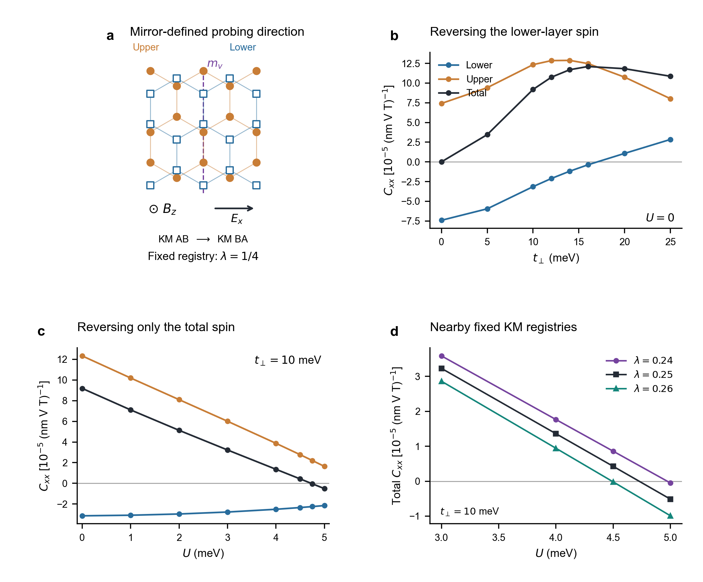
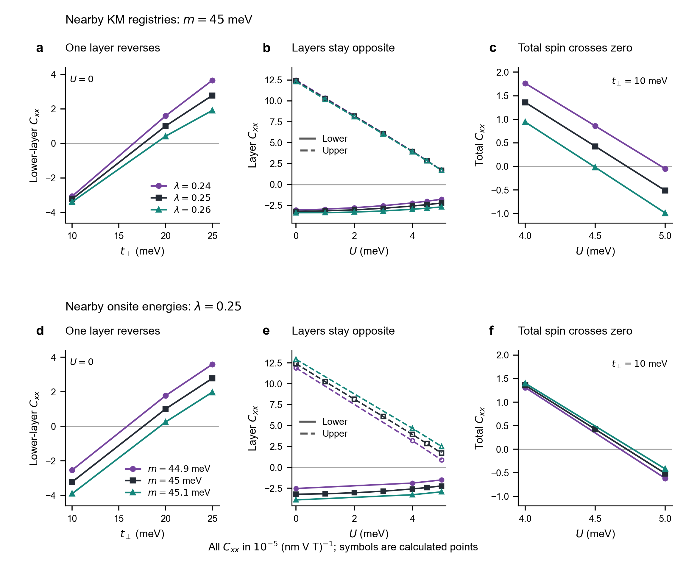
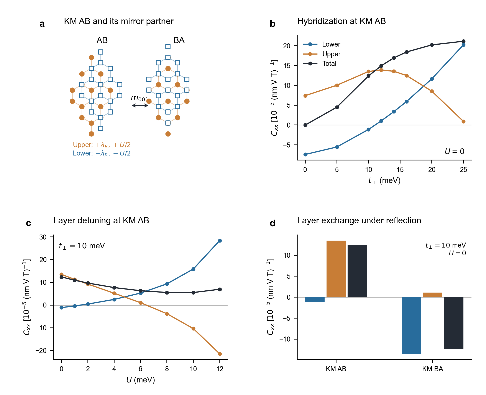
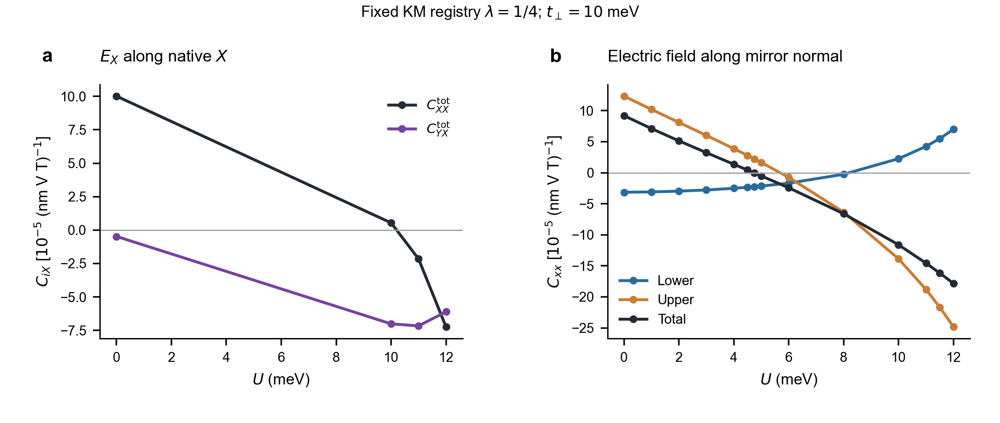
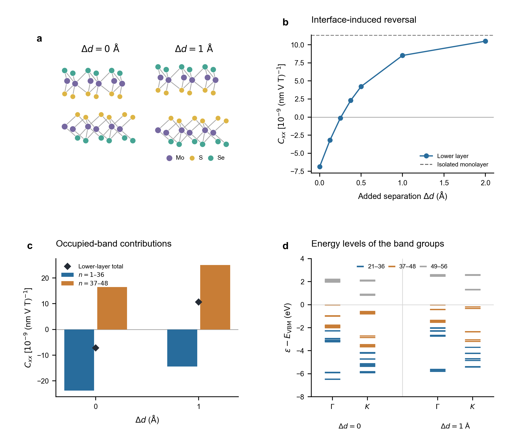
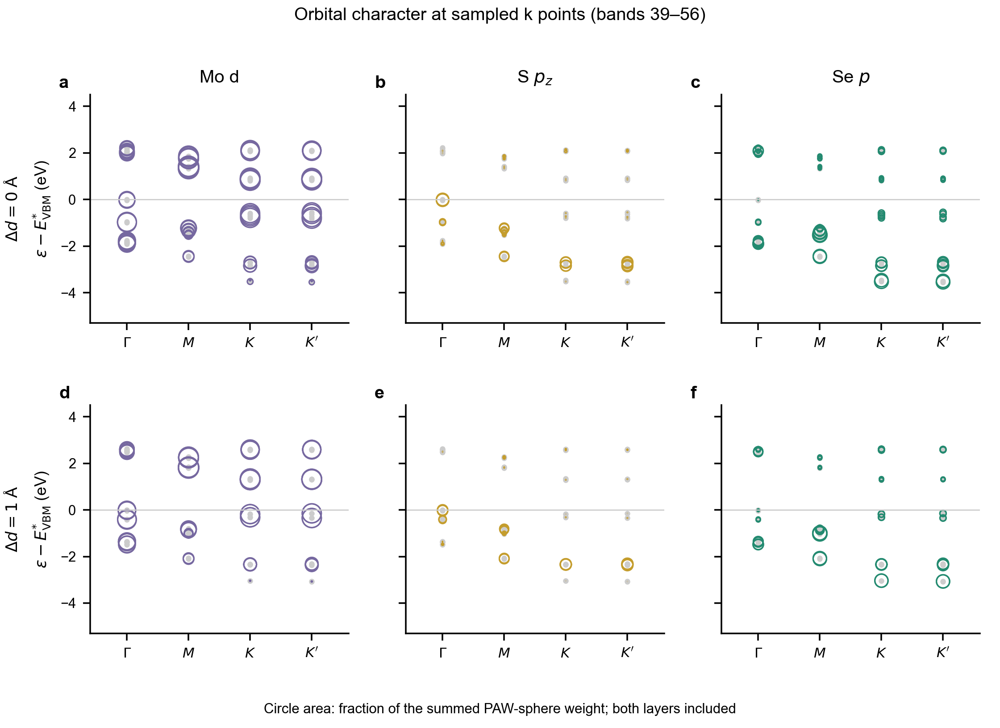
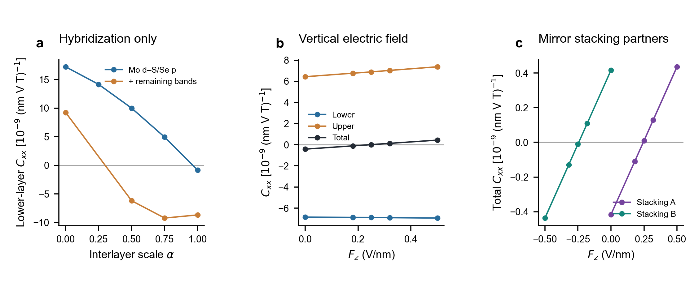
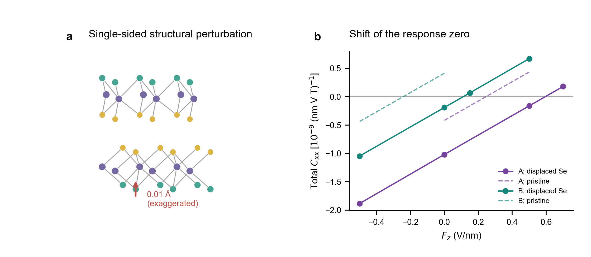
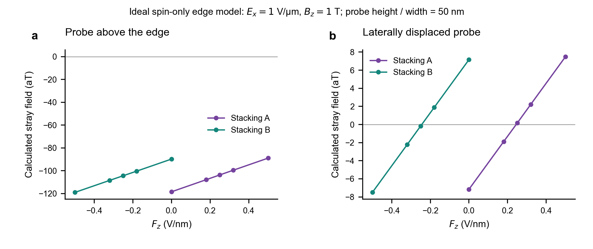
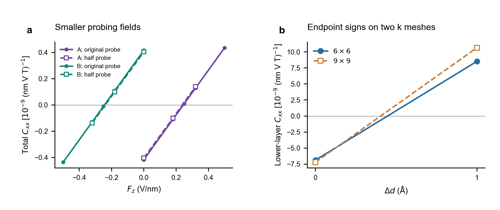

# 双层绝缘体中层分辨自旋响应的界面调控

> 连续讨论稿，更新于 2026-11-06。当前将物理问题、模型、材料、理论定义和验证放在同一篇文档中；待科学故事确定后再压缩篇幅、决定哪些内容移入 SM。模型使用“KM AB/BA”，材料使用“MoSSe S/S 堆垛 A/B”。研究沿革与数据来源统一见 [worklog](worklog.md)。

## 1．物理问题：一层自身翻向，还是两层补偿改变？

孤立层的晶体取向通常是判断其场致自旋方向的起点。形成双层界面后，这一判断是否仍然成立？我们研究固定层取向和探测场方向时，层间杂化能否使指定层的非线性磁电自旋响应相对孤立层反向，以及层间能级差能否进一步控制这一响应。这与只改变上下层贡献的相互抵消不同：前者改变同一层自身的响应符号，后者可以在两层各自不反向时改变双层总信号。

这里讨论零温、化学势位于带隙中的固定离子响应。面内电场 $E_x$ 和垂直自旋 Zeeman 场 $B_z$ 是产生响应的两个探测场；另用垂直静电场 $F_z$ 调节双层的电子结构。$F_z$ 与 $B_z$ 是不同物理量；$F_z$ 也不等于材料的电极化。以下所有层方向均在同一实验室坐标系中比较。

## 2．KM 模型：同一固定堆垛中的两种反转

我们从 Jia 等研究绝缘态 NMEE 所采用的 Kane–Mele 模型出发，增加层自由度。[1] 单层由蜂窝晶格的两个亚晶格 $a,b$ 构成，每个格点保留自旋上下两个态。其四类相互作用为

$$
H_{\rm KM}=-t_0\sum_{\langle ij\rangle}c_i^\dagger c_j
+i\lambda_R\sum_{\langle ij\rangle}c_i^\dagger(\boldsymbol\sigma\times\hat{\mathbf d}_{ij})_z c_j
+i\lambda_{\rm SO}\sum_{\langle\!\langle ij\rangle\!\rangle}\nu_{ij}c_i^\dagger\sigma_zc_j
+m\sum_i\xi_i c_i^\dagger c_i.
\tag{1}
$$

$c_i=(c_{i\uparrow},c_{i\downarrow})^T$，$\boldsymbol\sigma$ 作用于自旋；$t_0$ 是最近邻跃迁，$\lambda_R$ 是 Rashba 自旋轨道耦合，$\lambda_{\rm SO}$ 是次近邻本征自旋轨道耦合。$\xi_a=+1,\xi_b=-1$，所以 $m$ 为亚晶格在位能差的一半。$\hat{\mathbf d}_{ij}$ 沿电子从 $j$ 到 $i$ 的键方向，$\nu_{ij}=\pm1$ 标记次近邻路径的左右转向。键求和包括反向键以保证厄米性，不再重复加一遍厄米共轭；键方向及完全展开的 Bloch 矩阵列于第 6 节。

将两张单层按水平镜像取向堆叠，取上、下层为分块顺序，得到

$$
H_{\rm bi}(\mathbf k)=
\begin{pmatrix}
h_{\rm KM}(\mathbf k;m,+\lambda_R)+\dfrac U2 I_4 & t_\perp T(\mathbf k;\mathbf u)\\
t_\perp T^\dagger(\mathbf k;\mathbf u) & h_{\rm KM}(\mathbf k;m,-\lambda_R)-\dfrac U2 I_4
\end{pmatrix}.
\tag{2}
$$

水平镜像保持本征 SOC 和亚晶格在位项，使 Rashba 项反号。$T$ 是由两层相对平移 $\mathbf u$ 决定的无量纲层间跃迁矩阵，含同亚晶格和跨亚晶格路径；$t_\perp$ 共同缩放这些路径。$U$ 是上层相对下层的势能差，分别给两层加 $+U/2$ 与 $-U/2$。因此，改变 $t_\perp$ 是改变层间电子混合，改变 $U$ 是改变两层能级的相对位置。二者均可能影响最终本征态，不能把其作用简单等同于两个互不相关的物理过程。

为在同一构型中区分局域反向与层间补偿，我们研究 KM AB–BA 连线上的中间堆垛。用 $\lambda$ 表示沿该连线的相对位置：$\mathbf u(\lambda)=(1-\lambda)\mathbf u_{\rm AB}+\lambda\mathbf u_{\rm BA}$，其中下层相对上层的平移在 $120^\circ$ 基矢下为 $\mathbf u_{\rm AB}=(1/3,2/3)$、$\mathbf u_{\rm BA}=(2/3,1/3)$。主图固定 $\lambda=1/4$，改变电子耦合而不移动原子；邻近的 $\lambda=0.24,0.26$ 用于检验这一选择是否特殊。这里的 $\lambda$ 是堆垛位置参数，与两种 SOC 强度无关。电子模型不包含堆垛总能量，因此中间构型作为固定结构的机理算例，不被指定为自由双层的稳定基态。

这些构型保留一个不交换上下层的竖直镜面 $m_v$。我们令探测电场沿该镜面在材料平面内的法线，并将这一方向记为 $x$，磁场仍沿 $z$。此时 $E_xB_z$ 只允许诱导沿 $x$ 的自旋，两层的横向与面外 NMEE 自旋均被镜面对称性禁止。因此，下面的总系数过零可以表示这一阶诱导自旋的相消，而不仅是某一投影为零。这里的 $m_v$ 与交换两层、联系镜像伙伴的水平镜面 $m_{001}$ 不同。一般电场方向下，纵向投影过零仍可能留下横向自旋；图 4 对比这两种探测条件。

半填充占据八条能带中的四条，所展示的扫描均保持绝缘。参数为 $t_0=0.85$ eV、$\lambda_{\rm SO}=10$ meV、$\lambda_R=20$ meV、$m=45$ meV，最近邻键长 $a=0.142$ nm。具体位移、坐标与层间跃迁形式列于第 6 节。

### 响应系数及测量对象

用 $P_\ell$ 投影到第 $\ell$ 层，定义层自旋算符 $\Sigma_x^\ell=\{P_\ell,\Sigma_x\}/2$；本模型中 $P_\ell$ 与自旋矩阵对易，因此等于 $P_\ell\Sigma_x$。磁场始终耦合双层的总自旋，电场也作用于整个双层；只有读出的自旋按层划分。令

$$
H(E_x,B_z)=H_{\rm bi}+eE_x\hat x-\zeta B_z\Sigma_z,
\qquad
\delta s_x^\ell=C_{xx}^\ell E_xB_z,
\qquad
C_{xx}^{\rm tot}=C_{xx}^{\rm lower}+C_{xx}^{\rm upper}.
\tag{3}
$$

$e>0$，$\zeta$ 是采用该自旋算符时的 Zeeman 耦合系数；本模型沿用原计算约定 $\zeta=g\mu_B$、$g=10$。$s_x^\ell$ 按单位面积的 Pauli 自旋期望值计，图中不再乘额外的磁矩因子。

为使正文定义对应实际结果，我们使用静态混合导数

$$
C_{xx}^\ell=\left.\frac{\partial\chi_{x;x}^\ell(B_z)}{\partial B_z}\right|_{B_z=0},
\qquad
\chi_{x;x}^\ell(B_z)=
-2e\,\mathrm{Im}\!\int_{\rm BZ}\!\frac{d^2k}{(2\pi)^2}
\sum_{\substack{n\in\mathrm{occ}\\m\in\mathrm{unocc}}}
\frac{\langle u_n|\Sigma_x^\ell|u_m\rangle\langle u_m|\partial_{k_x}H|u_n\rangle}
{(\varepsilon_m-\varepsilon_n)^2}.
\tag{4}
$$

这里的能量和态均在有限 $B_z$ 下求得；$\partial_{k_x}H$ 是能量对波矢的导数，等于 $\hbar v_x$。先求磁场存在时自旋对电场的线性响应，再取其随磁场的一阶变化，便得到 $E_xB_z$ 系数。带隙在微扰中不闭合，占据带数保持不变。式 (4) 包含完整的占据—未占据带间求和；它给出本文实际计算的物理量。与原 NMEE 几何表达式的对应及完整静态导数见第 6 节；以下讨论围绕完整响应展开。

### 界面能够改变同一层的响应方向

图 1｜同一 KM 堆垛中的局域自旋反向与层间补偿。(a) $\lambda=1/4$ 构型的俯视示意；橙色圆点、蓝色方框代表上、下层，紫色虚线为竖直镜面 $m_v$ 的面内迹线，$E_x$ 垂直该迹线，$B_z$ 垂直材料。(b) 固定 $U=0$，改变层间跃迁强度。(c) 固定 $t_\perp=10$ meV，改变层势差，展示两层保持异号的首次总响应过零区间；更大 $U$ 见图 4。(d) 邻近三个固定堆垛的总响应过零。蓝、橙、黑依次为下层、上层和总值；单位为 $10^{-5}(\mathrm{nm\,V\,T})^{-1}$，正号对应正 $E_xB_z$ 下的 $+x$ 自旋。连线连接计算点，不代表滑移运动或能量路径。

层间杂化使下层响应偏离孤立层，并最终反向［图 1(b)］。解耦下层的系数为 $-7.41$；在 $t_\perp=10$ meV 时为 $-3.15$，增至 20 meV 后变为 $+1.08$，单位均为 $10^{-5}(\mathrm{nm\,V\,T})^{-1}$。同层过零位于 16 与 20 meV 之间，上层在这一范围保持正响应。层的朝向、堆垛、占据带数和探测场方向均未改变，带隙也没有闭合。因此，形成界面不仅能改变两层对总响应的权重，还能改变某一层自身的带间磁电响应方向。

从同一 $t_\perp=10$ meV、$U=0$ 状态出发，固定杂化强度而增加层势差，出现另一种反转［图 1(c)］。在 $U=0$ 至 5 meV 区间，下层始终负、上层始终正；上层响应减弱得更快，总响应在约 $U=4.7$ meV 过零。此时两层自旋仍各自存在，只是大小相等、方向相反。这与图 1(b) 中同一下层自身翻向不同：仅观察总信号变号，无法判定发生了哪一种过程。

为检验上述对照是否依赖精确的四分之一位置，我们在同一探测方向下比较 $\lambda=0.24,0.25,0.26$，并在固定 $\lambda=0.25$ 时比较 $m=44.9,45,45.1$ meV。

图 2｜两种反转过程在邻近 KM 堆垛与参数中共存。上排固定 $m=45$ meV，颜色与符号区分 $\lambda=0.24,0.25,0.26$；下排固定 $\lambda=0.25$，区分 $m=44.9,45,45.1$ meV。(a,d) 固定 $U=0$，增强层间杂化使同一下层由负转正。(b,e) 固定 $t_\perp=10$ meV，改变层势差：实线为下层，虚线为上层，各层保持原方向。(c,f) 同一组数据的总响应，放大 $U=4$–$5$ meV 的过零区间。系数单位统一为 $10^{-5}(\mathrm{nm\,V\,T})^{-1}$；连线仅连接计算点，各参数的取样数量不同，未拟合补点。

图 2 将“层自身翻向”和“层间补偿”分别显示出来：三种相邻堆垛都保留前者，也都能在上下层保持异号时实现后者。变化的是临界控制量与幅值，两个过程并不依赖精确的四分之一位置。这里验证的是邻域中的共存，而非整个滑移路径的普遍定律；更远的 $\lambda=0.30$ 或 $m=46$ meV 未在已检查的杂化范围重现下层反向。这些对照也说明，对称性允许一种响应，并不保证任意电子参数下都能把它调过零。

水平镜像还给出可迁移的结构关系：$m_{001}$ 将 $\lambda$ 映射为 $1-\lambda$，交换上下层，并使 $C_{xx}^{\mathrm{lower}}(1-\lambda,U)=-C_{xx}^{\mathrm{upper}}(\lambda,-U)$。这是模型镜像伙伴与后面 MoSSe S/S 堆垛 A/B 的共同对照标准；并不把 KM 的中间构型等同于材料的某个具体堆垛。

### 高对称构型与探测方向的对照

图 3｜高对称 KM AB 与 KM BA 对照。(a) 两个构型的俯视结构和水平镜像关系。(b) KM AB 在 $U=0$ 下的杂化扫描。(c) KM AB 在 $t_\perp=10$ meV 下的层势差扫描。(d) $t_\perp=10$ meV、$U=0$ 时两个镜像伙伴的层响应。数据保留原生 $X$ 探测方向；KM AB/BA 的三重旋转与竖直镜面使这里的纵向系数等价于正文方向。

KM AB 在 $t_\perp=10$ 至 12 meV 之间出现下层反向；固定 $t_\perp=10$ meV，仅改变层势差也能使下层反向。因此“同层翻向”并不依赖四分之一构型。另一方面，此参数下 $U=0\ldots12$ meV 的 KM AB 总响应保持正，没有重现正文中两层保持原方向、只有总响应翻号的过程。这个对照没有证明 KM AB 在其他参数下不可能补偿；它说明两类过程的共存不是由双层自由度或镜像关系自动保证。

KM AB/BA 的水平镜像交换层并反转面内自旋，故两构型在 $U=0$ 下都可呈下负上正，而占优势的层相反。不能把“镜像伙伴”解释为同一标签层的系数必须互为负号。

图 4｜KM 四分之一堆垛的探测方向与门控范围。(a) 沿模型原生 $X$ 的电场方向：总 $C_{XX}$ 变号时，总 $C_{YX}$ 并不消失。(b) 沿竖直镜面法线的电场方向，展示 $U=0\ldots12$ meV 的完整已算层势差范围；图 1(c) 只取首次总响应过零附近的 $0\ldots5$ meV。两图均固定 $t_\perp=10$ meV、$m=45$ meV。两种电场方向分别计算。

沿原生 $X$ 的约 10.25 meV 过零只说明 $s_X$ 的总投影为零，不能说明总诱导自旋消失。图 1 利用保留的竖直镜面选取探测方向，镜面禁止另外两个自旋分量，因而约 4.7 meV 的纵向过零才对应这个 $EB$ 阶完整自旋的相消。坐标与轴矢量变换见第 6 节。

更大 $U$ 下，单层自身也会反向。对完全解耦且占据不变的绝缘层，刚性层势差不改变响应；这里的门控作用也依赖层间耦合。因此正文的“两层方向不变”明确限于第一次补偿附近，不推广到整个门控范围。层响应和总响应不是不同的相，也不能只根据控制量叫作“门控”就事先认定它只调权重。

## 3．MoSSe：从模型命题到材料验证

模型得到的材料命题是：形成界面可以使指定层的 NMEE 相对其孤立层参照反向。为避免正负号约定掩盖这一共同点，可定义 $R_\ell=C_{xx}^\ell/C_{xx}^{\ell,\mathrm{iso}}$，其中参照层具有相同朝向和场协议，且响应非零。$R_\ell<0$ 表示相对孤立层反向，不依赖统一的自旋正号约定。KM 中增强杂化进入这一状态；若 MoSSe 接触态已经处在这一状态，拉开层距则应恢复孤立层方向。两者不需要具有相同的原始系数符号。

### 结构与孤立层参照

先用 Janus MoSSe 检查上述两个问题。固定下层由下至上的化学朝向 Se–Mo–S，采用 BSF 记号 $\{O\mid\boldsymbol\tau\}$ 指明上层相对下层的取向和平移。表中平移坐标采用材料数据库的 $120^\circ$ 面内基矢，省略层间的共同竖直平移。不同结构必须用同一个下层朝向和实验室场方向比较。

| 体系及作用 | 堆垛操作／结构变化 | 下层 $C_{xx}$ | 上层 $C_{xx}$ | 总响应 |
|---|---|---:|---:|---:|
| 孤立单层参照 | Se–Mo–S，7265 | 单层 $+11.31$ | — | 同单层 |
| 反演对称双层参照 | $\{I\mid(2/3,1/3)\}$，7270 | $-22.6$ | $+22.6$ | 对称性要求零 |
| S/S 原堆垛 A | $\{m_{001}\mid(1/3,2/3)\}$，7269 | $-6.85$ | $+6.43$ | $-0.42$ |
| S/S 镜像伙伴 B | $\{m_{001}\mid(2/3,1/3)\}$ | $-6.43$ | $+6.84$ | $+0.42$ |
| A，增大层间距 | $\Delta d=1$ Å | $+8.52$ | $-8.61$ | 约 $-0.085$ |
| A，固定结构加垂直场 | $F_z=+0.50$ V/nm | $-6.94$ | $+7.37$ | $+0.44$ |
| 同向 S/Se 双层 | $\{E\mid(2/3,1/3)\}$，7266 | $-99.10$ | $+110.02$ | $+10.92$ |

表中单位均为 $10^{-9}(\mathrm{nm\,V\,T})^{-1}$。这是一张物理对照表，汇集不同阶段的有限精度结果：单层为图 5(b) 的独立同网格参照，反演双层为早期较密网格层值，其余采用相应直接计算；不据末位数字比较增强比例。$\Delta d=1$ Å 的较密网格下层为 $+10.64$，支持正号。有限层距处的小总残差不被称为对称性严格为零。BiDB 将 7266、7269、7270 标为滑移稳定；7266 为其收录候选中的最低能结构，非保证所有制备条件下都优先形成。[2] 镜像 B 在自由、上下对称环境下继承 A 的结构稳定性；拉开层距的构型仅作机理对照。

图 5｜MoSSe 中相对孤立层的响应反转。(a) S/S 双层原结构及刚性增加层距 1 Å 的对照；紫、黄、绿分别为 Mo、S、Se。(b) 下层响应随附加层距 $\Delta d$ 的变化，虚线为相同化学朝向的孤立单层参照。(c) 第 1–36 和 37–48 条占据带的贡献，菱形为下层总值。(d) 两个层距下 Γ、K 点的离散能级，用同色标明带组；展示第 21–56 带，灰色为未占据态，各构型以其采样 VBM 为零。原 S/S 间距约 2.987 Å，所有带号按每个波矢处的能量从低到高排列。

MoSSe 接触态中的下层响应与同朝向的孤立层相反［图 5(b)］。增大层距后，下层由负转正，并逐渐接近孤立层的正响应。这给出模型命题的材料实例：相邻层可以改变该层的响应方向，减弱界面作用则使其恢复。拉层在此用于辨认界面作用，不被当成已完成的实验驱动方案；图中加入孤立层基准，是为了直接显示这种恢复关系。

这一反转涉及的占据态并不限于 VBM 附近。将 48 条占据带按能量顺序分为第 1–36 和 37–48 带后，前一组在接触态给出约 $-23.7$，后一组给出 $+16.5$；增加 1 Å 层距后分别变为约 $-14.4$ 和 $+25.1$［图 5(c)］。因此，不能用最高几条价带的响应替代完整占据态求和。图 5(d) 将这些编号对应到实际能级，避免把“较深价带”当作未定义的轨道名称。这是带组的合计贡献，并不意味着组内每条带同号，也尚未确定唯一的主导跃迁对。

已有轨道投影显示 Γ 附近的界面 S $p_z$ 混合随层距变化，而其他价带含 Mo $d$ 与硫族 $p$ 成分；图 6 将这些离散点的轨道权重画出。但轨道权重不包含自旋—电场矩阵元的相对相位，不能单独确定响应符号。要进一步说明哪组电子态造成反转，还须连接轨道混合、带间矩阵元和全布里渊区贡献，而不能仅凭 Γ 点的带边变化作归因。

图 6｜高对称点的轨道投影能级。上、下排分别为 $\Delta d=0,1$ Å；三列分别为 Mo $d$、S $p_z$、Se $p$。展示既有 Γ、M、K、K′ 点第 39–56 带，圆面积为该通道占全部 PAW 原子球投影权重的比例，两层求和。$E_{\rm VBM}^{*}$ 是这四个点中最高占据能级；数据沿用既有正 Zeeman 准备场、零面内电场，其物理对象是准备场下的离散轨道投影，而非零场连续能带。

图中 Γ 点的 S $p_z$ 权重和能级劈裂随层距改变，而 K 附近一些带仍以 Mo $d$ 为主。它支持界面改变电子态成分，但没有给出 NMEE 矩阵元的符号。该图只覆盖顶部十条占据带和八条空带，不能用来为第 1–36 带的全部贡献指定轨道来源。主图 5(d) 与本图的数据窗口不同，各自明确标号。

图 7｜层间杂化干预与固定结构下的静电控制。(a) 将原结构材料模型的整个 $d+p$ 层间块缩放为 $\alpha T$，其余按原模型保持不变；分别展示 44 态投影和 112 态嵌入模型。(b) 原堆垛 A 的层响应和总响应随垂直场 $F_z$ 的变化。(c) A 与镜像伙伴 B 的总响应及过零场；虚线为零响应。材料系数单位统一为 $10^{-9}(\mathrm{nm\,V\,T})^{-1}$，所有连线连接离散计算点。

仅改变层间跃迁就能引发材料模型的同层反转［图 7(a)］，进一步支持杂化的因果作用，而非仅凭层距与响应的相关性作判断。两种保留态空间都得到原始杂化下的负响应和弱杂化下的正响应；临界缩放与幅值不同，故目前能确定的是反转的存在，不能由此给出精确临界压力或唯一最小轨道集合。这里的 $\alpha=0$ 保留原界面的层内哈密顿量，也不等于重新自洽计算的自由单层。

### 固定结构下的门控与镜像伙伴

在所考察的 MoSSe 栅场区间，控制总自旋不需要使任何一层自身反向［图 7(b)］。固定 S/S 堆垛 A 的原子位置，下层保持负响应，上层保持正响应；上层随场增强并超过下层的绝对值，使总响应由负转正。它与 KM 图 1(c) 对应同一种物理过程：改变两层的补偿，而非使任一层自身反向。具体哪一层随正控制场增强不构成普适规律；材料栅场与模型势能差也不是同一符号约定或数值标度。定义总响应过零场 $F_0$ 满足

$$
C_{xx}^{\rm tot}(F_0)=0.
\tag{5}
$$

$F_0$ 只表示两层的 $E_xB_z$ 诱导自旋恰好抵消；它不是自发磁化消失、磁相变或堆垛畴切换的矫顽场。材料中的 $F_z$ 会受到屏蔽，其与 KM 层势能差 $U$ 之间没有未经标定的数值等号。本文材料图的 $F_z$ 正号沿用计算的电子受力场约定，换成器件顶、底栅接线极性需另行标定。

水平镜像 $m_{001}$ 交换两层并反转面内自旋，同时保持 $E_x$、$B_z$ 不变、使 $F_z$ 反号。在上下对称环境中，A、B 因而满足

$$
C_{xx}^{\rm lower,B}(F_z)=-C_{xx}^{\rm upper,A}(-F_z),\qquad
C_{xx}^{\rm tot,B}(F_z)=-C_{xx}^{\rm tot,A}(-F_z).
\tag{6}
$$

独立 DFT 给出零偏场两畴均为下负上正，但占优势的层相反。其总响应分别在约 $+0.24$、$-0.24$ V/nm 过零［图 7(c)］。这是两个完整堆垛之间的关系，不意味着 A 或 B 自身具有水平镜面对称。这些过零场能否用于实际畴读出，还需检查环境与探针的空间权重，见第 4 节。

## 4．从响应过零到实验辨认：环境与探针的作用

模型与材料中的总自旋过零，是一个明确的响应条件。把它用于实验辨认堆垛，还需要知道外部环境怎样改变响应，以及仪器是否给上下层相同的权重。

### 内建偏场与单侧环境

图 8｜单侧表面扰动与响应过零场。(a) 下层外侧 Se 向 Mo 面移动 0.01 Å，其他位置固定；箭头放大。(b) 对 A/B 施加相同扰动后的总响应；虚线为未扰动自由双层，实线为扰动后结果。

A/B 的过零场由约 +0.24/−0.24 V/nm 变为 +0.59/+0.11 V/nm。此例中两者间距仍约 0.48 V/nm，但两个场都已为正。因此不能在未知环境偏置时仅按过零场的正负给堆垛畴贴标签。

这不是具体基底计算，也不是一个已证明稳定的表面畸变。它的价值是说明绝对过零场并不由自由双层的镜像关系保护；不能由此宣称所有基底只会平移曲线。先前 KM 的共同标量偏置则严格使两条曲线一起平移，但真实单侧环境还可改变杂化和屏蔽。

### 测量信号是否与总自旋具有同一个零点？

图 9｜空间探测权重对磁信号零点的影响。由既有 DFT 自旋密度计算理想长直边缘磁场，取 $E_x=1$ V/μm、$B_z=1$ T，矩形探针高度和宽度均为 50 nm。(a) 位于边缘正上方。(b) 横向位移约 55.9 nm。两面板纵轴范围不同，仅计自旋磁场。

正上方探针的信号在已扫场区间不经过零，而位移后的理想探针能恢复接近 ±0.24 V/nm 的零点。这说明总层自旋抵消，不一定使每个局域磁信号都消失。原因是探针给不同深度的自旋不同权重，且每层内部本身也有较强的正负抵消。以两个净层自旋薄片替代真实空间密度，可能连主导深度矩的符号都算错。

优化位置后的零场信号仍只有约7 aT，现阶段没有相应可测信噪比证据。模型未包括轨道磁化、边缘重构、实际封装与噪声，因此不能把它写成可直接实施的磁成像方案。光学信号也不能不经磁光系数计算就与总自旋等同。

## 5．已确立的物理与尚待解决的机制

目前最明确的结论是：界面能够使一层的场致自旋响应相对其孤立层反向，即使层取向、探测场方向和绝缘占据都不变。同一个 KM 堆垛还允许仅改变两层补偿而使总响应翻号，两类过程在 MoSSe 中都有对应算例。因此，总信号反转本身不足以证明局域自旋反向。邻近 KM 构型支持这一现象不依赖精确的四分之一位置；KM AB 对照则明确了它并非所有堆垛、所有参数下的必然结果。MoSSe 的冻结跃迁对照为杂化的作用提供了比单纯层距扫描更直接的依据；占据带分解也说明，仅凭带边权重或最小能隙变化还不足以确定机制。

与已有 LEE 相比，层相反自旋、门控改变层权重以及总响应变号本身不是新的基本概念。[3] 当前应继续追问的是绝缘静态带间响应中，界面怎样改变局域自旋—电场耦合的符号。模型里已经出现的同层反转，尚需进一步归结到能级排列和带间矩阵元；MoSSe 中也尚未辨认出对不同投影方法都稳定的唯一轨道路径。这是当前机制叙述未闭合的部分，不能用“KM 与 DFT 一致”一句略过。

后续是否换材料，可在这一步更清楚后决定。MoSSe 暂时承担机制研究的材料参照；与 LEE 使用相同材料并不自动否定本工作的物理，但更换材料名称本身也不会补足机制。新体系宜根据主导能级差、层间轨道耦合、响应量级与实际调控方式选择。

## 6．模型、响应与验证的完整定义

以下保留判断上述物理所需的公式、算符和数值边界。它们与结果属于同一份稿件，目前不单独划作补充材料。

### 单层矩阵与层间跃迁

本节先使用模型原生面内坐标 $(X,Y)$ 展开 Hamiltonian；正文探测坐标 $(x,y)$ 与它相差一个面内转动，见本节后文。基底为 $(a\uparrow,a\downarrow,b\uparrow,b\downarrow)$。最近邻矢量为

$$
\boldsymbol\delta_1=a(0,1),\quad
\boldsymbol\delta_2=a(\sqrt3/2,-1/2),\quad
\boldsymbol\delta_3=a(-\sqrt3/2,-1/2).
$$

令 $\mathbf b_1=\boldsymbol\delta_2-\boldsymbol\delta_3$、$\mathbf b_2=\boldsymbol\delta_3-\boldsymbol\delta_1$、$\mathbf b_3=\boldsymbol\delta_1-\boldsymbol\delta_2$。与现有计算一致的矩阵为

$$
h_{\rm KM}(\mathbf k)=
\begin{pmatrix}
mI_2+d_{\rm SO}(\mathbf k)\sigma_z & q(\mathbf k)\\
q^\dagger(\mathbf k)&-mI_2-d_{\rm SO}(\mathbf k)\sigma_z
\end{pmatrix},
$$

$$
d_{\rm SO}=-2\lambda_{\rm SO}\sum_j\sin(\mathbf k\cdot\mathbf b_j),\qquad
q=-\sum_j e^{i\mathbf k\cdot\boldsymbol\delta_j}
\left[t_0I_2+i\lambda_R\frac{\sigma_X\delta_{jY}-\sigma_Y\delta_{jX}}a\right].
$$

$\boldsymbol\delta_j$ 是矩阵行亚晶格 $a$ 指向列亚晶格 $b$ 的位移；实空间式 (1) 的 $\hat{\mathbf d}_{ij}$ 沿相反的 $j\to i$ 方向。$\nu_{ij}$ 的选择对应上面的 $d_{\rm SO}$ 负号。键方向和基底约定可改变表面上的符号，但必须同时变换全部态与算符。这里以展开式为数值约定。

令 $M_s=I_2\otimes\sigma_z$，则 $M_sh_{\rm KM}(\lambda_R)M_s^\dagger=h_{\rm KM}(-\lambda_R)$。该矩阵与物理自旋镜像矩阵只差整体相位；它反转 $\sigma_{x,y}$，保持 $\sigma_z$，给出双层两对角块的关系。

取 $\mathbf a_1=\boldsymbol\delta_1-\boldsymbol\delta_2$、$\mathbf a_2=\boldsymbol\delta_1-\boldsymbol\delta_3$，夹角为 $60^\circ$；轨道位置为 $\mathbf r_a=0,\mathbf r_b=\boldsymbol\delta_1$。模型中 $\mathbf u$ 是下层相对上层的平移，层间矩阵为

$$
T_{pq}(\mathbf k;\mathbf u)=\sum_{\mathbf R}
\exp\!\left[-\frac{|\mathbf R+\mathbf r_q-\mathbf r_p+\mathbf u|^2}{\rho^2}\right]
e^{i\mathbf k\cdot(\mathbf R+\mathbf r_q-\mathbf r_p+\mathbf u)}I_2,
\qquad p,q\in\{a,b\}.
$$

衰减长度 $\rho=0.16$ nm，计算对 $\mathbf R=n_1\mathbf a_1+n_2\mathbf a_2$ 取 $n_1,n_2=-5,\ldots,5$。矩阵包含自旋守恒的同亚晶格与跨亚晶格跃迁，以面内错位确定路径的相对强度；没有实际压力或层距与 $t_\perp$ 的标定。

KM AB、KM BA 在 $120^\circ$ 基矢下的下层相对平移分别为 $(1/3,2/3)$、$(2/3,1/3)$，在 $60^\circ$ 基矢下分别为 $(-1/3,2/3)$、$(1/3,1/3)$。主图四分之一处为 $(5/12,7/12)$，等价于 $60^\circ$ 基矢下的 $(-1/6,7/12)$。材料 BSF 表描述的是上层相对下层的位置，两个表的参考层不同，不能不经变换直接等同分数坐标。KM 的位置参数 $\lambda$ 与 MoSSe S/S 堆垛 A/B 的标签也不是同一个变量。

“半填充”指每个波矢占据八带中的四带；不通过改变电子数保持绝缘。所有主图点保持绝缘占据子空间。

### 静态混合响应及其与 NMEE 量子几何的关系

在有限 $B_z$ 下，对电场扰动 $eE_x\hat x$ 做一阶微扰：

$$
\partial_{E_x}\langle S\rangle_n
=2e\operatorname{Re}\sum_{m\ne n}\frac{S_{nm}r^x_{mn}}{\varepsilon_n-\varepsilon_m}.
$$

由 $r^x_{mn}=i(\partial_{k_x}H)_{mn}/(\varepsilon_n-\varepsilon_m)$，占据态间的成对项相消，得到正文式 (4)。对 $B_z$ 求导时，能量和波函数均须求导；只求能量分母的导数并不完整。简并时对整个占据／未占据子空间求和，不给任意挑出的单个简并态赋予不变的物理贡献。

令 $W^\ell_{nm}=\langle u_n|\Sigma_x^\ell|u_m\rangle\langle u_m|\partial_{k_x}H|u_n\rangle$，$\Delta_{mn}=\varepsilon_m-\varepsilon_n>0$，则

$$
C_{xx}^\ell=-2e\operatorname{Im}\int_{\mathbf k}\sum_{n\in\mathrm{occ},m\in\mathrm{unocc}}
\left[
\frac{\partial_{B_z}W^\ell_{nm}}{\Delta_{mn}^2}
-\frac{2W^\ell_{nm}\partial_{B_z}\Delta_{mn}}{\Delta_{mn}^3}
\right]_{B_z=0}.
$$

第一部分来自磁场改变电场—自旋带间矩阵元，第二部分来自磁场改变跃迁能量。层间杂化能够同时影响它们。轨道权重没有给出矩阵元的相对相位，普通能带图也没有给出磁场下矩阵元的变化，因此单看“p_z 增多”或“能隙减小”不能确定符号。简并处仍需采用能带组或投影算符表达式。我们尚未将这两部分在 KM 和 MoSSe 中完整比较，不把上述代数恒等式当成已经发现的材料机制。

数值采用 eV、nm、V，使 $e\times1\mathrm V=1\mathrm{eV}$；公式保留 $e$ 表示电荷来源。Zeeman 端与自旋读出端分别按正文定义，不额外加入未说明的 $1/2$。实际磁矩换算必须与 Zeeman 算符和有效 g 因子一致，不能把 Pauli 自旋数直接当成已标定的仪器读数。

当 $t_\perp=0$，$U/2$ 和 $-U/2$ 分别是两层的单位矩阵势移。只要占据不变，每层本征矢、层内能量差、自旋和速度矩阵元均不变。因此

$$
C_{xx}^\ell(t_\perp=0,U)=C_{xx}^\ell(t_\perp=0,0).
$$

此处另算 $U=-12,0,+12$ meV 核对这一关系，保持共同绝缘隙。AB 在有限 $t_\perp$ 下的势差反转依赖层间作用；“有栅场”本身不足以使完全孤立、无载流子注入的层发生这类变化。此处只讨论 Hamiltonian 中的刚性层势差，不等同于真实材料中同时改变层内轨道和屏蔽的全部栅场作用。

原 NMEE 正文采用 $H_1=-g\mu_B\mathbf B\cdot\boldsymbol\sigma+e\mathbf E\cdot\mathbf r$。按其 SM 的明确指标约定，

$$
\delta s_\alpha^{\rm paper}=\Gamma_{\alpha\gamma;\beta}E_\beta B_\gamma,
\qquad s_\alpha^{\rm paper}=\mu_B\langle\sigma_\alpha\rangle.
$$

第一指标是输出自旋，第二指标是磁场，分号后为电场；本文 $s_x,E_x,B_z$ 对应原文图 5 的 $\Gamma_{xz;x}$。原文某处本构式文字的 $E,B$ 下标排列与后续公式不一致，本稿采用上述 SM 和算例的约定。

原文正文 Eq. (1) 展示的两带内禀项为

$$
\Gamma_{\alpha\gamma;\beta}^{(2)}
=eg\mu_B^2\sum_{n\ne m}\int_{\mathbf k}f_n
\left[
\frac{4\bar\sigma^\gamma_{nm}Q^{\beta\alpha}_{nm}}{\varepsilon_{nm}^2}
+\frac{\bar V^\beta_{nm}\mathcal F^{\alpha\gamma}_{nm}}{\varepsilon_{nm}^3}
\right].
$$

其中 $f_n$ 为占据数、$\int_{\mathbf k}=\int_{\rm BZ}d^2k/(2\pi)^2$。$\varepsilon_{nm}=\varepsilon_n-\varepsilon_m$，$\bar\sigma^\gamma_{nm}=\sigma^\gamma_{nn}-\sigma^\gamma_{mm}$，$\bar V^\beta_{nm}=\partial_{k_\beta}\varepsilon_n-\partial_{k_\beta}\varepsilon_m$；$Q^{\beta\alpha}_{nm}=\operatorname{Re}(r^\beta_{nm}\sigma^\alpha_{mn})$，$r^\beta_{nm}=i\langle u_n|\partial_{k_\beta}u_m\rangle$。自旋空间张量 $\Sigma^{\alpha\gamma}_{nm}=\sigma^\alpha_{nm}\sigma^\gamma_{mn}$ 的虚部给出 $\mathcal F^{\alpha\gamma}_{nm}=-2\operatorname{Im}\Sigma^{\alpha\gamma}_{nm}$。系数依赖自旋、电场矩阵元，不仅依赖能隙。

原 NMEE 第一作者曾确认：改写 intrinsic/extrinsic 分类时，Eq. (37) 后两部分的 $m=n$ 项被遗漏，并会产生额外的 two-band 贡献。本文不以印刷式的缺项结果作为拟合目标，直接采用完整静态响应。这个更正属于响应定义的背景；场准备与归一化仍按实际计算定义。

当前 KM 使用正文式 (4) 的完整静态带间响应，再对全局 Zeeman 场求导。MoSSe 使用固定离子有限场电子态的混合响应。本文 $s$ 是 Pauli 自旋面密度，不含原文输出端的额外 $\mu_B$；只有在响应分支和归一化也一致时，才可用 $\Gamma=\mu_B C$ 换算。不能用“内禀”标签代替场协议的定义。

### 两种镜面分别约束什么？

在层顺序为上、下的基底中，令 $\mathcal M=\tau_x\otimes I_{\rm sub}\otimes\sigma_z$。对下层相对平移 $\mathbf u$，水平镜像交换两层，使 $\mathbf u\to-\mathbf u$、$U\to-U$。KM AB 和 KM BA 的 $60^\circ$ 坐标满足 $\mathbf u_{\rm BA}=-\mathbf u_{\rm AB}+(0,1)$；最后一项是晶格平移。实际矩阵满足

$$
H_{\rm BA}(\mathbf k,-U)=\mathcal M H_{\rm AB}(\mathbf k,U)\mathcal M^\dagger,
\qquad
\mathcal M\Sigma_x^{\rm lower}\mathcal M^\dagger=-\Sigma_x^{\rm upper}.
$$

总 $\Sigma_z$ 与镜像对易，任一面内 $E$ 不变。因此它确实是 $m_{001}$ 伙伴关系，而非某个面内法线的镜面。三个一般波矢点的哈密顿量残差约 $5.3\times10^{-18}$ eV，速度核和层自旋算符也单独验证。KM AB/BA 用同一积分设置独立计算，而不是把一条曲线手动取负。

同样，路径满足 $\mathbf u(1-\lambda)=-\mathbf u(\lambda)+(0,1)$，故上述关系推广为 $\lambda\leftrightarrow1-\lambda$。四分之一构型的水平镜像伙伴是四分之三构型，而不是 KM BA 端点。对同一面内探测方向，层系数交换层并反号，总系数整体反号，同时 $U\to-U$。这一结构约束不要求两个伙伴都是各自的能量极小点。

KM AB 的较细计算取 $m=45$ meV，81×80×120 积分参数和 0.03125 T 导数步长。41×45×72、0.0625 T 的对照支持局域反转与栅场端点符号，不能把采样区间端点称为精确临界值。

KM AB–BA 连线各构型保留竖直镜面。其面内迹线沿原生坐标的 $\mathbf e_\parallel=(\sqrt3/2,-1/2)$，面内法线为 $\mathbf n=(1/2,\sqrt3/2)$。图 1 采用

$$
\hat{\mathbf x}=\mathbf n,\qquad
\hat{\mathbf y}=(-\sqrt3/2,1/2),\qquad
\hat{\mathbf z}\ \text{不变}.
$$

这是右手系。相应地，$\Sigma_x^\ell=\Sigma_X^\ell/2+\sqrt3\Sigma_Y^\ell/2$，$\partial_{k_x}H=\partial_{k_X}H/2+\sqrt3\partial_{k_Y}H/2$；同时变换读出自旋和电场顶角，Zeeman 顶角仍是全局 $\Sigma_z$。不同方向的系数必须同时变换读出自旋和电场顶角。若原生面内响应矩阵为 $C^{XY}$，新系数为 $C^{xy}=R C^{XY}R^T$，$R$ 的两行为上述 $\hat{\mathbf x},\hat{\mathbf y}$。

在上述坐标中，$m_v:(x,y,z)\mapsto(-x,y,z)$。电场是极矢量，$E_x\mapsto-E_x$；磁场、自旋是轴矢量，$B_z\mapsto-B_z$，$(s_x,s_y,s_z)\mapsto(s_x,-s_y,-s_z)$。因此 $E_xB_z$ 为偶，而 $s_y,s_z$ 为奇，逐层要求

$$
C_{yx}^\ell=C_{zx}^\ell=0,\qquad
\delta\mathbf s^\ell=C_{xx}^\ell E_xB_z\hat{\mathbf x}.
$$

该镜面不交换层，刚性层势差 $U$ 和整体跃迁缩放 $t_\perp$ 均保持它。于是 $C_{xx}^{\rm tot}=0$ 才是当前 $E_xB_z$ 阶、当前探测方向下的完整诱导自旋相消；不包含其他场阶数、轨道磁化或基底破坏镜面后的情况。若将电场沿镜面迹线施加，面外自旋则被允许，该允许分量也出现在计算中，因而不能沿那个方向只以纵向过零判定完整补偿。

以 $U_v=I_4\otimes(n_X\sigma_X+n_Y\sigma_Y)$ 实现自旋镜像，核查 $H(m_v\mathbf k)=U_v H(\mathbf k)U_v^\dagger$。对 $\lambda=0,0.2,0.25,0.3,1$，抽查一般波矢的最大残差约 $5.6\times10^{-16}$ eV。面外响应独立检查在 $U=0,11.5,12$ meV 接近数值零；完整面内张量转动后也满足禁止的交叉分量约束。另在过零邻域 $U=4.75$ meV 独立读出三分量，横向、面外层与总系数均小于 $4\times10^{-16}(\mathrm{nm\,V\,T})^{-1}$。上述镜面是对零探测场 Hamiltonian 的对称性；有限 $B_z$ 时相应协变关系含 $B_z\to-B_z$。

### 公式核对、材料精度与带组分解

图 1 的四分之一参考曲线采用 81×80×120 的谷区积分参数和 0.03125 T 导数步长；图 2 的所有邻域对比统一采用 41×45×72 与 0.0625 T。两图中的中心参数因此不是同一次积分，不据幅值末位比较差异。三项积分参数不代表三维均匀 k 网格。

展开式与现有单层、双层矩阵在三个一般波矢点的最大差小于 $6\times10^{-17}$ eV；占据—空带公式与既有静态核的差小于 $2\times10^{-18}$。这些检查核对公式与实现；材料精度由下面的独立对照判断。MoSSe 的两种分解定义不同：vc_by_valence 通过 $Q=1-P_{\rm occ}$ 保留未占据补空间，vc_pairs 才是有限显式空带配对表。图 5(c) 使用前者，不能将它解释成只取八条空带。其分组总和与直接层响应相差约 0.05% 和 0.27%；不声称数值严格闭合。

本文的物理判断以完整静态响应与独立对照为准。

图 10｜有限场与积分精度对主要结论的影响。(a) 原探测电场 ±0.004 V/Å、Zeeman 能量 0.016 eV，与两者同时减半的总响应对照。(b) 两套 k 网格下原层距和增加 1 Å 的下层响应，连线仅连接端点。

减半探测场后，两畴过零场仍约为 ±0.24 V/nm；两套网格也保持下层在两个层距端点异号。因此，过零场与反转的存在比精确幅值更稳定。层系数仍有约一成场步长变化，临界层距也未完成密网格定位；这些数值检查不等于实验场强建议。

每个波矢有 48 条占据带，第 37–48 带称顶部 12 带，其余为第 1–36 带。主图 5(d) 仅将第 21–56 带的 Γ、K 能级放在可读的共同能量窗；第 1–20 带更低，仍计入图 5(c) 的积分。

占据带分解使用 $Q=1-P_{\rm occ}$ 的补空间，不能与仅保留有限条空带的配对表混为一谈。带号是能量排序，不自动构成跨整个布里渊区隔离的固定轨道子空间；分组内有很强的异号抵消。因此“1–36 为负、37–48 为正”是这套分组的数值结果，尚不是材料普适的两个通道定律。下一步识别主导过程必须检查对分组边界及简并子空间处理的稳定性。

## 参考文献

[1] J. Jia et al., *Nonlinear Magnetoelectric Edelstein Effect*, PRL 136, 226302 (2026). [DOI](https://doi.org/10.1103/r3x2-kb93)；Zotero 正文与 SM 已核读。

[2] BiDB 原始论文及其滑移稳定性定义。[DOI](https://doi.org/10.1038/s41467-024-45003-w)

[3] B. Zhou et al., *Layer Edelstein Effect*, PRL 137, 076401 (2026). [DOI](https://doi.org/10.1103/qhvs-pfkq)
