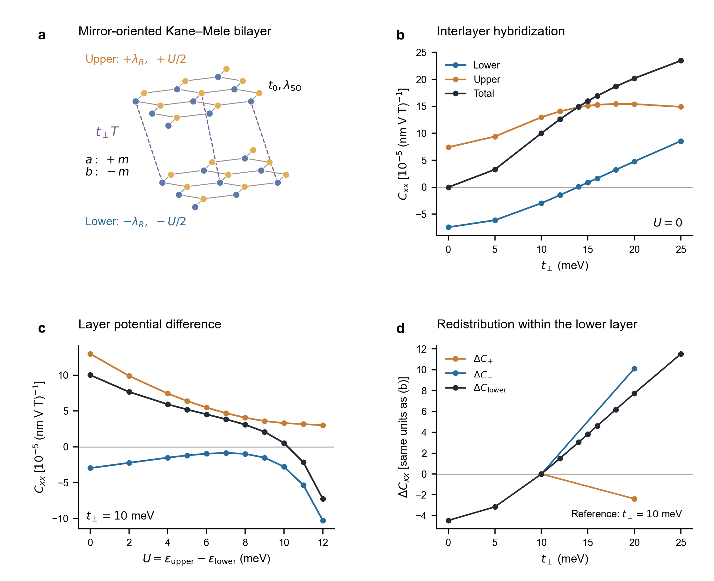
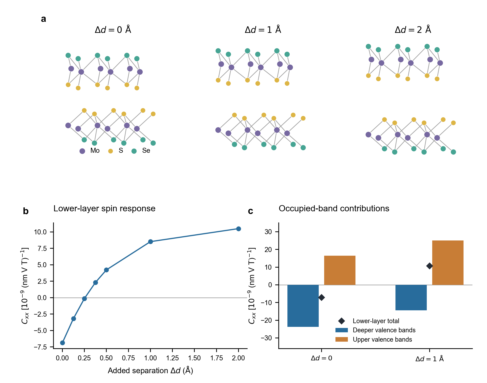
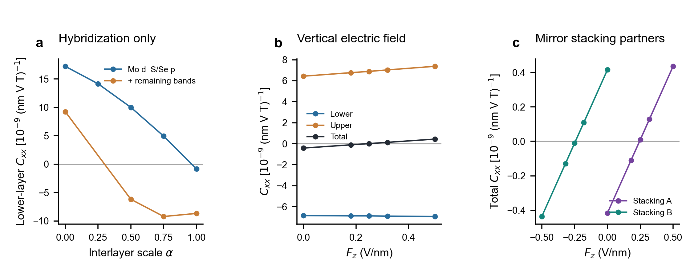

# 双层绝缘体中层分辨自旋响应的界面调控

> 2026-11-06 修订。先保留完整的理论定义、物理解释和材料对照，暂不按 PRL 篇幅删减。原有批注稿不变。公式的展开与原 NMEE 正文/SM 的对应放在[理论定义与公式核对](理论定义与公式核对.md)，[批注回应与机制问题](批注回应与机制问题.md)列出仍待讨论的结论。

## 1．问题：界面改变一层的自旋方向，还是改变两层的相互抵消？

在非磁双层绝缘体中，面内电场与垂直磁场共同诱导的自旋可以在上下层取相反方向。两层响应不等时，体系具有非零的总自旋响应。然而，总响应变号并不必然意味着某一层的诱导自旋反向：它也可能来自两个反向层响应的相对强度变化。我们关注更具体的界面效应——在单层的化学朝向、探测场方向与电子数不变时，层间杂化能否改变这一层自身的响应符号，以及这种变化由哪些带间过程产生。

这里讨论零温、化学势位于带隙中的固定离子响应。面内电场 $E_x$ 和垂直自旋 Zeeman 场 $B_z$ 是产生响应的两个探测场；另用垂直静电场 $F_z$ 调节双层的电子结构。$F_z$ 与 $B_z$ 是不同物理量；$F_z$ 也不等于材料的电极化。以下所有层方向均在同一实验室坐标系中比较。

## 2．双层 Kane–Mele 模型

我们从 Jia 等研究绝缘态 NMEE 所采用的 Kane–Mele 模型出发，增加层自由度。[1] 单层由蜂窝晶格的两个亚晶格 $a,b$ 构成，每个格点保留自旋上下两个态。其四类相互作用为

$$
H_{\rm KM}=-t_0\sum_{\langle ij\rangle}c_i^\dagger c_j
+i\lambda_R\sum_{\langle ij\rangle}c_i^\dagger(\boldsymbol\sigma\times\hat{\mathbf d}_{ij})_z c_j
+i\lambda_{\rm SO}\sum_{\langle\!\langle ij\rangle\!\rangle}\nu_{ij}c_i^\dagger\sigma_zc_j
+m\sum_i\xi_i c_i^\dagger c_i.
\tag{1}
$$

$c_i=(c_{i\uparrow},c_{i\downarrow})^T$，$\boldsymbol\sigma$ 作用于自旋；$t_0$ 是最近邻跃迁，$\lambda_R$ 是 Rashba 自旋轨道耦合，$\lambda_{\rm SO}$ 是次近邻本征自旋轨道耦合。$\xi_a=+1,\xi_b=-1$，所以 $m$ 为亚晶格在位能差的一半。$\hat{\mathbf d}_{ij}$ 沿电子从 $j$ 到 $i$ 的键方向，$\nu_{ij}=\pm1$ 标记次近邻路径的左右转向。键求和包括反向键以保证厄米性，不再重复加一遍厄米共轭；数值所用键方向及完全展开的 Bloch 矩阵见理论说明。

将两张单层按水平镜像取向堆叠，取上、下层为分块顺序，得到

$$
H_{\rm bi}(\mathbf k)=
\begin{pmatrix}
h_{\rm KM}(\mathbf k;m,+\lambda_R)+\dfrac U2 I_4 & t_\perp T(\mathbf k;\mathbf u)\\
t_\perp T^\dagger(\mathbf k;\mathbf u) & h_{\rm KM}(\mathbf k;m,-\lambda_R)-\dfrac U2 I_4
\end{pmatrix}.
\tag{2}
$$

水平镜像保持本征 SOC 和亚晶格在位项，使 Rashba 项反号。$T$ 是由两层相对平移 $\mathbf u$ 决定的无量纲层间跃迁矩阵，含同亚晶格和跨亚晶格路径；$t_\perp$ 共同缩放这些路径。$U$ 是上层相对下层的势能差，分别给两层加 $+U/2$ 与 $-U/2$。因此，改变 $t_\perp$ 是改变层间电子混合，改变 $U$ 是改变两层能级的相对位置。二者均可能影响最终本征态，不能把其作用简单等同于两个互不相关的物理过程。

图 1 选取 AB–BA 平移路径四分之一处的一个固定堆垛构型，在半填充下占据八条能带中的四条，并保持绝缘。模型不计算结构总能量，所以这个构型是研究电子机制的代表点，不被称为力学稳定堆垛。参数为 $t_0=0.85$ eV、$\lambda_{\rm SO}=10$ meV、$\lambda_R=20$ meV、$m=45$ meV，最近邻键长 $a=0.142$ nm。具体位移约定和层间跃迁形式在理论说明中列全。

### 响应系数及测量对象

用 $P_\ell$ 投影到第 $\ell$ 层，定义层自旋算符 $\Sigma_x^\ell=\{P_\ell,\Sigma_x\}/2$；本模型中 $P_\ell$ 与自旋矩阵对易，因此等于 $P_\ell\Sigma_x$。磁场始终耦合双层的总自旋，电场也作用于整个双层；只有读出的自旋按层划分。令

$$
H(E_x,B_z)=H_{\rm bi}+eE_x\hat x-\zeta B_z\Sigma_z,
\qquad
\delta s_x^\ell=C_{xx}^\ell E_xB_z,
\qquad
C_{xx}^{\rm tot}=C_{xx}^{\rm lower}+C_{xx}^{\rm upper}.
\tag{3}
$$

$e>0$，$\zeta$ 是采用该自旋算符时的 Zeeman 耦合系数；本模型沿用原计算约定 $\zeta=g\mu_B$、$g=10$。$s_x^\ell$ 按单位面积的 Pauli 自旋期望值计，图中不再乘额外的磁矩因子。

为使正文定义对应实际结果，我们使用静态混合导数

$$
C_{xx}^\ell=\left.\frac{\partial\chi_{x;x}^\ell(B_z)}{\partial B_z}\right|_{B_z=0},
\qquad
\chi_{x;x}^\ell(B_z)=
-2e\,\mathrm{Im}\!\int_{\rm BZ}\!\frac{d^2k}{(2\pi)^2}
\sum_{\substack{n\in\mathrm{occ}\\m\in\mathrm{unocc}}}
\frac{\langle u_n|\Sigma_x^\ell|u_m\rangle\langle u_m|\partial_{k_x}H|u_n\rangle}
{(\varepsilon_m-\varepsilon_n)^2}.
\tag{4}
$$

这里的能量和态均在有限 $B_z$ 下求得；$\partial_{k_x}H$ 是能量对波矢的导数，等于 $\hbar v_x$。先求磁场存在时自旋对电场的线性响应，再取其随磁场的一阶变化，便得到 $E_xB_z$ 系数。带隙在微扰中不闭合，占据带数保持不变。式 (4) 包含完整的占据—未占据带间求和；它是当前数据的定义，并非直接把原 NMEE 论文印刷版两带公式换一个层投影。原文的几何表达式、三带项和已有对角项争议在理论说明中分别列明。

### 模型结果：同层反向与总响应反向

图 1(a) 展示上下层、亚晶格在位能、相反的 Rashba 项，以及层间跃迁；虚线只示意其中几条路径，计算同时包含同亚晶格与跨亚晶格路径。图 1(b) 的横坐标 $t_\perp$ 对应式 (2) 的非对角块强度；纵坐标是相同正 $E_xB_z$ 下的层响应或总响应，正负分别表示诱导自旋沿 $+x$ 或 $-x$。

从 $t_\perp=10$ meV、$U=0$ 出发，把 $t_\perp$ 增至 $20$ meV，下层 $C_{xx}$ 由 $-2.96$ 变为 $+4.78$，上层保持正，总响应也保持正，单位为 $10^{-5}(\mathrm{nm\,V\,T})^{-1}$。这是指定下层的诱导自旋反向。图 1(c) 从相同起点出发，固定 $t_\perp=10$ meV，将 $U$ 增至 $12$ meV；此时下层始终为负、上层始终为正，但总响应由 $+10.02$ 变为 $-7.24$。这次变号来自两层响应的相互抵消关系改变。

图 1(d) 进一步将下层响应按动量空间积分核的正负区域分组，以 $t_\perp=10$ meV 为参照绘出变化。加强杂化时，负贡献绝对值的减小超过正贡献的减小，下层净值因而转正。该分组反映响应在动量空间的重新分布，不等于已经辨认出两个固定轨道通道。正、负分组分别只在已有分解的 10、20 meV 两点绘出，黑线显示同一参数扫描的下层总变化；图中连线不是新计算的中间分解。

## 3．从模型到材料：什么是应当验证的共同物理？

上述结果提出一个具体的材料问题：与孤立单层相比，形成界面能否改变该层内部的带间自旋响应，并使其方向反转？同时，固定界面后，静电场是否还能通过改变两层响应的相对大小，使双层总响应变号？前一个问题检查局域响应本身是否被界面改写，后一个问题检查层间补偿。

两者的理论联系不要求所有材料在增强杂化时都朝同一方向变化。在本例 KM 中，解耦下层的响应已经为负；而同化学朝向的孤立 MoSSe 单层响应为正。重要的是相对于各自单层参照，层间作用是否产生足以改变符号的修正。这个修正的符号由能级差以及自旋、电场和层间跃迁的矩阵元共同决定，不由“杂化增强”这句话本身决定。进一步的弱耦合分析与尚未完成的机制分解见[批注回应与机制问题](批注回应与机制问题.md)。

## 4．MoSSe：由结构、带间贡献到层间杂化

先用 Janus MoSSe 检查上述两个问题。固定下层由下至上的化学朝向 Se–Mo–S，采用 BSF 记号 $\{O|\boldsymbol\tau\}$ 指明上层相对下层的取向和平移。表中平移坐标采用材料数据库的 $120^\circ$ 面内基矢，省略层间的共同竖直平移。不同结构必须用同一个下层朝向和实验室场方向比较。

| 体系及作用 | 堆垛操作／结构变化 | 下层 $C_{xx}$ | 上层 $C_{xx}$ | 总响应 |
|---|---|---:|---:|---:|
| 孤立单层参照 | Se–Mo–S，7265 | 单层约 $+13$ 至 $+14$ | — | 同单层 |
| 反演对称双层参照 | $\{I|(2/3,1/3)\}$，7270 | $-22.6$ | $+22.6$ | 对称性要求零 |
| S/S 原堆垛 A | $\{m_{001}|(1/3,2/3)\}$，7269 | $-6.85$ | $+6.43$ | $-0.42$ |
| S/S 镜像伙伴 B | $\{m_{001}|(2/3,1/3)\}$ | $-6.43$ | $+6.84$ | $+0.42$ |
| A，增大层间距 | $\Delta d=1$ Å | $+8.52$ | $-8.61$ | 约 $-0.085$ |
| A，固定结构加垂直场 | $F_z=+0.50$ V/nm | $-6.94$ | $+7.37$ | $+0.44$ |
| 同向 S/Se 双层 | $\{E|(2/3,1/3)\}$，7266 | $-99.10$ | $+110.02$ | $+10.92$ |

表中单位均为 $10^{-9}(\mathrm{nm\,V\,T})^{-1}$。这是一张物理对照表，汇集不同阶段的有限精度结果：单层为独立方法／较密网格的范围，反演双层为早期较密网格层值，其余采用相应直接计算；不据末位数字比较增强比例。$\Delta d=1$ Å 的较密网格下层为 $+10.64$，支持正号。有限层距处的小总残差不被称为对称性严格为零。BiDB 将 7266、7269、7270 标为滑移稳定；7266 为其收录候选中的最低能结构，非保证所有制备条件下都优先形成。[2] 镜像 B 在自由、上下对称环境下继承 A 的结构稳定性；拉开层距的构型仅作机理对照。

图 2(a) 给出 S/S 双层及保持层内结构不变的层距对照。$\Delta d$ 是界面两个 S 原子面间距相对原结构的增加量，原间距约为 $2.987$ Å；它不是滑移幅度。图 2(b) 表明下层在接触态为负，增大层距后转正，并逐渐接近孤立层的方向。这与单纯让上下层失去完全抵消不同：同一下层的响应已经改变符号。

图 2(c) 将原层距和 $\Delta d=1$ Å 的下层响应按占据带分解。在原层距处，顶部占据带给出约 $+16.5$，更深价带给出约 $-23.7$；增大层距后，两者分别变为约 $+25.1$ 和 $-14.4$。负贡献在接触态占优，正贡献在较弱层间作用下占优。分组分别为顶部 12 条及更深的 36 条占据带，均包含当前计算保留的空带；这里不是把每条带当成互不相干的独立电子系统。

这个结果提示不能只用带隙或 VBM/CBM 的轨道权重解释反转。Γ 附近的界面 S $p_z$ 杂化确实随层距明显改变，但更深的 Mo $d$–S/Se $p$ 混合态和 Γ、K/K′ 以外的动量区域也参与响应。因此，目前证据支持多带参与的界面调控，尚不支持“某一条 S–S 键唯一决定符号”的结论。

层距变化会同时影响杂化、能级和电子屏蔽。为进一步辨别层间跃迁的作用，我们在原结构的材料哈密顿量中仅将整个 Mo $d$–S/Se $p$ 层间块乘以缩放系数 $\alpha$，其余按原模型保持不变［图 3(a)］。$\alpha=1$ 为原始层间矩阵元，减小 $\alpha$ 表示削弱层间杂化。44 态投影模型与保留其他能带响应的 112 态嵌入模型都给出下层由负转正，但临界 $\alpha$ 和幅值不同。这一对照说明层间杂化的改变本身可以引发反转；它还没有给出可靠的临界压力或唯一最小轨道模型。$\alpha=0$ 的模型也不等同于重新自洽计算的自由单层。

### 固定结构下的门控与镜像伙伴

图 3(b) 固定 A 的原子位置，横轴改为垂直静电场 $F_z$。下层仍向负方向响应，上层仍向正方向响应；上层随场增强并超过下层的绝对值，总响应由负转正。定义净响应过零场 $F_0$ 满足

$$
C_{xx}^{\rm tot}(F_0)=0.
\tag{5}
$$

$F_0$ 只表示两层的 $E_xB_z$ 诱导自旋恰好抵消；它不是自发磁化消失、磁相变或堆垛畴切换的矫顽场。材料中的 $F_z$ 会受到屏蔽，其与 KM 层势能差 $U$ 之间没有未经标定的数值等号。本文材料图的 $F_z$ 正号沿用计算的电子受力场约定，换成器件顶、底栅接线极性需另行标定。

水平镜像 $m_{001}$ 交换两层并反转面内自旋，同时保持 $E_x$、$B_z$ 不变、使 $F_z$ 反号。在上下对称环境中，A、B 因而满足

$$
C_{xx}^{\rm lower,B}(F_z)=-C_{xx}^{\rm upper,A}(-F_z),\qquad
C_{xx}^{\rm tot,B}(F_z)=-C_{xx}^{\rm tot,A}(-F_z).
\tag{6}
$$

独立 DFT 给出零偏场两畴均为下负上正，但占优势的层相反。其总响应分别在约 $+0.24$、$-0.24$ V/nm 过零［图 3(c)］。这是两个完整堆垛之间的关系，不意味着 A 或 B 自身具有水平镜面对称。非对称环境及实验读出的限制单列在[补充讨论与图](补充讨论与图.md)，不在当前结果段落中将这一关系直接宣称为已实现的畴读出方案。

## 5．目前形成的逻辑，以及仍缺的一环

模型与材料共同回答了两个不同问题：界面能改写某层自身的响应方向，固定界面上的静电场又能调节两层补偿。MoSSe 的冻结跃迁对照为杂化的作用提供了比单纯层距扫描更直接的依据；深价带分解说明，机制不能被缩减为带边权重或最小能隙的变化。

与已有 LEE 相比，层相反自旋、门控改变层权重以及总响应变号本身不是新的基本概念。[3] 当前应继续追问的是绝缘静态带间响应中，界面怎样改变局域自旋—电场耦合的符号。模型里已经出现的同层反转，尚需进一步归结到能级排列和带间矩阵元；MoSSe 中也尚未辨认出对不同投影方法都稳定的唯一轨道路径。这是当前机制叙述未闭合的部分，不能用“KM 与 DFT 一致”一句略过。

后续是否换材料，可在这一步更清楚后决定。MoSSe 暂时承担机制研究的材料参照；与 LEE 使用相同材料并不自动否定本工作的物理，但更换材料名称本身也不会补足机制。新体系宜根据主导能级差、层间轨道耦合、响应量级与实际调控方式选择。

## 参考文献与阅读路径

[1] J. Jia et al., *Nonlinear Magnetoelectric Edelstein Effect*, PRL 136, 226302 (2026). [DOI](https://doi.org/10.1103/r3x2-kb93)；Zotero 正文与 SM 已核读。

[2] BiDB 原始论文及其滑移稳定性定义。[DOI](https://doi.org/10.1038/s41467-024-45003-w)

[3] B. Zhou et al., *Layer Edelstein Effect*, PRL 137, 076401 (2026). [DOI](https://doi.org/10.1103/qhvs-pfkq)

本稿的图文顺序参考了层依赖无序、带边混合及蓝磷界面工作的组织方式，具体借鉴与差别列于[文献图式核查](文献图式核查.md)。未复制它们的图像。
