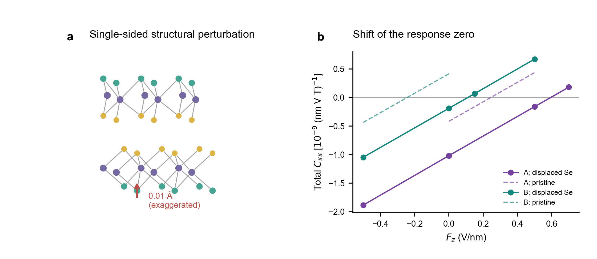
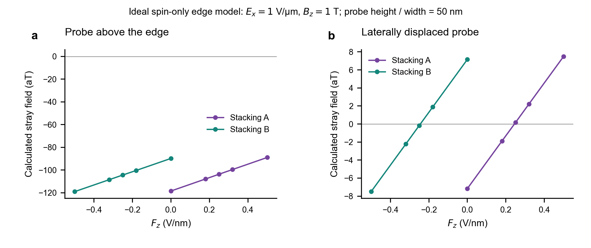
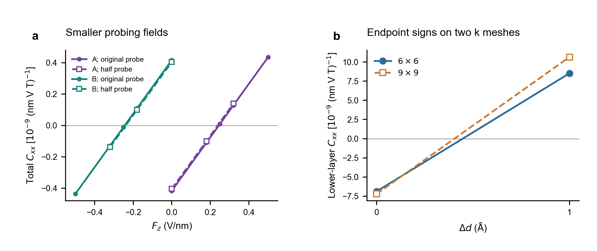

# 补充讨论与图

2026-11-06。以下图均使用既有数据，不是新计算。正文只保留直接服务于界面机制和层响应的结果。

## S1．单侧环境扰动影响过零场的绝对位置

图 S1(a) 示意只将下层外侧 Se 向 Mo 面移动 0.01 Å，其他原子与层间距不变，箭头为说明位移而放大。(b) 同样的扰动分别施加在 A、B 两堆垛上，独立 DFT 得到总响应曲线。虚线为原自由板层。

A/B 的过零场由约 +0.24/−0.24 V/nm 变为 +0.59/+0.11 V/nm。此例中两者间距仍约 0.48 V/nm，但两个场都已为正。因此不能在未知环境偏置时仅按过零场的正负给堆垛畴贴标签。

这不是具体基底计算，也不是一个已证明稳定的表面畸变。它的价值是说明绝对过零场并不由自由双层的镜像关系保护；不能由此宣称所有基底只会平移曲线。先前 KM 的共同标量偏置则严格使两条曲线一起平移，但真实单侧环境还可改变杂化和屏蔽。

## S2．磁探针的空间权重会改变信号的零点

以已有 DFT 实空间自旋密度计算理想长直边缘的磁场，取 E_x=1 V/μm、B_z=1 T。两个面板都使用高度50 nm、宽度50 nm的矩形均匀探针：(a)探针中心位于边缘正上方；(b)横向移到约55.9 nm处，以减弱对深度一阶矩的敏感性。图中是计算的自旋磁场，不是实验数据或真实仪器噪声模拟；两面板纵轴范围不同。

正上方探针的信号在已扫场区间不经过零，而位移后的理想探针能恢复接近 ±0.24 V/nm 的零点。这说明总层自旋抵消，不一定使每个局域磁信号都消失。原因是探针给不同深度的自旋不同权重，且每层内部本身也有较强的正负抵消。以两个净层自旋薄片替代真实空间密度，可能连主导深度矩的符号都算错。

优化位置后的零场信号仍只有约7 aT，现阶段没有相应可测信噪比证据。模型未包括轨道磁化、边缘重构、实际封装与噪声，因此不能把它写成可直接实施的磁成像方案。光学信号也不能不经磁光系数计算就与总自旋等同。

## S3．过零场与端点符号的数值检查

(a) 将面内探测电场由 ±0.004 减至 ±0.002 V/Å，同时将 Zeeman 能量参数由0.016减至0.008 eV。两畴总响应的过零场仍约为 ±0.24 V/nm（减半后的插值约+0.238/−0.239）。这是数值微扰幅度检查，不是建议实验施加这些等效场强。层系数幅度仍有约一成变化，因此不能声称已获得无限小场极限的精确幅值。

(b) 原层距和增加1 Å两端的下层响应，在两套k网格中均由负转正。较密网格改变幅值，但不改变端点符号。图中连线仅连接两个对照点；临界层距没有在较密网格上完成全区间定位。

## 仍有价值、但暂不合并为主图的结果

- S/Se 堆垛的独立预测与 DFT：模型事先给出下层负响应，独立 DFT 支持，并显示相对 S/S 接触态大幅增强。因为同时改变了上层取向与面内堆垛，不能把它等同于单纯滑移切换。
- 改变空间分层边界：支持若干端点的层符号，但层幅值与靠近过零处的符号可能敏感。总响应不依赖分层边界。
- 轨道模型截断与轨道干预：整个 d+p 层间块的符号效应较稳健，单一 p_z 路径的结论依赖投影窗口；删除部分轨道还可能改变占据数或关闭带隙，不能只保留“好看”的截断结果。
- 小滑移的响应幂次：保留既有对称性记录，当前不作为局域反转机制的主张。

上面三张新整理的补充图覆盖本轮批注要求的夜间环境、探测与主要数值检查。其余检查依原专题记录保存，当前没有重新生成全部历史扫描图。
