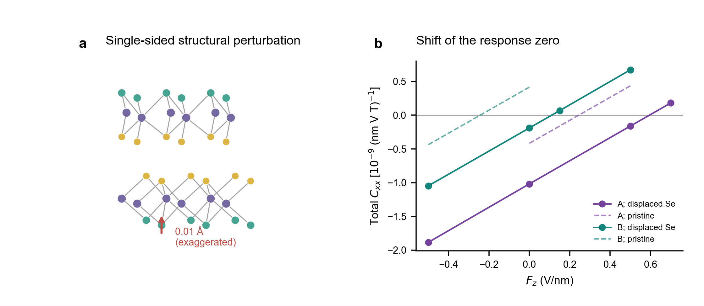
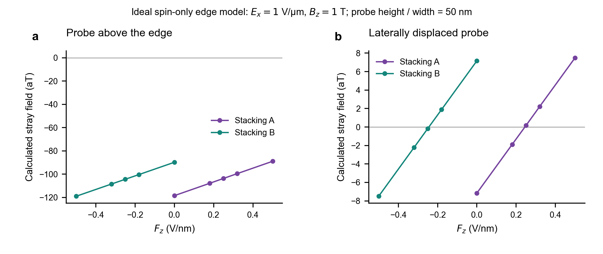
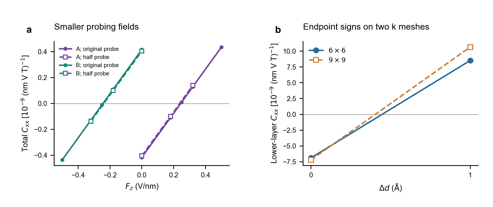
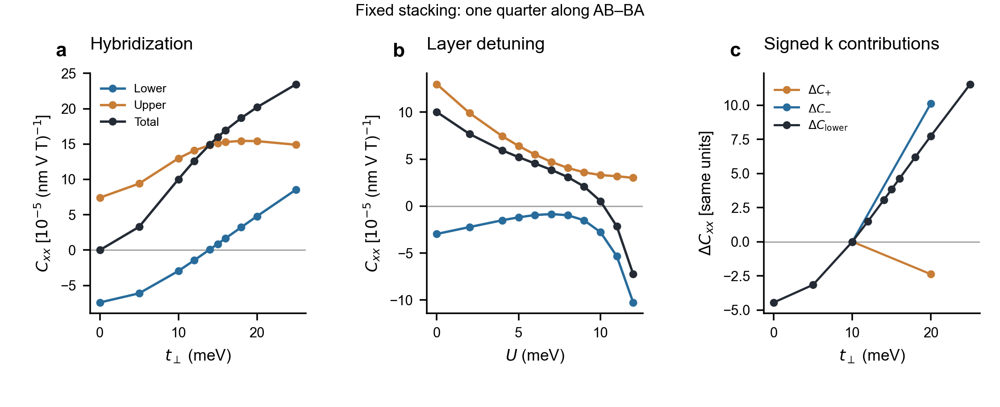
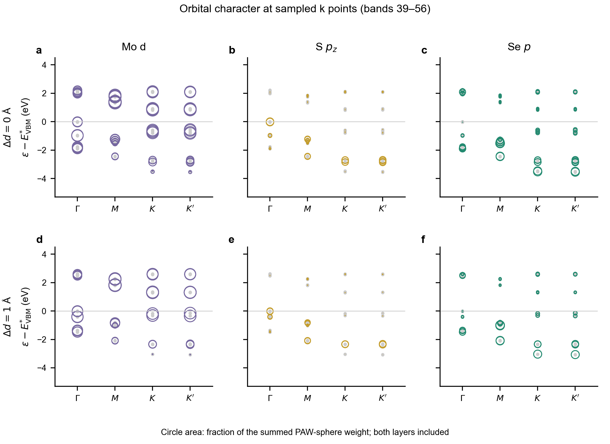

# 补充讨论与图

2026-11-06 第二轮。以下图使用既有材料数据和原四分之一堆垛数据；本轮新算 AB/BA 放在正文。正文只保留直接服务于界面机制和层响应的结果。

## S1．单侧环境扰动影响过零场的绝对位置

图 S1｜单侧表面扰动与响应过零场。(a) 下层外侧 Se 向 Mo 面移动 0.01 Å，其他位置固定；箭头放大。(b) 对 A/B 施加相同扰动后的总响应；虚线为未扰动自由双层，实线为扰动后结果。

A/B 的过零场由约 +0.24/−0.24 V/nm 变为 +0.59/+0.11 V/nm。此例中两者间距仍约 0.48 V/nm，但两个场都已为正。因此不能在未知环境偏置时仅按过零场的正负给堆垛畴贴标签。

这不是具体基底计算，也不是一个已证明稳定的表面畸变。它的价值是说明绝对过零场并不由自由双层的镜像关系保护；不能由此宣称所有基底只会平移曲线。先前 KM 的共同标量偏置则严格使两条曲线一起平移，但真实单侧环境还可改变杂化和屏蔽。

## S2．磁探针的空间权重会改变信号的零点

图 S2｜空间探测权重对磁信号零点的影响。由既有 DFT 自旋密度计算理想长直边缘磁场，取 $E_x=1$ V/μm、$B_z=1$ T，矩形探针高度和宽度均为 50 nm。(a) 位于边缘正上方。(b) 横向位移约 55.9 nm。两面板纵轴范围不同，仅计自旋磁场。

正上方探针的信号在已扫场区间不经过零，而位移后的理想探针能恢复接近 ±0.24 V/nm 的零点。这说明总层自旋抵消，不一定使每个局域磁信号都消失。原因是探针给不同深度的自旋不同权重，且每层内部本身也有较强的正负抵消。以两个净层自旋薄片替代真实空间密度，可能连主导深度矩的符号都算错。

优化位置后的零场信号仍只有约7 aT，现阶段没有相应可测信噪比证据。模型未包括轨道磁化、边缘重构、实际封装与噪声，因此不能把它写成可直接实施的磁成像方案。光学信号也不能不经磁光系数计算就与总自旋等同。

## S3．过零场与端点符号的数值检查

图 S3｜有限场与积分精度对主要结论的影响。(a) 原探测电场 ±0.004 V/Å、Zeeman 能量 0.016 eV，与两者同时减半的总响应对照。(b) 两套 k 网格下原层距和增加 1 Å 的下层响应，连线仅连接端点。

减半探测场后，两畴过零场仍约为 ±0.24 V/nm；两套网格也保持下层在两个层距端点异号。因此，过零场与反转的存在比精确幅值更稳定。层系数仍有约一成场步长变化，临界层距也未完成密网格定位；这些数值检查不等于实验场强建议。

## 仍有价值、但暂不合并为主图的结果

- S/Se 堆垛的独立预测与 DFT：模型事先给出下层负响应，独立 DFT 支持，并显示相对 S/S 接触态大幅增强。因为同时改变了上层取向与面内堆垛，不能把它等同于单纯滑移切换。
- 改变空间分层边界：支持若干端点的层符号，但层幅值与靠近过零处的符号可能敏感。总响应不依赖分层边界。
- 轨道模型截断与轨道干预：整个 d+p 层间块的符号效应较稳健，单一 p_z 路径的结论依赖投影窗口；删除部分轨道还可能改变占据数或关闭带隙，不能只保留“好看”的截断结果。
- 小滑移的响应幂次：保留既有对称性记录，当前不作为局域反转机制的主张。

## S4．非高对称堆垛中的两类响应变化

图 S4｜AB–BA 路径四分之一处的调控对照。固定 $m=45$ meV。(a) $U=0$ 的杂化扫描。(b) $t_\perp=10$ meV 的层势差扫描。(c) 下层正、负动量积分核贡献相对 $t_\perp=10$ meV 的变化；分解仅有 10、20 meV 两点，黑线为完整扫描的下层变化。

这里既出现杂化引起的同层反向，也出现两层方向保持不变、总响应过零的门控路径。与正文 AB 对照，局域反转不依赖四分之一这个特殊展示点，但纯补偿门控不能被原封不动推广到所有堆垛。其关键不是哪个控制参数必定对应哪一种效应，而是控制参数怎样改变该构型的层间混合和带间响应。正负动量区域还会随参数改变，不是两个固定轨道通道。

## S5．轨道投影给出了哪些信息？

图 S5｜高对称点的轨道投影能级。上、下排分别为 $\Delta d=0,1$ Å；三列分别为 Mo $d$、S $p_z$、Se $p$。展示既有 Γ、M、K、K′ 点第 39–56 带，圆面积为该通道占全部 PAW 原子球投影权重的比例，两层求和。$E_{\rm VBM}^{*}$ 是这四个点中最高占据能级；数据沿用既有正 Zeeman 准备场、零面内电场，不是新的零磁场连续能带计算。

图中 Γ 点的 S $p_z$ 权重和能级劈裂随层距改变，而 K 附近一些带仍以 Mo $d$ 为主。它支持界面改变电子态成分，但没有给出 NMEE 矩阵元的符号。该图只覆盖顶部十条占据带和八条空带，不能用来为第 1–36 带的全部贡献指定轨道来源。主图 2(d) 与本图的数据窗口不同，各自明确标号。

目前可画的是离散能级／轨道投影，而非连续路径 fatband。连续路径、零场轨道投影和主导响应子空间应在下一轮机制计算中对应起来；不能仅为得到类似文献的图形而在离散点间补造色散。

## 带组的定义和解释边界

每个波矢有 48 条占据带，第 37–48 带称顶部 12 带，其余为第 1–36 带。主图 2(d) 仅将第 21–56 带的 Γ、K 能级放在可读的共同能量窗；第 1–20 带更低，仍计入图 2(c) 的积分。

占据带分解使用 $Q=1-P_{\rm occ}$ 的补空间，不能与仅保留有限条空带的配对表混为一谈。带号是能量排序，不自动构成跨整个布里渊区隔离的固定轨道子空间；分组内有很强的异号抵消。因此“1–36 为负、37–48 为正”是这套分组的数值结果，尚不是材料普适的两个通道定律。下一步识别主导过程必须检查对分组边界及简并子空间处理的稳定性。
