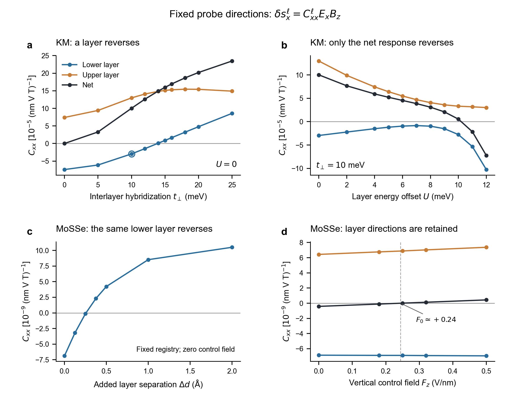
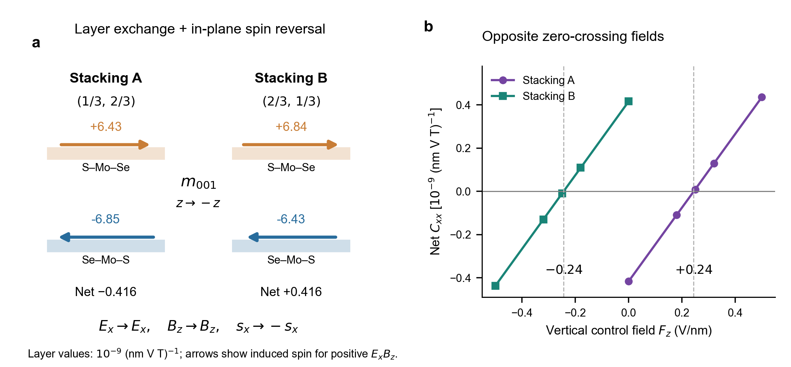

# 双层绝缘体中局域自旋响应反转与层间补偿

2026-11-06 · 中文结果段落讨论稿。用途：先确定正文科学问题，再决定下一轮计算。不是完整投稿稿。本文的 NMEE 专指目前计算的固定离子、绝缘态、静态自旋 Zeeman–电场混合响应；与文献全部驱动 NMEE 项的对应仍需公式核查。

## 正文候选

层间耦合既可以改变两层自旋响应的相对强度，也可以改写某一层自身的响应方向。这两种变化对整片磁信号的影响并不等价。我们以镜像取向的 Kane–Mele 双层为最小模型，在固定配准和填充下分别调节层间杂化与层势能差，其哈密顿量为

$$
H(\mathbf k)=
\begin{pmatrix}
h_{\rm KM}(\mathbf k;m,+\lambda_R)+U/2 & t_\perp T(\mathbf k;\mathbf u)\\
t_\perp T^\dagger(\mathbf k;\mathbf u) & h_{\rm KM}(\mathbf k;m,-\lambda_R)-U/2
\end{pmatrix}.
\tag{1}
$$

对角块按上、下层排列，包含蜂窝晶格最近邻跃迁、亚晶格在位能差 $\pm m$、本征自旋轨道耦合和 Rashba 耦合；水平镜像使两层 Rashba 项异号。无量纲矩阵 $T$ 包含由配准 $\mathbf u$ 决定的同亚晶格及跨亚晶格层间跃迁，$t_\perp$ 控制它们的共同强度，$U$ 为上层相对下层的势能差。磁场耦合整个双层的自旋，电场也作用于整个体系。以层投影自旋定义

$$
\delta s_x^\ell=C_{xx}^\ell E_xB_z,\qquad
C_{xx}^{\rm net}=C_{xx}^{\rm lower}+C_{xx}^{\rm upper}.
\tag{2}
$$

固定同一配准及 $m=45$ meV，从 $t_\perp=10$ meV、$U=0$ 出发，加强杂化可使下层响应由负转正，而整片保持正响应；保持杂化不变并增加层势能差，则可使整片响应由正转负，同时两层各自保持原方向［图 1(a,b)］。因此，净信号翻号并不等于某一层自旋翻向；反之，局域反转也可以发生在净信号没有翻号的情况下。模型中下层响应包含符号相反、对杂化敏感程度不同的动量区域；两者优势互换导致局域反转。

第一性原理计算在 S/S 界面的 Janus MoSSe 双层中给出了这两类变化的材料实例。以下层由下至上的化学序列 Se–Mo–S 为参照，选择镜像取向堆垛 $\{m_{001}|(1/3,2/3)\}$，省略竖直平移。保持配准与化学朝向不变，增加层间距可使下层的 $C_{xx}$ 由负转正［图 1(c)］。原层距处，较深占据带对下层的负贡献超过顶部占据带的正贡献；层距增加后，正贡献增强而负贡献减弱，优势随之互换。冻结其余块并仅削弱材料 $d+p$ 模型的层间跃迁也能重现反转，支持层间杂化能够改变局域响应符号的解释。这一共同机制不要求模型和材料具有相同的单调变化方向：当前 KM 在增强杂化时翻号，MoSSe 在减弱杂化时翻号。

固定 MoSSe 的离子结构，垂直控制场 $F_z$ 则主要改变两层响应的补偿程度［图 1(d)］。当 $F_z$ 从零增加至 $0.50$ V/nm，下层保持负响应，上层保持正响应，整片系数却从约 $-0.42$ 变为 $+0.44$，单位为 $10^{-9}(\mathrm{nm\,V\,T})^{-1}$。定义 $F_0$ 为 $C_{xx}^{\rm net}(F_0)=0$ 的偏场，即净响应过零场。该点表示两层诱导自旋恰好抵消，而非局域自旋消失或发生磁相变。

水平镜像给出了可检验的堆垛伙伴关系。镜像 $m_{001}$ 将原堆垛 A 映射为相对配准 $(2/3,1/3)$ 的堆垛 B，并同时交换上下层、反转面内自旋与垂直控制场，而保持面内探测电场 $E_x$ 和垂直探测磁场 $B_z$ 不变。因此，在上下对称环境中，

$$
C_{xx}^{\rm lower,B}(F_z)=-C_{xx}^{\rm upper,A}(-F_z),\qquad
C_{xx}^{\rm net,B}(F_z)=-C_{xx}^{\rm net,A}(-F_z).
\tag{3}
$$

独立 DFT 验证了这一关系：零控制场下，两堆垛均为下层负、上层正，但占优势的层相反，整片响应随之异号［图 2(a)］；净响应分别在约 $+0.24$ 与 $-0.24$ V/nm 过零［图 2(b)］。这为通过响应曲线区分镜像堆垛提供了理论依据。非对称环境中的场标定、畴在扫场中的稳定性及真实探针的灵敏度仍需确定，故现阶段不将其表述为已经实现的堆垛畴读出。

## 图

图注、数据选择和来源见 FIGURE_NOTES.md 与 source_data.csv。

## 术语与物理边界（讨论记录，不放正文）

| 统一用语 | 含义 | 避免混淆 |
|---|---|---|
| $m_{001}=m_z$ | 镜面平行材料，法线沿 $z$；以界面中面为原点 | 不是法线在面内的竖直镜面 |
| 镜像伙伴 A/B | 两个不同堆垛在镜像下相互映射 | 不表示 A 或 B 单独具有水平镜面对称 |
| $E_x,B_z$ | 提取 EB 系数的探测场 | 与调控层势差的 $F_z$ 分开 |
| $F_0$：净响应过零场 | 两层 EB 诱导自旋响应和为零的垂直控制场 | 非矫顽场、非磁相变；不是零外场的自发磁化补偿温度 |
| $U$ | KM 两层势能差 | 不是材料电极化，也未标定为实验栅压 |
| 同层反转 | 固定层标签、化学朝向和探测场方向，该层 EB 响应改变符号 | 不把上/下层的标签互换当成同层反转 |

本文 s 与归档数值沿用 Pauli 自旋面密度。真实自旋角动量和电子磁矩需分别乘以相应常数；磁矩与电子自旋方向的符号约定不能省略。镜像交换、反号及过零关系不受统一换算影响。F_z 的数值正号沿用计算的电子受力场约定，接到真实器件的顶/底栅极性之前需要换算。垂直偏场可包含屏蔽，不能把 KM 的 U 与 DFT 的 F_z 简单等同。

## 科学问题与 PRL 论证边界

目前最稳妥的问题是：在非磁绝缘双层中，界面杂化如何改变一个指定层的场致自旋方向，并如何与仅改变两层补偿程度的门控效应区分？KM 给出最小存在性证明，MoSSe 给出深价带与近带边贡献竞争的材料实例，镜像关系给出模型无关的伙伴约束。

上述两条路径是已验证的对照，不是把“杂化调控”与“局域反转”、“栅控”与“只改变补偿”永久绑定；其他参数下两类控制都可能改变层符号或净值。

这比仅报告“加一个层自由度后产生净响应”更具体，但尚不意味着 PRL 新颖性已经确立。层分辨、相反层自旋和门控改变层权重已有直接先例；LEE 的基本观测量是电流诱导自旋，本文是绝缘静态 EB 自旋。我们需要进一步凝练的物理增量，是能预测局域响应符号的带间竞争条件，而不只是“杂化改变响应”这一宽泛结论。另一方面，“净响应翻号不足以判定局域翻向”本身是容易理解的和式性质；只有结合非平凡的符号控制机制或真正可用的判别方案，才具有更强的研究价值。[LEE 正文](https://arxiv.org/html/2607.17209v1)

单侧 Se 向内移动 0.01 Å 的计算是固定离子的扰动敏感性检查。它表明两个过零场的绝对位置对环境可以敏感；没有具体基底、力常数或实验应变的对应，不应被写成一种已实现的材料调控方式。放 SM 或工作记录，不进入当前正文主线。磁探测器卷积、噪声预算同样暂留讨论；夜间估计未支持把直接磁读出宣称为可行器件。

下一轮在确认本稿科学问题后再安排计算。优先选择能够把“带间正负竞争”变成预测的一个最小判据，并用独立结构或参数点检验；不为补足文章形式而立即铺开材料或 80 层群。若选择以畴读出为主线，则真实可测观测量与保持畴不动的扫场协议是必须补上的证据，不能用更多电子结构过零曲线替代。

## 证据对应

- 式 (1)、KM 图 1(a,b)：现有 AuditBilayer 与 fixed_stack_cxx.csv；不是新的拟合。亚晶格 m=45 meV 是针对内部竞争的参数筛选，邻近 m=46 meV 复查已完成，未证明宽参数区间普遍性。固定四分之一配准为电子机制检验，不声称该 KM 配准的机械稳定性。
- MoSSe 图 1(c)：原有 7 个层距点；较密网格端点验证负转正，精确临界层距未密网格收敛。深价带/近带边竞争与冻结跃迁对照详见既有机制记录。
- 图 1(d)、图 2：原有 10 个自由板层独立 DFT；半探测场给出约 ±0.24 V/nm 的复查，不作末位精度或实验临界电压承诺。
- 式 (3)：轴矢量变换与伙伴结构严格推论；归档 DFT 在数值精度内支持。平面镜像对平行镜面磁矩反向的说明见 [IUCr 教学资料](https://www.iucr.org/what-we-do/education/pamphlets/teaching-crystallographic-and-magnetic-point-group-symmetry-using)。

段落任务依次为：问题与模型 → 两类控制的差别 → 材料内的带间竞争 → 门控补偿 → 镜像约束与有限应用预言。当前稿刻意先写 Results，不补写尚无证据的新机制名称或器件性能结论。
