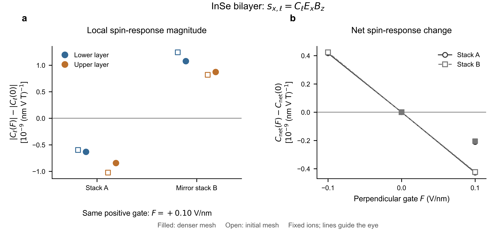

# InSe mirror partner: electrical tuning and structural switching

All five planned independent self-consistent states are complete. The same
positive physical gate weakens both opposite local-spin responses in stack A
and strengthens both in its horizontal-mirror partner B. Neither layer reverses
its own spin direction. Both net coefficients decrease. The 6x6 and 8x8 meshes,
128/144/160-state cutoffs, and halved magnetic-probe steps retain these trends.
Pre-result prediction and scope remain in [PLAN.md](PLAN.md).

Representative 8x8 changes at F=+0.10 V/nm relative to each same-mesh zero-field
state, in 1e-9 (nm V T)^-1:

| Stack | Change of lower magnitude | Change of upper magnitude | Net coefficient change |
|---|---:|---:|---:|
| A | -0.631 | -0.843 | -0.211 |
| B | +1.078 | +0.873 | -0.205 |

The layer-magnitude changes are about 0.06–0.10% at this field, not a giant
local enhancement. All checked probe gaps exceed 0.896 eV. The small net
changes fall by about half on the denser mesh, so no quantitative enhancement
factor is claimed. No matched 8x8 monolayer is available. Do not combine
unmatched meshes to infer gain. See `summary.json` and the two source CSVs.

Figure: (a) Change of each layer's response magnitude under the same positive
gate; negative means weakening, positive strengthening. (b) Gate-induced net
coefficient changes, subtracting each stack's own zero-gate baseline. Passing
through zero in this difference plot does not indicate a spin reversal. Open
markers use the initial 6x6 mesh; filled markers use 8x8. Lines only guide the
eye. All displayed data use the 160-state cutoff and standard probe step;
other deterministic checks are retained in the CSVs, not statistical error bars.
The ionic coordinates are fixed; F is distinct from the Ex and Bz probes.

## Question and prediction

In the original A domain, a small positive F weakens both opposite layer-spin
responses. In B, the same positive F is predicted to strengthen both. Neither
claim means that a layer's spin changes its own sign. The mirror law relates
C_lower(B,F)=-C_upper(A,-F); the finite-field B values must be calculated
independently. Two meshes test tuning directions, without pursuing identical
enhancement factors. Five new SCFs are planned; no ionic switching is simulated.

The control F is the conventional physical field along the fixed laboratory
+z direction. VASP uses the opposite sign for EFIELD, so EFIELD=-F/10 in
eV/Angstrom for F in V/nm; this follows the
[official EFIELD definition](https://www.vasp.at/wiki/index.php/EFIELD).
The gate-prepared states are self-consistent; the subsequent Ex/Bz probe is
the existing frozen-potential, spin-Zeeman-only insulating response protocol.

## Physical distinction to test

Let C_net=C_upper+C_lower and C_stag=(C_upper-C_lower)/2. The latter measures
the opposing layer-spin response; it is not spontaneous magnetic order.
Horizontal-mirror partners obey

- C_net^B(F) = -C_net^A(-F),
- C_stag^B(F) = C_stag^A(-F).

Consequently their zero-gate linear **net** tuning is identical, whereas the
linear tuning of the opposing layer response reverses. The independent SCFs
test whether this local prediction persists over the selected finite field.
A net-only gate scan cannot reveal this local strengthening/weakening contrast.
Writing g=dC_net/dF and k=dC_stag/dF at zero gate, both opposite layer
magnitudes weaken in A when k < -abs(g)/2. The mirror partner has the same
g and the opposite k, and both strengthen. This is a response-level criterion,
not yet a prediction from orbital energies and matrix elements.
It is also distinct from a reversal of either layer's actual induced spin.
The mirror identity is standard tensor symmetry; its application does not
by itself establish new microscopic physics or PRL-level novelty.

## Can the gate also move the structure?

Yes in principle, but a change of electronic response does not itself establish
sliding, and a fixed-ion calculation cannot establish that a real device stays
in its original domain. There are two different derivatives: the change of C
with F at fixed atomic coordinates, and the additional change when coordinates
or domain fractions move with F. This study computes the first.

The two requested papers sharpen the distinction:

- [Ke, Liu and Liu, PRL135,046201 (2025)](https://doi.org/10.1103/jhlq-2dd7):
  in ideal C3-symmetric h-BN AB/BA domain interiors, a perpendicular field
  cannot produce a nonzero net in-plane layer force. Their simulations show
  switching through symmetry-breaking, wide domain walls, where off-diagonal
  Born-charge components provide lateral driving forces. These h-BN wall
  speeds and fields are not InSe switching thresholds.
- [Wang et al., PRL137,126801 (2026)](https://doi.org/10.1103/jq6y-y9ft):
  uniaxial strain breaks C3 in monodomain h-BN and allows directed lateral
  forces. Compressive/tensile strain changes the force direction and the
  accessible barrier; merely allowing a force does not guarantee switching.
  Their uniaxial strain is different from our previous C3-preserving biaxial
  strain. No new strain calculation is started here.

The force definition we use is unambiguous: the relevant derivative is
partial F_y / partial E_z = partial p_z / partial u_y (with a consistent
charge/unit convention). Published BEC index order is not silently copied.
Zero net lateral force at a high-symmetry point is not proof of positive
curvature, absence of thermal nucleation, or a finite experimental coercive
field. A field may change stiffness or barriers even when the initial force
vanishes. Interfaces, defects, edges and domain walls can remove the ideal
symmetry restriction.

Practical implication: distinguish a small, reversible readout within a
stationary domain from a pulse that changes the domain. Track an independent
A/B structural/domain marker during a gate scan; net spin signal or hysteresis
alone does not uniquely identify electronic tuning versus domain motion.
If C_eff=f C_A+(1-f) C_B, its gate derivative contains the additional term
(C_A-C_B) df/dF. At zero gate in ideal mirror partners, G_A=G_B, so a fixed
mixture has the same net linear electronic slope; moving domain fractions
can still add a separate signal. Ionic relaxation contributes further terms.

The current finite-field SCFs retain force tables for a limited consistency
check. They do not measure a full Born-charge tensor, a sliding barrier, or
domain-wall mobility. A future minimal mechanical check would examine
near-registry restoring forces/stiffness under the proposed readout field;
domain-wall switching would require a separate treatment.

## Connection to the material series and the PRL candidate

MoS2 shows activation of a monolayer-forbidden component and a local sign
not reproduced by the specified electrostatic reference. MoSSe shows a
same-layer sign change and strongly unequal gate sensitivity. InSe instead
has two substantial, opposing layer changes; its selected mixing controls
alter their gate slopes even when the static layer-spin directions stay fixed.
The shared physical question is how an interface rewrites both a layer's
signed response and its sensitivity to an external gate. These observations
do not establish a universal single occupied-empty channel or threshold.

The mirror-domain test attaches the InSe tuning pattern to an actual stacking
choice, beyond an artificial channel deletion. It does not establish that a
laboratory gate can move between those choices without other changes.
A PRL claim would still need a concise predictive microscopic condition and
an experimentally credible consequence. In particular, large cancelling local
coefficients are not a large net experimental signal; neither their detection
threshold nor a layer-selective spin readout has been established here. A standard mirror law, a larger
response type catalogue, or a precise enhancement factor alone is insufficient.

## FQFE connection and scope

Internal sublattice switching within an InSe monolayer is a different
coordinate from relative sliding of two intact monolayers. A fractional
polarization branch does not exempt ordinary response tensors from point-group
selection rules. In an isolated D3h layer at zero gate, the presently probed
Gamma_xxz (s_x from Ex Bz) remains forbidden. Some all-in-plane EB components
are allowed; a space-inverted pair reverses these allowed coefficients.
Two axial factors (spin and magnetic field) cancel under spatial operations,
so this NMEE tensor has the same spatial transformation character as a polar
rank-three tensor, without implying identical microscopic physics to BPVE.

`symmetry_checks.json` verifies the allowed indices in the actual monolayer
Cartesian frame. No FQFE switching or additional magnetic-field-direction
calculation is launched. An in-plane electric probe can itself couple to an
in-plane FQFE polarization, so a future FQFE response measurement must also
distinguish weak probing from structural writing; the gate is not the only
field that can affect structure. The user's manuscript was read locally; its PDF,
full text, numerical results and figures are not redistributed in this archive.

## Reading scope and provenance

The two published main texts were read from Zotero. Relevant complete pages,
including the domain-wall paper's End Matter, were visually inspected.
The directional paper's SM computational-method/strain-control sections were
accessible through the publisher's indexed PDF; later retrieval was blocked.
The domain-wall SM was not obtained in this pass. No unseen supplemental
table is used to claim an InSe switching threshold.

All VASP and wavefunction processing on Japan execute in PBS compute nodes.
Small-data audits and figures are prepared locally. No other shared account
job is altered. Licensed PAW data and wavefunction caches remain on
compute storage; only the selected inputs, code, small results and our own
analysis are archived. Local literature extractions are not committed.
