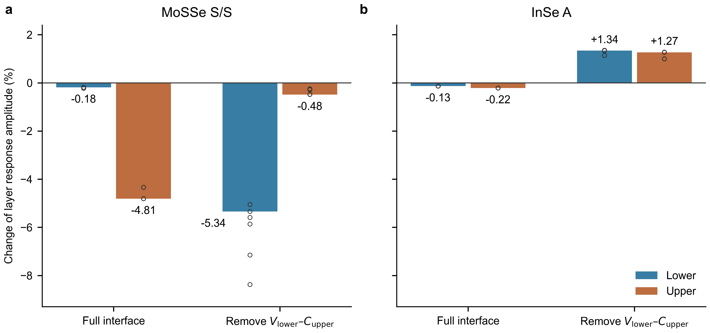

# Interface channels redistribute layer gate susceptibility

2026-11-10. This round reanalyses the **already completed** MoSSe S/S A and InSe A channel interventions at zero and ±0.10 V/nm. There are no new DFT calculations, remote jobs, materials or enlarged models. All 315 original field/control/window points (105 three-field groups) are retained via hashed source records in the sibling archives.

## Physical answer

**MoSSe supports a common-channel causal link:** the selected mixing between lower-layer valence states and upper-layer empty states supports both the negative lower-layer NMEE and the unusually gate-sensitive upper layer. Removing that mixing makes the lower-layer zero-gate response positive and transfers gate dominance to the lower layer. This is not just an artifact of dividing by a different response amplitude: the upper-layer absolute gate slope decreases as well.

**InSe provides an instructive contrast:** removal of the same directional class of mixing leaves both layers' response directions unchanged, but increases both fractional gate sensitivities and reverses the effect of increasing the gate field—from weakening both amplitudes to strengthening both. Thus a channel can enhance selective gate control in one interface while restraining or changing its direction in another. A same-layer sign reversal is not a necessary condition for changing gate control.

The data support a conditional interface mechanism, not a universal rule that stronger VC mixing always increases NMEE or its gate sensitivity.

## Primary comparison

At fixed ions and probe fields, increase the control field from −0.10 to +0.10 V/nm. Percentages below are changes of each layer's **amplitude**, divided by its mean endpoint amplitude. Negative means weaker, positive stronger. They are not changes relative to zero field, and removing a Hamiltonian channel is not a physical gate operation.

| Material and control | Lower C at zero gate | Lower amplitude change | Upper amplitude change | Upper signed gate slope G |
|---|---:|---:|---:|---:|
| MoSSe, physical interface | −6.193 | −0.184% | −4.811% | −1.427 |
| MoSSe, remove lower-V / upper-C mixing | +4.961 | −5.341% | −0.485% | +0.207 |
| InSe, physical interface | −1053.124 | −0.135% | −0.215% | −11.311 |
| InSe, remove lower-V / upper-C mixing | −581.862 | +1.339% | +1.267% | +35.877 |

C units: 10⁻⁹ (nm V T)⁻¹ for the static Ex Bz-induced in-plane Pauli-spin density. G=[C(+0.10)−C(−0.10)]/0.20, units 10⁻⁹ (V² T)⁻¹. In physical MoSSe and InSe the lower C is negative and upper positive. After this removal, MoSSe is lower-positive/upper-negative; InSe remains lower-negative/upper-positive. Every primary control retains its layer signs over the gate interval: channel-induced direction changes must not be mistaken for gate-induced same-layer switching.

For the representative MoSSe window, the upper fractional susceptibility falls by about 90%, and its absolute slope falls by about 86%. Across all six paired projection settings these reductions are 89–95% and 86–94%, respectively. The upper/lower fractional-sensitivity ratio changes from 19–26 to 0.030–0.091: the preferred layer switches. For InSe, upper fractional sensitivity grows by 4.6–6.0 times and absolute slope magnitude by 2.8–3.2 times across all nine settings. The two layers become comparably sensitive. These are model-intervention ranges, not statistical uncertainty or experimental enhancement factors.

Figure. Signed fractional changes in the layer response amplitudes across the same gate interval. Bars: largest available full-space window, frozen-8 selected-space construction. Open circles: all six (MoSSe) or nine (InSe) projection settings, not independent samples. Positive values indicate strengthening, negative values weakening. The same vertical scale is used for both materials. No layers reverse within the gate interval in these primary controls. The layer direction changes caused by deleting the channel are listed separately in the table.

## What the other controls establish

- Remove both selected cross-layer valence–empty directions in MoSSe: the lower C is positive in all settings and the pronounced upper selectivity disappears (fractional upper/lower ratio 0.79–1.59, versus 19–26 for the full interface). Representative amplitude changes are −0.662% lower, +0.606% upper; both absolute gate slopes are small and negative. This supports the common VC-class link, without treating these channels as additive contributions.
- Remove only VV+CC in MoSSe: lower C remains negative and upper fractional sensitivity still dominates (ratio 7–30). Thus the loss of selectivity is not an unavoidable result of removing any interlayer matrix block. Other blocks still affect magnitudes.
- Restore 75% of the selected VC amplitude in MoSSe: lower C is still positive in all six settings while the upper layer already accounts for 84–95% of absolute layer gate changes. Therefore lower-layer direction reversal does **not cause** or define the onset of gate selectivity; both can result from the same mixing. Some C values approach zero here, so large percentage changes are not evidence of useful amplification. Their full records and endpoint-crossing flags are retained.
- InSe is not a scaled copy of MoSSe. Removing both VC directions lowers absolute gate slopes, but its upper fractional susceptibility does not consistently fall across projection windows (0.0041–0.0138 (V/nm)⁻¹ versus 0.0107–0.0109 for the full system). Do not generalize from the representative frozen-8 row. Removing either one directional VC channel separately makes both layers more sensitive; removing the lower-V / upper-C direction reverses the gate-amplitude trend, while removing the reverse direction preserves weakening. The directional-channel comparison is robust even though the combined-removal fractional trend is not.

## Definitions and causal scope

Use the original fixed zero-gate layer subspaces and their occupied/empty projectors. The primary intervention removes the Hermitian block

T_bv,tc = P_bv H P_tc + P_tc H P_bv,

represented in the full KS response space at each gate by the existing PAW-overlap transport. These are occupied/empty sectors of the **separated projected layer blocks**, not single instantaneous eigenbands of the whole bilayer. Rotations inside either complete sector do not change its projector; the choice of selected orbital space still matters and is tested by the retained projection windows.

All other matrix blocks and physical vertices remain. The original independently screened gate-state potentials are kept fixed. The hypothetical modified Hamiltonians have **not** been rescreened or structurally relaxed. Consequently this is a controlled electronic intervention conditional on the chosen subspaces, not a new self-consistent material, an isolated layer, a pure electrostatic reference or a direct laboratory operation. Channel effects need not add linearly.

Let A_l=(|C_l(+F)|+|C_l(−F)|)/2. We compare G_l and R_l=|G_l|/A_l, with F=0.10 V/nm. A second diagnostic divides every control's |G| by the *same physical-interface* A_l; it therefore cannot benefit from changing the normalization denominator. This confirms the primary MoSSe decrease and InSe increase. Endpoint sign-change flags are retained for all secondary controls; percentages near a small C are not used to claim enhancement. R_net is archived for completeness but not used as evidence because near layer cancellation it can be arbitrarily large.

This analysis does not use the previous unstable bandwise energy-denominator/matrix-element split. The new result does **not** establish that MoSSe's weak lower-layer gate change specifically comes from cancellation between those two diagnostic pieces.

## Implication for the PRL candidate and KM

A defensible working statement is: **interface mixing controls not only the signed response carried by a layer, but also which layer an electric field most effectively controls and whether that control strengthens or weakens the response.** MoSSe supplies a conditional common-channel test linking direction rewriting and strong upper-layer control; InSe demonstrates that the direction and layer distribution of control are distinct from the baseline response sign.

KM can describe these as two independent characteristics, C_l and its gate derivative, and test how level alignment and spin/electric matrix elements change them. It should not be forced to reproduce a material-specific channel rule without evidence. A universal predictive condition is still missing. The next substantive gap is to predict, from a specified level alignment and matrix elements, when a directional channel enhances gate sensitivity and when it suppresses it, then test a physical control at fixed material. The present controls identify that question more sharply; they do not by themselves establish PRL novelty or an experimental readout.

## Evidence, limits and reproduction

- Inputs: sibling `mosse-screened-channels-20261109/result.json` and `inse-nmee-20261109/channels.json`; SHA256, original compute job/node, and all 105 control/window groups are in `summary.json`. These calculations predate the present relative-sensitivity question; this is a retrospective causal-control analysis, not a new blind prediction.
- Minimum gaps over all original controls: MoSSe 0.795 eV, InSe 0.725 eV. Full-response baseline matches the previous independently implemented kernel within 1.3×10⁻⁹ in the recorded units. Maximum layer-sum residual <1.8×10⁻¹². Source hashes checked; no field/control/window excluded from the table.
- Inherited magnetic-step checks: maximum C changes 3.9×10⁻⁵ (MoSSe), 0.0153 (InSe) for the representative projection. Those are not new convergence checks. The original 6×6 momentum grid, finite empty-state space, and previously noted B-even residual/mesh sensitivity remain limitations; no claim of final absolute convergence.
- Reproduce locally from this archive: `python analyze.py`, `python check.py`, `python plot.py`. Optional `--materials-root` selects the directory holding the original sibling records. NumPy and matplotlib required. The scripts process only small returned JSON files; no scheduler or electronic calculation is invoked.
- `all_controls.csv` keeps all windows and normalization variants; `representative.csv` keeps all seven controls in the representative windows. `checks.json` records source/baseline and cross-window claim checks. The figure selects the declared primary full/directional comparison; secondary controls remain in the tables.
- No private transport helper, license file, wavefunction or credential is archived. Model cores, GitHub workflows and notification settings unchanged. Routine archive commit uses `[skip ci]`; skipped checks are not passed remote checks.
