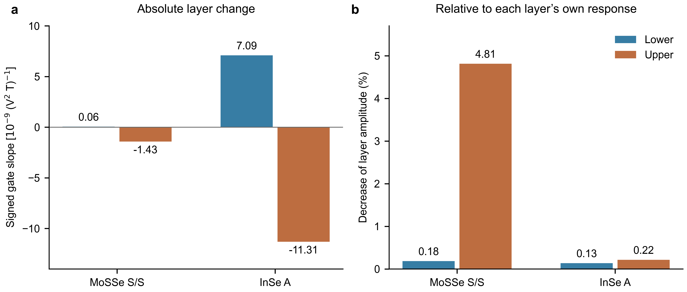

# MoSSe / InSe screened gate response: matched definition, unresolved attribution

## Physical outcome

The existing fixed-ion, insulating, independently self-consistent states at external gate fields −0.10 and +0.10 V/nm were reanalysed without new DFT or a larger model. The physical spin response and its gate change reproduce the previous results. **The proposed explanation by cancellation between energy shifts and matrix changes is not established by this analysis.** The separate terms do not have a demonstrated small-magnetic-probe limit and depend on how bands at different gate fields are paired. Their large cancellation must not be presented as a material mechanism.

A useful, independent comparison is the fractional change of each layer's own response. It changes the framing: the MoSSe lower layer is not especially inert compared with the InSe lower layer; the conspicuous contrast is the unusually gate-sensitive MoSSe upper layer.

| Existing self-consistent states | Lower G | Upper G | Net G | Lower amplitude decrease | Upper amplitude decrease |
|---|---:|---:|---:|---:|---:|
| MoSSe S/S A | +0.0570 | −1.4265 | −1.3695 | 0.184% | 4.81% |
| InSe A | +7.0862 | −11.3104 | −4.2242 | 0.135% | 0.215% |

G=[C(+0.10)−C(−0.10)]/0.20, units 10⁻⁹ (V² T)⁻¹. C is the existing layer coefficient for the static Ex Bz-induced in-plane spin, in 10⁻⁹ (nm V T)⁻¹. Both materials remain lower-negative/upper-positive. A positive G on the negative lower layer therefore weakens its amplitude; a negative G on the positive upper layer also weakens it. Percentages compare amplitudes between these two endpoints, divided by the magnitude of their mean C; **they are not changes from zero field or enhancement relative to an isolated layer**. No net percentage is used as evidence of amplification because the net is near cancellation.

The representative entries use the largest available band window (112/160) and smallest magnetic probe, 0.0000625 eV. With the original band-window checks MoSSe's lower decrease is about 0.18–0.23% and its upper decrease about 4.3–4.8%; the qualitative asymmetry remains. These are existing 6×6 states, not newly converged material predictions. InSe's previously observed sensitivity of the small net to k sampling remains an explicit limitation.

Figure. (a) Signed layer gate slopes, in common units. (b) Decrease of each layer's own response amplitude when the control field increases from −0.10 to +0.10 V/nm, with the probe fields and ions fixed. InSe's much larger absolute responses must not be confused with stronger fractional gate control. Colors identify layers, not opposite directions of the control field. Deterministic results; no statistical error bars.

## Same response convention as the eight-state KM analysis

The material response is originally evaluated with the covariant electric dipole r_cv. Define Δ=ε_v−ε_c and V_cv=−iΔ r_cv, so that

χ_l = Σ_vc 2 Re(S^l_vc r_cv)/Δ = Σ_vc N_l/Δ²,

N_l = −2 Im(S^l_vc V_cv), D=Δ⁻², C_l=∂χ_l/∂B.

Cell, magnetic and length conversion factors are included in `split_kernel.py`. At each magnetic probe ±b, use the exact endpoint identity (δF=0.20 V/nm):

G_energy(χ) = (N₊+N₋)(D₊−D₋)/(2δF),

G_matrix(χ) = (N₊−N₋)(D₊+D₋)/(2δF).

Their sum is [N₊D₊−N₋D₋]/δF. Apply the same B-odd difference as for the original C. The gate states include self-consistent screening; the magnetic probe remains the existing spin-only frozen-potential perturbation. This is a finite gate secant, not a newly evaluated exact zero-field tangent. Gate sign follows the original calculation convention; KM's U is an internal energy difference and is not numerically identified with this external field.

Three occupied/empty-sector-preserving band correspondences are retained: zero-gate-anchored PAW overlap matching; direct plus/minus overlap matching; energy ordering. All preserve the full sum. The direct overlap uses the available truncated zero-gate space and is a diagnostic, not an exact complete-basis overlap.

A single-energy-denominator partition is also archived. It leaves the response unchanged while moving terms between numerator and denominator. Since V was reconstructed from Δr, the 'matrix' term is not exclusively wavefunction hybridization, and neither partition is an experimentally separable electrostatic/hybridization fraction. The KM analytic small-offset check passes for the specified kernel, but that does not guarantee well-defined bandwise pieces in a multiband material.

## Failed attribution test — retained rather than hidden

Using anchored matching, the MoSSe lower-layer energy piece changes from +489.64 at b=0.002 eV to −657.53 at b=0.0000625 eV. Its full G stays +0.05701. For InSe the corresponding energy piece changes from −29.13 to −3565.90, while full G stays +7.086. The matrix piece compensates these changes. The interpretation of either isolated piece is thus not converged. Different matchings add further spread; the single-denominator repartition also changes their magnitudes.

The exact sum is well checked: old full responses reproduce within 3.1×10⁻¹⁰; largest split-closure error is below 3.3×10⁻⁹ and largest layer-sum error below 4.8×10⁻⁹ in the reported units. This arithmetic success **does not validate the attribution**. Small same-sector energy separations and imperfect single-band overlap matches are recorded. They indicate why bandwise assignments need care, but this run does not establish a unique root cause or prove that every possible decomposition is impossible.

Consequently, the requested either/or question remains open: the evidence does not distinguish weak underlying sensitivity from a well-defined internal cancellation. In particular, it is invalid to infer a real huge hidden response solely because two unstable diagnostic terms sum to a small physical number.

## Connection to KM and the PRL candidate

Retain the working chain: **the interface changes the electronic states associated with a layer → gate susceptibility is redistributed unequally between layers → the net response becomes layer-selectively controllable.** Existing fixed-layer-space channel interventions provide material support for interface involvement; this round establishes a useful comparison of the final layer susceptibilities, not the microscopic middle arrow.

KM demonstrates one possible internal-cancellation mechanism and can test predictions in a controlled setting. It has not proved that MoSSe and InSe realize that identical mechanism. A more pointed materials question is now: what interface-induced change makes MoSSe's upper layer especially responsive, while InSe's two layers respond more comparably? The next discriminating analysis, if agreed, should use the already defined fixed layer/orbital subspaces to test whether the same channel intervention removes the enhanced *fractional* upper-layer sensitivity. It should retain whole near-degenerate groups and the full response, rather than optimizing an arbitrary bandwise split. No additional such intervention or DFT was run here.

## Execution / reproducibility

- Initial job 563905.cmspbs1, csuper004, PBS DP_002, 4 CPUs/16 GB, exit 0, 2m08s.
- Refinement job 563910.cmspbs1, csuper004, same allocation, exit 0, 1m31s.
- All remote scientific computation ran inside PBS compute nodes. No new VASP job, no frontend numerical work, no other shared jobs changed.
- `PLAN.md` predates results. `result.json` retains 30 rows (all 96/112 or 128/144/160 windows, b=.002/.001, three matchings); `result_refined.json` retains 24 rows (largest windows, four smaller b, all matchings). Input cache and overlap SHA256 values are embedded. No wavefunction, POTCAR, executable or credential is uploaded.
- `baseline_verification.json` preserves original endpoint values and source hashes. `all_diagnostics.csv` contains all 162 layer/net diagnostic records; `layer_changes.csv` is the four-value physics comparison. `summary.json` retains ranges, gaps and normalization.
- Reproduce summary/figure: `python analyze.py`, `python plot.py`. `python check_local.py` checks exact identity, phase/permutation invariance, and the sibling archived KM small-offset limit. NumPy, SciPy and matplotlib are required.
- Reproduce remote processing only with access to the recorded scientific input caches: submit `run.pbs` within the task directory; refinement uses `qsub -v REFINE=1,LOG_NAME=refine.log run.pbs`. Compute-node guards reject frontend execution. Do not run `run_split.py` on the login node.
- Review: kernel signs, units, field interval, layer ordering, correspondence orientation and full-response baseline checked. No shared response core or workflow changed. Archive commit uses `[skip ci]`; skipped CI is not passed CI.
