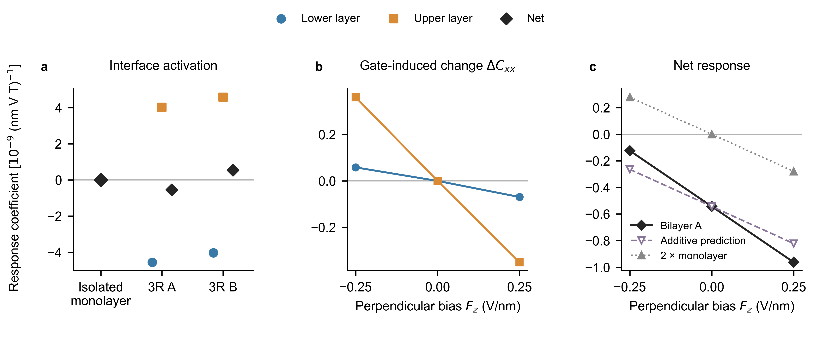

# Non-Janus 3R-MoS2 NMEE control

Status: all seven planned comparison points and two accuracy checks are complete. The independent 9×9 check retains lower-negative, upper-positive and net-negative zero-gate A responses, with 7.28% net and 20–22% layer-amplitude changes from the smaller-probe 6×6 result. This is qualitative screening, not converged amplitudes or full-tensor validation. All listed calculations have ended; twelve-state model work remains paused.

BiDB 1929 is the isolated layer; BiDB 1930 is the sliding-stable parallel 3R bilayer. B is the exact horizontal mirror partner of A, not a second unrelated chemical orientation. Slabs are centered and share the same supercell height. A source and B partner have equal zero-field energy by symmetry, not a new independent stability calculation.

Fields: conventional gate Fz in V/nm, with VASP EFIELD=-Fz/10. Probe Ex is EFIELD_PEAD and probe Bz is spin-only BEXT. Total/layer coefficients use Pauli spin density, actual area, and fixed ions/neutral insulating filling. Monolayer half-spaces are not treated as layers.

response_initial_four_signs.py is the exact source used by the three initial zero-gate jobs. response.py additionally permits the established nonmagnetic time-reversal reduction for gate points. A missing negative-B check is recorded as null, never zero. POTCAR, WAVECAR, CHGCAR and transport credentials are not distributed. Reproduction requires authorized VASP/PAW access and a compatible compute-node PBS environment.

No new PRL novelty, universal mechanism, experimental switch or quantitative convergence claim at this stage.

## Prediction sealed before gated bilayer results

At 2026-11-07 19:50 Asia/Shanghai, the isolated-layer-addition hypothesis predicts net A responses -0.8221 and -0.2642 at +0.25 and -0.25 V/nm, respectively. Each prediction adds twice the isolated-monolayer field increment to the independently calculated zero-gate A baseline. Both remain negative. See gate_prediction.json for layer predictions and exact inputs. A disagreement would reject this simple addition model, without by itself isolating hopping from self-consistent interface electrostatics.

Metadata correction: finite-PEAD empty-state EIGENVAL entries are placeholders, not physical gaps. Raw records are retained under results/raw. Only seed_gaps_eV in canonical results is a reported gap; profile.py performs this correction and validates the spatial integrals on a PBS compute node. Initial input_hashes.json refers to the setup snapshot in commit fc43d5e, not subsequent analysis edits.

## Interpretation boundaries

The applied perpendicular field is not merely a rigid layer-energy offset. The isolated MoS2 layer also responds when that field breaks its horizontal mirror, so the field changes intralayer electronic states even without a bilayer. In an exactly decoupled insulating model, a constant energy shift of an entire layer leaves its internal transition energies, wavefunctions and response unchanged as long as occupations do not change. A material gate calculation therefore cannot automatically be interpreted as the pure layer-detuning parameter in the KM model.

The zero-field 3R A structure has C3v, not an internal horizontal layer-exchange mirror. The horizontal mirror connects two distinct structures A and B. It enforces C_net(B,F)=-C_net(A,-F), not C_net(A,F)=-C_net(A,-F). Opposite compensation fields are conditional on a zero existing; symmetry does not guarantee such a zero within an experimentally usable field range.

[Layer Edelstein Effect](https://arxiv.org/html/2607.17209v1) already treats current-induced opposite layer spins and electric control, including field-activated components. Its transport mechanism depends on states near the Fermi level. The present neutral insulating Ex Bz response is a different observable, but this difference alone does not establish novelty. [Electrically Reversible Layer-Tensor Responses in Bilayers](https://arxiv.org/html/2610.34067v1) provides a general layer-exchange tensor framework; it is relevant background for transformation laws, not evidence that our polar 3R structure must have an odd-in-F curve. No unique interlayer-hopping mechanism has been established by the present static-field comparisons.

## Initial completed comparison

Cxx is the coefficient of induced Pauli spin density sx = Cxx Ex Bz. Units: 10^-9 (nm V T)^-1. These are exploratory, common-protocol k6 results, not precision-converged values. No gate-induced sign reversal was found in the three tested A states.

| Structure | Fz (V/nm) | Lower | Upper | Net/whole layer |
|---|---:|---:|---:|---:|
| Isolated MoS2 | 0 | — | — | -0.000084 |
| 3R A | 0 | -4.561 | +4.018 | -0.543 |
| Mirror 3R B | 0 | -4.037 | +4.580 | +0.542 |
| 3R A | -0.25 | -4.503 | +4.379 | -0.124 |
| 3R A | +0.25 | -4.630 | +3.668 | -0.963 |
| Isolated MoS2 | -0.25 | — | — | +0.1393 |
| Isolated MoS2 | +0.25 | — | — | -0.1396 |

Figure: (a) zero-gate whole monolayer and lower/upper/net bilayer coefficients; A and B are horizontal mirror partners. (b) Changes from zero gate in each layer of A, not the absolute coefficients. (c) A net coefficient, the sealed additive prediction, and two isolated-layer responses. Lines connect discrete calculated points and do not fit a compensation threshold. All seven base-protocol points are used; the half-probe/mesh checks are separate accuracy diagnostics. No statistical confidence intervals are implied. SVG/PDF retain editable text; PNG is a preview, so the source validator's missing-TIFF warning is intentional.

The observed gate increments are 1.504 times the sealed independent-layer-increment prediction on both sides. This rejects exact independent addition at the tested precision; it does not uniquely separate hopping from interface electrostatics, and the ratio is not yet a converged material constant. Reducing both probe fields by two changes the zero-gate net coefficient by 0.34%, while layer amplitudes change by 14–16%. A forbidden linear sz component retains a residual: the full response tensor is not validated. The independent mesh check is complete: at the same small probes, k9 gives net/lower/upper = -0.584461/-6.270033/+5.685572, versus k6 -0.544810/-5.211858/+4.667049. Signs are retained; magnitudes are not converged. The forbidden sz residual drops from 3.414 to 0.100 but remains nonzero. PEAD polarization-string clustering warnings also remain an open numerical diagnostic. The biased points were not rerun at k9, so the 1.50 ratio and any extrapolated compensation field are not precision predictions.

The whole-layer monolayer coefficient is zero by symmetry, whereas its internal opposite spatial contributions are large. Rigidly translating two isolated-layer response profiles gives nonzero half-space tail contributions of about +2.04/-2.04, opposite to the actual A layer signs, and zero net. See profile_superposition.json for this partition diagnostic; it is not a self-consistent decoupled-layer calculation or a uniquely separable physical mechanism.

## Completed accuracy checks

| Zero-gate A protocol | Lower | Upper | Net |
|---|---:|---:|---:|
| k6, Ex=0.004 V/Å, BEXT=0.016 eV | -4.5612 | +4.0182 | -0.5430 |
| k6, both probes halved | -5.2119 | +4.6670 | -0.5448 |
| k9, same halved probes | -6.2700 | +5.6856 | -0.5845 |

Units as above. These are deterministic sensitivity tests, not statistical replicates. No rigorous uncertainty interval or continuum-limit extrapolation is inferred. The qualitative interface-activation interpretation remains a candidate; static interface electrostatics and coherent interlayer mixing have not been separated. The small signal is not an experimental-detectability claim.

Final lineage: 548534 recovered the incomplete positive-gate comparison by recomputing only its negative-Ex state; 548536 independently evaluated the k9 check; 548538 generated the final canonical gap metadata and spatial profiles for all nine records. See jobs.json and continuation_status.json. Input hashes in input_hashes.json are the original setup snapshot; final_manifest.json hashes this delivered analysis/data bundle. verification.json checks internal data integrity, not the physical convergence of the entire response tensor.
