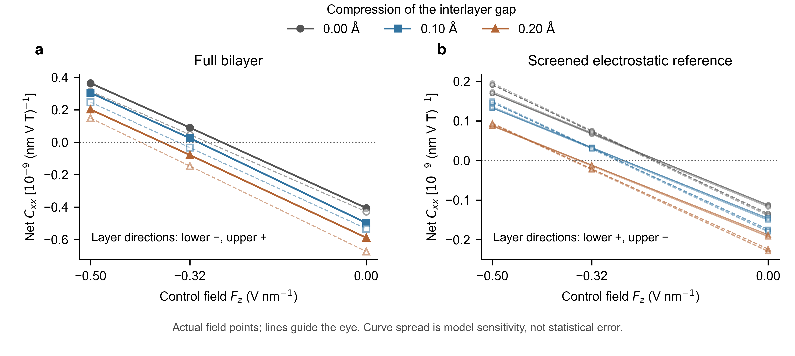

# Fixed-3R MoS₂: compression moves compensation, but the trend is not unique to hybridization

Small geometric compressions move the net spin-NMEE compensation field toward more negative values. At the common control field −0.32 V/nm, the original bilayer has a positive net response, whereas a 0.20 Å compression gives a negative net response. The full material keeps lower-layer Cxx negative and upper-layer Cxx positive at every sampled point, with a minimum sampled probe gap of 0.9993 eV.

The screened electrostatic representation reproduces both the direction of the compensation shift and the common-field net sign reversal, despite having the opposite layer directions (lower positive, upper negative). Therefore these net observables alone do not identify explicit interlayer hybridization. This does not undo the separate, earlier full-space hopping-intervention evidence for a hybridization-driven layer reversal.

## Results

| Compression of S/S gap (Å) | Full material: estimated compensation (V/nm) | Screened electrostatic reference (V/nm) |
|---:|---:|---:|
| 0 | −0.288 to −0.262 | −0.211 to −0.199 |
| 0.10 | −0.341 to −0.305 | −0.276 to −0.262 |
| 0.20 | −0.410 to −0.370 | −0.357 to −0.341 |

These are piecewise-linear estimates between actual sign-bracketing field points, not additional calculated zeros, confidence intervals or experimentally calibrated thresholds. All three fields (0, −0.32, −0.50 V/nm) are available at each geometry. The full-material spread compares 96 and 112 retained KS states; the reference spread covers four retained-state counts and two spatial tapers. The new midpoint changes the endpoint-only full-material estimates by at most about 0.0055 V/nm. At 0.10 Å and −0.32 V/nm the small net sign is cutoff-sensitive; no definite sign is assigned there.

At 0.20 Å compression the zero-gate net imbalance grows by 45–57%, whereas the change induced by sweeping the gate from 0 to −0.50 V/nm grows by only 3–11%. A larger negative field is therefore needed to balance the initially dominant negative lower-layer response. The comparison is neutral and insulating, not a carrier-doping switch. The field-dependent responses of the two layers must not be treated as fixed isolated-layer contributions.

Figure. Net Cxx versus the physical perpendicular control field at three fixed-registry separations. (a) Full bilayer; solid/filled curves retain 96 KS states, dashed/open curves 112. (b) Smooth screened electrostatic representation; all eight cutoff/taper combinations are shown. The panels have different vertical scales. Lines connect actual calculation points; curve spread is model sensitivity, not statistical error. The opposite layer directions annotated in the panels hold at every sampled point. Similar net compensation trends therefore need not imply the same layer-local response.

## What the reference does and does not establish

Each layer's plane-averaged ionic-plus-Hartree environment is extracted independently from the self-consistent bilayer calculation and projected onto the existing isolated-monolayer KS basis, without explicit cross-layer electronic states. A local constant is removed, the profile is smoothed over 0.20 Å, and the neighboring ionic well is excluded using tapers ending at 3.2/3.8 Å. The whole isolated-monolayer spin response represents one material layer; the two are then summed. The scalar potential is not fitted to NMEE.

The extracted screened potential already contains charge redistribution caused by the full interface, including hybridization. This is not an exact deletion of every microscopic consequence of hybridization. In-plane local fields, full XC/nonlocal interface changes and additional probe self-consistency are absent. The valid inference is that explicit coherent cross-layer states are not required to reproduce this qualitative trend within the reference, and that the trend is not a unique hybridization fingerprint. No additive electrostatic/hybridization percentages are inferred.

## Scope and checks

- BiDB MoS₂ monolayer 1929 and parallel 3R bilayer 1930; fixed in-plane cell, registry and intralayer structure. The reference S/S gap is 3.03829445 Å; compressed gaps are 2.93829445 and 2.83829445 Å. Geometric C3v is preserved. These are imposed separations, not pressures calibrated in GPa or a newly relaxed pressure path.
- Seven new zero-magnetic-field self-consistent VASP references; two prior endpoints reused. Gate self-consistency is included; NMEE probes use the existing frozen-potential static spin-only material response. No new independently self-consistent finite-probe NMEE validation was performed.
- All 7 SCF/export/response jobs and the electrostatic-reference job completed with exit 0 on Japanese PBS compute nodes. No scientific processing ran on login nodes. The largest new half-Zeeman-step change was 0.0000327 in the stated coefficient units. Input hashes, rigid-layer geometry, control-field signs, layer additivity, occupied-space links and positive gaps were checked.
- The 6×6 integration mesh and retained-band dependence are not final absolute-amplitude/critical-field convergence. The reference minimum probe gap is 1.5967 eV. No phonon, mechanical-pressure calibration, new material or twelve-state model was added.
- `PLAN.md` and `prior_prediction.json` preserve the before-result selection and prediction. The qualitative direction and common-field sign ordering were supported; the extrapolated numeric thresholds from expansion were not quantitatively exact.

## Data and reproduction

- `summary.json`, `full_response.csv`, `electrostatic_response.csv`: all actual values, gaps, root brackets/estimates and field leverage.
- Per-case `result.json`, `input.json`, `export.json`, `seed/{POSCAR,INCAR,KPOINTS,finished.json}`: seven new input/result records. Reused `d000_fm050/result.json` comes from the preceding gate-spacing study; `baseline.json` comes from the preceding interface study. Those studies are archived beside this one; their previously committed baseline was `4cad0e55d0e4c5b150febe6feb124cce67c87f9f`.
- `reference_cases.json`, `electrostatic_reference.json`, `reference_profiles.npz`: exact provenance and all 72 reference settings. Large KS/operator caches remain on the computation resource. Licensed POTCAR files, large wavefunction/charge/potential files and credentials are not distributed.
- `point.py`, `point.pbs`, `export.py`, `analyze.py`, `electrostatic_reference.py`, `reference.pbs`: scientific workflow. Remote scientific entry points require PBS compute allocations. Paths identify the existing calculation dependencies; a valid licensed VASP/PAW environment is required to rerun the electronic calculations. The copied CHGCAR is only a starting guess (ICHARG=1), followed by full SCF convergence.
- `summarize.py`, `validate_inputs.py`, `plot.py`: local result collection, integrity checks and figure reproduction. Run in that order with Python, NumPy, ASE, spglib and matplotlib available. These do not submit calculations. Units are 10⁻⁹ (nm V T)⁻¹ for Pauli spin density per area.
- `jobs.json`, `reference_job.json`, `final_job_status.json`, `reference_status.json`, `validation.json`: bounded-job provenance and completion checks.
- `MANIFEST.sha256`: archived-file integrity. Original POSCAR formatting is retained to preserve recorded input hashes, including ASE header whitespace.
- [Unified worklog](../../../docs/manuscript/worklog.md) remains the sole current progress narrative. The continuous manuscript has not been rewritten in this iteration.

Figure QA: Python-only quantitative comparison, 178×80 mm; all 18 full-material and 72 reference net values shown, with every layer value preserved in source CSV. No observations were discarded. PNG is 600 dpi; editable SVG and PDF are supplied. Static source preflight passes; its missing-TIFF warning is accepted because vector PDF/SVG are supplied. Rendered labels, signs and scales were visually checked. This is a research comparison, not a submission-ready claim of final convergence.
