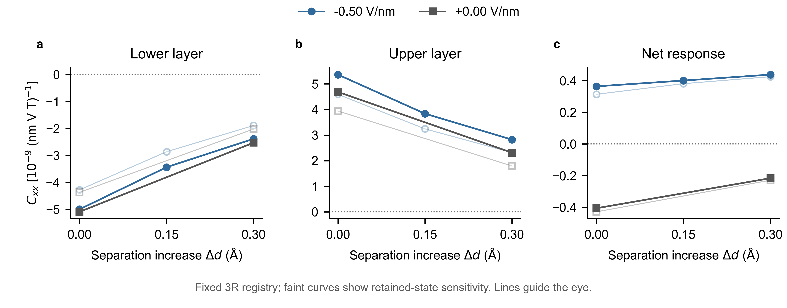

# MoS2: gate control near the reference 3R separation

**Result:** the tested negative gate reverses the net NMEE through layer compensation, but does not reverse the lower layer at the reference separation or at +0.15/+0.30 Å. No accessible same-layer reversal condition has been established by this round.

The earlier mechanism study found opposing trends from smooth interface electrostatics and selected interlayer mixing. This study tests a real fixed-registry control, not a hopping multiplier renamed as distance. It retains the BiDB 1930 3R A registry, in-plane cell and each intralayer geometry. The S/S gap at the structural reference is 3.03829445 Å. Atoms in the two layers move by ±Δd/2; no relaxation, pressure calibration or sliding is performed.

| Δd (Å) | Fz (V/nm) | Lower Cxx | Upper Cxx | Net Cxx |
|---:|---:|---:|---:|---:|
| 0 | 0 | −5.091 | +4.685 | −0.406 |
| 0 | −0.50 | −4.998 | +5.362 | +0.364 |
| 0.15 | −0.50 | −3.435 | +3.835 | +0.401 |
| 0.30 | 0 | −2.526 | +2.310 | −0.216 |
| 0.30 | −0.50 | −2.382 | +2.820 | +0.438 |

Units: 10⁻⁹ (nm V T)⁻¹, Pauli spin density per area, δs_x=Cxx E_x B_z. Table uses 96 retained KS states. Fz is the independent vertical control, with VASP EFIELD=−Fz/10. The zero-field structural reference is reused from [the preceding study](../mos2-interface-20261108); all four other points are new self-consistent zero-B references with the gate included. The infinitesimal probe response is evaluated by the existing **frozen-potential** full-KS engine. This is not a new fully self-consistent finite-probe validation.

At the reference separation, roughly 88% of the gate-induced net change comes from the upper layer; the negative lower-layer magnitude changes only about 2%. Increasing separation by 0.30 Å at fixed −0.50 V/nm instead reduces both opposite layer responses by roughly half, with much of their changes cancelling in the net. These controls have different dominant effects within the tested range, not a proven exact separation of electrostatics and hybridization.

Lower, upper and total response versus actual spacing increment. Filled points are 96 states and faint open points 112 states. They show retained-state sensitivity, not statistical errors. All five references are shown; connecting lines guide the eye, with no fitted critical field/distance. Absolute amplitudes and precise thresholds remain unconverged.

## Evidence and reuse

- [PLAN.md](PLAN.md) was written and transferred before submission. Field sign was selected from the prior opposite-sign isolated-layer response. The tested −0.50 V/nm is an exploratory bound, not a claim of device tolerance.
- [summary.json](summary.json) contains all 96/112 values, gate/distance differences and numerical audits. The sampled gaps including probe shifts remain at least 1.15 eV. Halving the magnetic difference step changes new-point components by less than 2.7×10⁻⁵ in table units.
- Each case directory preserves the result, export checks, input metadata, POSCAR, INCAR and KPOINTS. No licensed potential, executable, credentials or large wavefunctions are included.
- [point.py](point.py) and [point.pbs](point.pbs) reproduce the four bounded jobs on the existing authorized compute installation. The zero-field starting input family and parser dependencies are identified by their existing remote locations. Wavefunctions and caches remain in the corresponding remote case directories.
- [export.py](export.py) and [analyze.py](analyze.py) are unchanged snapshots of the preceding full-KS engine. [collect.py](collect.py) verifies geometry, input hashes, insulating gaps, layer sums, probe steps and completed compute-node jobs.
- [symmetry.py](symmetry.py) calls the project's pinned group-theory toolkit commit 551a0daf8d4ba5a5f24b2811694bfe438616de48. Run it with the toolkit checkout path. The polar-E and axial-B inputs are distinct, with explicit layer permutations; only spatial selection rules are imposed. [symmetry.json](symmetry.json) gives the resulting constraints.
- [research_context.md](research_context.md) answers the five physical questions and records primary-source scope. The unified manuscript [worklog](../../../docs/manuscript/worklog.md) is the reader-facing record; no new independent manuscript version was created.
- [figure_source.csv](figure_source.csv) has all 30 component/cutoff observations. [plot.py](plot.py), editable PDF/SVG and the PNG provide the figure.

## Boundaries

The fixed structure is conditional on maintaining the domain in a real gated device. Field-driven relaxation or domain-wall motion has not been calculated. Expanded spacing is not positive applied pressure. No same-layer reversal is observed at the sampled points, but this does not rule out unsampled nonmonotonic behavior or all other feasible controls. A net zero is not a lower-layer zero. Precise compensation thresholds have not been located.

The 12-state fit stays paused. KM remains a conceptual model for local reversal versus layer compensation and nonadditivity; the material channel tests do not establish an identical dominant microscopic pathway. Generic gate-selected layer tensors already have a symmetry framework in the recent Zhou-group PRB; the project's candidate additional contribution must concern the interfacial mechanism, a predictive control condition and a credible measurement.
