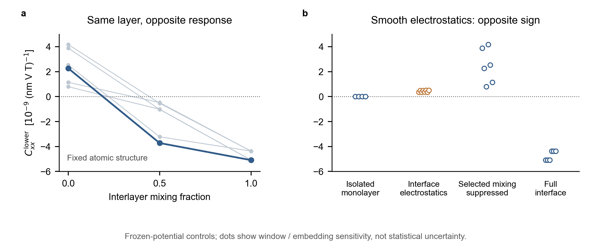

# Fixed-3R MoS₂: interface-induced competition in layer NMEE

The fixed-geometry controls support a qualitative result: smooth interface electrostatics produces a **positive** lower-layer response, whereas the actual interface produces a **negative** one. Restoring selected Mo d/S p interlayer mixing reverses the lower-layer response in all six tested material-window choices. This is not a quantitative decomposition of electrostatic and hybridization percentages.

Observable: δsₓˡ = Cₓₓˡ Eₓ B_z, Pauli spin per area. All tabulated C are in 10⁻⁹ (nm V T)⁻¹. Fixed atoms, insulating, spin-only Zeeman; no orbital magnetic response or experimental sensitivity estimate. Structure stays BiDB 1930, parallel 3R MoS₂, with BiDB 1929 as the constituent-layer reference.

| Lower-layer control | Cₓₓ |
|---|---:|
| Isolated monolayer | approximately 0 |
| Isolated monolayer under independently extracted smooth interface potential | +0.356 to +0.513 |
| Selected d+p cross-layer Hamiltonian block removed, other interface ingredients held fixed | +0.794 to +4.171 |
| Full interface in the same frozen-potential model | −5.091 to −4.368 |
| Self-consistent finite-field DFT, previous k6 half-probe check | −5.212 |

Intervals are sensitivity to specified controls/windows, not statistical error bars. The monolayer's two half-spaces are not two material layers; its **whole-layer** response is used for the first two rows. The last row is a distinct, screened calculation and is not used to fit the material model.

Figure: (a) lower-layer C at fixed atomic structure as the selected d+p interlayer coupling is restored. All six window choices are drawn; the highlighted representative keeps 96 KS states and freezes 8 additional empty states in constructing the 44-orbital intervention. The response itself retains all 96 states. Lines connect only the three calculated points. (b) isolated layer, planar electrostatic embedding, selected-mixing-suppressed and full-interface responses. All window/cutoff values are shown. The third column is **not** an electrostatic-only bilayer. The figure is a qualitative mechanism comparison, not a converged amplitude prediction.

## What changes the sign?

The sign follows the electronic states rather than the transplanted spectrum in all six rank-ordered spectral controls. Weak-mixing states with full-interface energies give positive lower C (+1.34 to +4.28); full-interface states with weak-mixing energies remain negative (−9.90 to −8.75). This is an artificial mechanism test, not a realizable material state.

Restoring only interlayer occupied–empty mixing gives negative lower C (−13.04 to −11.76) in all six choices. Occupied–occupied mixing alone remains positive (+0.48 to +6.50). Empty–empty and combined same-sector controls depend on the window and can themselves reverse the layer. Therefore occupied–empty mixing is a robust **sufficient** reversing channel, not a proven unique or necessary channel. Channel responses cannot be added as independent contributions. All tested controls remain gapped (minimum about 1.14 eV).

The net bilayer response is much smaller and reflects cancellation. Its sign under artificial hopping removal depends on the window; do not turn the robust lower-layer conclusion into a universal statement about the net signal.

## Relation to MoSSe and KM

MoS₂ and the earlier MoSSe S/S calculation now share a more specific tested feature: cross-layer occupied–empty mixing can reverse a layer's response, and changing the spectrum alone does not explain the sign. MoS₂ begins with a mirror-forbidden isolated-layer component; Janus MoSSe begins with a nonzero component. Their common interface effect acts on different starting points.

The current eight-state KM model demonstrates interface-driven layer reversal and layer compensation, but its channel decomposition differs: its occupied–empty channel does not play the same reversing role as in these material tests. Keep KM as a conceptual demonstration; do not claim it is already a common microscopic minimal model. The twelve-state work remains paused.

## Limits and reproducibility

- `analysis.json`: complete baseline, B-step, empty-state cutoff and selected-hopping controls. 96/112-state references preserve the signs but differ in amplitudes. Residual B-even susceptibilities remain, especially at the highest monolayer empty-state cutoff; the central B derivative and low-cutoff monolayer forbidden response are checked independently.
- `electrostatic.json`, `electrostatic_audit.json`: plane-averaged ionic+Hartree embedding, with two smooth spatial cutoffs and four empty-state cutoffs. Microscopic in-plane fields, XC, nonlocal environment and further self-consistent screening are omitted. The extracted potential is not fitted to C. Its amplitude must not be converted into an electrostatic percentage of the full response.
- A rigid internal layer offset is not a perpendicular electric field. The latter also changes the internal states of an isolated layer. A bare uniform potential here produces a larger response than the earlier screened DFT gate; the independent self-consistent potential calibration in `gate_embedding.json` recovers C = −0.113 to −0.118 (whole-cell embedding), compared with the earlier screened DFT −0.140. The applied +0.25 V/nm corresponds to an internal layer linear fit of only +0.0119 V/nm. Spatially truncated embedding gives −0.077 to −0.093: signs are stable, amplitudes remain approximate.
- `mechanism_followup.json`: all spectral and channel controls, including the same-sector exceptions.
- Zero-field references and all remote Python ran inside PBS compute allocations. Inputs/jobs/status are archived. Licensed PAW data, wavefunctions and credentials are not published. Full caches remain in the private calculation directory.
- The scripts use the pre-existing PAW/WAVECAR parser environment; this small archive is a study record, not a standalone VASP distribution. Source and parameter hashes are in the manifests.

Related primary literature: Liang et al., [PRX 12, 041005 (2022)](https://doi.org/10.1103/PhysRevX.12.041005), resolves asymmetric interlayer coupling and electrostatic contributions to K-point band offsets. That known band-offset mechanism is background; it does not establish that NMEE is controlled solely by K-edge states. See `research_context.md`.
