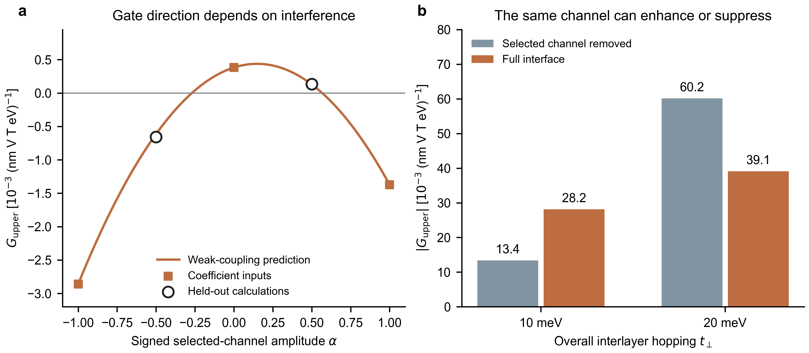

# Eight-state KM: cross-channel interference controls electrical tunability

This round feeds the contrasting MoSSe/InSe interventions back into the **unchanged eight-state KM model**. No new orbitals, DFT, material fitting, or remote computation. The reference registry remains the existing fraction1/4, mass45meV, with parallel in-plane spin/electric probe angle60° and Bz. U is the internal upper-minus-lower onsite energy difference, not a calibrated external gate field.

## What was learned

1. The existing KM already accommodates **either enhancement or suppression** of upper-layer gate sensitivity by the same directional interlayer channel. At fixed U=−4meV, removing lower-valence/upper-empty mixing reduces |G_upper| at t=10meV but increases it at t=20meV. The finest checked ratios full/removal are 2.109 and 0.650. This distinguishes effects of an interface channel without adding states to match a desired material outcome.
2. In the weak-coupling regime, a signed cross term between hopping paths explains why the sign of a gate response cannot be inferred from layer energy alignment and hopping magnitudes alone. A simple expansion predicted previously uncalculated half-amplitude responses, including their signs.
3. For two held-out weak-coupling cases with the same magnitude but opposite **relative sign** of the selected channel, the lower C remains negative and upper C positive. Nevertheless increasing U strengthens both amplitudes in one case and weakens both in the other. Thus layer-response direction and gate-control direction are independent properties. This supplies a controlled conceptual analogue of the distinction exposed by InSe; it does not reproduce all its microscopic channels.

## Response and fixed channel definition

C_l is the coefficient of the static E_parallel Bz-induced layer spin. G_l=∂C_l/∂U. Where C_l is nonzero, ∂|C_l|/∂U=sign(C_l)G_l; the sign of G alone is not the sign of amplitude control.

Use the occupied/empty projectors of the two separated layer blocks at zero B. Each layer has two occupied and two empty states. The chosen Hermitian channel is

K_s(k)=P_bv H_inter(k) P_tc + h.c.,

with b=bottom/lower, t=top/upper. It is kept fixed under the magnetic probe; the remaining interlayer terms are K_r. At each k the Hamiltonian has the same original intralayer blocks, an onsite UW, and the interlayer combination t[K_r+αK_s]. Here K_r/K_s are understood per unit overall hopping t; α=1 is the original full interface, α=0 removes the selected direction. Negative α changes its sign **relative to the other channels**.

The selected projectors depend on k. Their derivatives are included in the electric vertex; simply deleting a Hamiltonian block while keeping its old velocity would be inconsistent. The numerical derivatives agree within1.2×10⁻¹² in the off-grid check. In this uniform-layer-offset model the separated-layer projectors do not depend on U before filling changes. Full spin and Zeeman operators remain unchanged.

These grouped projectors differ from instantaneous full-bilayer eigenband assignments. The failed material denominator/numerator attribution is not used. Scaling a selected channel or reversing its relative sign is a diagnostic Hamiltonian control, not a proposed laboratory operation.

## A concise weak-coupling mechanism

The isolated layers' eigenvectors and interband energy differences are unchanged by a rigid onsite offset, so G(t=0)=0 as long as the insulating filling remains fixed. Flipping the sign of **all** interlayer hoppings is a layer-basis gauge transformation; spin and the gate vertex commute with that transformation. The complete G is therefore even in t. For a gapped analytic weak-coupling regime,

G_l(t,α)=t²[A_l+B_l α+D_l α²]+O(t⁴).

A describes the other interlayer channels, D the selected channel's leading quadratic effect, and B their cross term. B is why the effects cannot in general be inferred by calculating the selected channel in isolation. These are perturbative response coefficients, not additive fractions of a strong-coupling material. Their signs depend on the spin/electric/gate vertices as well as energy denominators; energy proximity alone does not determine them.

At t_ref=2meV and U=0, the estimated upper-layer expression is

G_upper(α) ≈ (0.3823 + 0.7434 α − 2.4986 α²) ×10⁻³ (nm V T eV)⁻¹.

The coefficients come from α=−1,0,+1 calculations and estimate the weak-coupling expansion; they are not claimed to be exact derivatives at t=0. The cross term is positive, while the quadratic selected-channel term is negative. At a half-restored channel these can yield positive G; at full restoration G is negative. With the same bare layer energies and the same selected hopping magnitude, α=+1/2 and α=−1/2 differ in the cross term. The *full hybridized spectrum* is allowed to change; we do not claim it is identical.

In this expansion, amplification relative to channel removal requires |A+Bα+Dα²|>|A|; suppression corresponds to the reverse inequality. This inequality alone is algebra, not a new universal physical law. The useful content is the identified, independently tested cross term and its competing signs. A rule based on only a few material energy levels has not been established.

## Predictions written before held-out calculations

`weak_prediction.json` was written using only the t2meV, α=−1,0,+1 training data. It predicted responses at t1/2/4meV and α=0,1/2,1, with G proportional to t². Subsequent independent finite-U calculations used denser quadrature and smaller U/B probes. All predicted lower/upper/net slope signs agree. The t2, α=0/1 points are repeated baseline checks; seven other weak-coupling combinations are held out. For the upper layer, errors across these tests are at most7.3%; the weak residual lower response at t4meV has28.1% relative error. Thus the expansion is qualitative outside the weakest limit and cannot be advertised as uniform high-precision interpolation.

A second recorded prediction (`phase_prediction.json`) used the same coefficients to predict α=−1/2 before that case was computed. Representative validation:

| t2meV, U=0 | Lower C ×10³ | Upper C ×10³ | Lower G ×10³ | Upper G ×10³ | Increasing U |
|---|---:|---:|---:|---:|---|
| α=+1/2 | −0.06891 | +0.06968 | −0.94716 | +0.13224 | strengthens both amplitudes |
| α=−1/2 | −0.09466 | +0.08488 | +0.74336 | −0.65792 | weakens both amplitudes |

C units (nm V T)⁻¹; G units (nm V T eV)⁻¹. Both layers retain their directions over the small U interval. Predicted upper G values were +0.12931 and −0.61411 in the same ×10³ table units. The additional phase test has at most7.5% relative error for a layer and13.9% for the smaller net response. This is a genuine held-out model test, **not a prediction for a material or for an experimentally switchable hopping phase**.

## Full-model contrasts beyond weak coupling

At the same registry and U=−4meV:

| t | Upper G, selected channel removed | Upper G, original full interface | Absolute-slope ratio |
|---|---:|---:|---:|
| 10meV | +13.354 | −28.159 | 2.109 |
| 20meV | +60.172 | −39.119 | 0.650 |

G entries are in10⁻³ (nm V T eV)⁻¹. These are full numerical responses, **not** extrapolations of the weak t2 expansion. The full interface's selected-channel effect on the gate sensitivity is enhancing in the first comparison, suppressing in the second. The upper C can change direction between full/removal in these strong comparisons, so they do not on their own demonstrate fixed-direction gate control; the weak phase comparison above provides that separate evidence.

Intermediate channel-restoration data show nonmonotonic C and G; endpoints with the same sign must not be used to infer the entire path has no zero. Every calculated point is archived. This is why the finite phase comparison and local gate tests are described by their actual ranges.

Figure. (a) Upper-layer gate slope at t2meV, U=0. The curve is the prewritten weak-coupling expression; filled squares supplied its coefficients, open circles are held-out ±1/2-channel calculations. Tested upper C values remain positive, so positive/negative G correspond to strengthening/weakening. (b) Magnitude of upper-layer gate slope at U=−4meV for t10/20, using the finest checked full/removal calculations. The same channel can enhance or suppress |G| depending on the background electronic response. No statistical error bars; no material fitting.

## How to use this in the materials story

MoSSe's selected directional channel supports strong upper-layer control and lower-layer direction rewriting. InSe exposes a different balance: deleting the same *class* of channel increases both sensitivities and reverses control direction without reversing baseline layer signs. The KM calculation shows that the basic enhancement/suppression and direction/slope distinction do not require extra states. It offers an economical organizing mechanism: the signed interplay of interlayer response paths, including a cross term.

It does **not** establish that the particular KM cross term quantitatively explains either material, nor that the same microscopic channel flips C in KM and MoSSe. A shared enhancement factor or threshold is not inferred. The remaining material task is to test whether grouped-path interference/matrix signs, rather than energy alignment alone, account for their contrasting gate changes. Mapping the diagnostic relative phase to a realizable stacking, strain or field control is also unproved. PRL novelty and experimental readout remain open.

## Checks and reproduction

- All71 parameter/control/refinement rows retain common insulating gaps, minimum4.07meV. Quadrature and probe refinement preserve the strong enhancement/suppression contrast.
- Original full-model C agrees with the previously archived independent implementation within10⁻¹⁵; finite-U G agrees with its analytic tangent within1.7×10⁻⁷. Global interlayer-sign gauge identity, exact channel-velocity derivatives, Hermiticity and layer sums pass. See `checks.json`.
- Fine/finest numerical settings are embedded per source file. C magnitudes converge more slowly than G; no universal magnitude accuracy is claimed.
- Reproduce each run with `run.py` and the `parameters` in its JSON. `summarize.py`, `check.py`, `plot.py` rebuild the archive. NumPy/matplotlib and the unchanged repository KM modules are required. Source predictions include hashes; no results were fitted retrospectively to held-out data.
- All runs local Mac. No new remote jobs, no wavefiles or secrets, no model-core changes. Commit is a research archive with `[skip ci]`; no remote CI pass is implied.
