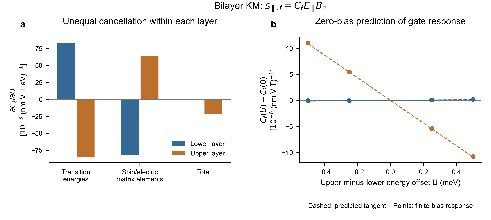

# KM gate selectivity: unequal cancellation within each layer

The existing eight-state KM model predicts the initial gate direction from its
zero-bias energies, layer vertex and spin/electric matrix elements. Independent
finite-bias calculations confirm the predicted layer directions. No new band,
material, DFT, or fit is introduced.

The useful physical result is **unequal cancellation of gate-induced changes
inside the two layers**. In the representative state, transition-energy shifts
alone suggest similarly strong, opposite layer changes. Changes of the physical
spin/electric matrix elements almost cancel this effect in the lower layer,
but only partially in the upper layer. The resulting gate sensitivity is
strongly upper-selective. An unchanged local spin direction therefore does not
imply unchanged electrical tunability.

## Observable, model, and what was predicted

The observable remains the frozen-occupation, static, insulating spin-Zeeman
response s_parallel,l = C_l E_parallel Bz. The common in-plane spin/E direction
is 60 degrees in the existing KM coordinates, not the lab-x axis of all DFT
structures. The upper-minus-lower onsite energy difference is U, in eV.
Positive U raises the upper layer by U/2 and lowers the bottom by U/2. It is
not a physical unscreened perpendicular field in V/nm.

Use the existing mirror bilayer with sublattice mass45 meV, path fraction0.25,
and t10/15/20 meV. No stability of this electronic-model registry is asserted.
The zero-bias tangent is written before independent U=±0.25/±0.50 meV tests.
The fraction0.75 mirror predictions are also saved before their independent
calculations. `PLAN.md` records the original test; `mirror-prediction.json`
hashes its source prediction. Response signs are not fitted to validation data.

## The microscopic information needed

At each finite magnetic probe field, use the same electric-response kernel:

\[
\chi_\ell=-2\operatorname{Im}\sum_{v,c}
\frac{(S_\ell)_{vc}V_{cv}}{(\epsilon_v-\epsilon_c)^2},\qquad
C_\ell=\partial_{B_z}\chi_\ell.
\]

Define W = partial H / partial U = (P_upper-P_lower)/2. Its diagonal element
is half the difference of a state's upper/lower weights. Hellmann–Feynman
then fixes how each transition energy changes. Its off-diagonal elements
change the electronic states, with the first-order rotation

\[
K_{mn}=\frac{W_{mn}}{\epsilon_n-\epsilon_m}\quad(m\ne n),\qquad
\partial_U S_\ell=[S_\ell,K],\quad \partial_U V=[V,K].
\]

Thus layer character fixes the gate lever arm; energy separation fixes the
susceptibility to mixing; the signed, phase-invariant products of the spin,
electric and layer vertices fix whether the response increases or decreases.
Level proximity or layer assignment alone cannot replace those products.
In this onsite-offset model V has no explicit U derivative. A spatial physical
field, screening and internal layer polarization require further terms.

Differentiating the full kernel gives G_l = partial_U C_l, split into the
transition-denominator term and the spin/velocity-matrix term. This is a
response-derivative diagnostic, not two realizable Hamiltonians, not separate
observables, and not percentages of electrostatics and hybridization. It uses
resolved finite-B eigenstates; unresolved same-sector degeneracies are rejected.
Eigenstate-rotation sectors VV/CC/VC here are NOT the fixed separated-layer
projectors used in the material channel-removal studies.

## Results

Representative refined t10 case; G units 10^-3 (nm V T eV)^-1:

| Gate-induced change | Lower | Upper |
|---|---:|---:|
| Transition-energy contribution | +82.848 | -85.085 |
| Spin/electric matrix contribution | -82.594 | +63.344 |
| Complete G | +0.254 | -21.741 |

The upper layer carries about99% of the sum of absolute initial changes.
The lower spin is negative, the upper positive: a small positive U weakens
both magnitudes, with the upper change much larger. Restoring complete matrix
changes is essential to predict which layer is sensitive.

Increasing t from10 to20 meV reverses C_lower from negative to positive, but
G_lower stays positive in all three tested t cases. Direction reversal and
gate sensitivity are distinct properties; the former is not a necessary
threshold for strong layer selectivity.

The mirror state remains lower-negative/upper-positive but swaps the two G
values. The same positive U therefore strengthens both magnitudes. This
reproduces the qualitative InSe mirror-domain contrast without enlarging KM.
The mirror transformation itself is established tensor symmetry, not a new law.

Figure: (a) Contributions to the initial layer gate sensitivity at t10 meV,
showing near cancellation in the lower layer and incomplete cancellation in
the upper. (b) Zero-bias analytic tangents (dashed) and independently calculated
finite-bias changes (points), with each layer's own zero-bias response subtracted.
A zero in this difference plot is not a reversal of its actual induced spin.
The plotted values use the 61/60/96 integration setting; refined values above
retain the interpretation. All controls and checks remain in source_data.csv.

## Validation and limits

- Three t values and four held-out offsets: all lower/upper/net change signs
  agree with the zero-bias prediction. Symmetric finite-offset slopes differ
  by at most0.28% from the analytic tangent. All common gaps exceed9.93 meV.
- The small lower slope has substantial relative one-sided curvature: the
  largest error of a finite-offset linear extrapolation is148%. Do not claim
  uniformly accurate finite-bias amplitudes or a broad switching interval.
- Denser integration and halved B step preserve local selectivity; the
  independent mirror tangent agrees with the prior symmetry prediction within
  3e-14 in the reported units. Off-grid finite-difference, random-phase,
  layer-sum and derivative-closure checks are retained.
- The energy-only net sign changes between coarse and refined integrations;
  the exploratory 'wrong net direction' inference is discarded. The robust
  finding is its failure to explain the strong layer selectivity.
- This is an exact zero-bias response derivative, not yet a simple universal
  scalar descriptor. Its ingredients are microscopic and predictive locally,
  but compressing them to an energy-only rule would discard necessary signs.
- No physical gate calibration, ionic motion, orbital magnetic response, or
  experimental detectability has been established by this model test.

## What the three materials do and do not establish

MoS2: the existing matched-layer and spectral-transplant controls support an
interface-induced layer response whose sign follows the electronic states,
not just energy shifts. The new gate-derivative split is not yet evaluated in
MoS2, so it does not establish this same quantitative cancellation mechanism.

MoSSe: existing screened controls connect selected cross-layer valence–empty
mixing to BOTH local direction rewriting and strong upper gate sensitivity.
Strong selectivity already occurs before the lower response changes sign.
This is consistent with the KM distinction, but not proof of identical band
channels or of the new denominator/matrix cancellation in the material.

InSe: deleting the specified lower-valence/upper-empty mixing reverses both
layer gate slopes while leaving their zero-gate directions unchanged. The
independent mirror-domain SCFs confirm a realizable stacking contrast in the
fixed-ion model. Several sectors matter; a single VC sign-reversal mechanism
cannot be imposed on it.

The sharper working hypothesis is that an interface controls **how strongly
competing gate-induced changes cancel within each layer**, in addition to
controlling cancellation between layers. The next material test should apply
a consistent derivative analysis to the already-screened MoSSe and InSe states,
including their field-dependent vertices. It should test whether lower-layer
near cancellation distinguishes MoSSe's strong selectivity from InSe's two
substantial layer changes. This material test is NOT completed here. MoS2
provides a separate interface-activation control. Do not restore twelve-state
fitting or add materials merely to conceal this missing causal link.

## Reproduce

Run predict.py with the grid/field settings in each result JSON, then
summarize.py and plot_result.py. Repository modules supply the unchanged KM
Hamiltonian, spin/velocity operators and integration scheme. `manifest.json`
records source hashes and source revision. Everything in this round ran locally;
no remote compute job or new DFT was submitted. Full raw deterministic controls
are retained; there are no statistical error bars or fitted data.
